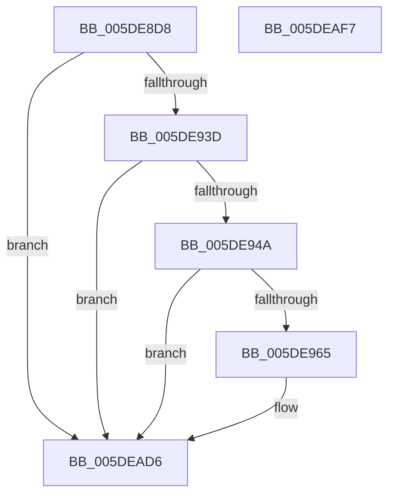

# PpmEventParkNodePreferenceEx

- RVA: `0x005DE8D8`–`0x005DEAF8` (길이 `544` bytes)
- VA: `0x00000001405DE8D8`
- 실행 섹션: `.text`
- PDB 이름 있음: `예`; PDB Function 태그: `아니요`
- unwind 정보 RVA: `0x000CD87C`
- 디코드: `124`개 명령, `544/544` bytes 표시
- 미해석 바이트: `0` (있으면 어셈블리에 `.byte`로 보존)

> 이 문서는 커널 이미지의 기계어와 PDB 기호를 분석해 생성했습니다. 4번과 5번은 함수 원형과 자료형을 바이너리 사용 방식에서 추정한 C 해석이며 원본 소스 복구 결과는 아닙니다.

## 1. Dependencies

- 직접 호출 지점: **8**; 고유 호출 대상: **4**
- 직접 호출자로 확인된 함수: **1**
- RIP 상대 이미지 참조: **5**

### Outgoing calls
- `0x005DE958` → [EtwEventEnabled](../39/EtwEventEnabled_function_00392450.md) (function, `0x00392450`)
- `0x005DE997` → [PpmEventAddAffinityMaskAsSubset](../4E/PpmEventAddAffinityMaskAsSubset_function_004EF628.md) (function, `0x004EF628`)
- `0x005DE9F7` → [PpmEventAddAffinityMaskAsSubset](../4E/PpmEventAddAffinityMaskAsSubset_function_004EF628.md) (function, `0x004EF628`)
- `0x005DEA2F` → [PpmEventAddAffinityMaskAsSubset](../4E/PpmEventAddAffinityMaskAsSubset_function_004EF628.md) (function, `0x004EF628`)
- `0x005DEA67` → [PpmEventAddAffinityMaskAsSubset](../4E/PpmEventAddAffinityMaskAsSubset_function_004EF628.md) (function, `0x004EF628`)
- `0x005DEA9F` → [PpmEventAddAffinityMaskAsSubset](../4E/PpmEventAddAffinityMaskAsSubset_function_004EF628.md) (function, `0x004EF628`)
- `0x005DEAD1` → [EtwWriteEx](../25/EtwWriteEx_function_0025F0D0.md) (function, `0x0025F0D0`)
- `0x005DEAE0` → [_security_check_cookie](../6A/_security_check_cookie_function_006AC640.md) (function, `0x006AC640`)

### Direct callers
- [PpmParkComputeUnparkMaskEx](../5E/PpmParkComputeUnparkMaskEx_function_005E05E0.md) at `0x005E0A9A`

### Static image references
- `0x005DE8F6` → RVA `0x00E0A740` (`.data`; read)
- `0x005DE91F` → RVA `0x00E67A70` (`.data`; read)
- `0x005DE93D` → RVA `0x00E67A39` (`.data`; read)
- `0x005DE94A` → RVA `0x00F083E8` (`.data`; read)
- `0x005DE951` → RVA `0x00021780` (`.rdata`; read)

## 2. Other-region calls and transfers

- 다른 실행 섹션으로 향하는 call: **0**
- 별도 외부 분기/꼬리 이동을 확인하지 못했습니다.

## 3. Assembly (complete function range)

```asm
005DE8D8  66 89 54 24 10                  mov word ptr [rsp + 0x10], dx
005DE8DD  55                              push rbp
005DE8DE  53                              push rbx
005DE8DF  56                              push rsi
005DE8E0  57                              push rdi
005DE8E1  41 54                           push r12
005DE8E3  41 56                           push r14
005DE8E5  41 57                           push r15
005DE8E7  48 8D AC 24 50 FF FF FF         lea rbp, [rsp - 0xb0]
005DE8EF  48 81 EC B0 01 00 00            sub rsp, 0x1b0
005DE8F6  48 8B 05 43 BE 82 00            mov rax, qword ptr [rip + 0x82be43]
005DE8FD  48 33 C4                        xor rax, rsp
005DE900  48 89 85 A0 00 00 00            mov qword ptr [rbp + 0xa0], rax
005DE907  83 64 24 48 00                  and dword ptr [rsp + 0x48], 0
005DE90C  4D 8B F1                        mov r14, r9
005DE90F  83 64 24 44 00                  and dword ptr [rsp + 0x44], 0
005DE914  49 8B F0                        mov rsi, r8
005DE917  83 64 24 40 00                  and dword ptr [rsp + 0x40], 0
005DE91C  48 8B F9                        mov rdi, rcx
005DE91F  48 8B 1D 4A 91 88 00            mov rbx, qword ptr [rip + 0x88914a]
005DE926  4C 8B BD 10 01 00 00            mov r15, qword ptr [rbp + 0x110]
005DE92D  4C 8B A5 18 01 00 00            mov r12, qword ptr [rbp + 0x118]
005DE934  48 85 DB                        test rbx, rbx
005DE937  0F 84 99 01 00 00               je 0x1405dead6
005DE93D  80 3D F5 90 88 00 00            cmp byte ptr [rip + 0x8890f5], 0
005DE944  0F 84 8C 01 00 00               je 0x1405dead6
005DE94A  48 8B 0D 97 9A 92 00            mov rcx, qword ptr [rip + 0x929a97]
005DE951  48 8D 15 28 2E A4 FF            lea rdx, [rip - 0x5bd1d8]
005DE958  E8 F3 3A DB FF                  call 0x140392450
005DE95D  84 C0                           test al, al
005DE95F  0F 84 71 01 00 00               je 0x1405dead6
005DE965  48 8D 44 24 40                  lea rax, [rsp + 0x40]
005DE96A  48 8B D7                        mov rdx, rdi
005DE96D  48 89 44 24 38                  mov qword ptr [rsp + 0x38], rax
005DE972  4C 8D 4C 24 60                  lea r9, [rsp + 0x60]
005DE977  48 8D 44 24 44                  lea rax, [rsp + 0x44]
005DE97C  33 C9                           xor ecx, ecx
005DE97E  48 89 44 24 30                  mov qword ptr [rsp + 0x30], rax
005DE983  4C 8D 44 24 50                  lea r8, [rsp + 0x50]
005DE988  48 8D 44 24 48                  lea rax, [rsp + 0x48]
005DE98D  48 89 44 24 28                  mov qword ptr [rsp + 0x28], rax
005DE992  48 89 5C 24 20                  mov qword ptr [rsp + 0x20], rbx
005DE997  E8 8C 0C F1 FF                  call 0x1404ef628
005DE99C  8B 4C 24 40                     mov ecx, dword ptr [rsp + 0x40]
005DE9A0  48 8D 95 F8 00 00 00            lea rdx, [rbp + 0xf8]
005DE9A7  8B C1                           mov eax, ecx
005DE9A9  4C 8D 4C 24 60                  lea r9, [rsp + 0x60]
005DE9AE  48 C1 E0 04                     shl rax, 4
005DE9B2  4C 8D 44 24 50                  lea r8, [rsp + 0x50]
005DE9B7  48 03 C3                        add rax, rbx
005DE9BA  FF C1                           inc ecx
005DE9BC  89 4C 24 40                     mov dword ptr [rsp + 0x40], ecx
005DE9C0  48 8B CF                        mov rcx, rdi
005DE9C3  83 60 0C 00                     and dword ptr [rax + 0xc], 0
005DE9C7  48 89 10                        mov qword ptr [rax], rdx
005DE9CA  48 8B D6                        mov rdx, rsi
005DE9CD  C7 40 08 02 00 00 00            mov dword ptr [rax + 8], 2
005DE9D4  48 8D 44 24 40                  lea rax, [rsp + 0x40]
005DE9D9  48 89 44 24 38                  mov qword ptr [rsp + 0x38], rax
005DE9DE  48 8D 44 24 44                  lea rax, [rsp + 0x44]
005DE9E3  48 89 44 24 30                  mov qword ptr [rsp + 0x30], rax
005DE9E8  48 8D 44 24 48                  lea rax, [rsp + 0x48]
005DE9ED  48 89 44 24 28                  mov qword ptr [rsp + 0x28], rax
005DE9F2  48 89 5C 24 20                  mov qword ptr [rsp + 0x20], rbx
005DE9F7  E8 2C 0C F1 FF                  call 0x1404ef628
005DE9FC  48 8D 44 24 40                  lea rax, [rsp + 0x40]
005DEA01  49 8B D6                        mov rdx, r14
005DEA04  48 89 44 24 38                  mov qword ptr [rsp + 0x38], rax
005DEA09  4C 8D 4C 24 60                  lea r9, [rsp + 0x60]
005DEA0E  48 8D 44 24 44                  lea rax, [rsp + 0x44]
005DEA13  48 8B CF                        mov rcx, rdi
005DEA16  48 89 44 24 30                  mov qword ptr [rsp + 0x30], rax
005DEA1B  4C 8D 44 24 50                  lea r8, [rsp + 0x50]
005DEA20  48 8D 44 24 48                  lea rax, [rsp + 0x48]
005DEA25  48 89 44 24 28                  mov qword ptr [rsp + 0x28], rax
005DEA2A  48 89 5C 24 20                  mov qword ptr [rsp + 0x20], rbx
005DEA2F  E8 F4 0B F1 FF                  call 0x1404ef628
005DEA34  48 8D 44 24 40                  lea rax, [rsp + 0x40]
005DEA39  49 8B D7                        mov rdx, r15
005DEA3C  48 89 44 24 38                  mov qword ptr [rsp + 0x38], rax
005DEA41  4C 8D 4C 24 60                  lea r9, [rsp + 0x60]
005DEA46  48 8D 44 24 44                  lea rax, [rsp + 0x44]
005DEA4B  48 8B CF                        mov rcx, rdi
005DEA4E  48 89 44 24 30                  mov qword ptr [rsp + 0x30], rax
005DEA53  4C 8D 44 24 50                  lea r8, [rsp + 0x50]
005DEA58  48 8D 44 24 48                  lea rax, [rsp + 0x48]
005DEA5D  48 89 44 24 28                  mov qword ptr [rsp + 0x28], rax
005DEA62  48 89 5C 24 20                  mov qword ptr [rsp + 0x20], rbx
005DEA67  E8 BC 0B F1 FF                  call 0x1404ef628
005DEA6C  48 8D 44 24 40                  lea rax, [rsp + 0x40]
005DEA71  49 8B D4                        mov rdx, r12
005DEA74  48 89 44 24 38                  mov qword ptr [rsp + 0x38], rax
005DEA79  4C 8D 4C 24 60                  lea r9, [rsp + 0x60]
005DEA7E  48 8D 44 24 44                  lea rax, [rsp + 0x44]
005DEA83  48 8B CF                        mov rcx, rdi
005DEA86  48 89 44 24 30                  mov qword ptr [rsp + 0x30], rax
005DEA8B  4C 8D 44 24 50                  lea r8, [rsp + 0x50]
005DEA90  48 8D 44 24 48                  lea rax, [rsp + 0x48]
005DEA95  48 89 44 24 28                  mov qword ptr [rsp + 0x28], rax
005DEA9A  48 89 5C 24 20                  mov qword ptr [rsp + 0x20], rbx
005DEA9F  E8 84 0B F1 FF                  call 0x1404ef628
005DEAA4  8B 44 24 40                     mov eax, dword ptr [rsp + 0x40]
005DEAA8  48 8D 15 D1 2C A4 FF            lea rdx, [rip - 0x5bd32f]
005DEAAF  48 8B 0D 32 99 92 00            mov rcx, qword ptr [rip + 0x929932]
005DEAB6  45 33 C9                        xor r9d, r9d
005DEAB9  48 89 5C 24 38                  mov qword ptr [rsp + 0x38], rbx
005DEABE  45 33 C0                        xor r8d, r8d
005DEAC1  89 44 24 30                     mov dword ptr [rsp + 0x30], eax
005DEAC5  48 83 64 24 28 00               and qword ptr [rsp + 0x28], 0
005DEACB  48 83 64 24 20 00               and qword ptr [rsp + 0x20], 0
005DEAD1  E8 FA 05 C8 FF                  call 0x14025f0d0
005DEAD6  48 8B 8D A0 00 00 00            mov rcx, qword ptr [rbp + 0xa0]
005DEADD  48 33 CC                        xor rcx, rsp
005DEAE0  E8 5B DB 0C 00                  call 0x1406ac640
005DEAE5  48 81 C4 B0 01 00 00            add rsp, 0x1b0
005DEAEC  41 5F                           pop r15
005DEAEE  41 5E                           pop r14
005DEAF0  41 5C                           pop r12
005DEAF2  5F                              pop rdi
005DEAF3  5E                              pop rsi
005DEAF4  5B                              pop rbx
005DEAF5  5D                              pop rbp
005DEAF6  C3                              ret
005DEAF7  CC                              int3
```

## 4. C-style interpretation (structured pseudocode)

```c
__int64 __fastcall PpmEventParkNodePreferenceEx(__int64 a1, unsigned __int16 a2, __int64 a3, __int64 a4, __int64 a5, __int64 a6)
{
    __int64 result;
    __int64 v_rsp;
    unsigned __int64 v_stack_m188;
    unsigned __int64 v_stack_m198;
    unsigned int v_stack_m1A0;
    unsigned int v_stack_m1A4;
    unsigned int v_stack_m1A8;
    unsigned __int64 v_stack_m1B0;
    unsigned __int64 v_stack_m1B8;
    unsigned __int64 v_stack_m1C0;
    unsigned __int64 v_stack_m1C8;
    unsigned __int64 v_stack_m48;
    unsigned __int64 v_stack_mE8;
    unsigned __int16 v_stack_p10;

    v_stack_p10 = a2;
    v_rsp = (v_rsp) - (432);
    result = (*(unsigned __int64 *)(v_rip + 8568387)) ^ (v_rsp);
    v_stack_m48 = result;
    if (*(unsigned __int64 *)(v_rip + 8950090) == 0) goto loc_005DEAD6;
    if ((*(unsigned __int8 *)(v_rip + 8950005)) == 0) goto loc_005DEAD6;
    result = EtwEventEnabled(*(unsigned __int64 *)(v_rip + 9607831), v_rip - 6017496, a3, a4);
    if ((unsigned __int8)(result) != 0) {
        result = v_stack_m1A8;
        a2 = a1;
        v_stack_m1B0 = result;
        a4 = v_stack_m188;
        result = v_stack_m1A4;
        a1 = 0;
        v_stack_m1B8 = result;
        a3 = v_stack_m198;
        result = v_stack_m1A0;
        v_stack_m1C0 = result;
        v_stack_m1C8 = *(unsigned __int64 *)(v_rip + 8950090);
        result = PpmEventAddAffinityMaskAsSubset(a1, a2, a3, a4);
        a1 = v_stack_m1A8;
        a2 = v_stack_p10;
        result = (unsigned int)(a1);
        a4 = v_stack_m188;
        result = (result) << (4);
        a3 = v_stack_m198;
        result = (result) + (*(unsigned __int64 *)(v_rip + 8950090));
        a1 = (unsigned int)((a1) + 1);
        v_stack_m1A8 = (unsigned int)(a1);
        a1 = a1;
        *(unsigned __int64 *)(result) = a2;
        a2 = a3;
        *(unsigned int *)(result + 8) = 2;
        result = v_stack_m1A8;
        v_stack_m1B0 = result;
        result = v_stack_m1A4;
        v_stack_m1B8 = result;
        result = v_stack_m1A0;
        v_stack_m1C0 = result;
        v_stack_m1C8 = *(unsigned __int64 *)(v_rip + 8950090);
        result = PpmEventAddAffinityMaskAsSubset(a1, a2, a3, a4);
        result = v_stack_m1A8;
        a2 = a4;
        v_stack_m1B0 = result;
        a4 = v_stack_m188;
        result = v_stack_m1A4;
        a1 = a1;
        v_stack_m1B8 = result;
        a3 = v_stack_m198;
        result = v_stack_m1A0;
        v_stack_m1C0 = result;
        v_stack_m1C8 = *(unsigned __int64 *)(v_rip + 8950090);
        result = PpmEventAddAffinityMaskAsSubset(a1, a2, a3, a4);
        result = v_stack_m1A8;
        a2 = a5;
        v_stack_m1B0 = result;
        a4 = v_stack_m188;
        result = v_stack_m1A4;
        a1 = a1;
        v_stack_m1B8 = result;
        a3 = v_stack_m198;
        result = v_stack_m1A0;
        v_stack_m1C0 = result;
        v_stack_m1C8 = *(unsigned __int64 *)(v_rip + 8950090);
        result = PpmEventAddAffinityMaskAsSubset(a1, a2, a3, a4);
        result = v_stack_m1A8;
        a2 = a6;
        v_stack_m1B0 = result;
        a4 = v_stack_m188;
        result = v_stack_m1A4;
        a1 = a1;
        v_stack_m1B8 = result;
        a3 = v_stack_m198;
        result = v_stack_m1A0;
        v_stack_m1C0 = result;
        v_stack_m1C8 = *(unsigned __int64 *)(v_rip + 8950090);
        result = PpmEventAddAffinityMaskAsSubset(a1, a2, a3, a4);
        result = v_stack_m1A8;
        a2 = v_rip - 6017839;
        a1 = *(unsigned __int64 *)(v_rip + 9607474);
        a4 = 0;
        v_stack_m1B0 = *(unsigned __int64 *)(v_rip + 8950090);
        a3 = 0;
        v_stack_m1B8 = (unsigned int)(result);
        result = EtwWriteEx(a1, a2, a3, a4);
    }
    a1 = (v_stack_m48) ^ (v_rsp);
    result = _security_check_cookie(a1, a2, a3, a4);
    v_rsp = (v_rsp) + (432);
    return result;
}
```

## 5. (Beta) C Style

```c
int64_t PpmEventParkNodePreferenceEx(int64_t Arg1, uint16_t Arg2, int64_t Arg3, int64_t Arg4, int64_t Arg5, int64_t Arg6)
{
    int64_t result;
    int64_t local_rsp;
    uint64_t v_stack_m188;
    uint64_t v_stack_m198;
    uint32_t v_stack_m1A0;
    uint32_t v_stack_m1A4;
    uint32_t v_stack_m1A8;
    uint64_t v_stack_m1B0;
    uint64_t v_stack_m1B8;
    uint64_t v_stack_m1C0;
    uint64_t v_stack_m1C8;
    uint64_t v_stack_m48;
    uint64_t v_stack_mE8;
    uint16_t v_stack_p10;

    v_stack_p10 = Arg2;
    local_rsp = (local_rsp) - (432);
    result = (*(uint64_t *)(v_rip + 0x82BE43)) ^ (local_rsp);
    v_stack_m48 = result;
    if (*(uint64_t *)(v_rip + 0x88914A) == 0) goto loc_005DEAD6;
    if ((*(uint8_t *)(v_rip + 0x8890F5)) == 0) goto loc_005DEAD6;
    result = EtwEventEnabled(*(uint64_t *)(v_rip + 0x929A97), v_rip - 6017496, Arg3, Arg4);
    if ((uint8_t)(result) != 0) {
        result = v_stack_m1A8;
        Arg2 = Arg1;
        v_stack_m1B0 = result;
        Arg4 = v_stack_m188;
        result = v_stack_m1A4;
        Arg1 = 0;
        v_stack_m1B8 = result;
        Arg3 = v_stack_m198;
        result = v_stack_m1A0;
        v_stack_m1C0 = result;
        v_stack_m1C8 = *(uint64_t *)(v_rip + 0x88914A);
        result = PpmEventAddAffinityMaskAsSubset(Arg1, Arg2, Arg3, Arg4);
        Arg1 = v_stack_m1A8;
        Arg2 = v_stack_p10;
        result = (uint32_t)(Arg1);
        Arg4 = v_stack_m188;
        result = (result) << (4);
        Arg3 = v_stack_m198;
        result = (result) + (*(uint64_t *)(v_rip + 0x88914A));
        Arg1 = (uint32_t)((Arg1) + 1);
        v_stack_m1A8 = (uint32_t)(Arg1);
        Arg1 = Arg1;
        *(uint64_t *)(result) = Arg2;
        Arg2 = Arg3;
        *(uint32_t *)(result + 0x8) = 2;
        result = v_stack_m1A8;
        v_stack_m1B0 = result;
        result = v_stack_m1A4;
        v_stack_m1B8 = result;
        result = v_stack_m1A0;
        v_stack_m1C0 = result;
        v_stack_m1C8 = *(uint64_t *)(v_rip + 0x88914A);
        result = PpmEventAddAffinityMaskAsSubset(Arg1, Arg2, Arg3, Arg4);
        result = v_stack_m1A8;
        Arg2 = Arg4;
        v_stack_m1B0 = result;
        Arg4 = v_stack_m188;
        result = v_stack_m1A4;
        Arg1 = Arg1;
        v_stack_m1B8 = result;
        Arg3 = v_stack_m198;
        result = v_stack_m1A0;
        v_stack_m1C0 = result;
        v_stack_m1C8 = *(uint64_t *)(v_rip + 0x88914A);
        result = PpmEventAddAffinityMaskAsSubset(Arg1, Arg2, Arg3, Arg4);
        result = v_stack_m1A8;
        Arg2 = Arg5;
        v_stack_m1B0 = result;
        Arg4 = v_stack_m188;
        result = v_stack_m1A4;
        Arg1 = Arg1;
        v_stack_m1B8 = result;
        Arg3 = v_stack_m198;
        result = v_stack_m1A0;
        v_stack_m1C0 = result;
        v_stack_m1C8 = *(uint64_t *)(v_rip + 0x88914A);
        result = PpmEventAddAffinityMaskAsSubset(Arg1, Arg2, Arg3, Arg4);
        result = v_stack_m1A8;
        Arg2 = Arg6;
        v_stack_m1B0 = result;
        Arg4 = v_stack_m188;
        result = v_stack_m1A4;
        Arg1 = Arg1;
        v_stack_m1B8 = result;
        Arg3 = v_stack_m198;
        result = v_stack_m1A0;
        v_stack_m1C0 = result;
        v_stack_m1C8 = *(uint64_t *)(v_rip + 0x88914A);
        result = PpmEventAddAffinityMaskAsSubset(Arg1, Arg2, Arg3, Arg4);
        result = v_stack_m1A8;
        Arg2 = v_rip - 6017839;
        Arg1 = *(uint64_t *)(v_rip + 0x929932);
        Arg4 = 0;
        v_stack_m1B0 = *(uint64_t *)(v_rip + 0x88914A);
        Arg3 = 0;
        v_stack_m1B8 = (uint32_t)(result);
        result = EtwWriteEx(Arg1, Arg2, Arg3, Arg4);
    }
    Arg1 = (v_stack_m48) ^ (local_rsp);
    result = _security_check_cookie(Arg1, Arg2, Arg3, Arg4);
    local_rsp = (local_rsp) + (432);
    return result;
}
```

## 6. Execution-region graph

[열기: 2D/3D 그래프와 함수 탐색 컨트롤 패널](../../../control-panel.html?section=text&rva=0x005DE8D8&view=graph)

- 2D 그래프는 위에서 아래로 흐르고, 3D 그래프는 빈 공간을 드래그해 회전합니다. Shift+드래그는 이동, 휠은 확대·축소, 함수 노드 선택은 대상 보고서 이동입니다.

### Static fallback


