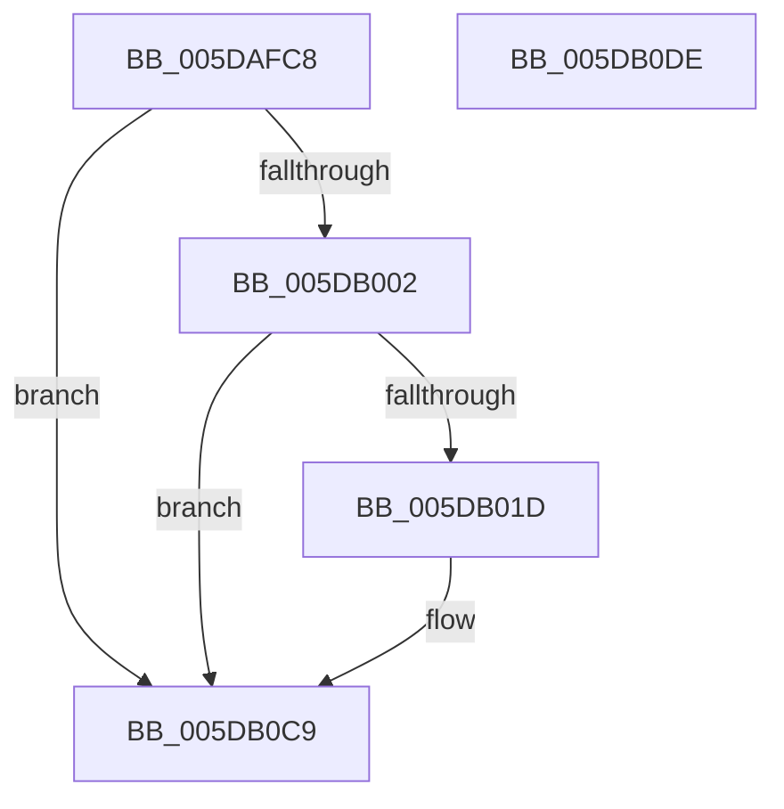

# PpmEventParkNodePreference

- RVA: `0x005DAFC8`–`0x005DB0DF` (길이 `279` bytes)
- VA: `0x00000001405DAFC8`
- 실행 섹션: `.text`
- PDB 이름 있음: `예`; PDB Function 태그: `아니요`
- unwind 정보 RVA: `0x000CB588`
- 디코드: `64`개 명령, `279/279` bytes 표시
- 미해석 바이트: `0` (있으면 어셈블리에 `.byte`로 보존)

> 이 문서는 커널 이미지의 기계어와 PDB 기호를 분석해 생성했습니다. 4번과 5번은 함수 원형과 자료형을 바이너리 사용 방식에서 추정한 C 해석이며 원본 소스 복구 결과는 아닙니다.

## 1. Dependencies

- 직접 호출 지점: **3**; 고유 호출 대상: **3**
- 직접 호출자로 확인된 함수: **1**
- RIP 상대 이미지 참조: **4**

### Outgoing calls
- `0x005DB010` → [EtwEventEnabled](../39/EtwEventEnabled_function_00392450.md) (function, `0x00392450`)
- `0x005DB0C4` → [EtwWriteEx](../25/EtwWriteEx_function_0025F0D0.md) (function, `0x0025F0D0`)
- `0x005DB0D0` → [_security_check_cookie](../6A/_security_check_cookie_function_006AC640.md) (function, `0x006AC640`)

### Direct callers
- [sub_006F3648](../6F/Unknown_function_006F3648.md) at `0x006F37DA`

### Static image references
- `0x005DAFE7` → RVA `0x00E0A740` (`.data`; read)
- `0x005DAFF5` → RVA `0x00E67A39` (`.data`; read)
- `0x005DB002` → RVA `0x00F083E8` (`.data`; read)
- `0x005DB009` → RVA `0x000213E0` (`.rdata`; read)

## 2. Other-region calls and transfers

- 다른 실행 섹션으로 향하는 call: **0**
- 별도 외부 분기/꼬리 이동을 확인하지 못했습니다.

## 3. Assembly (complete function range)

```asm
005DAFC8  48 8B C4                        mov rax, rsp
005DAFCB  4C 89 48 20                     mov qword ptr [rax + 0x20], r9
005DAFCF  44 88 40 18                     mov byte ptr [rax + 0x18], r8b
005DAFD3  48 89 50 10                     mov qword ptr [rax + 0x10], rdx
005DAFD7  66 89 48 08                     mov word ptr [rax + 8], cx
005DAFDB  55                              push rbp
005DAFDC  48 8D 68 B9                     lea rbp, [rax - 0x47]
005DAFE0  48 81 EC C0 00 00 00            sub rsp, 0xc0
005DAFE7  48 8B 05 52 F7 82 00            mov rax, qword ptr [rip + 0x82f752]
005DAFEE  48 33 C4                        xor rax, rsp
005DAFF1  48 89 45 2F                     mov qword ptr [rbp + 0x2f], rax
005DAFF5  80 3D 3D CA 88 00 00            cmp byte ptr [rip + 0x88ca3d], 0
005DAFFC  0F 84 C7 00 00 00               je 0x1405db0c9
005DB002  48 8B 0D DF D3 92 00            mov rcx, qword ptr [rip + 0x92d3df]
005DB009  48 8D 15 D0 63 A4 FF            lea rdx, [rip - 0x5b9c30]
005DB010  E8 3B 74 DB FF                  call 0x140392450
005DB015  84 C0                           test al, al
005DB017  0F 84 AC 00 00 00               je 0x1405db0c9
005DB01D  83 65 CB 00                     and dword ptr [rbp - 0x35], 0
005DB021  48 8D 45 4F                     lea rax, [rbp + 0x4f]
005DB025  83 65 DB 00                     and dword ptr [rbp - 0x25], 0
005DB029  48 8D 15 B0 63 A4 FF            lea rdx, [rip - 0x5b9c50]
005DB030  83 65 EB 00                     and dword ptr [rbp - 0x15], 0
005DB034  B9 08 00 00 00                  mov ecx, 8
005DB039  83 65 FB 00                     and dword ptr [rbp - 5], 0
005DB03D  45 33 C9                        xor r9d, r9d
005DB040  83 65 0B 00                     and dword ptr [rbp + 0xb], 0
005DB044  45 33 C0                        xor r8d, r8d
005DB047  83 65 1B 00                     and dword ptr [rbp + 0x1b], 0
005DB04B  83 65 2B 00                     and dword ptr [rbp + 0x2b], 0
005DB04F  48 89 45 BF                     mov qword ptr [rbp - 0x41], rax
005DB053  48 8D 45 57                     lea rax, [rbp + 0x57]
005DB057  48 89 45 CF                     mov qword ptr [rbp - 0x31], rax
005DB05B  48 8D 45 5F                     lea rax, [rbp + 0x5f]
005DB05F  48 89 45 DF                     mov qword ptr [rbp - 0x21], rax
005DB063  48 8D 45 67                     lea rax, [rbp + 0x67]
005DB067  48 89 45 EF                     mov qword ptr [rbp - 0x11], rax
005DB06B  48 8D 45 6F                     lea rax, [rbp + 0x6f]
005DB06F  48 89 45 FF                     mov qword ptr [rbp - 1], rax
005DB073  48 8D 45 77                     lea rax, [rbp + 0x77]
005DB077  48 89 45 0F                     mov qword ptr [rbp + 0xf], rax
005DB07B  48 8D 45 7F                     lea rax, [rbp + 0x7f]
005DB07F  48 89 45 1F                     mov qword ptr [rbp + 0x1f], rax
005DB083  48 8D 45 BF                     lea rax, [rbp - 0x41]
005DB087  48 89 44 24 38                  mov qword ptr [rsp + 0x38], rax
005DB08C  C7 44 24 30 07 00 00 00         mov dword ptr [rsp + 0x30], 7
005DB094  48 83 64 24 28 00               and qword ptr [rsp + 0x28], 0
005DB09A  48 83 64 24 20 00               and qword ptr [rsp + 0x20], 0
005DB0A0  89 4D D7                        mov dword ptr [rbp - 0x29], ecx
005DB0A3  89 4D F7                        mov dword ptr [rbp - 9], ecx
005DB0A6  89 4D 07                        mov dword ptr [rbp + 7], ecx
005DB0A9  89 4D 17                        mov dword ptr [rbp + 0x17], ecx
005DB0AC  89 4D 27                        mov dword ptr [rbp + 0x27], ecx
005DB0AF  48 8B 0D 32 D3 92 00            mov rcx, qword ptr [rip + 0x92d332]
005DB0B6  C7 45 C7 02 00 00 00            mov dword ptr [rbp - 0x39], 2
005DB0BD  C7 45 E7 01 00 00 00            mov dword ptr [rbp - 0x19], 1
005DB0C4  E8 07 40 C8 FF                  call 0x14025f0d0
005DB0C9  48 8B 4D 2F                     mov rcx, qword ptr [rbp + 0x2f]
005DB0CD  48 33 CC                        xor rcx, rsp
005DB0D0  E8 6B 15 0D 00                  call 0x1406ac640
005DB0D5  48 81 C4 C0 00 00 00            add rsp, 0xc0
005DB0DC  5D                              pop rbp
005DB0DD  C3                              ret
005DB0DE  CC                              int3
```

## 4. C-style interpretation (structured pseudocode)

```c
__int64 __fastcall PpmEventParkNodePreference(unsigned __int16 a1, __int64 a2, int a3, __int64 a4)
{
    __int64 result;
    __int64 v_rsp;
    unsigned __int64 v_stack_m90;
    unsigned int v_stack_m98;
    unsigned __int64 v_stack_mA0;
    unsigned __int64 v_stack_mA8;

    *(unsigned __int64 *)(v_rsp + 32) = a4;
    *(unsigned __int8 *)(v_rsp + 24) = (unsigned __int8)(a3);
    *(unsigned __int64 *)(v_rsp + 16) = a2;
    *(unsigned __int16 *)(v_rsp + 8) = a1;
    v_rsp = (v_rsp) - (192);
    result = (*(unsigned __int64 *)(v_rip + 8582994)) ^ (v_rsp);
    *(unsigned __int64 *)(v_rsp - 71 + 47) = result;
    if ((*(unsigned __int8 *)(v_rip + 8964669)) == 0) goto loc_005DB0C9;
    result = EtwEventEnabled(*(unsigned __int64 *)(v_rip + 9622495), v_rip - 6003760, a3, a4);
    if ((unsigned __int8)(result) != 0) {
        result = v_rsp - 71 + 79;
        a2 = v_rip - 6003792;
        a1 = 8;
        a4 = 0;
        a3 = 0;
        *(unsigned __int64 *)(v_rsp - 71 - 65) = result;
        result = v_rsp - 71 + 87;
        *(unsigned __int64 *)(v_rsp - 71 - 49) = result;
        result = v_rsp - 71 + 95;
        *(unsigned __int64 *)(v_rsp - 71 - 33) = result;
        result = v_rsp - 71 + 103;
        *(unsigned __int64 *)(v_rsp - 71 - 17) = result;
        result = v_rsp - 71 + 111;
        *(unsigned __int64 *)(v_rsp - 71 - 1) = result;
        result = v_rsp - 71 + 119;
        *(unsigned __int64 *)(v_rsp - 71 + 15) = result;
        result = v_rsp - 71 + 127;
        *(unsigned __int64 *)(v_rsp - 71 + 31) = result;
        result = v_rsp - 71 - 65;
        v_stack_m90 = result;
        v_stack_m98 = 7;
        *(unsigned int *)(v_rsp - 71 - 41) = a1;
        *(unsigned int *)(v_rsp - 71 - 9) = a1;
        *(unsigned int *)(v_rsp - 71 + 7) = a1;
        *(unsigned int *)(v_rsp - 71 + 23) = a1;
        *(unsigned int *)(v_rsp - 71 + 39) = a1;
        a1 = *(unsigned __int64 *)(v_rip + 9622322);
        *(unsigned int *)(v_rsp - 71 - 57) = 2;
        *(unsigned int *)(v_rsp - 71 - 25) = 1;
        result = EtwWriteEx(a1, a2, a3, a4);
    }
    a1 = (*(unsigned __int64 *)(v_rsp - 71 + 47)) ^ (v_rsp);
    result = _security_check_cookie(a1, a2, a3, a4);
    v_rsp = (v_rsp) + (192);
    return result;
}
```

## 5. (Beta) C Style

```c
int64_t PpmEventParkNodePreference(uint16_t Arg1, int64_t Arg2, int32_t Arg3, int64_t Arg4)
{
    int64_t result;
    int64_t local_rsp;
    uint64_t v_stack_m90;
    uint32_t v_stack_m98;
    uint64_t v_stack_mA0;
    uint64_t v_stack_mA8;

    *(uint64_t *)(local_rsp + 0x20) = Arg4;
    *(uint8_t *)(local_rsp + 0x18) = (uint8_t)(Arg3);
    *(uint64_t *)(local_rsp + 0x10) = Arg2;
    *(uint16_t *)(local_rsp + 0x8) = Arg1;
    local_rsp = (local_rsp) - (192);
    result = (*(uint64_t *)(v_rip + 0x82F752)) ^ (local_rsp);
    *(uint64_t *)(local_rsp - 0x47 + 0x2F) = result;
    if ((*(uint8_t *)(v_rip + 0x88CA3D)) == 0) goto loc_005DB0C9;
    result = EtwEventEnabled(*(uint64_t *)(v_rip + 0x92D3DF), v_rip - 6003760, Arg3, Arg4);
    if ((uint8_t)(result) != 0) {
        result = local_rsp - 71 + 79;
        Arg2 = v_rip - 6003792;
        Arg1 = 8;
        Arg4 = 0;
        Arg3 = 0;
        *(uint64_t *)(local_rsp - 0x47 - 0x41) = result;
        result = local_rsp - 71 + 87;
        *(uint64_t *)(local_rsp - 0x47 - 0x31) = result;
        result = local_rsp - 71 + 95;
        *(uint64_t *)(local_rsp - 0x47 - 0x21) = result;
        result = local_rsp - 71 + 103;
        *(uint64_t *)(local_rsp - 0x47 - 0x11) = result;
        result = local_rsp - 71 + 111;
        *(uint64_t *)(local_rsp - 0x47 - 0x1) = result;
        result = local_rsp - 71 + 119;
        *(uint64_t *)(local_rsp - 0x47 + 0xF) = result;
        result = local_rsp - 71 + 127;
        *(uint64_t *)(local_rsp - 0x47 + 0x1F) = result;
        result = local_rsp - 71 - 65;
        v_stack_m90 = result;
        v_stack_m98 = 7;
        *(uint32_t *)(local_rsp - 0x47 - 0x29) = Arg1;
        *(uint32_t *)(local_rsp - 0x47 - 0x9) = Arg1;
        *(uint32_t *)(local_rsp - 0x47 + 0x7) = Arg1;
        *(uint32_t *)(local_rsp - 0x47 + 0x17) = Arg1;
        *(uint32_t *)(local_rsp - 0x47 + 0x27) = Arg1;
        Arg1 = *(uint64_t *)(v_rip + 0x92D332);
        *(uint32_t *)(local_rsp - 0x47 - 0x39) = 2;
        *(uint32_t *)(local_rsp - 0x47 - 0x19) = 1;
        result = EtwWriteEx(Arg1, Arg2, Arg3, Arg4);
    }
    Arg1 = (*(uint64_t *)(local_rsp - 0x47 + 0x2F)) ^ (local_rsp);
    result = _security_check_cookie(Arg1, Arg2, Arg3, Arg4);
    local_rsp = (local_rsp) + (192);
    return result;
}
```

## 6. Execution-region graph

[열기: 2D/3D 그래프와 함수 탐색 컨트롤 패널](../../../control-panel.html?section=text&rva=0x005DAFC8&view=graph)

- 2D 그래프는 위에서 아래로 흐르고, 3D 그래프는 빈 공간을 드래그해 회전합니다. Shift+드래그는 이동, 휠은 확대·축소, 함수 노드 선택은 대상 보고서 이동입니다.

### Static fallback


