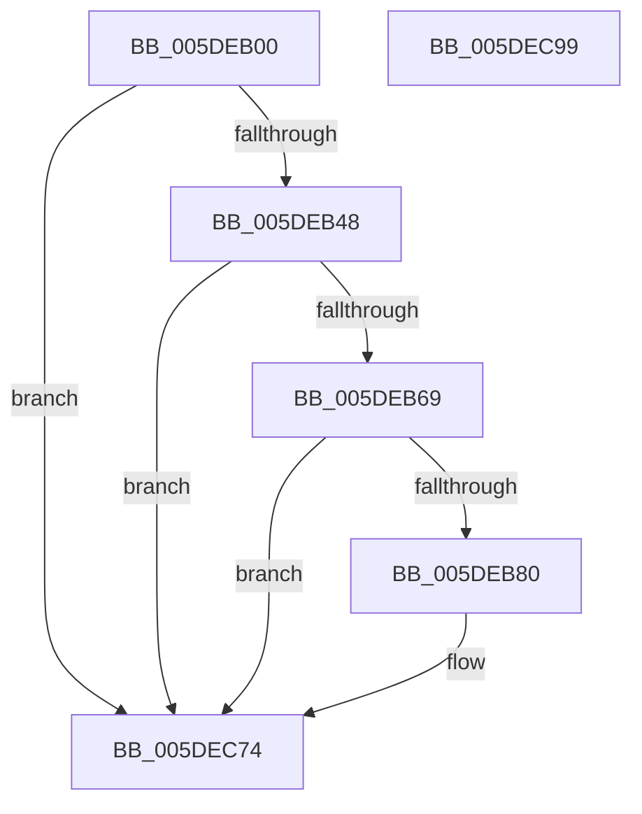

# PpmEventParkNodeRestrictionEx

- RVA: `0x005DEB00`–`0x005DEC9A` (길이 `410` bytes)
- VA: `0x00000001405DEB00`
- 실행 섹션: `.text`
- PDB 이름 있음: `예`; PDB Function 태그: `아니요`
- unwind 정보 RVA: `0x000CD918`
- 디코드: `97`개 명령, `410/410` bytes 표시
- 미해석 바이트: `0` (있으면 어셈블리에 `.byte`로 보존)

> 이 문서는 커널 이미지의 기계어와 PDB 기호를 분석해 생성했습니다. 4번과 5번은 함수 원형과 자료형을 바이너리 사용 방식에서 추정한 C 해석이며 원본 소스 복구 결과는 아닙니다.

## 1. Dependencies

- 직접 호출 지점: **4**; 고유 호출 대상: **4**
- 직접 호출자로 확인된 함수: **1**
- RIP 상대 이미지 참조: **6**

### Outgoing calls
- `0x005DEB73` → [EtwEventEnabled](../39/EtwEventEnabled_function_00392450.md) (function, `0x00392450`)
- `0x005DEBAE` → [PpmEventAddAffinityMaskAsSubset](../4E/PpmEventAddAffinityMaskAsSubset_function_004EF628.md) (function, `0x004EF628`)
- `0x005DEC6F` → [EtwWriteEx](../25/EtwWriteEx_function_0025F0D0.md) (function, `0x0025F0D0`)
- `0x005DEC7B` → [_security_check_cookie](../6A/_security_check_cookie_function_006AC640.md) (function, `0x006AC640`)

### Direct callers
- [PpmEventParkNodeRestriction](PpmEventParkNodeRestriction_function_005DB0E8.md) at `0x005DB11F`

### Static image references
- `0x005DEB1B` → RVA `0x00E0A740` (`.data`; read)
- `0x005DEB38` → RVA `0x00E67A70` (`.data`; read)
- `0x005DEB4A` → RVA `0x00020C48` (`.rdata`; read)
- `0x005DEB51` → RVA `0x000225E0` (`.rdata`; read)
- `0x005DEB5C` → RVA `0x00E67A39` (`.data`; read)
- `0x005DEB69` → RVA `0x00F083E8` (`.data`; read)

## 2. Other-region calls and transfers

- 다른 실행 섹션으로 향하는 call: **0**
- 별도 외부 분기/꼬리 이동을 확인하지 못했습니다.

## 3. Assembly (complete function range)

```asm
005DEB00  48 8B C4                        mov rax, rsp
005DEB03  48 89 58 08                     mov qword ptr [rax + 8], rbx
005DEB07  48 89 70 18                     mov qword ptr [rax + 0x18], rsi
005DEB0B  48 89 78 20                     mov qword ptr [rax + 0x20], rdi
005DEB0F  55                              push rbp
005DEB10  48 8D 68 A1                     lea rbp, [rax - 0x5f]
005DEB14  48 81 EC B0 00 00 00            sub rsp, 0xb0
005DEB1B  48 8B 05 1E BC 82 00            mov rax, qword ptr [rip + 0x82bc1e]
005DEB22  48 33 C4                        xor rax, rsp
005DEB25  48 89 45 47                     mov qword ptr [rbp + 0x47], rax
005DEB29  83 65 F7 00                     and dword ptr [rbp - 9], 0
005DEB2D  48 8B F2                        mov rsi, rdx
005DEB30  83 65 F3 00                     and dword ptr [rbp - 0xd], 0
005DEB34  83 65 EB 00                     and dword ptr [rbp - 0x15], 0
005DEB38  48 8B 3D 31 8F 88 00            mov rdi, qword ptr [rip + 0x888f31]
005DEB3F  48 85 FF                        test rdi, rdi
005DEB42  0F 84 2C 01 00 00               je 0x1405dec74
005DEB48  84 C9                           test cl, cl
005DEB4A  48 8D 05 F7 20 A4 FF            lea rax, [rip - 0x5bdf09]
005DEB51  48 8D 1D 88 3A A4 FF            lea rbx, [rip - 0x5bc578]
005DEB58  48 0F 44 D8                     cmove rbx, rax
005DEB5C  80 3D D6 8E 88 00 00            cmp byte ptr [rip + 0x888ed6], 0
005DEB63  0F 84 0B 01 00 00               je 0x1405dec74
005DEB69  48 8B 0D 78 98 92 00            mov rcx, qword ptr [rip + 0x929878]
005DEB70  48 8B D3                        mov rdx, rbx
005DEB73  E8 D8 38 DB FF                  call 0x140392450
005DEB78  84 C0                           test al, al
005DEB7A  0F 84 F4 00 00 00               je 0x1405dec74
005DEB80  48 8D 45 EB                     lea rax, [rbp - 0x15]
005DEB84  33 C9                           xor ecx, ecx
005DEB86  48 89 44 24 38                  mov qword ptr [rsp + 0x38], rax
005DEB8B  48 8D 56 30                     lea rdx, [rsi + 0x30]
005DEB8F  48 8D 45 F3                     lea rax, [rbp - 0xd]
005DEB93  48 89 44 24 30                  mov qword ptr [rsp + 0x30], rax
005DEB98  4C 8D 4D 07                     lea r9, [rbp + 7]
005DEB9C  48 8D 45 F7                     lea rax, [rbp - 9]
005DEBA0  48 89 44 24 28                  mov qword ptr [rsp + 0x28], rax
005DEBA5  4C 8D 45 EF                     lea r8, [rbp - 0x11]
005DEBA9  48 89 7C 24 20                  mov qword ptr [rsp + 0x20], rdi
005DEBAE  E8 75 0A F1 FF                  call 0x1404ef628
005DEBB3  8A 86 D0 04 00 00               mov al, byte ptr [rsi + 0x4d0]
005DEBB9  48 8D 4D E7                     lea rcx, [rbp - 0x19]
005DEBBD  44 8B 4D EB                     mov r9d, dword ptr [rbp - 0x15]
005DEBC1  BA 01 00 00 00                  mov edx, 1
005DEBC6  88 45 E7                        mov byte ptr [rbp - 0x19], al
005DEBC9  41 8B C1                        mov eax, r9d
005DEBCC  48 C1 E0 04                     shl rax, 4
005DEBD0  48 03 C7                        add rax, rdi
005DEBD3  48 89 7C 24 38                  mov qword ptr [rsp + 0x38], rdi
005DEBD8  83 60 0C 00                     and dword ptr [rax + 0xc], 0
005DEBDC  48 89 08                        mov qword ptr [rax], rcx
005DEBDF  41 8D 49 01                     lea ecx, [r9 + 1]
005DEBE3  89 50 08                        mov dword ptr [rax + 8], edx
005DEBE6  48 8D 45 E8                     lea rax, [rbp - 0x18]
005DEBEA  80 BE D4 04 00 00 00            cmp byte ptr [rsi + 0x4d4], 0
005DEBF1  0F 95 45 E8                     setne byte ptr [rbp - 0x18]
005DEBF5  48 C1 E1 04                     shl rcx, 4
005DEBF9  48 03 CF                        add rcx, rdi
005DEBFC  83 61 0C 00                     and dword ptr [rcx + 0xc], 0
005DEC00  48 89 01                        mov qword ptr [rcx], rax
005DEC03  48 8D 86 E4 04 00 00            lea rax, [rsi + 0x4e4]
005DEC0A  89 51 08                        mov dword ptr [rcx + 8], edx
005DEC0D  41 8D 49 02                     lea ecx, [r9 + 2]
005DEC11  48 C1 E1 04                     shl rcx, 4
005DEC15  48 8B D3                        mov rdx, rbx
005DEC18  48 03 CF                        add rcx, rdi
005DEC1B  83 61 0C 00                     and dword ptr [rcx + 0xc], 0
005DEC1F  48 89 01                        mov qword ptr [rcx], rax
005DEC22  C7 41 08 02 00 00 00            mov dword ptr [rcx + 8], 2
005DEC29  41 8D 49 03                     lea ecx, [r9 + 3]
005DEC2D  44 0F B7 00                     movzx r8d, word ptr [rax]
005DEC31  48 8B 86 E8 04 00 00            mov rax, qword ptr [rsi + 0x4e8]
005DEC38  48 C1 E1 04                     shl rcx, 4
005DEC3C  48 03 CF                        add rcx, rdi
005DEC3F  41 C1 E0 02                     shl r8d, 2
005DEC43  83 61 0C 00                     and dword ptr [rcx + 0xc], 0
005DEC47  48 89 01                        mov qword ptr [rcx], rax
005DEC4A  41 8D 41 04                     lea eax, [r9 + 4]
005DEC4E  89 44 24 30                     mov dword ptr [rsp + 0x30], eax
005DEC52  45 33 C9                        xor r9d, r9d
005DEC55  48 83 64 24 28 00               and qword ptr [rsp + 0x28], 0
005DEC5B  48 83 64 24 20 00               and qword ptr [rsp + 0x20], 0
005DEC61  44 89 41 08                     mov dword ptr [rcx + 8], r8d
005DEC65  45 33 C0                        xor r8d, r8d
005DEC68  48 8B 0D 79 97 92 00            mov rcx, qword ptr [rip + 0x929779]
005DEC6F  E8 5C 04 C8 FF                  call 0x14025f0d0
005DEC74  48 8B 4D 47                     mov rcx, qword ptr [rbp + 0x47]
005DEC78  48 33 CC                        xor rcx, rsp
005DEC7B  E8 C0 D9 0C 00                  call 0x1406ac640
005DEC80  4C 8D 9C 24 B0 00 00 00         lea r11, [rsp + 0xb0]
005DEC88  49 8B 5B 10                     mov rbx, qword ptr [r11 + 0x10]
005DEC8C  49 8B 73 20                     mov rsi, qword ptr [r11 + 0x20]
005DEC90  49 8B 7B 28                     mov rdi, qword ptr [r11 + 0x28]
005DEC94  49 8B E3                        mov rsp, r11
005DEC97  5D                              pop rbp
005DEC98  C3                              ret
005DEC99  CC                              int3
```

## 4. C-style interpretation (structured pseudocode)

```c
__int64 __fastcall PpmEventParkNodeRestrictionEx(unsigned __int8 a1, __int64 a2)
{
    __int64 result;
    __int64 v_rbx;
    __int64 v_rsp;
    unsigned __int64 v_stack_m8;
    unsigned __int64 v_stack_m80;
    unsigned __int64 v_stack_m88;
    unsigned __int64 v_stack_m90;
    unsigned __int64 v_stack_m98;

    *(unsigned __int64 *)(v_rsp + 8) = v_rbx;
    *(unsigned __int64 *)(v_rsp + 24) = v_rsi;
    *(unsigned __int64 *)(v_rsp + 32) = v_rdi;
    v_rsp = (v_rsp) - (176);
    result = (*(unsigned __int64 *)(v_rip + 8567838)) ^ (v_rsp);
    *(unsigned __int64 *)(v_rsp - 95 + 71) = result;
    if (*(unsigned __int64 *)(v_rip + 8949553) == 0) goto loc_005DEC74;
    v_rbx = v_rip - 6014328;
    if (a1 == 0) { v_rbx = v_rip - 6020873; }
    if ((*(unsigned __int8 *)(v_rip + 8949462)) == 0) goto loc_005DEC74;
    result = EtwEventEnabled(*(unsigned __int64 *)(v_rip + 9607288), v_rbx, a3, a4);
    if ((unsigned __int8)(result) != 0) {
        result = v_rsp - 95 - 21;
        a1 = 0;
        v_stack_m80 = result;
        a2 = a2 + 48;
        result = v_rsp - 95 - 13;
        v_stack_m88 = result;
        a4 = v_rsp - 95 + 7;
        result = v_rsp - 95 - 9;
        v_stack_m90 = result;
        a3 = v_rsp - 95 - 17;
        v_stack_m98 = *(unsigned __int64 *)(v_rip + 8949553);
        result = PpmEventAddAffinityMaskAsSubset(a1, a2, a3, a4);
        result = *(unsigned __int8 *)(a2 + 1232);
        a1 = v_rsp - 95 - 25;
        a4 = *(unsigned int *)(v_rsp - 95 - 21);
        a2 = 1;
        *(unsigned __int8 *)(v_rsp - 95 - 25) = (unsigned __int8)(result);
        result = (unsigned int)(a4);
        result = (result) << (4);
        result = (result) + (*(unsigned __int64 *)(v_rip + 8949553));
        v_stack_m80 = *(unsigned __int64 *)(v_rip + 8949553);
        *(unsigned __int64 *)(result) = a1;
        a1 = a4 + 1;
        *(unsigned int *)(result + 8) = (unsigned int)(a2);
        result = v_rsp - 95 - 24;
        a1 = (a1) << (4);
        a1 = (a1) + (*(unsigned __int64 *)(v_rip + 8949553));
        *(unsigned __int64 *)(a1) = result;
        result = a2 + 1252;
        *(unsigned int *)(a1 + 8) = (unsigned int)(a2);
        a1 = a4 + 2;
        a1 = (a1) << (4);
        a2 = v_rbx;
        a1 = (a1) + (*(unsigned __int64 *)(v_rip + 8949553));
        *(unsigned __int64 *)(a1) = result;
        *(unsigned int *)(a1 + 8) = 2;
        a1 = a4 + 3;
        a3 = *(unsigned __int16 *)(result);
        result = *(unsigned __int64 *)(a2 + 1256);
        a1 = (a1) << (4);
        a1 = (a1) + (*(unsigned __int64 *)(v_rip + 8949553));
        a3 = (unsigned int)((a3) << (2));
        *(unsigned __int64 *)(a1) = result;
        result = a4 + 4;
        v_stack_m88 = (unsigned int)(result);
        a4 = 0;
        *(unsigned int *)(a1 + 8) = (unsigned int)(a3);
        a3 = 0;
        a1 = *(unsigned __int64 *)(v_rip + 9607033);
        result = EtwWriteEx(a1, a2, a3, a4);
    }
    a1 = (*(unsigned __int64 *)(v_rsp - 95 + 71)) ^ (v_rsp);
    result = _security_check_cookie(a1, a2, a3, a4);
    return result;
}
```

## 5. (Beta) C Style

```c
int64_t PpmEventParkNodeRestrictionEx(uint8_t Arg1, void *Arg2)
{
    uint8_t *arg2 = (uint8_t *)Arg2;

    int64_t result;
    int64_t local_rbx;
    int64_t local_rsp;
    uint64_t v_stack_m8;
    uint64_t v_stack_m80;
    uint64_t v_stack_m88;
    uint64_t v_stack_m90;
    uint64_t v_stack_m98;

    *(uint64_t *)(local_rsp + 0x8) = local_rbx;
    *(uint64_t *)(local_rsp + 0x18) = local_rsi;
    *(uint64_t *)(local_rsp + 0x20) = local_rdi;
    local_rsp = (local_rsp) - (176);
    result = (*(uint64_t *)(v_rip + 0x82BC1E)) ^ (local_rsp);
    *(uint64_t *)(local_rsp - 0x5F + 0x47) = result;
    if (*(uint64_t *)(v_rip + 0x888F31) == 0) goto loc_005DEC74;
    local_rbx = v_rip - 6014328;
    if (Arg1 == 0) { local_rbx = v_rip - 6020873; }
    if ((*(uint8_t *)(v_rip + 0x888ED6)) == 0) goto loc_005DEC74;
    result = EtwEventEnabled(*(uint64_t *)(v_rip + 0x929878), local_rbx, a3, a4);
    if ((uint8_t)(result) != 0) {
        result = local_rsp - 95 - 21;
        Arg1 = 0;
        v_stack_m80 = result;
        Arg2 = Arg2 + 48;
        result = local_rsp - 95 - 13;
        v_stack_m88 = result;
        a4 = local_rsp - 95 + 7;
        result = local_rsp - 95 - 9;
        v_stack_m90 = result;
        a3 = local_rsp - 95 - 17;
        v_stack_m98 = *(uint64_t *)(v_rip + 0x888F31);
        result = PpmEventAddAffinityMaskAsSubset(Arg1, Arg2, a3, a4);
        result = *(uint8_t *)(arg2 + 0x4D0);
        Arg1 = local_rsp - 95 - 25;
        a4 = *(uint32_t *)(local_rsp - 0x5F - 0x15);
        Arg2 = 1;
        *(uint8_t *)(local_rsp - 0x5F - 0x19) = (uint8_t)(result);
        result = (uint32_t)(a4);
        result = (result) << (4);
        result = (result) + (*(uint64_t *)(v_rip + 0x888F31));
        v_stack_m80 = *(uint64_t *)(v_rip + 0x888F31);
        *(uint64_t *)(result) = Arg1;
        Arg1 = a4 + 1;
        *(uint32_t *)(result + 0x8) = (uint32_t)(Arg2);
        result = local_rsp - 95 - 24;
        Arg1 = (Arg1) << (4);
        Arg1 = (Arg1) + (*(uint64_t *)(v_rip + 0x888F31));
        *(uint64_t *)(Arg1) = result;
        result = Arg2 + 1252;
        *(uint32_t *)(Arg1 + 0x8) = (uint32_t)(Arg2);
        Arg1 = a4 + 2;
        Arg1 = (Arg1) << (4);
        Arg2 = local_rbx;
        Arg1 = (Arg1) + (*(uint64_t *)(v_rip + 0x888F31));
        *(uint64_t *)(Arg1) = result;
        *(uint32_t *)(Arg1 + 0x8) = 2;
        Arg1 = a4 + 3;
        a3 = *(uint16_t *)(result);
        result = *(uint64_t *)(arg2 + 0x4E8);
        Arg1 = (Arg1) << (4);
        Arg1 = (Arg1) + (*(uint64_t *)(v_rip + 0x888F31));
        a3 = (uint32_t)((a3) << (2));
        *(uint64_t *)(Arg1) = result;
        result = a4 + 4;
        v_stack_m88 = (uint32_t)(result);
        a4 = 0;
        *(uint32_t *)(Arg1 + 0x8) = (uint32_t)(a3);
        a3 = 0;
        Arg1 = *(uint64_t *)(v_rip + 0x929779);
        result = EtwWriteEx(Arg1, Arg2, a3, a4);
    }
    Arg1 = (*(uint64_t *)(local_rsp - 0x5F + 0x47)) ^ (local_rsp);
    result = _security_check_cookie(Arg1, Arg2, a3, a4);
    return result;
}
```

### 관측된 메모리 오프셋

구조체 형식이 확인되지 않은 접근은 인자 기준의 오프셋으로만 기록했습니다.

| 기준 인자 | 오프셋 표현 | 폭 (bit) | 접근 |
|---|---:|---:|---|
| `Arg2` | `+ 0x0` | `16` | `R` |
| `Arg2` | `+ 0x30` | `64` | `R` |
| `Arg2` | `+ 0x4D0` | `8` | `R` |
| `Arg2` | `+ 0x4D4` | `8` | `R` |
| `Arg2` | `+ 0x4E4` | `64` | `R` |
| `Arg2` | `+ 0x4E8` | `64` | `R` |

## 6. Execution-region graph

[열기: 2D/3D 그래프와 함수 탐색 컨트롤 패널](../../../control-panel.html?section=text&rva=0x005DEB00&view=graph)

- 2D 그래프는 위에서 아래로 흐르고, 3D 그래프는 빈 공간을 드래그해 회전합니다. Shift+드래그는 이동, 휠은 확대·축소, 함수 노드 선택은 대상 보고서 이동입니다.

### Static fallback


