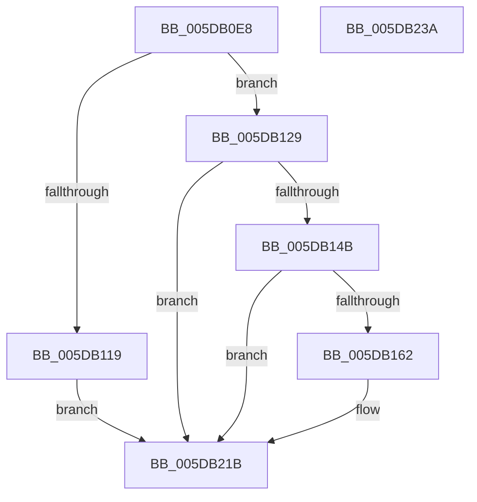

# PpmEventParkNodeRestriction

- RVA: `0x005DB0E8`–`0x005DB23B` (길이 `339` bytes)
- VA: `0x00000001405DB0E8`
- 실행 섹션: `.text`
- PDB 이름 있음: `예`; PDB Function 태그: `아니요`
- unwind 정보 RVA: `0x000CD1EC`
- 디코드: `80`개 명령, `339/339` bytes 표시
- 미해석 바이트: `0` (있으면 어셈블리에 `.byte`로 보존)

> 이 문서는 커널 이미지의 기계어와 PDB 기호를 분석해 생성했습니다. 4번과 5번은 함수 원형과 자료형을 바이너리 사용 방식에서 추정한 C 해석이며 원본 소스 복구 결과는 아닙니다.

## 1. Dependencies

- 직접 호출 지점: **5**; 고유 호출 대상: **5**
- 직접 호출자로 확인된 함수: **2**
- RIP 상대 이미지 참조: **5**

### Outgoing calls
- `0x005DB110` → [Feature_PpmParkEx__private_IsEnabledDeviceUsageNoInline](../4F/Feature_PpmParkEx__private_IsEnabledDeviceUsageNoInline_function_004F135C.md) (function, `0x004F135C`)
- `0x005DB11F` → [PpmEventParkNodeRestrictionEx](PpmEventParkNodeRestrictionEx_function_005DEB00.md) (function, `0x005DEB00`)
- `0x005DB155` → [EtwEventEnabled](../39/EtwEventEnabled_function_00392450.md) (function, `0x00392450`)
- `0x005DB216` → [EtwWriteEx](../25/EtwWriteEx_function_0025F0D0.md) (function, `0x0025F0D0`)
- `0x005DB222` → [_security_check_cookie](../6A/_security_check_cookie_function_006AC640.md) (function, `0x006AC640`)

### Direct callers
- [PpmParkEvaluateRestriction](../4A/PpmParkEvaluateRestriction_function_004ADE0C.md) at `0x004ADE6A`
- [PpmEventTraceControlCallback](../../page/A5/PpmEventTraceControlCallback_function_00A51F60.md) at `0x00A52246`

### Static image references
- `0x005DB0FC` → RVA `0x00E0A740` (`.data`; read)
- `0x005DB12C` → RVA `0x00020F60` (`.rdata`; read)
- `0x005DB133` → RVA `0x000211B8` (`.rdata`; read)
- `0x005DB13E` → RVA `0x00E67A39` (`.data`; read)
- `0x005DB14B` → RVA `0x00F083E8` (`.data`; read)

## 2. Other-region calls and transfers

- 다른 실행 섹션으로 향하는 call: **0**
- 별도 외부 분기/꼬리 이동을 확인하지 못했습니다.

## 3. Assembly (complete function range)

```asm
005DB0E8  48 89 5C 24 18                  mov qword ptr [rsp + 0x18], rbx
005DB0ED  55                              push rbp
005DB0EE  56                              push rsi
005DB0EF  57                              push rdi
005DB0F0  48 8D 6C 24 B9                  lea rbp, [rsp - 0x47]
005DB0F5  48 81 EC C0 00 00 00            sub rsp, 0xc0
005DB0FC  48 8B 05 3D F6 82 00            mov rax, qword ptr [rip + 0x82f63d]
005DB103  48 33 C4                        xor rax, rsp
005DB106  48 89 45 37                     mov qword ptr [rbp + 0x37], rax
005DB10A  48 8B FA                        mov rdi, rdx
005DB10D  40 8A F1                        mov sil, cl
005DB110  E8 47 62 F1 FF                  call 0x1404f135c
005DB115  85 C0                           test eax, eax
005DB117  74 10                           je 0x1405db129
005DB119  48 8B D7                        mov rdx, rdi
005DB11C  40 8A CE                        mov cl, sil
005DB11F  E8 DC 39 00 00                  call 0x1405deb00
005DB124  E9 F2 00 00 00                  jmp 0x1405db21b
005DB129  40 84 F6                        test sil, sil
005DB12C  48 8D 05 2D 5E A4 FF            lea rax, [rip - 0x5ba1d3]
005DB133  48 8D 1D 7E 60 A4 FF            lea rbx, [rip - 0x5b9f82]
005DB13A  48 0F 44 D8                     cmove rbx, rax
005DB13E  80 3D F4 C8 88 00 00            cmp byte ptr [rip + 0x88c8f4], 0
005DB145  0F 84 D0 00 00 00               je 0x1405db21b
005DB14B  48 8B 0D 96 D2 92 00            mov rcx, qword ptr [rip + 0x92d296]
005DB152  48 8B D3                        mov rdx, rbx
005DB155  E8 F6 72 DB FF                  call 0x140392450
005DB15A  84 C0                           test al, al
005DB15C  0F 84 B9 00 00 00               je 0x1405db21b
005DB162  83 65 E3 00                     and dword ptr [rbp - 0x1d], 0
005DB166  48 8D 8F E4 04 00 00            lea rcx, [rdi + 0x4e4]
005DB16D  83 65 F3 00                     and dword ptr [rbp - 0xd], 0
005DB171  48 8D 47 04                     lea rax, [rdi + 4]
005DB175  83 65 03 00                     and dword ptr [rbp + 3], 0
005DB179  BA 01 00 00 00                  mov edx, 1
005DB17E  80 BF D4 04 00 00 00            cmp byte ptr [rdi + 0x4d4], 0
005DB185  48 89 45 D7                     mov qword ptr [rbp - 0x29], rax
005DB189  48 8D 47 10                     lea rax, [rdi + 0x10]
005DB18D  0F 95 45 C8                     setne byte ptr [rbp - 0x38]
005DB191  48 89 45 E7                     mov qword ptr [rbp - 0x19], rax
005DB195  8A 87 D0 04 00 00               mov al, byte ptr [rdi + 0x4d0]
005DB19B  45 33 C9                        xor r9d, r9d
005DB19E  83 65 13 00                     and dword ptr [rbp + 0x13], 0
005DB1A2  45 33 C0                        xor r8d, r8d
005DB1A5  83 65 23 00                     and dword ptr [rbp + 0x23], 0
005DB1A9  83 65 33 00                     and dword ptr [rbp + 0x33], 0
005DB1AD  88 45 C7                        mov byte ptr [rbp - 0x39], al
005DB1B0  48 8D 45 C7                     lea rax, [rbp - 0x39]
005DB1B4  48 89 45 F7                     mov qword ptr [rbp - 9], rax
005DB1B8  48 8D 45 C8                     lea rax, [rbp - 0x38]
005DB1BC  48 89 45 07                     mov qword ptr [rbp + 7], rax
005DB1C0  48 8B 87 E8 04 00 00            mov rax, qword ptr [rdi + 0x4e8]
005DB1C7  48 89 45 27                     mov qword ptr [rbp + 0x27], rax
005DB1CB  0F B7 01                        movzx eax, word ptr [rcx]
005DB1CE  C1 E0 02                        shl eax, 2
005DB1D1  89 45 2F                        mov dword ptr [rbp + 0x2f], eax
005DB1D4  48 8D 45 D7                     lea rax, [rbp - 0x29]
005DB1D8  48 89 44 24 38                  mov qword ptr [rsp + 0x38], rax
005DB1DD  C7 44 24 30 06 00 00 00         mov dword ptr [rsp + 0x30], 6
005DB1E5  48 83 64 24 28 00               and qword ptr [rsp + 0x28], 0
005DB1EB  48 83 64 24 20 00               and qword ptr [rsp + 0x20], 0
005DB1F1  89 55 FF                        mov dword ptr [rbp - 1], edx
005DB1F4  89 55 0F                        mov dword ptr [rbp + 0xf], edx
005DB1F7  48 89 4D 17                     mov qword ptr [rbp + 0x17], rcx
005DB1FB  48 8B 0D E6 D1 92 00            mov rcx, qword ptr [rip + 0x92d1e6]
005DB202  89 55 1F                        mov dword ptr [rbp + 0x1f], edx
005DB205  48 8B D3                        mov rdx, rbx
005DB208  C7 45 DF 02 00 00 00            mov dword ptr [rbp - 0x21], 2
005DB20F  C7 45 EF 08 00 00 00            mov dword ptr [rbp - 0x11], 8
005DB216  E8 B5 3E C8 FF                  call 0x14025f0d0
005DB21B  48 8B 4D 37                     mov rcx, qword ptr [rbp + 0x37]
005DB21F  48 33 CC                        xor rcx, rsp
005DB222  E8 19 14 0D 00                  call 0x1406ac640
005DB227  48 8B 9C 24 F0 00 00 00         mov rbx, qword ptr [rsp + 0xf0]
005DB22F  48 81 C4 C0 00 00 00            add rsp, 0xc0
005DB236  5F                              pop rdi
005DB237  5E                              pop rsi
005DB238  5D                              pop rbp
005DB239  C3                              ret
005DB23A  CC                              int3
```

## 4. C-style interpretation (structured pseudocode)

```c
__int64 __fastcall PpmEventParkNodeRestriction(unsigned __int8 a1, __int64 a2, int a3, int a4)
{
    __int64 result;
    __int64 v_rbx;
    __int64 v_rsp;
    unsigned __int64 v_stack_m28;
    unsigned int v_stack_m2C;
    unsigned int v_stack_m30;
    unsigned __int64 v_stack_m38;
    unsigned int v_stack_m3C;
    unsigned int v_stack_m40;
    unsigned __int64 v_stack_m48;
    unsigned int v_stack_m4C;
    unsigned int v_stack_m50;
    unsigned __int64 v_stack_m58;
    unsigned int v_stack_m5C;
    unsigned __int64 v_stack_m5F;
    unsigned int v_stack_m60;
    unsigned __int64 v_stack_m68;
    unsigned int v_stack_m6C;
    unsigned int v_stack_m70;
    unsigned __int64 v_stack_m78;
    unsigned int v_stack_m7C;
    unsigned int v_stack_m80;
    unsigned __int64 v_stack_m88;
    unsigned __int8 v_stack_m97;
    unsigned __int8 v_stack_m98;
    unsigned __int64 v_stack_mA0;
    unsigned int v_stack_mA8;
    unsigned __int64 v_stack_mB0;
    unsigned __int64 v_stack_mB8;
    unsigned __int64 v_stack_p18;

    v_stack_p18 = v_rbx;
    v_rsp = (v_rsp) - (192);
    result = (*(unsigned __int64 *)(v_rip + 8582717)) ^ (v_rsp);
    v_stack_m28 = result;
    result = Feature_PpmParkEx__private_IsEnabledDeviceUsageNoInline(a1, a2, a3, a4);
    if ((unsigned int)(result) == 0) goto loc_005DB129;
    result = PpmEventParkNodeRestrictionEx(a1, a2, a3, a4);
    goto loc_005DB21B;
loc_005DB129:
    v_rbx = v_rip - 6004610;
    if (a1 == 0) { v_rbx = v_rip - 6005203; }
    if ((*(unsigned __int8 *)(v_rip + 8964340)) == 0) goto loc_005DB21B;
    result = EtwEventEnabled(*(unsigned __int64 *)(v_rip + 9622166), v_rbx, a3, a4);
    if ((unsigned __int8)(result) != 0) {
        a1 = a2 + 1252;
        result = a2 + 4;
        a2 = 1;
        v_stack_m88 = result;
        result = a2 + 16;
        v_stack_m78 = result;
        result = *(unsigned __int8 *)(a2 + 1232);
        a4 = 0;
        a3 = 0;
        v_stack_m98 = (unsigned __int8)(result);
        result = v_stack_m98;
        v_stack_m68 = result;
        result = v_stack_m97;
        v_stack_m58 = result;
        result = *(unsigned __int64 *)(a2 + 1256);
        v_stack_m38 = result;
        result = *(unsigned __int16 *)(a1);
        result = (unsigned int)((result) << (2));
        v_stack_m30 = (unsigned int)(result);
        result = v_stack_m88;
        v_stack_mA0 = result;
        v_stack_mA8 = 6;
        v_stack_m60 = (unsigned int)(a2);
        v_stack_m50 = (unsigned int)(a2);
        v_stack_m48 = a1;
        a1 = *(unsigned __int64 *)(v_rip + 9621990);
        v_stack_m40 = (unsigned int)(a2);
        a2 = v_rbx;
        v_stack_m80 = 2;
        v_stack_m70 = 8;
        result = EtwWriteEx(a1, a2, a3, a4);
    }
    a1 = (v_stack_m28) ^ (v_rsp);
    result = _security_check_cookie(a1, a2, a3, a4);
    v_rsp = (v_rsp) + (192);
    return result;
}
```

## 5. (Beta) C Style

```c
int64_t PpmEventParkNodeRestriction(uint8_t Arg1, void *Arg2, int32_t Arg3, int32_t Arg4)
{
    uint8_t *arg2 = (uint8_t *)Arg2;

    int64_t result;
    int64_t local_rbx;
    int64_t local_rsp;
    uint64_t v_stack_m28;
    uint32_t v_stack_m2C;
    uint32_t v_stack_m30;
    uint64_t v_stack_m38;
    uint32_t v_stack_m3C;
    uint32_t v_stack_m40;
    uint64_t v_stack_m48;
    uint32_t v_stack_m4C;
    uint32_t v_stack_m50;
    uint64_t v_stack_m58;
    uint32_t v_stack_m5C;
    uint64_t v_stack_m5F;
    uint32_t v_stack_m60;
    uint64_t v_stack_m68;
    uint32_t v_stack_m6C;
    uint32_t v_stack_m70;
    uint64_t v_stack_m78;
    uint32_t v_stack_m7C;
    uint32_t v_stack_m80;
    uint64_t v_stack_m88;
    uint8_t v_stack_m97;
    uint8_t v_stack_m98;
    uint64_t v_stack_mA0;
    uint32_t v_stack_mA8;
    uint64_t v_stack_mB0;
    uint64_t v_stack_mB8;
    uint64_t v_stack_p18;

    v_stack_p18 = local_rbx;
    local_rsp = (local_rsp) - (192);
    result = (*(uint64_t *)(v_rip + 0x82F63D)) ^ (local_rsp);
    v_stack_m28 = result;
    result = Feature_PpmParkEx__private_IsEnabledDeviceUsageNoInline(Arg1, Arg2, Arg3, Arg4);
    if ((uint32_t)(result) == 0) goto loc_005DB129;
    result = PpmEventParkNodeRestrictionEx(Arg1, Arg2, Arg3, Arg4);
    goto loc_005DB21B;
loc_005DB129:
    local_rbx = v_rip - 6004610;
    if (Arg1 == 0) { local_rbx = v_rip - 6005203; }
    if ((*(uint8_t *)(v_rip + 0x88C8F4)) == 0) goto loc_005DB21B;
    result = EtwEventEnabled(*(uint64_t *)(v_rip + 0x92D296), local_rbx, Arg3, Arg4);
    if ((uint8_t)(result) != 0) {
        Arg1 = Arg2 + 1252;
        result = Arg2 + 4;
        Arg2 = 1;
        v_stack_m88 = result;
        result = Arg2 + 16;
        v_stack_m78 = result;
        result = *(uint8_t *)(arg2 + 0x4D0);
        Arg4 = 0;
        Arg3 = 0;
        v_stack_m98 = (uint8_t)(result);
        result = v_stack_m98;
        v_stack_m68 = result;
        result = v_stack_m97;
        v_stack_m58 = result;
        result = *(uint64_t *)(arg2 + 0x4E8);
        v_stack_m38 = result;
        result = *(uint16_t *)(Arg1);
        result = (uint32_t)((result) << (2));
        v_stack_m30 = (uint32_t)(result);
        result = v_stack_m88;
        v_stack_mA0 = result;
        v_stack_mA8 = 6;
        v_stack_m60 = (uint32_t)(Arg2);
        v_stack_m50 = (uint32_t)(Arg2);
        v_stack_m48 = Arg1;
        Arg1 = *(uint64_t *)(v_rip + 0x92D1E6);
        v_stack_m40 = (uint32_t)(Arg2);
        Arg2 = local_rbx;
        v_stack_m80 = 2;
        v_stack_m70 = 8;
        result = EtwWriteEx(Arg1, Arg2, Arg3, Arg4);
    }
    Arg1 = (v_stack_m28) ^ (local_rsp);
    result = _security_check_cookie(Arg1, Arg2, Arg3, Arg4);
    local_rsp = (local_rsp) + (192);
    return result;
}
```

### 관측된 메모리 오프셋

구조체 형식이 확인되지 않은 접근은 인자 기준의 오프셋으로만 기록했습니다.

| 기준 인자 | 오프셋 표현 | 폭 (bit) | 접근 |
|---|---:|---:|---|
| `Arg2` | `+ 0x0` | `16` | `R` |
| `Arg2` | `+ 0x4` | `64` | `R` |
| `Arg2` | `+ 0x10` | `64` | `R` |
| `Arg2` | `+ 0x4D0` | `8` | `R` |
| `Arg2` | `+ 0x4D4` | `8` | `R` |
| `Arg2` | `+ 0x4E4` | `64` | `R` |
| `Arg2` | `+ 0x4E8` | `64` | `R` |

## 6. Execution-region graph

[열기: 2D/3D 그래프와 함수 탐색 컨트롤 패널](../../../control-panel.html?section=text&rva=0x005DB0E8&view=graph)

- 2D 그래프는 위에서 아래로 흐르고, 3D 그래프는 빈 공간을 드래그해 회전합니다. Shift+드래그는 이동, 휠은 확대·축소, 함수 노드 선택은 대상 보고서 이동입니다.

### Static fallback


