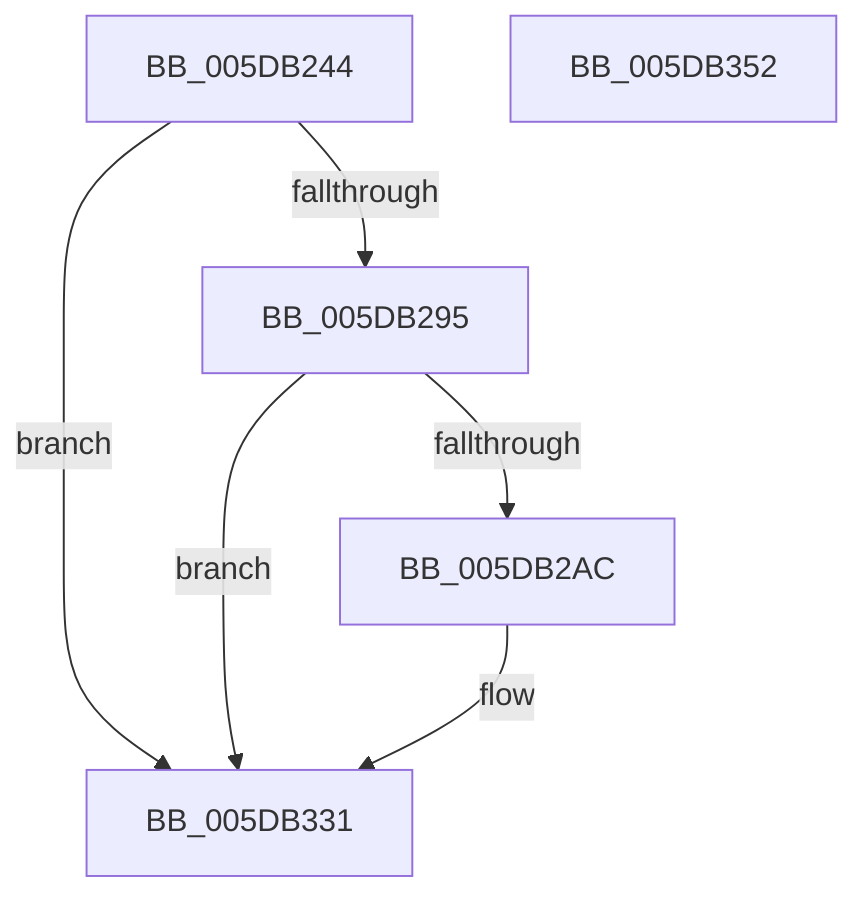

# PpmEventProcessorVetoRequest

- RVA: `0x005DB244`–`0x005DB353` (길이 `271` bytes)
- VA: `0x00000001405DB244`
- 실행 섹션: `.text`
- PDB 이름 있음: `예`; PDB Function 태그: `아니요`
- unwind 정보 RVA: `0x000CD2DC`
- 디코드: `62`개 명령, `271/271` bytes 표시
- 미해석 바이트: `0` (있으면 어셈블리에 `.byte`로 보존)

> 이 문서는 커널 이미지의 기계어와 PDB 기호를 분석해 생성했습니다. 4번과 5번은 함수 원형과 자료형을 바이너리 사용 방식에서 추정한 C 해석이며 원본 소스 복구 결과는 아닙니다.

## 1. Dependencies

- 직접 호출 지점: **3**; 고유 호출 대상: **3**
- 직접 호출자로 확인된 함수: **1**
- RIP 상대 이미지 참조: **5**

### Outgoing calls
- `0x005DB29F` → [EtwEventEnabled](../39/EtwEventEnabled_function_00392450.md) (function, `0x00392450`)
- `0x005DB32C` → [EtwWriteEx](../25/EtwWriteEx_function_0025F0D0.md) (function, `0x0025F0D0`)
- `0x005DB338` → [_security_check_cookie](../6A/_security_check_cookie_function_006AC640.md) (function, `0x006AC640`)

### Direct callers
- [PpmUpdateProcessorIdleVeto](PpmUpdateProcessorIdleVeto_function_005D0C50.md) at `0x005D0D52`

### Static image references
- `0x005DB262` → RVA `0x00E0A740` (`.data`; read)
- `0x005DB273` → RVA `0x00020CA8` (`.rdata`; read)
- `0x005DB27A` → RVA `0x00021130` (`.rdata`; read)
- `0x005DB288` → RVA `0x00E67A39` (`.data`; read)
- `0x005DB295` → RVA `0x00F083E8` (`.data`; read)

## 2. Other-region calls and transfers

- 다른 실행 섹션으로 향하는 call: **0**
- 별도 외부 분기/꼬리 이동을 확인하지 못했습니다.

## 3. Assembly (complete function range)

```asm
005DB244  48 8B C4                        mov rax, rsp
005DB247  48 89 58 08                     mov qword ptr [rax + 8], rbx
005DB24B  48 89 78 20                     mov qword ptr [rax + 0x20], rdi
005DB24F  44 89 40 18                     mov dword ptr [rax + 0x18], r8d
005DB253  89 50 10                        mov dword ptr [rax + 0x10], edx
005DB256  55                              push rbp
005DB257  48 8D 68 A1                     lea rbp, [rax - 0x5f]
005DB25B  48 81 EC A0 00 00 00            sub rsp, 0xa0
005DB262  48 8B 05 D7 F4 82 00            mov rax, qword ptr [rip + 0x82f4d7]
005DB269  48 33 C4                        xor rax, rsp
005DB26C  48 89 45 47                     mov qword ptr [rbp + 0x47], rax
005DB270  45 84 C9                        test r9b, r9b
005DB273  48 8D 05 2E 5A A4 FF            lea rax, [rip - 0x5ba5d2]
005DB27A  48 8D 1D AF 5E A4 FF            lea rbx, [rip - 0x5ba151]
005DB281  48 8B F9                        mov rdi, rcx
005DB284  48 0F 45 D8                     cmovne rbx, rax
005DB288  80 3D AA C7 88 00 00            cmp byte ptr [rip + 0x88c7aa], 0
005DB28F  0F 84 9C 00 00 00               je 0x1405db331
005DB295  48 8B 0D 4C D1 92 00            mov rcx, qword ptr [rip + 0x92d14c]
005DB29C  48 8B D3                        mov rdx, rbx
005DB29F  E8 AC 71 DB FF                  call 0x140392450
005DB2A4  84 C0                           test al, al
005DB2A6  0F 84 85 00 00 00               je 0x1405db331
005DB2AC  0F B6 87 D0 00 00 00            movzx eax, byte ptr [rdi + 0xd0]
005DB2B3  B9 04 00 00 00                  mov ecx, 4
005DB2B8  83 65 13 00                     and dword ptr [rbp + 0x13], 0
005DB2BC  45 33 C9                        xor r9d, r9d
005DB2BF  83 65 23 00                     and dword ptr [rbp + 0x23], 0
005DB2C3  45 33 C0                        xor r8d, r8d
005DB2C6  83 65 33 00                     and dword ptr [rbp + 0x33], 0
005DB2CA  48 8B D3                        mov rdx, rbx
005DB2CD  83 65 43 00                     and dword ptr [rbp + 0x43], 0
005DB2D1  66 89 45 F7                     mov word ptr [rbp - 9], ax
005DB2D5  48 8D 45 F7                     lea rax, [rbp - 9]
005DB2D9  48 89 45 07                     mov qword ptr [rbp + 7], rax
005DB2DD  48 8D 87 D1 00 00 00            lea rax, [rdi + 0xd1]
005DB2E4  48 89 45 17                     mov qword ptr [rbp + 0x17], rax
005DB2E8  48 8D 45 6F                     lea rax, [rbp + 0x6f]
005DB2EC  48 89 45 27                     mov qword ptr [rbp + 0x27], rax
005DB2F0  48 8D 45 77                     lea rax, [rbp + 0x77]
005DB2F4  48 89 45 37                     mov qword ptr [rbp + 0x37], rax
005DB2F8  48 8D 45 07                     lea rax, [rbp + 7]
005DB2FC  48 89 44 24 38                  mov qword ptr [rsp + 0x38], rax
005DB301  89 4C 24 30                     mov dword ptr [rsp + 0x30], ecx
005DB305  48 83 64 24 28 00               and qword ptr [rsp + 0x28], 0
005DB30B  48 83 64 24 20 00               and qword ptr [rsp + 0x20], 0
005DB311  89 4D 2F                        mov dword ptr [rbp + 0x2f], ecx
005DB314  89 4D 3F                        mov dword ptr [rbp + 0x3f], ecx
005DB317  48 8B 0D CA D0 92 00            mov rcx, qword ptr [rip + 0x92d0ca]
005DB31E  C7 45 0F 02 00 00 00            mov dword ptr [rbp + 0xf], 2
005DB325  C7 45 1F 01 00 00 00            mov dword ptr [rbp + 0x1f], 1
005DB32C  E8 9F 3D C8 FF                  call 0x14025f0d0
005DB331  48 8B 4D 47                     mov rcx, qword ptr [rbp + 0x47]
005DB335  48 33 CC                        xor rcx, rsp
005DB338  E8 03 13 0D 00                  call 0x1406ac640
005DB33D  4C 8D 9C 24 A0 00 00 00         lea r11, [rsp + 0xa0]
005DB345  49 8B 5B 10                     mov rbx, qword ptr [r11 + 0x10]
005DB349  49 8B 7B 28                     mov rdi, qword ptr [r11 + 0x28]
005DB34D  49 8B E3                        mov rsp, r11
005DB350  5D                              pop rbp
005DB351  C3                              ret
005DB352  CC                              int3
```

## 4. C-style interpretation (structured pseudocode)

```c
__int64 __fastcall PpmEventProcessorVetoRequest(__int64 a1, int a2, int a3, int a4)
{
    __int64 result;
    __int64 v_rbx;
    __int64 v_rsp;
    unsigned __int64 v_stack_m70;
    unsigned int v_stack_m78;
    unsigned __int64 v_stack_m8;
    unsigned __int64 v_stack_m80;
    unsigned __int64 v_stack_m88;

    *(unsigned __int64 *)(v_rsp + 8) = v_rbx;
    *(unsigned __int64 *)(v_rsp + 32) = v_rdi;
    *(unsigned int *)(v_rsp + 24) = a3;
    *(unsigned int *)(v_rsp + 16) = a2;
    v_rsp = (v_rsp) - (160);
    result = (*(unsigned __int64 *)(v_rip + 8582359)) ^ (v_rsp);
    *(unsigned __int64 *)(v_rsp - 95 + 71) = result;
    v_rbx = v_rip - 6005073;
    if ((unsigned __int8)(a4) != 0) { v_rbx = v_rip - 6006226; }
    if ((*(unsigned __int8 *)(v_rip + 8964010)) == 0) goto loc_005DB331;
    result = EtwEventEnabled(*(unsigned __int64 *)(v_rip + 9621836), v_rbx, a3, a4);
    if ((unsigned __int8)(result) != 0) {
        result = *(unsigned __int8 *)(a1 + 208);
        a1 = 4;
        a4 = 0;
        a3 = 0;
        a2 = v_rbx;
        *(unsigned __int16 *)(v_rsp - 95 - 9) = (unsigned __int16)(result);
        result = v_rsp - 95 - 9;
        *(unsigned __int64 *)(v_rsp - 95 + 7) = result;
        result = a1 + 209;
        *(unsigned __int64 *)(v_rsp - 95 + 23) = result;
        result = v_rsp - 95 + 111;
        *(unsigned __int64 *)(v_rsp - 95 + 39) = result;
        result = v_rsp - 95 + 119;
        *(unsigned __int64 *)(v_rsp - 95 + 55) = result;
        result = v_rsp - 95 + 7;
        v_stack_m70 = result;
        v_stack_m78 = (unsigned int)(a1);
        *(unsigned int *)(v_rsp - 95 + 47) = (unsigned int)(a1);
        *(unsigned int *)(v_rsp - 95 + 63) = (unsigned int)(a1);
        a1 = *(unsigned __int64 *)(v_rip + 9621706);
        *(unsigned int *)(v_rsp - 95 + 15) = 2;
        *(unsigned int *)(v_rsp - 95 + 31) = 1;
        result = EtwWriteEx(a1, a2, a3, a4);
    }
    a1 = (*(unsigned __int64 *)(v_rsp - 95 + 71)) ^ (v_rsp);
    result = _security_check_cookie(a1, a2, a3, a4);
    return result;
}
```

## 5. (Beta) C Style

```c
int64_t PpmEventProcessorVetoRequest(void *Arg1, int32_t Arg2, int32_t Arg3, int32_t Arg4)
{
    uint8_t *arg1 = (uint8_t *)Arg1;

    int64_t result;
    int64_t local_rbx;
    int64_t local_rsp;
    uint64_t v_stack_m70;
    uint32_t v_stack_m78;
    uint64_t v_stack_m8;
    uint64_t v_stack_m80;
    uint64_t v_stack_m88;

    *(uint64_t *)(local_rsp + 0x8) = local_rbx;
    *(uint64_t *)(local_rsp + 0x20) = local_rdi;
    *(uint32_t *)(local_rsp + 0x18) = Arg3;
    *(uint32_t *)(local_rsp + 0x10) = Arg2;
    local_rsp = (local_rsp) - (160);
    result = (*(uint64_t *)(v_rip + 0x82F4D7)) ^ (local_rsp);
    *(uint64_t *)(local_rsp - 0x5F + 0x47) = result;
    local_rbx = v_rip - 6005073;
    if ((uint8_t)(Arg4) != 0) { local_rbx = v_rip - 6006226; }
    if ((*(uint8_t *)(v_rip + 0x88C7AA)) == 0) goto loc_005DB331;
    result = EtwEventEnabled(*(uint64_t *)(v_rip + 0x92D14C), local_rbx, Arg3, Arg4);
    if ((uint8_t)(result) != 0) {
        result = *(uint8_t *)(arg1 + 0xD0);
        Arg1 = 4;
        Arg4 = 0;
        Arg3 = 0;
        Arg2 = local_rbx;
        *(uint16_t *)(local_rsp - 0x5F - 0x9) = (uint16_t)(result);
        result = local_rsp - 95 - 9;
        *(uint64_t *)(local_rsp - 0x5F + 0x7) = result;
        result = Arg1 + 209;
        *(uint64_t *)(local_rsp - 0x5F + 0x17) = result;
        result = local_rsp - 95 + 111;
        *(uint64_t *)(local_rsp - 0x5F + 0x27) = result;
        result = local_rsp - 95 + 119;
        *(uint64_t *)(local_rsp - 0x5F + 0x37) = result;
        result = local_rsp - 95 + 7;
        v_stack_m70 = result;
        v_stack_m78 = (uint32_t)(Arg1);
        *(uint32_t *)(local_rsp - 0x5F + 0x2F) = (uint32_t)(Arg1);
        *(uint32_t *)(local_rsp - 0x5F + 0x3F) = (uint32_t)(Arg1);
        Arg1 = *(uint64_t *)(v_rip + 0x92D0CA);
        *(uint32_t *)(local_rsp - 0x5F + 0xF) = 2;
        *(uint32_t *)(local_rsp - 0x5F + 0x1F) = 1;
        result = EtwWriteEx(Arg1, Arg2, Arg3, Arg4);
    }
    Arg1 = (*(uint64_t *)(local_rsp - 0x5F + 0x47)) ^ (local_rsp);
    result = _security_check_cookie(Arg1, Arg2, Arg3, Arg4);
    return result;
}
```

### 관측된 메모리 오프셋

구조체 형식이 확인되지 않은 접근은 인자 기준의 오프셋으로만 기록했습니다.

| 기준 인자 | 오프셋 표현 | 폭 (bit) | 접근 |
|---|---:|---:|---|
| `Arg1` | `+ 0xD0` | `8` | `R` |
| `Arg1` | `+ 0xD1` | `64` | `R` |

## 6. Execution-region graph

[열기: 2D/3D 그래프와 함수 탐색 컨트롤 패널](../../../control-panel.html?section=text&rva=0x005DB244&view=graph)

- 2D 그래프는 위에서 아래로 흐르고, 3D 그래프는 빈 공간을 드래그해 회전합니다. Shift+드래그는 이동, 휠은 확대·축소, 함수 노드 선택은 대상 보고서 이동입니다.

### Static fallback


