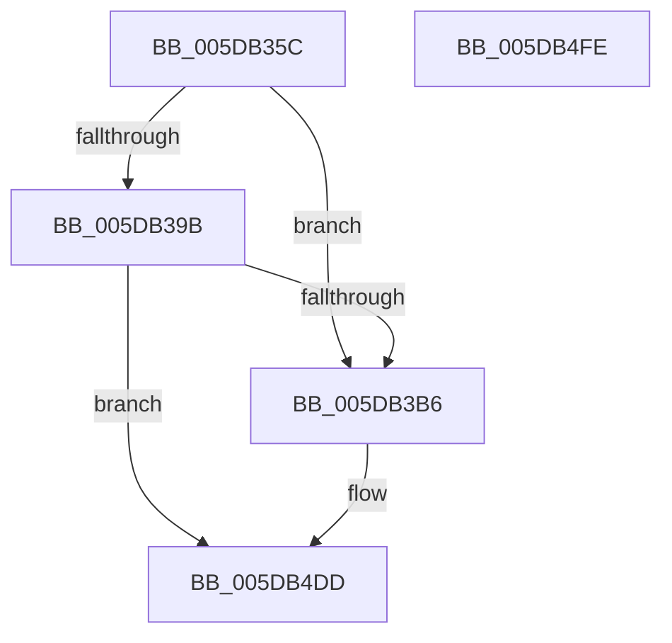

# PpmEventVpQosChange

- RVA: `0x005DB35C`–`0x005DB4FF` (길이 `419` bytes)
- VA: `0x00000001405DB35C`
- 실행 섹션: `.text`
- PDB 이름 있음: `예`; PDB Function 태그: `아니요`
- unwind 정보 RVA: `0x000C6F60`
- 디코드: `80`개 명령, `419/419` bytes 표시
- 미해석 바이트: `0` (있으면 어셈블리에 `.byte`로 보존)

> 이 문서는 커널 이미지의 기계어와 PDB 기호를 분석해 생성했습니다. 4번과 5번은 함수 원형과 자료형을 바이너리 사용 방식에서 추정한 C 해석이며 원본 소스 복구 결과는 아닙니다.

## 1. Dependencies

- 직접 호출 지점: **3**; 고유 호출 대상: **3**
- 직접 호출자로 확인된 함수: **2**
- RIP 상대 이미지 참조: **4**

### Outgoing calls
- `0x005DB3A9` → [EtwEventEnabled](../39/EtwEventEnabled_function_00392450.md) (function, `0x00392450`)
- `0x005DB4D8` → [EtwWriteEx](../25/EtwWriteEx_function_0025F0D0.md) (function, `0x0025F0D0`)
- `0x005DB4E4` → [_security_check_cookie](../6A/_security_check_cookie_function_006AC640.md) (function, `0x006AC640`)

### Direct callers
- [sub_00391AFF](../39/Unknown_function_00391AFF.md) at `0x00391B2D`
- [sub_00391D5F](../39/Unknown_function_00391D5F.md) at `0x00391DA7`

### Static image references
- `0x005DB373` → RVA `0x00E0A740` (`.data`; read)
- `0x005DB38B` → RVA `0x00E67A39` (`.data`; read)
- `0x005DB39B` → RVA `0x00F083E8` (`.data`; read)
- `0x005DB3A2` → RVA `0x00011290` (`.rdata`; read)

## 2. Other-region calls and transfers

- 다른 실행 섹션으로 향하는 call: **0**
- 별도 외부 분기/꼬리 이동을 확인하지 못했습니다.

## 3. Assembly (complete function range)

```asm
005DB35C  48 89 5C 24 08                  mov qword ptr [rsp + 8], rbx
005DB361  48 89 7C 24 10                  mov qword ptr [rsp + 0x10], rdi
005DB366  55                              push rbp
005DB367  48 8D 6C 24 D0                  lea rbp, [rsp - 0x30]
005DB36C  48 81 EC 30 01 00 00            sub rsp, 0x130
005DB373  48 8B 05 C6 F3 82 00            mov rax, qword ptr [rip + 0x82f3c6]
005DB37A  48 33 C4                        xor rax, rsp
005DB37D  48 89 45 20                     mov qword ptr [rbp + 0x20], rax
005DB381  33 FF                           xor edi, edi
005DB383  C7 44 24 44 64 00 00 00         mov dword ptr [rsp + 0x44], 0x64
005DB38B  40 38 3D A7 C6 88 00            cmp byte ptr [rip + 0x88c6a7], dil
005DB392  48 8B D9                        mov rbx, rcx
005DB395  89 7C 24 40                     mov dword ptr [rsp + 0x40], edi
005DB399  75 1B                           jne 0x1405db3b6
005DB39B  48 8B 0D 46 D0 92 00            mov rcx, qword ptr [rip + 0x92d046]
005DB3A2  48 8D 15 E7 5E A3 FF            lea rdx, [rip - 0x5ca119]
005DB3A9  E8 A2 70 DB FF                  call 0x140392450
005DB3AE  84 C0                           test al, al
005DB3B0  0F 84 27 01 00 00               je 0x1405db4dd
005DB3B6  0F B6 83 D0 00 00 00            movzx eax, byte ptr [rbx + 0xd0]
005DB3BD  48 8D 15 CC 5E A3 FF            lea rdx, [rip - 0x5ca134]
005DB3C4  48 8B 0D 1D D0 92 00            mov rcx, qword ptr [rip + 0x92d01d]
005DB3CB  45 33 C9                        xor r9d, r9d
005DB3CE  66 89 44 24 48                  mov word ptr [rsp + 0x48], ax
005DB3D3  45 33 C0                        xor r8d, r8d
005DB3D6  48 8D 44 24 40                  lea rax, [rsp + 0x40]
005DB3DB  48 C7 44 24 58 04 00 00 00      mov qword ptr [rsp + 0x58], 4
005DB3E4  48 89 44 24 50                  mov qword ptr [rsp + 0x50], rax
005DB3E9  48 8D 43 44                     lea rax, [rbx + 0x44]
005DB3ED  48 89 44 24 60                  mov qword ptr [rsp + 0x60], rax
005DB3F2  48 8D 44 24 48                  lea rax, [rsp + 0x48]
005DB3F7  48 89 44 24 70                  mov qword ptr [rsp + 0x70], rax
005DB3FC  48 8D 83 D1 00 00 00            lea rax, [rbx + 0xd1]
005DB403  48 89 45 80                     mov qword ptr [rbp - 0x80], rax
005DB407  48 8D 44 24 44                  lea rax, [rsp + 0x44]
005DB40C  48 89 45 90                     mov qword ptr [rbp - 0x70], rax
005DB410  48 8D 44 24 44                  lea rax, [rsp + 0x44]
005DB415  48 89 45 A0                     mov qword ptr [rbp - 0x60], rax
005DB419  48 8D 44 24 44                  lea rax, [rsp + 0x44]
005DB41E  48 89 45 B0                     mov qword ptr [rbp - 0x50], rax
005DB422  48 8D 44 24 44                  lea rax, [rsp + 0x44]
005DB427  48 89 45 C0                     mov qword ptr [rbp - 0x40], rax
005DB42B  48 8D 44 24 40                  lea rax, [rsp + 0x40]
005DB430  48 89 45 D0                     mov qword ptr [rbp - 0x30], rax
005DB434  48 8D 44 24 40                  lea rax, [rsp + 0x40]
005DB439  48 89 45 E0                     mov qword ptr [rbp - 0x20], rax
005DB43D  48 8D 44 24 40                  lea rax, [rsp + 0x40]
005DB442  48 89 45 F0                     mov qword ptr [rbp - 0x10], rax
005DB446  48 8D 44 24 40                  lea rax, [rsp + 0x40]
005DB44B  48 89 45 00                     mov qword ptr [rbp], rax
005DB44F  48 8D 83 44 8A 00 00            lea rax, [rbx + 0x8a44]
005DB456  48 89 45 10                     mov qword ptr [rbp + 0x10], rax
005DB45A  48 8D 44 24 50                  lea rax, [rsp + 0x50]
005DB45F  48 89 44 24 38                  mov qword ptr [rsp + 0x38], rax
005DB464  C7 44 24 30 0D 00 00 00         mov dword ptr [rsp + 0x30], 0xd
005DB46C  48 89 7C 24 28                  mov qword ptr [rsp + 0x28], rdi
005DB471  48 89 7C 24 20                  mov qword ptr [rsp + 0x20], rdi
005DB476  48 C7 44 24 68 04 00 00 00      mov qword ptr [rsp + 0x68], 4
005DB47F  48 C7 44 24 78 02 00 00 00      mov qword ptr [rsp + 0x78], 2
005DB488  48 C7 45 88 01 00 00 00         mov qword ptr [rbp - 0x78], 1
005DB490  48 C7 45 98 04 00 00 00         mov qword ptr [rbp - 0x68], 4
005DB498  48 C7 45 A8 04 00 00 00         mov qword ptr [rbp - 0x58], 4
005DB4A0  48 C7 45 B8 04 00 00 00         mov qword ptr [rbp - 0x48], 4
005DB4A8  48 C7 45 C8 04 00 00 00         mov qword ptr [rbp - 0x38], 4
005DB4B0  48 C7 45 D8 04 00 00 00         mov qword ptr [rbp - 0x28], 4
005DB4B8  48 C7 45 E8 04 00 00 00         mov qword ptr [rbp - 0x18], 4
005DB4C0  48 C7 45 F8 04 00 00 00         mov qword ptr [rbp - 8], 4
005DB4C8  48 C7 45 08 04 00 00 00         mov qword ptr [rbp + 8], 4
005DB4D0  48 C7 45 18 04 00 00 00         mov qword ptr [rbp + 0x18], 4
005DB4D8  E8 F3 3B C8 FF                  call 0x14025f0d0
005DB4DD  48 8B 4D 20                     mov rcx, qword ptr [rbp + 0x20]
005DB4E1  48 33 CC                        xor rcx, rsp
005DB4E4  E8 57 11 0D 00                  call 0x1406ac640
005DB4E9  4C 8D 9C 24 30 01 00 00         lea r11, [rsp + 0x130]
005DB4F1  49 8B 5B 10                     mov rbx, qword ptr [r11 + 0x10]
005DB4F5  49 8B 7B 18                     mov rdi, qword ptr [r11 + 0x18]
005DB4F9  49 8B E3                        mov rsp, r11
005DB4FC  5D                              pop rbp
005DB4FD  C3                              ret
005DB4FE  CC                              int3
```

## 4. C-style interpretation (structured pseudocode)

```c
__int64 __fastcall PpmEventVpQosChange(__int64 a1, __int64 a2, int a3, int a4)
{
    __int64 result;
    __int64 v_rdi;
    __int64 v_rsp;
    unsigned __int64 v_stack_m100;
    unsigned int v_stack_m108;
    unsigned __int64 v_stack_m110;
    unsigned __int64 v_stack_m118;
    unsigned __int64 v_stack_m18;
    unsigned __int64 v_stack_m20;
    unsigned __int64 v_stack_m28;
    unsigned __int64 v_stack_m30;
    unsigned __int64 v_stack_m38;
    unsigned __int64 v_stack_m40;
    unsigned __int64 v_stack_m48;
    unsigned __int64 v_stack_m50;
    unsigned __int64 v_stack_m58;
    unsigned __int64 v_stack_m60;
    unsigned __int64 v_stack_m68;
    unsigned __int64 v_stack_m70;
    unsigned __int64 v_stack_m78;
    unsigned __int64 v_stack_m8;
    unsigned __int64 v_stack_m80;
    unsigned __int64 v_stack_m88;
    unsigned __int64 v_stack_m90;
    unsigned __int64 v_stack_m98;
    unsigned __int64 v_stack_mA0;
    unsigned __int64 v_stack_mA8;
    unsigned __int64 v_stack_mB0;
    unsigned __int64 v_stack_mB8;
    unsigned __int64 v_stack_mC0;
    unsigned __int64 v_stack_mC8;
    unsigned __int64 v_stack_mD0;
    unsigned __int64 v_stack_mD8;
    unsigned __int64 v_stack_mE0;
    unsigned __int64 v_stack_mE8;
    unsigned __int16 v_stack_mF0;
    unsigned int v_stack_mF4;
    unsigned int v_stack_mF8;
    unsigned __int64 v_stack_p10;
    unsigned __int64 v_stack_p8;

    v_stack_p8 = v_rbx;
    v_stack_p10 = v_rdi;
    v_rsp = (v_rsp) - (304);
    result = (*(unsigned __int64 *)(v_rip + 8582086)) ^ (v_rsp);
    v_stack_m18 = result;
    v_rdi = 0;
    v_stack_mF4 = 100;
    v_stack_mF8 = 0;
    if ((*(unsigned __int8 *)(v_rip + 8963751)) != 0) goto loc_005DB3B6;
    result = EtwEventEnabled(*(unsigned __int64 *)(v_rip + 9621574), v_rip - 6070553, a3, a4);
    if ((unsigned __int8)(result) != 0) {
        result = *(unsigned __int8 *)(a1 + 208);
        a2 = v_rip - 6070580;
        a1 = *(unsigned __int64 *)(v_rip + 9621533);
        a4 = 0;
        v_stack_mF0 = (unsigned __int16)(result);
        a3 = 0;
        result = v_stack_mF8;
        v_stack_mE0 = 4;
        v_stack_mE8 = result;
        result = a1 + 68;
        v_stack_mD8 = result;
        result = v_stack_mF0;
        v_stack_mC8 = result;
        result = a1 + 209;
        v_stack_mB8 = result;
        result = v_stack_mF4;
        v_stack_mA8 = result;
        result = v_stack_mF4;
        v_stack_m98 = result;
        result = v_stack_mF4;
        v_stack_m88 = result;
        result = v_stack_mF4;
        v_stack_m78 = result;
        result = v_stack_mF8;
        v_stack_m68 = result;
        result = v_stack_mF8;
        v_stack_m58 = result;
        result = v_stack_mF8;
        v_stack_m48 = result;
        result = v_stack_mF8;
        v_stack_m38 = result;
        result = a1 + 35396;
        v_stack_m28 = result;
        result = v_stack_mE8;
        v_stack_m100 = result;
        v_stack_m108 = 13;
        v_stack_m110 = 0;
        v_stack_m118 = 0;
        v_stack_mD0 = 4;
        v_stack_mC0 = 2;
        v_stack_mB0 = 1;
        v_stack_mA0 = 4;
        v_stack_m90 = 4;
        v_stack_m80 = 4;
        v_stack_m70 = 4;
        v_stack_m60 = 4;
        v_stack_m50 = 4;
        v_stack_m40 = 4;
        v_stack_m30 = 4;
        v_stack_m20 = 4;
        result = EtwWriteEx(a1, a2, a3, a4);
    }
    a1 = (v_stack_m18) ^ (v_rsp);
    result = _security_check_cookie(a1, a2, a3, a4);
    return result;
}
```

## 5. (Beta) C Style

```c
int64_t PpmEventVpQosChange(void *Arg1, int64_t Arg2, int32_t Arg3, int32_t Arg4)
{
    uint8_t *arg1 = (uint8_t *)Arg1;

    int64_t result;
    int64_t local_rdi;
    int64_t local_rsp;
    uint64_t v_stack_m100;
    uint32_t v_stack_m108;
    uint64_t v_stack_m110;
    uint64_t v_stack_m118;
    uint64_t v_stack_m18;
    uint64_t v_stack_m20;
    uint64_t v_stack_m28;
    uint64_t v_stack_m30;
    uint64_t v_stack_m38;
    uint64_t v_stack_m40;
    uint64_t v_stack_m48;
    uint64_t v_stack_m50;
    uint64_t v_stack_m58;
    uint64_t v_stack_m60;
    uint64_t v_stack_m68;
    uint64_t v_stack_m70;
    uint64_t v_stack_m78;
    uint64_t v_stack_m8;
    uint64_t v_stack_m80;
    uint64_t v_stack_m88;
    uint64_t v_stack_m90;
    uint64_t v_stack_m98;
    uint64_t v_stack_mA0;
    uint64_t v_stack_mA8;
    uint64_t v_stack_mB0;
    uint64_t v_stack_mB8;
    uint64_t v_stack_mC0;
    uint64_t v_stack_mC8;
    uint64_t v_stack_mD0;
    uint64_t v_stack_mD8;
    uint64_t v_stack_mE0;
    uint64_t v_stack_mE8;
    uint16_t v_stack_mF0;
    uint32_t v_stack_mF4;
    uint32_t v_stack_mF8;
    uint64_t v_stack_p10;
    uint64_t v_stack_p8;

    v_stack_p8 = local_rbx;
    v_stack_p10 = local_rdi;
    local_rsp = (local_rsp) - (304);
    result = (*(uint64_t *)(v_rip + 0x82F3C6)) ^ (local_rsp);
    v_stack_m18 = result;
    local_rdi = 0;
    v_stack_mF4 = 100;
    v_stack_mF8 = 0;
    if ((*(uint8_t *)(v_rip + 0x88C6A7)) != 0) goto loc_005DB3B6;
    result = EtwEventEnabled(*(uint64_t *)(v_rip + 0x92D046), v_rip - 6070553, Arg3, Arg4);
    if ((uint8_t)(result) != 0) {
        result = *(uint8_t *)(arg1 + 0xD0);
        Arg2 = v_rip - 6070580;
        Arg1 = *(uint64_t *)(v_rip + 0x92D01D);
        Arg4 = 0;
        v_stack_mF0 = (uint16_t)(result);
        Arg3 = 0;
        result = v_stack_mF8;
        v_stack_mE0 = 4;
        v_stack_mE8 = result;
        result = Arg1 + 68;
        v_stack_mD8 = result;
        result = v_stack_mF0;
        v_stack_mC8 = result;
        result = Arg1 + 209;
        v_stack_mB8 = result;
        result = v_stack_mF4;
        v_stack_mA8 = result;
        result = v_stack_mF4;
        v_stack_m98 = result;
        result = v_stack_mF4;
        v_stack_m88 = result;
        result = v_stack_mF4;
        v_stack_m78 = result;
        result = v_stack_mF8;
        v_stack_m68 = result;
        result = v_stack_mF8;
        v_stack_m58 = result;
        result = v_stack_mF8;
        v_stack_m48 = result;
        result = v_stack_mF8;
        v_stack_m38 = result;
        result = Arg1 + 35396;
        v_stack_m28 = result;
        result = v_stack_mE8;
        v_stack_m100 = result;
        v_stack_m108 = 13;
        v_stack_m110 = 0;
        v_stack_m118 = 0;
        v_stack_mD0 = 4;
        v_stack_mC0 = 2;
        v_stack_mB0 = 1;
        v_stack_mA0 = 4;
        v_stack_m90 = 4;
        v_stack_m80 = 4;
        v_stack_m70 = 4;
        v_stack_m60 = 4;
        v_stack_m50 = 4;
        v_stack_m40 = 4;
        v_stack_m30 = 4;
        v_stack_m20 = 4;
        result = EtwWriteEx(Arg1, Arg2, Arg3, Arg4);
    }
    Arg1 = (v_stack_m18) ^ (local_rsp);
    result = _security_check_cookie(Arg1, Arg2, Arg3, Arg4);
    return result;
}
```

### 관측된 메모리 오프셋

구조체 형식이 확인되지 않은 접근은 인자 기준의 오프셋으로만 기록했습니다.

| 기준 인자 | 오프셋 표현 | 폭 (bit) | 접근 |
|---|---:|---:|---|
| `Arg1` | `+ 0x44` | `64` | `R` |
| `Arg1` | `+ 0xD0` | `8` | `R` |
| `Arg1` | `+ 0xD1` | `64` | `R` |
| `Arg1` | `+ 0x8A44` | `64` | `R` |

## 6. Execution-region graph

[열기: 2D/3D 그래프와 함수 탐색 컨트롤 패널](../../../control-panel.html?section=text&rva=0x005DB35C&view=graph)

- 2D 그래프는 위에서 아래로 흐르고, 3D 그래프는 빈 공간을 드래그해 회전합니다. Shift+드래그는 이동, 휠은 확대·축소, 함수 노드 선택은 대상 보고서 이동입니다.

### Static fallback


