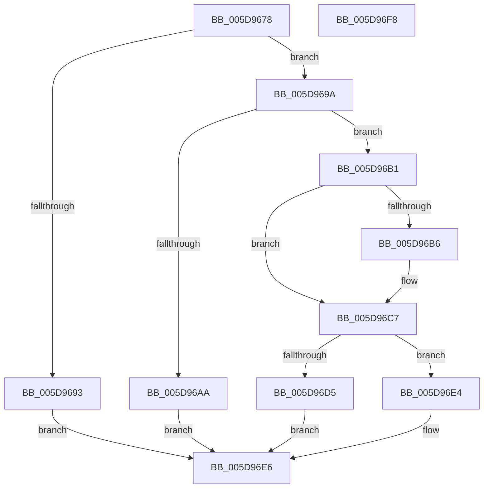

# PpmFireWmiEvent

- RVA: `0x005D9678`–`0x005D96F9` (길이 `129` bytes)
- VA: `0x00000001405D9678`
- 실행 섹션: `.text`
- PDB 이름 있음: `예`; PDB Function 태그: `아니요`
- unwind 정보 RVA: `0x00060BC4`
- 디코드: `41`개 명령, `129/129` bytes 표시
- 미해석 바이트: `0` (있으면 어셈블리에 `.byte`로 보존)

> 이 문서는 커널 이미지의 기계어와 PDB 기호를 분석해 생성했습니다. 4번과 5번은 함수 원형과 자료형을 바이너리 사용 방식에서 추정한 C 해석이며 원본 소스 복구 결과는 아닙니다.

## 1. Dependencies

- 직접 호출 지점: **4**; 고유 호출 대상: **4**
- 직접 호출자로 확인된 함수: **4**
- RIP 상대 이미지 참조: **0**

### Outgoing calls
- `0x005D969D` → [PpmAllocWmiEvent](PpmAllocWmiEvent_function_005D95DC.md) (function, `0x005D95DC`)
- `0x005D96C2` → [memcpy](../6C/memcpy_function_006C6840.md) (function, `0x006C6840`)
- `0x005D96CA` → [IoWMIWriteEvent](../38/IoWMIWriteEvent_function_00386480.md) (function, `0x00386480`)
- `0x005D96DD` → [ExFreePoolWithTag](../../poolcode/B8/ExFreePoolWithTag_function_00B82870.md) (function, `0x00B82870`)

### Direct callers
- [PpmEventThermalCapChange](../42/PpmEventThermalCapChange_function_0042B6E4.md) at `0x0042B78E`
- [PpmEventDomainPerfStateChange](../47/PpmEventDomainPerfStateChange_function_0047B720.md) at `0x0047B9EE`
- [PpmEventLegacyProcessorPerfStateChange](../48/PpmEventLegacyProcessorPerfStateChange_function_004800AC.md) at `0x004801D3`
- [PopFireThermalWmiEvent](PopFireThermalWmiEvent_function_005D5448.md) at `0x005D5499`

### Static image references
- 디코드된 RIP-relative 메모리 참조가 없습니다.

## 2. Other-region calls and transfers

- 다른 실행 섹션으로 향하는 call: **1**
  - `0x005D96DD` → [ExFreePoolWithTag](../../poolcode/B8/ExFreePoolWithTag_function_00B82870.md) (`.text` → `POOLCODE`)
- 별도 외부 분기/꼬리 이동을 확인하지 못했습니다.

## 3. Assembly (complete function range)

```asm
005D9678  48 89 5C 24 08                  mov qword ptr [rsp + 8], rbx
005D967D  48 89 74 24 10                  mov qword ptr [rsp + 0x10], rsi
005D9682  57                              push rdi
005D9683  48 83 EC 20                     sub rsp, 0x20
005D9687  83 79 08 00                     cmp dword ptr [rcx + 8], 0
005D968B  49 8B D9                        mov rbx, r9
005D968E  41 8B F0                        mov esi, r8d
005D9691  75 07                           jne 0x1405d969a
005D9693  BB 01 00 00 C0                  mov ebx, 0xc0000001
005D9698  EB 4C                           jmp 0x1405d96e6
005D969A  44 8B C6                        mov r8d, esi
005D969D  E8 3A FF FF FF                  call 0x1405d95dc
005D96A2  48 8B F8                        mov rdi, rax
005D96A5  48 85 C0                        test rax, rax
005D96A8  75 07                           jne 0x1405d96b1
005D96AA  BB 9A 00 00 C0                  mov ebx, 0xc000009a
005D96AF  EB 35                           jmp 0x1405d96e6
005D96B1  48 85 DB                        test rbx, rbx
005D96B4  74 11                           je 0x1405d96c7
005D96B6  8B 48 38                        mov ecx, dword ptr [rax + 0x38]
005D96B9  4C 8B C6                        mov r8, rsi
005D96BC  48 03 CF                        add rcx, rdi
005D96BF  48 8B D3                        mov rdx, rbx
005D96C2  E8 79 D1 0E 00                  call 0x1406c6840
005D96C7  48 8B CF                        mov rcx, rdi
005D96CA  E8 B1 CD DA FF                  call 0x140386480
005D96CF  8B D8                           mov ebx, eax
005D96D1  85 C0                           test eax, eax
005D96D3  79 0F                           jns 0x1405d96e4
005D96D5  BA 50 50 4D 77                  mov edx, 0x774d5050
005D96DA  48 8B CF                        mov rcx, rdi
005D96DD  E8 8E 91 5A 00                  call 0x140b82870
005D96E2  EB 02                           jmp 0x1405d96e6
005D96E4  33 DB                           xor ebx, ebx
005D96E6  48 8B 74 24 38                  mov rsi, qword ptr [rsp + 0x38]
005D96EB  8B C3                           mov eax, ebx
005D96ED  48 8B 5C 24 30                  mov rbx, qword ptr [rsp + 0x30]
005D96F2  48 83 C4 20                     add rsp, 0x20
005D96F6  5F                              pop rdi
005D96F7  C3                              ret
005D96F8  CC                              int3
```

## 4. C-style interpretation (structured pseudocode)

```c
__int64 __fastcall PpmFireWmiEvent(__int64 a1, __int64 a2, int a3, __int64 a4)
{
    __int64 result;
    __int64 v_rbx;
    __int64 v_rsp;
    unsigned __int64 v_stack_p10;
    unsigned __int64 v_stack_p8;

    v_stack_p8 = v_rbx;
    v_stack_p10 = v_rsi;
    v_rsp = (v_rsp) - (32);
    if ((*(unsigned int *)(a1 + 8)) != 0) goto loc_005D969A;
    goto loc_005D96E6;
loc_005D969A:
    result = PpmAllocWmiEvent(a1, a2, (unsigned int)((unsigned int)((unsigned int)(a3))), a4);
    if (result != 0) goto loc_005D96B1;
    goto loc_005D96E6;
loc_005D96B1:
    if ((unsigned int)(0xC000009AULL) != 0) {
        a1 = *(unsigned int *)(result + 56);
        a3 = (unsigned int)(a3);
        a1 = (a1) + (result);
        a2 = (unsigned int)(0xC000009AULL);
        result = memcpy(a1, a2, a3, a4);
    }
    result = IoWMIWriteEvent(result, a2, a3, a4);
    if (!sign_flag) goto loc_005D96E4;
    result = ExFreePoolWithTag(result, (unsigned int)(0x774D5050ULL), a3, a4);
    goto loc_005D96E6;
loc_005D96E4:
    v_rbx = 0;
loc_005D96E6:
    v_rsp = (v_rsp) + (32);
    return 0;
}
```

## 5. (Beta) C Style

```c
int64_t PpmFireWmiEvent(void *Arg1, int64_t Arg2, int32_t Arg3, int64_t Arg4)
{
    uint8_t *arg1 = (uint8_t *)Arg1;

    int64_t result;
    int64_t local_rbx;
    int64_t local_rsp;
    uint64_t v_stack_p10;
    uint64_t v_stack_p8;

    v_stack_p8 = local_rbx;
    v_stack_p10 = local_rsi;
    local_rsp = (local_rsp) - (32);
    if ((*(uint32_t *)(arg1 + 0x8)) != 0) goto loc_005D969A;
    goto loc_005D96E6;
loc_005D969A:
    result = PpmAllocWmiEvent(Arg1, Arg2, (uint32_t)((uint32_t)((uint32_t)(Arg3))), Arg4);
    if (result != 0) goto loc_005D96B1;
    goto loc_005D96E6;
loc_005D96B1:
    if ((uint32_t)(0xC000009AULL) != 0) {
        Arg1 = *(uint32_t *)(result + 0x38);
        Arg3 = (uint32_t)(Arg3);
        Arg1 = (Arg1) + (result);
        Arg2 = (uint32_t)(0xC000009AULL);
        result = memcpy(Arg1, Arg2, Arg3, Arg4);
    }
    result = IoWMIWriteEvent(result, Arg2, Arg3, Arg4);
    if (!sign_flag) goto loc_005D96E4;
    result = ExFreePoolWithTag(result, (uint32_t)(0x774D5050ULL), Arg3, Arg4);
    goto loc_005D96E6;
loc_005D96E4:
    local_rbx = 0;
loc_005D96E6:
    local_rsp = (local_rsp) + (32);
    return 0;
}
```

### 관측된 메모리 오프셋

구조체 형식이 확인되지 않은 접근은 인자 기준의 오프셋으로만 기록했습니다.

| 기준 인자 | 오프셋 표현 | 폭 (bit) | 접근 |
|---|---:|---:|---|
| `Arg1` | `+ 0x8` | `32` | `R` |

## 6. Execution-region graph

[열기: 2D/3D 그래프와 함수 탐색 컨트롤 패널](../../../control-panel.html?section=text&rva=0x005D9678&view=graph)

- 2D 그래프는 위에서 아래로 흐르고, 3D 그래프는 빈 공간을 드래그해 회전합니다. Shift+드래그는 이동, 휠은 확대·축소, 함수 노드 선택은 대상 보고서 이동입니다.

### Static fallback


