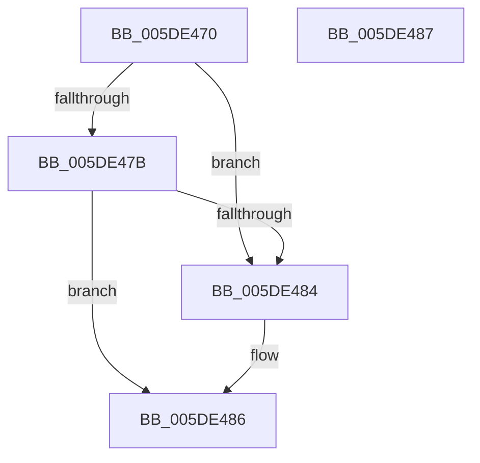

# PpmHeteroCheckWpsTableUpdatedSim

- RVA: `0x005DE470`–`0x005DE488` (길이 `24` bytes)
- VA: `0x00000001405DE470`
- 실행 섹션: `.text`
- PDB 이름 있음: `예`; PDB Function 태그: `아니요`
- unwind 정보 RVA: `0x000DB714`
- 디코드: `8`개 명령, `24/24` bytes 표시
- 미해석 바이트: `0` (있으면 어셈블리에 `.byte`로 보존)

> 이 문서는 커널 이미지의 기계어와 PDB 기호를 분석해 생성했습니다. 4번과 5번은 함수 원형과 자료형을 바이너리 사용 방식에서 추정한 C 해석이며 원본 소스 복구 결과는 아닙니다.

## 1. Dependencies

- 직접 호출 지점: **0**; 고유 호출 대상: **0**
- 직접 호출자로 확인된 함수: **0**
- RIP 상대 이미지 참조: **2**

### Outgoing calls
- 직접 디코드된 call 명령이 없습니다.

### Direct callers
- 이 함수 시작 RVA로 연결되는 직접 call은 확인되지 않았습니다. 간접 호출은 완전히 역산할 수 없습니다.

### Static image references
- `0x005DE470` → RVA `0x00FC6A94` (`ALMOSTRO`; read)
- `0x005DE47B` → RVA `0x00FC5003` (`ALMOSTRO`; read)

## 2. Other-region calls and transfers

- 다른 실행 섹션으로 향하는 call: **0**
- 별도 외부 분기/꼬리 이동을 확인하지 못했습니다.

## 3. Assembly (complete function range)

```asm
005DE470  80 3D 1D 86 9E 00 00            cmp byte ptr [rip + 0x9e861d], 0
005DE477  B0 01                           mov al, 1
005DE479  74 09                           je 0x1405de484
005DE47B  80 3D 81 6B 9E 00 0F            cmp byte ptr [rip + 0x9e6b81], 0xf
005DE482  74 02                           je 0x1405de486
005DE484  32 C0                           xor al, al
005DE486  C3                              ret
005DE487  CC                              int3
```

## 4. C-style interpretation (structured pseudocode)

```c
__int64 __fastcall PpmHeteroCheckWpsTableUpdatedSim(void)
{
    __int64 result;

    if ((*(unsigned __int8 *)(v_rip + 10389021)) == 0) goto loc_005DE484;
    result = 1;
    if ((*(unsigned __int8 *)(v_rip + 10382209)) != 15) {
        result = 0;
    }
    return result;
}
```

## 5. (Beta) C Style

```c
void PpmHeteroCheckWpsTableUpdatedSim(void)
{
    int64_t result;

    if ((*(uint8_t *)(v_rip + 0x9E861D)) == 0) goto loc_005DE484;
    result = 1;
    if ((*(uint8_t *)(v_rip + 0x9E6B81)) != 15) {
        result = 0;
    }
    return result;
}
```

## 6. Execution-region graph

[열기: 2D/3D 그래프와 함수 탐색 컨트롤 패널](../../../control-panel.html?section=text&rva=0x005DE470&view=graph)

- 2D 그래프는 위에서 아래로 흐르고, 3D 그래프는 빈 공간을 드래그해 회전합니다. Shift+드래그는 이동, 휠은 확대·축소, 함수 노드 선택은 대상 보고서 이동입니다.

### Static fallback


