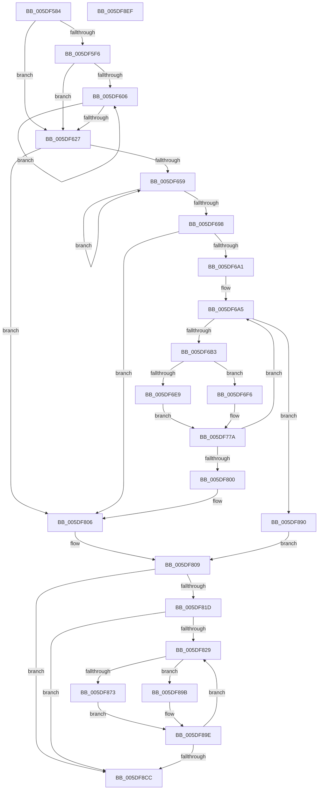

# PpmHeteroComputeMultiClassUnparkCountEx

- RVA: `0x005DF584`–`0x005DF8F0` (길이 `876` bytes)
- VA: `0x00000001405DF584`
- 실행 섹션: `.text`
- PDB 이름 있음: `예`; PDB Function 태그: `아니요`
- unwind 정보 RVA: `0x000CD93C`
- 디코드: `220`개 명령, `876/876` bytes 표시
- 미해석 바이트: `0` (있으면 어셈블리에 `.byte`로 보존)

> 이 문서는 커널 이미지의 기계어와 PDB 기호를 분석해 생성했습니다. 4번과 5번은 함수 원형과 자료형을 바이너리 사용 방식에서 추정한 C 해석이며 원본 소스 복구 결과는 아닙니다.

## 1. Dependencies

- 직접 호출 지점: **9**; 고유 호출 대상: **8**
- 직접 호출자로 확인된 함수: **1**
- RIP 상대 이미지 참조: **1**

### Outgoing calls
- `0x005DF5D2` → [memset](../6C/memset_function_006C6C40.md) (function, `0x006C6C40`)
- `0x005DF63F` → [memset](../6C/memset_function_006C6C40.md) (function, `0x006C6C40`)
- `0x005DF688` → [KiOrAffinityEx](../39/KiOrAffinityEx_function_0039A84C.md) (function, `0x0039A84C`)
- `0x005DF71B` → [PpmHeteroComputeCoreParkingUtilitiesEx](../4F/PpmHeteroComputeCoreParkingUtilitiesEx_function_004F1E44.md) (function, `0x004F1E44`)
- `0x005DF761` → [PpmHeteroComputeUnparkCountEx](../4F/PpmHeteroComputeUnparkCountEx_function_004F1950.md) (function, `0x004F1950`)
- `0x005DF7CF` → [PpmEventTraceMultiClassHeteroResponseEx](../4F/PpmEventTraceMultiClassHeteroResponseEx_function_004F204C.md) (function, `0x004F204C`)
- `0x005DF7E5` → [KiSubtractAffinityEx](../2D/KiSubtractAffinityEx_function_002D61E8.md) (function, `0x002D61E8`)
- `0x005DF8B2` → [PpmEventTraceMultiClassHeteroResponseUpdate](../4D/PpmEventTraceMultiClassHeteroResponseUpdate_function_004D0B1C.md) (function, `0x004D0B1C`)
- `0x005DF8D6` → [_security_check_cookie](../6A/_security_check_cookie_function_006AC640.md) (function, `0x006AC640`)

### Direct callers
- [PpmCheckComputeMultiClassHeteroResponseEx](../4F/PpmCheckComputeMultiClassHeteroResponseEx_function_004F14A4.md) at `0x004F17D2`

### Static image references
- `0x005DF5A0` → RVA `0x00E0A740` (`.data`; read)

## 2. Other-region calls and transfers

- 다른 실행 섹션으로 향하는 call: **0**
- 별도 외부 분기/꼬리 이동을 확인하지 못했습니다.

## 3. Assembly (complete function range)

```asm
005DF584  40 55                           push rbp
005DF586  53                              push rbx
005DF587  56                              push rsi
005DF588  57                              push rdi
005DF589  41 54                           push r12
005DF58B  41 55                           push r13
005DF58D  41 56                           push r14
005DF58F  41 57                           push r15
005DF591  48 8D AC 24 58 FF FF FF         lea rbp, [rsp - 0xa8]
005DF599  48 81 EC A8 01 00 00            sub rsp, 0x1a8
005DF5A0  48 8B 05 99 B1 82 00            mov rax, qword ptr [rip + 0x82b199]
005DF5A7  48 33 C4                        xor rax, rsp
005DF5AA  48 89 85 90 00 00 00            mov qword ptr [rbp + 0x90], rax
005DF5B1  4C 89 44 24 68                  mov qword ptr [rsp + 0x68], r8
005DF5B6  48 8B D9                        mov rbx, rcx
005DF5B9  48 89 54 24 78                  mov qword ptr [rsp + 0x78], rdx
005DF5BE  48 8D 4D 88                     lea rcx, [rbp - 0x78]
005DF5C2  41 BE 00 01 00 00               mov r14d, 0x100
005DF5C8  4C 89 4C 24 60                  mov qword ptr [rsp + 0x60], r9
005DF5CD  45 8B C6                        mov r8d, r14d
005DF5D0  33 D2                           xor edx, edx
005DF5D2  E8 69 76 0E 00                  call 0x1406c6c40
005DF5D7  48 8B B3 80 04 00 00            mov rsi, qword ptr [rbx + 0x480]
005DF5DE  33 FF                           xor edi, edi
005DF5E0  89 7C 24 50                     mov dword ptr [rsp + 0x50], edi
005DF5E4  48 89 7C 24 70                  mov qword ptr [rsp + 0x70], rdi
005DF5E9  44 8D 6F 01                     lea r13d, [rdi + 1]
005DF5ED  40 38 BD 20 01 00 00            cmp byte ptr [rbp + 0x120], dil
005DF5F4  74 31                           je 0x1405df627
005DF5F6  41 8B D5                        mov edx, r13d
005DF5F9  48 89 BB A8 04 00 00            mov qword ptr [rbx + 0x4a8], rdi
005DF600  44 38 6B 0C                     cmp byte ptr [rbx + 0xc], r13b
005DF604  76 21                           jbe 0x1405df627
005DF606  8B C2                           mov eax, edx
005DF608  41 03 D5                        add edx, r13d
005DF60B  48 8D 0C 80                     lea rcx, [rax + rax*4]
005DF60F  48 8B 83 08 05 00 00            mov rax, qword ptr [rbx + 0x508]
005DF616  48 C1 E1 07                     shl rcx, 7
005DF61A  48 89 7C 01 10                  mov qword ptr [rcx + rax + 0x10], rdi
005DF61F  0F B6 43 0C                     movzx eax, byte ptr [rbx + 0xc]
005DF623  3B D0                           cmp edx, eax
005DF625  72 DF                           jb 0x1405df606
005DF627  44 8B A5 10 01 00 00            mov r12d, dword ptr [rbp + 0x110]
005DF62E  48 8D 4D 88                     lea rcx, [rbp - 0x78]
005DF632  4D 8B C6                        mov r8, r14
005DF635  48 C7 45 80 01 00 20 00         mov qword ptr [rbp - 0x80], 0x200001
005DF63D  33 D2                           xor edx, edx
005DF63F  E8 FC 75 0E 00                  call 0x1406c6c40
005DF644  8A 53 0C                        mov dl, byte ptr [rbx + 0xc]
005DF647  44 8B F7                        mov r14d, edi
005DF64A  44 8B FF                        mov r15d, edi
005DF64D  41 8B FD                        mov edi, r13d
005DF650  41 3A D5                        cmp dl, r13b
005DF653  0F 86 AD 01 00 00               jbe 0x1405df806
005DF659  44 0F B7 4D 82                  movzx r9d, word ptr [rbp - 0x7e]
005DF65E  4C 8D 45 80                     lea r8, [rbp - 0x80]
005DF662  8B C7                           mov eax, edi
005DF664  48 8D 4D 80                     lea rcx, [rbp - 0x80]
005DF668  48 8D 14 80                     lea rdx, [rax + rax*4]
005DF66C  48 C1 E2 07                     shl rdx, 7
005DF670  48 03 93 08 05 00 00            add rdx, qword ptr [rbx + 0x508]
005DF677  0F B7 42 08                     movzx eax, word ptr [rdx + 8]
005DF67B  44 03 F0                        add r14d, eax
005DF67E  0F B7 02                        movzx eax, word ptr [rdx]
005DF681  48 83 C2 28                     add rdx, 0x28
005DF685  44 03 F8                        add r15d, eax
005DF688  E8 BF B1 DB FF                  call 0x14039a84c
005DF68D  0F B6 53 0C                     movzx edx, byte ptr [rbx + 0xc]
005DF691  41 03 FD                        add edi, r13d
005DF694  3B FA                           cmp edi, edx
005DF696  72 C1                           jb 0x1405df659
005DF698  41 3A D5                        cmp dl, r13b
005DF69B  0F 86 65 01 00 00               jbe 0x1405df806
005DF6A1  8A CA                           mov cl, dl
005DF6A3  8A C2                           mov al, dl
005DF6A5  45 33 C0                        xor r8d, r8d
005DF6A8  8A D0                           mov dl, al
005DF6AA  45 85 E4                        test r12d, r12d
005DF6AD  0F 84 DD 01 00 00               je 0x1405df890
005DF6B3  41 8B C5                        mov eax, r13d
005DF6B6  41 8D 55 01                     lea edx, [r13 + 1]
005DF6BA  45 8B D0                        mov r10d, r8d
005DF6BD  4C 89 44 24 58                  mov qword ptr [rsp + 0x58], r8
005DF6C2  89 54 24 54                     mov dword ptr [rsp + 0x54], edx
005DF6C6  48 8D 3C 80                     lea rdi, [rax + rax*4]
005DF6CA  48 C1 E7 07                     shl rdi, 7
005DF6CE  48 03 BB 08 05 00 00            add rdi, qword ptr [rbx + 0x508]
005DF6D5  0F B7 47 08                     movzx eax, word ptr [rdi + 8]
005DF6D9  44 2B F0                        sub r14d, eax
005DF6DC  0F B7 07                        movzx eax, word ptr [rdi]
005DF6DF  44 2B F8                        sub r15d, eax
005DF6E2  0F B6 C1                        movzx eax, cl
005DF6E5  3B D0                           cmp edx, eax
005DF6E7  75 0D                           jne 0x1405df6f6
005DF6E9  45 8B C8                        mov r9d, r8d
005DF6EC  44 89 44 24 50                  mov dword ptr [rsp + 0x50], r8d
005DF6F1  E9 84 00 00 00                  jmp 0x1405df77a
005DF6F6  4C 8B 4C 24 60                  mov r9, qword ptr [rsp + 0x60]
005DF6FB  48 8D 44 24 58                  lea rax, [rsp + 0x58]
005DF700  4C 8B 44 24 68                  mov r8, qword ptr [rsp + 0x68]
005DF705  48 8D 55 80                     lea rdx, [rbp - 0x80]
005DF709  48 89 44 24 28                  mov qword ptr [rsp + 0x28], rax
005DF70E  41 8B CD                        mov ecx, r13d
005DF711  48 8D 44 24 70                  lea rax, [rsp + 0x70]
005DF716  48 89 44 24 20                  mov qword ptr [rsp + 0x20], rax
005DF71B  E8 24 27 F1 FF                  call 0x1404f1e44
005DF720  4C 8B 4C 24 68                  mov r9, qword ptr [rsp + 0x68]
005DF725  48 8D 44 24 50                  lea rax, [rsp + 0x50]
005DF72A  48 8B 54 24 78                  mov rdx, qword ptr [rsp + 0x78]
005DF72F  41 B8 01 00 00 00               mov r8d, 1
005DF735  48 89 44 24 48                  mov qword ptr [rsp + 0x48], rax
005DF73A  41 8B CD                        mov ecx, r13d
005DF73D  48 8B 44 24 58                  mov rax, qword ptr [rsp + 0x58]
005DF742  44 89 7C 24 40                  mov dword ptr [rsp + 0x40], r15d
005DF747  44 89 74 24 38                  mov dword ptr [rsp + 0x38], r14d
005DF74C  48 89 44 24 30                  mov qword ptr [rsp + 0x30], rax
005DF751  48 8B 44 24 60                  mov rax, qword ptr [rsp + 0x60]
005DF756  48 89 44 24 28                  mov qword ptr [rsp + 0x28], rax
005DF75B  48 83 64 24 20 00               and qword ptr [rsp + 0x20], 0
005DF761  E8 EA 21 F1 FF                  call 0x1404f1950
005DF766  44 8B 4C 24 50                  mov r9d, dword ptr [rsp + 0x50]
005DF76B  44 8B D0                        mov r10d, eax
005DF76E  45 3B CC                        cmp r9d, r12d
005DF771  45 0F 43 CC                     cmovae r9d, r12d
005DF775  44 89 4C 24 50                  mov dword ptr [rsp + 0x50], r9d
005DF77A  0F B7 0F                        movzx ecx, word ptr [rdi]
005DF77D  41 8B D4                        mov edx, r12d
005DF780  41 2B D1                        sub edx, r9d
005DF783  48 89 74 24 48                  mov qword ptr [rsp + 0x48], rsi
005DF788  66 44 89 4C 24 40               mov word ptr [rsp + 0x40], r9w
005DF78E  3B D1                           cmp edx, ecx
005DF790  4C 8B 4C 24 60                  mov r9, qword ptr [rsp + 0x60]
005DF795  0F 43 D1                        cmovae edx, ecx
005DF798  41 8A CD                        mov cl, r13b
005DF79B  44 8B C2                        mov r8d, edx
005DF79E  44 2B E2                        sub r12d, edx
005DF7A1  66 44 89 44 24 38               mov word ptr [rsp + 0x38], r8w
005DF7A7  4C 8B 44 24 68                  mov r8, qword ptr [rsp + 0x68]
005DF7AC  8B C2                           mov eax, edx
005DF7AE  48 8D 55 80                     lea rdx, [rbp - 0x80]
005DF7B2  48 0F AF C6                     imul rax, rsi
005DF7B6  66 44 89 54 24 30               mov word ptr [rsp + 0x30], r10w
005DF7BC  48 01 47 10                     add qword ptr [rdi + 0x10], rax
005DF7C0  48 8B 44 24 58                  mov rax, qword ptr [rsp + 0x58]
005DF7C5  44 89 74 24 28                  mov dword ptr [rsp + 0x28], r14d
005DF7CA  48 89 44 24 20                  mov qword ptr [rsp + 0x20], rax
005DF7CF  E8 78 28 F1 FF                  call 0x1404f204c
005DF7D4  44 0F B7 4D 82                  movzx r9d, word ptr [rbp - 0x7e]
005DF7D9  48 8D 57 28                     lea rdx, [rdi + 0x28]
005DF7DD  4C 8D 45 80                     lea r8, [rbp - 0x80]
005DF7E1  48 8D 4D 80                     lea rcx, [rbp - 0x80]
005DF7E5  E8 FE 69 CF FF                  call 0x1402d61e8
005DF7EA  0F B6 4B 0C                     movzx ecx, byte ptr [rbx + 0xc]
005DF7EE  44 8B 6C 24 54                  mov r13d, dword ptr [rsp + 0x54]
005DF7F3  8A C1                           mov al, cl
005DF7F5  8A D1                           mov dl, cl
005DF7F7  44 3B E9                        cmp r13d, ecx
005DF7FA  0F 82 A5 FE FF FF               jb 0x1405df6a5
005DF800  41 BD 01 00 00 00               mov r13d, 1
005DF806  45 33 C0                        xor r8d, r8d
005DF809  48 01 B3 A8 04 00 00            add qword ptr [rbx + 0x4a8], rsi
005DF810  44 38 85 18 01 00 00            cmp byte ptr [rbp + 0x118], r8b
005DF817  0F 84 AF 00 00 00               je 0x1405df8cc
005DF81D  41 8B FD                        mov edi, r13d
005DF820  41 3A D5                        cmp dl, r13b
005DF823  0F 86 A3 00 00 00               jbe 0x1405df8cc
005DF829  48 8B 8B A8 04 00 00            mov rcx, qword ptr [rbx + 0x4a8]
005DF830  8B C7                           mov eax, edi
005DF832  4C 8D 0C 80                     lea r9, [rax + rax*4]
005DF836  49 C1 E1 07                     shl r9, 7
005DF83A  4C 03 8B 08 05 00 00            add r9, qword ptr [rbx + 0x508]
005DF841  49 3B CD                        cmp rcx, r13
005DF844  49 0F 42 CD                     cmovb rcx, r13
005DF848  33 D2                           xor edx, edx
005DF84A  48 89 8B A8 04 00 00            mov qword ptr [rbx + 0x4a8], rcx
005DF851  48 8B C1                        mov rax, rcx
005DF854  48 D1 E8                        shr rax, 1
005DF857  49 03 41 10                     add rax, qword ptr [r9 + 0x10]
005DF85B  48 F7 F1                        div rcx
005DF85E  41 0F B7 09                     movzx ecx, word ptr [r9]
005DF862  66 3B C1                        cmp ax, cx
005DF865  66 0F 43 C1                     cmovae ax, cx
005DF869  66 41 89 41 06                  mov word ptr [r9 + 6], ax
005DF86E  66 85 C0                        test ax, ax
005DF871  74 28                           je 0x1405df89b
005DF873  0F B7 C8                        movzx ecx, ax
005DF876  49 3B F5                        cmp rsi, r13
005DF879  49 8B 81 50 02 00 00            mov rax, qword ptr [r9 + 0x250]
005DF880  49 0F 42 F5                     cmovb rsi, r13
005DF884  33 D2                           xor edx, edx
005DF886  48 6B 04 C8 64                  imul rax, qword ptr [rax + rcx*8], 0x64
005DF88B  48 F7 F6                        div rsi
005DF88E  EB 0E                           jmp 0x1405df89e
005DF890  41 BD 01 00 00 00               mov r13d, 1
005DF896  E9 6E FF FF FF                  jmp 0x1405df809
005DF89B  41 8A C0                        mov al, r8b
005DF89E  41 88 81 7C 02 00 00            mov byte ptr [r9 + 0x27c], al
005DF8A5  49 8B D1                        mov rdx, r9
005DF8A8  4C 8B 83 A8 04 00 00            mov r8, qword ptr [rbx + 0x4a8]
005DF8AF  40 8A CF                        mov cl, dil
005DF8B2  E8 65 12 EF FF                  call 0x1404d0b1c
005DF8B7  0F B6 43 0C                     movzx eax, byte ptr [rbx + 0xc]
005DF8BB  41 03 FD                        add edi, r13d
005DF8BE  41 B8 00 00 00 00               mov r8d, 0
005DF8C4  3B F8                           cmp edi, eax
005DF8C6  0F 82 5D FF FF FF               jb 0x1405df829
005DF8CC  48 8B 8D 90 00 00 00            mov rcx, qword ptr [rbp + 0x90]
005DF8D3  48 33 CC                        xor rcx, rsp
005DF8D6  E8 65 CD 0C 00                  call 0x1406ac640
005DF8DB  48 81 C4 A8 01 00 00            add rsp, 0x1a8
005DF8E2  41 5F                           pop r15
005DF8E4  41 5E                           pop r14
005DF8E6  41 5D                           pop r13
005DF8E8  41 5C                           pop r12
005DF8EA  5F                              pop rdi
005DF8EB  5E                              pop rsi
005DF8EC  5B                              pop rbx
005DF8ED  5D                              pop rbp
005DF8EE  C3                              ret
005DF8EF  CC                              int3
```

## 4. C-style interpretation (structured pseudocode)

```c
__int64 __fastcall PpmHeteroComputeMultiClassUnparkCountEx(__int64 a1, __int64 a2, __int64 a3, __int64 a4, unsigned int a5, unsigned __int8 a6, unsigned __int8 a7)
{
    __int64 result;
    __int64 v_r12;
    __int64 v_r14;
    __int64 v_r15;
    __int64 v_rdi;
    __int64 v_rsi;
    __int64 v_rsp;
    unsigned __int64 v_stack_m160;
    unsigned __int16 v_stack_m166;
    unsigned __int64 v_stack_m168;
    unsigned __int64 v_stack_m170;
    unsigned __int64 v_stack_m178;
    unsigned __int64 v_stack_m180;
    unsigned __int64 v_stack_m188;
    unsigned __int64 v_stack_m190;
    unsigned int v_stack_m194;
    unsigned int v_stack_m198;
    unsigned __int64 v_stack_m1A0;
    unsigned int v_stack_m1A8;
    unsigned int v_stack_m1B0;
    unsigned __int64 v_stack_m1B8;
    unsigned __int64 v_stack_m1C0;
    unsigned __int64 v_stack_m1C8;
    unsigned __int64 v_stack_m58;
    unsigned __int64 v_stack_mE8;

    v_rsp = (v_rsp) - (424);
    result = (*(unsigned __int64 *)(v_rip + 8565145)) ^ (v_rsp);
    v_stack_m58 = result;
    v_stack_m180 = a3;
    v_stack_m170 = a2;
    v_stack_m188 = a4;
    a2 = 0;
    result = memset(v_stack_m160, a2, 256, a4);
    v_rdi = 0;
    v_stack_m198 = 0;
    v_stack_m178 = 0;
    if (a7 == 0) goto loc_005DF627;
    *(unsigned __int64 *)(a1 + 1192) = 0;
    if ((*(unsigned __int8 *)(a1 + 12)) <= ((unsigned __int8)(v_rdi + 1))) goto loc_005DF627;
loc_005DF606:
    a2 = (unsigned int)(((unsigned int)((unsigned int)(v_rdi + 1))) + ((unsigned int)(v_rdi + 1)));
    a1 = ((unsigned int)((unsigned int)((unsigned int)((unsigned int)(v_rdi + 1)))) + (unsigned int)((unsigned int)((unsigned int)((unsigned int)(v_rdi + 1)))) * 4) << (7);
    *(unsigned __int64 *)(a1 + *(unsigned __int64 *)(a1 + 1288) * 1 + 16) = 0;
    if (((unsigned int)(a2)) < ((unsigned int)(*(unsigned __int8 *)(a1 + 12)))) goto loc_005DF606;
loc_005DF627:
    v_stack_m168 = 0x200001ULL;
    a2 = 0;
    result = memset(v_stack_m160, a2, 256, a4);
    if (((unsigned __int8)(*(unsigned __int8 *)(a1 + 12))) <= ((unsigned __int8)(v_rdi + 1))) goto loc_005DF806;
loc_005DF659:
    a2 = ((unsigned int)((unsigned int)((unsigned int)((unsigned int)(v_rdi + 1)))) + (unsigned int)((unsigned int)((unsigned int)((unsigned int)(v_rdi + 1)))) * 4) << (7);
    a2 = (a2) + (*(unsigned __int64 *)(a1 + 1288));
    v_r14 = (unsigned int)((0) + ((unsigned int)(*(unsigned __int16 *)(a2 + 8))));
    a2 = (a2) + (40);
    v_r15 = (unsigned int)((0) + ((unsigned int)(*(unsigned __int16 *)(a2))));
    result = KiOrAffinityEx(v_stack_m168, a2, v_stack_m168, v_stack_m166);
    v_rdi = (unsigned int)(((unsigned int)((unsigned int)(v_rdi + 1))) + ((unsigned int)(v_rdi + 1)));
    if (((unsigned int)(v_rdi)) < ((unsigned int)(*(unsigned __int8 *)(a1 + 12)))) goto loc_005DF659;
    if (((unsigned __int8)(*(unsigned __int8 *)(a1 + 12))) <= ((unsigned __int8)(v_rdi + 1))) goto loc_005DF806;
loc_005DF6A5:
    a3 = 0;
    if ((unsigned int)((unsigned int)(a5)) == 0) goto loc_005DF890;
    v_stack_m190 = 0;
    v_stack_m194 = (unsigned int)(v_rdi + 1 + 1);
    v_rdi = ((unsigned int)((unsigned int)(v_rdi + 1)) + (unsigned int)((unsigned int)(v_rdi + 1)) * 4) << (7);
    v_rdi = (v_rdi) + (*(unsigned __int64 *)(a1 + 1288));
    v_r14 = (unsigned int)((v_r14) - ((unsigned int)(*(unsigned __int16 *)(v_rdi + 8))));
    v_r15 = (unsigned int)((v_r15) - ((unsigned int)(*(unsigned __int16 *)(v_rdi))));
    if (((unsigned int)(v_rdi + 1 + 1)) != ((unsigned int)((unsigned __int8)((unsigned __int8)(*(unsigned __int8 *)(a1 + 12)))))) goto loc_005DF6F6;
    v_stack_m198 = 0;
    goto loc_005DF77A;
loc_005DF6F6:
    v_stack_m1C0 = v_stack_m190;
    v_stack_m1C8 = v_stack_m178;
    result = PpmHeteroComputeCoreParkingUtilitiesEx((unsigned int)((unsigned int)(v_rdi + 1)), v_stack_m168, v_stack_m180, v_stack_m188);
    v_stack_m1A0 = v_stack_m198;
    v_stack_m1A8 = (unsigned int)(v_r15);
    v_stack_m1B0 = (unsigned int)(v_r14);
    v_stack_m1B8 = v_stack_m190;
    v_stack_m1C0 = v_stack_m188;
    result = PpmHeteroComputeUnparkCountEx((unsigned int)((unsigned int)(v_rdi + 1)), v_stack_m170, 1, v_stack_m180);
    a4 = (unsigned int)(v_stack_m198);
    if (((unsigned int)((unsigned int)(v_stack_m198))) >= ((unsigned int)((unsigned int)(a5)))) { a4 = (unsigned int)((unsigned int)(a5)); }
    v_stack_m198 = (unsigned int)(a4);
loc_005DF77A:
    a2 = (unsigned int)(((unsigned int)((unsigned int)((unsigned int)(a5)))) - ((unsigned int)(a4)));
    v_stack_m1A0 = *(unsigned __int64 *)(a1 + 1152);
    v_stack_m1A8 = (unsigned __int16)(a4);
    if (((unsigned int)(a2)) >= ((unsigned int)(*(unsigned __int16 *)(v_rdi)))) { a2 = (unsigned int)(*(unsigned __int16 *)(v_rdi)); }
    v_r12 = (unsigned int)(((unsigned int)(a5)) - ((unsigned int)(a2)));
    v_stack_m1B0 = (unsigned __int16)((unsigned int)((unsigned int)(a2)));
    result = ((unsigned int)((unsigned int)(a2))) * (*(unsigned __int64 *)(a1 + 1152));
    v_stack_m1B8 = (unsigned __int16)((unsigned int)((unsigned int)(result)));
    v_stack_m1C0 = (unsigned int)(v_r14);
    v_stack_m1C8 = v_stack_m190;
    result = PpmEventTraceMultiClassHeteroResponseEx((unsigned __int8)(v_rdi + 1), v_stack_m168, v_stack_m180, v_stack_m188);
    result = KiSubtractAffinityEx(v_stack_m168, v_rdi + 40, v_stack_m168, v_stack_m166);
    if (((unsigned int)((unsigned int)(v_stack_m194))) < ((unsigned int)(*(unsigned __int8 *)(a1 + 12)))) goto loc_005DF6A5;
loc_005DF806:
    a3 = 0;
loc_005DF809:
    if (a6 == 0) goto loc_005DF8CC;
    if (((unsigned __int8)((unsigned __int8)(*(unsigned __int8 *)(a1 + 12)))) <= 1) goto loc_005DF8CC;
loc_005DF829:
    a4 = (1 + 1 * 4) << (7);
    a4 = (a4) + (*(unsigned __int64 *)(a1 + 1288));
    a1 = *(unsigned __int64 *)(a1 + 1192);
    if ((*(unsigned __int64 *)(a1 + 1192)) < 1) { a1 = 1; }
    a2 = 0;
    *(unsigned __int64 *)(a1 + 1192) = a1;
    result = (a1) >> (1);
    result = (result) + (*(unsigned __int64 *)(a4 + 16));
    if (((unsigned __int16)(result)) >= ((unsigned __int16)(*(unsigned __int16 *)(a4)))) { result = (unsigned __int16)(*(unsigned __int16 *)(a4)); }
    *(unsigned __int16 *)(a4 + 6) = (unsigned __int16)(result);
    if ((unsigned __int16)(result) == 0) goto loc_005DF89B;
    v_rsi = *(unsigned __int64 *)(a1 + 1152);
    if ((*(unsigned __int64 *)(a1 + 1152)) < 1) { v_rsi = 1; }
    a2 = 0;
    result = (*(unsigned __int64 *)(a4 + 592)) * (*(unsigned __int64 *)(*(unsigned __int64 *)(a4 + 592) + (unsigned __int16)(result) * 8));
    goto loc_005DF89E;
loc_005DF890:
    goto loc_005DF809;
loc_005DF89B:
loc_005DF89E:
    *(unsigned __int8 *)(a4 + 636) = 0;
    result = PpmEventTraceMultiClassHeteroResponseUpdate(1, a4, *(unsigned __int64 *)(a1 + 1192), a4);
    v_rdi = (unsigned int)((1) + (1));
    if (((unsigned int)(v_rdi)) < ((unsigned int)(*(unsigned __int8 *)(a1 + 12)))) goto loc_005DF829;
loc_005DF8CC:
    a1 = (v_stack_m58) ^ (v_rsp);
    result = _security_check_cookie(a1, a4, 0, a4);
    v_rsp = (v_rsp) + (424);
    return result;
}
```

## 5. (Beta) C Style

```c
int64_t PpmHeteroComputeMultiClassUnparkCountEx(void *Arg1, int64_t Arg2, int64_t Arg3, int64_t Arg4, uint32_t Arg5, uint8_t Arg6, uint8_t Arg7)
{
    uint8_t *arg1 = (uint8_t *)Arg1;

    int64_t result;
    int64_t local_r12;
    int64_t local_r14;
    int64_t local_r15;
    int64_t local_rdi;
    int64_t local_rsi;
    int64_t local_rsp;
    uint64_t v_stack_m160;
    uint16_t v_stack_m166;
    uint64_t v_stack_m168;
    uint64_t v_stack_m170;
    uint64_t v_stack_m178;
    uint64_t v_stack_m180;
    uint64_t v_stack_m188;
    uint64_t v_stack_m190;
    uint32_t v_stack_m194;
    uint32_t v_stack_m198;
    uint64_t v_stack_m1A0;
    uint32_t v_stack_m1A8;
    uint32_t v_stack_m1B0;
    uint64_t v_stack_m1B8;
    uint64_t v_stack_m1C0;
    uint64_t v_stack_m1C8;
    uint64_t v_stack_m58;
    uint64_t v_stack_mE8;

    local_rsp = (local_rsp) - (424);
    result = (*(uint64_t *)(v_rip + 0x82B199)) ^ (local_rsp);
    v_stack_m58 = result;
    v_stack_m180 = Arg3;
    v_stack_m170 = Arg2;
    v_stack_m188 = Arg4;
    Arg2 = 0;
    result = memset(v_stack_m160, Arg2, 256, Arg4);
    local_rdi = 0;
    v_stack_m198 = 0;
    v_stack_m178 = 0;
    if (Arg7 == 0) goto loc_005DF627;
    *(uint64_t *)(arg1 + 0x4A8) = 0;
    if ((*(uint8_t *)(arg1 + 0xC)) <= ((uint8_t)(local_rdi + 1))) goto loc_005DF627;
loc_005DF606:
    Arg2 = (uint32_t)(((uint32_t)((uint32_t)(local_rdi + 1))) + ((uint32_t)(local_rdi + 1)));
    Arg1 = ((uint32_t)((uint32_t)((uint32_t)((uint32_t)(local_rdi + 1)))) + (uint32_t)((uint32_t)((uint32_t)((uint32_t)(local_rdi + 1)))) * 4) << (7);
    *(uint64_t *)(arg1 + *(uint64_t *)(arg1 + 0x508) * 1 + 0x10) = 0;
    if (((uint32_t)(Arg2)) < ((uint32_t)(*(uint8_t *)(arg1 + 0xC)))) goto loc_005DF606;
loc_005DF627:
    v_stack_m168 = 0x200001ULL;
    Arg2 = 0;
    result = memset(v_stack_m160, Arg2, 256, Arg4);
    if (((uint8_t)(*(uint8_t *)(arg1 + 0xC))) <= ((uint8_t)(local_rdi + 1))) goto loc_005DF806;
loc_005DF659:
    Arg2 = ((uint32_t)((uint32_t)((uint32_t)((uint32_t)(local_rdi + 1)))) + (uint32_t)((uint32_t)((uint32_t)((uint32_t)(local_rdi + 1)))) * 4) << (7);
    Arg2 = (Arg2) + (*(uint64_t *)(arg1 + 0x508));
    local_r14 = (uint32_t)((0) + ((uint32_t)(*(uint16_t *)(Arg2 + 0x8))));
    Arg2 = (Arg2) + (40);
    local_r15 = (uint32_t)((0) + ((uint32_t)(*(uint16_t *)(Arg2))));
    result = KiOrAffinityEx(v_stack_m168, Arg2, v_stack_m168, v_stack_m166);
    local_rdi = (uint32_t)(((uint32_t)((uint32_t)(local_rdi + 1))) + ((uint32_t)(local_rdi + 1)));
    if (((uint32_t)(local_rdi)) < ((uint32_t)(*(uint8_t *)(arg1 + 0xC)))) goto loc_005DF659;
    if (((uint8_t)(*(uint8_t *)(arg1 + 0xC))) <= ((uint8_t)(local_rdi + 1))) goto loc_005DF806;
loc_005DF6A5:
    Arg3 = 0;
    if ((uint32_t)((uint32_t)(Arg5)) == 0) goto loc_005DF890;
    v_stack_m190 = 0;
    v_stack_m194 = (uint32_t)(local_rdi + 1 + 1);
    local_rdi = ((uint32_t)((uint32_t)(local_rdi + 1)) + (uint32_t)((uint32_t)(local_rdi + 1)) * 4) << (7);
    local_rdi = (local_rdi) + (*(uint64_t *)(arg1 + 0x508));
    local_r14 = (uint32_t)((local_r14) - ((uint32_t)(*(uint16_t *)(local_rdi + 0x8))));
    local_r15 = (uint32_t)((local_r15) - ((uint32_t)(*(uint16_t *)(local_rdi))));
    if (((uint32_t)(local_rdi + 1 + 1)) != ((uint32_t)((uint8_t)((uint8_t)(*(uint8_t *)(arg1 + 0xC)))))) goto loc_005DF6F6;
    v_stack_m198 = 0;
    goto loc_005DF77A;
loc_005DF6F6:
    v_stack_m1C0 = v_stack_m190;
    v_stack_m1C8 = v_stack_m178;
    result = PpmHeteroComputeCoreParkingUtilitiesEx((uint32_t)((uint32_t)(local_rdi + 1)), v_stack_m168, v_stack_m180, v_stack_m188);
    v_stack_m1A0 = v_stack_m198;
    v_stack_m1A8 = (uint32_t)(local_r15);
    v_stack_m1B0 = (uint32_t)(local_r14);
    v_stack_m1B8 = v_stack_m190;
    v_stack_m1C0 = v_stack_m188;
    result = PpmHeteroComputeUnparkCountEx((uint32_t)((uint32_t)(local_rdi + 1)), v_stack_m170, 1, v_stack_m180);
    Arg4 = (uint32_t)(v_stack_m198);
    if (((uint32_t)((uint32_t)(v_stack_m198))) >= ((uint32_t)((uint32_t)(Arg5)))) { Arg4 = (uint32_t)((uint32_t)(Arg5)); }
    v_stack_m198 = (uint32_t)(Arg4);
loc_005DF77A:
    Arg2 = (uint32_t)(((uint32_t)((uint32_t)((uint32_t)(Arg5)))) - ((uint32_t)(Arg4)));
    v_stack_m1A0 = *(uint64_t *)(arg1 + 0x480);
    v_stack_m1A8 = (uint16_t)(Arg4);
    if (((uint32_t)(Arg2)) >= ((uint32_t)(*(uint16_t *)(local_rdi)))) { Arg2 = (uint32_t)(*(uint16_t *)(local_rdi)); }
    local_r12 = (uint32_t)(((uint32_t)(Arg5)) - ((uint32_t)(Arg2)));
    v_stack_m1B0 = (uint16_t)((uint32_t)((uint32_t)(Arg2)));
    result = ((uint32_t)((uint32_t)(Arg2))) * (*(uint64_t *)(arg1 + 0x480));
    v_stack_m1B8 = (uint16_t)((uint32_t)((uint32_t)(result)));
    v_stack_m1C0 = (uint32_t)(local_r14);
    v_stack_m1C8 = v_stack_m190;
    result = PpmEventTraceMultiClassHeteroResponseEx((uint8_t)(local_rdi + 1), v_stack_m168, v_stack_m180, v_stack_m188);
    result = KiSubtractAffinityEx(v_stack_m168, local_rdi + 40, v_stack_m168, v_stack_m166);
    if (((uint32_t)((uint32_t)(v_stack_m194))) < ((uint32_t)(*(uint8_t *)(arg1 + 0xC)))) goto loc_005DF6A5;
loc_005DF806:
    Arg3 = 0;
loc_005DF809:
    if (Arg6 == 0) goto loc_005DF8CC;
    if (((uint8_t)((uint8_t)(*(uint8_t *)(arg1 + 0xC)))) <= 1) goto loc_005DF8CC;
loc_005DF829:
    Arg4 = (1 + 1 * 4) << (7);
    Arg4 = (Arg4) + (*(uint64_t *)(arg1 + 0x508));
    Arg1 = *(uint64_t *)(arg1 + 0x4A8);
    if ((*(uint64_t *)(arg1 + 0x4A8)) < 1) { Arg1 = 1; }
    Arg2 = 0;
    *(void **)(arg1 + 0x4A8) = Arg1;
    result = (Arg1) >> (1);
    result = (result) + (*(uint64_t *)(Arg4 + 0x10));
    if (((uint16_t)(result)) >= ((uint16_t)(*(uint16_t *)(Arg4)))) { result = (uint16_t)(*(uint16_t *)(Arg4)); }
    *(uint16_t *)(Arg4 + 0x6) = (uint16_t)(result);
    if ((uint16_t)(result) == 0) goto loc_005DF89B;
    local_rsi = *(uint64_t *)(arg1 + 0x480);
    if ((*(uint64_t *)(arg1 + 0x480)) < 1) { local_rsi = 1; }
    Arg2 = 0;
    result = (*(uint64_t *)(Arg4 + 0x250)) * (*(uint64_t *)(*(uint64_t *)(Arg4 + 0x250) + (uint16_t)(result) * 8));
    goto loc_005DF89E;
loc_005DF890:
    goto loc_005DF809;
loc_005DF89B:
loc_005DF89E:
    *(uint8_t *)(Arg4 + 0x27C) = 0;
    result = PpmEventTraceMultiClassHeteroResponseUpdate(1, Arg4, *(uint64_t *)(arg1 + 0x4A8), Arg4);
    local_rdi = (uint32_t)((1) + (1));
    if (((uint32_t)(local_rdi)) < ((uint32_t)(*(uint8_t *)(arg1 + 0xC)))) goto loc_005DF829;
loc_005DF8CC:
    Arg1 = (v_stack_m58) ^ (local_rsp);
    result = _security_check_cookie(Arg1, Arg4, 0, Arg4);
    local_rsp = (local_rsp) + (424);
    return result;
}
```

### 관측된 메모리 오프셋

구조체 형식이 확인되지 않은 접근은 인자 기준의 오프셋으로만 기록했습니다.

| 기준 인자 | 오프셋 표현 | 폭 (bit) | 접근 |
|---|---:|---:|---|
| `Arg1` | `+ 0xC` | `8` | `R` |
| `Arg1` | `+ 0x480` | `64` | `R` |
| `Arg1` | `+ 0x4A8` | `64` | `R` |
| `Arg1` | `+ 0x4A8` | `64` | `R/W` |
| `Arg1` | `+ 0x4A8` | `64` | `W` |
| `Arg1` | `+ 0x508` | `64` | `R` |

## 6. Execution-region graph

[열기: 2D/3D 그래프와 함수 탐색 컨트롤 패널](../../../control-panel.html?section=text&rva=0x005DF584&view=graph)

- 2D 그래프는 위에서 아래로 흐르고, 3D 그래프는 빈 공간을 드래그해 회전합니다. Shift+드래그는 이동, 휠은 확대·축소, 함수 노드 선택은 대상 보고서 이동입니다.

### Static fallback


