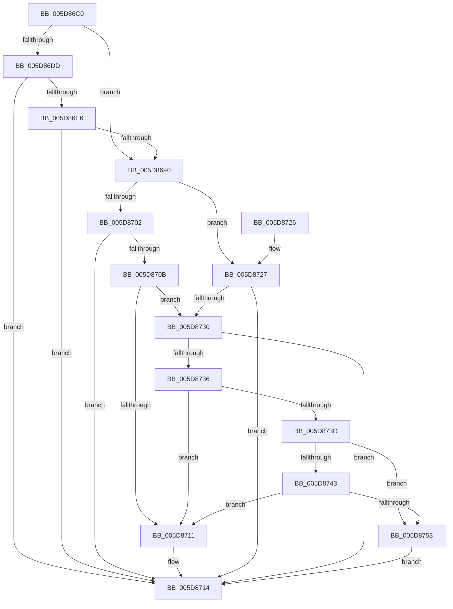

# PpmHeteroHgsCpuSupportedForContainment

- RVA: `0x005D86C0`–`0x005D875F` (길이 `159` bytes)
- VA: `0x00000001405D86C0`
- 실행 섹션: `.text`
- PDB 이름 있음: `예`; PDB Function 태그: `아니요`
- unwind 정보 RVA: `0x000CCC84`
- 디코드: `47`개 명령, `159/159` bytes 표시
- 미해석 바이트: `0` (있으면 어셈블리에 `.byte`로 보존)

> 이 문서는 커널 이미지의 기계어와 PDB 기호를 분석해 생성했습니다. 4번과 5번은 함수 원형과 자료형을 바이너리 사용 방식에서 추정한 C 해석이며 원본 소스 복구 결과는 아닙니다.

## 1. Dependencies

- 직접 호출 지점: **3**; 고유 호출 대상: **3**
- 직접 호출자로 확인된 함수: **1**
- RIP 상대 이미지 참조: **1**

### Outgoing calls
- `0x005D86D1` → [Feature_PpmParkEx__private_IsEnabledNoReportingNoInline](../4F/Feature_PpmParkEx__private_IsEnabledNoReportingNoInline_function_004F40E0.md) (function, `0x004F40E0`)
- `0x005D86E6` → [KeQueryActiveNodeCount](../5B/KeQueryActiveNodeCount_function_005BBD10.md) (function, `0x005BBD10`)
- `0x005D86F9` → [Feature_WpsExtendedFamilyContainment__private_IsEnabledDeviceUsageNoInline](Feature_WpsExtendedFamilyContainment__private_IsEnabledDeviceUsageNoInline_function_005D8618.md) (function, `0x005D8618`)

### Direct callers
- [PpmHeteroHgsDetectContainmentPresence](PpmHeteroHgsDetectContainmentPresence_function_005D8768.md) at `0x005D87FE`

### Static image references
- `0x005D86DD` → RVA `0x00FC5018` (`ALMOSTRO`; read)

## 2. Other-region calls and transfers

- 다른 실행 섹션으로 향하는 call: **0**
- 별도 외부 분기/꼬리 이동을 확인하지 못했습니다.

## 3. Assembly (complete function range)

```asm
005D86C0  48 89 5C 24 08                  mov qword ptr [rsp + 8], rbx
005D86C5  48 89 74 24 10                  mov qword ptr [rsp + 0x10], rsi
005D86CA  57                              push rdi
005D86CB  48 83 EC 20                     sub rsp, 0x20
005D86CF  33 DB                           xor ebx, ebx
005D86D1  E8 0A BA F1 FF                  call 0x1404f40e0
005D86D6  8D 73 01                        lea esi, [rbx + 1]
005D86D9  85 C0                           test eax, eax
005D86DB  74 13                           je 0x1405d86f0
005D86DD  66 39 35 34 C9 9E 00            cmp word ptr [rip + 0x9ec934], si
005D86E4  77 2E                           ja 0x1405d8714
005D86E6  E8 25 36 FE FF                  call 0x1405bbd10
005D86EB  66 3B C6                        cmp ax, si
005D86EE  77 24                           ja 0x1405d8714
005D86F0  65 48 8B 3C 25 20 00 00 00      mov rdi, qword ptr gs:[0x20]
005D86F9  E8 1A FF FF FF                  call 0x1405d8618
005D86FE  85 C0                           test eax, eax
005D8700  74 25                           je 0x1405d8727
005D8702  80 BF 8D 00 00 00 02            cmp byte ptr [rdi + 0x8d], 2
005D8709  75 09                           jne 0x1405d8714
005D870B  80 7F 40 0F                     cmp byte ptr [rdi + 0x40], 0xf
005D870F  7E 1F                           jle 0x1405d8730
005D8711  40 8A DE                        mov bl, sil
005D8714  48 8B 74 24 38                  mov rsi, qword ptr [rsp + 0x38]
005D8719  8A C3                           mov al, bl
005D871B  48 8B 5C 24 30                  mov rbx, qword ptr [rsp + 0x30]
005D8720  48 83 C4 20                     add rsp, 0x20
005D8724  5F                              pop rdi
005D8725  C3                              ret
005D8726  CC                              int3
005D8727  80 BF 8D 00 00 00 02            cmp byte ptr [rdi + 0x8d], 2
005D872E  75 E4                           jne 0x1405d8714
005D8730  80 7F 40 06                     cmp byte ptr [rdi + 0x40], 6
005D8734  75 DE                           jne 0x1405d8714
005D8736  8A 47 43                        mov al, byte ptr [rdi + 0x43]
005D8739  3C AA                           cmp al, 0xaa
005D873B  74 D4                           je 0x1405d8711
005D873D  04 54                           add al, 0x54
005D873F  3C 21                           cmp al, 0x21
005D8741  77 10                           ja 0x1405d8753
005D8743  48 B9 01 02 03 06 03 00 00 00   movabs rcx, 0x306030201
005D874D  48 0F A3 C1                     bt rcx, rax
005D8751  72 BE                           jb 0x1405d8711
005D8753  80 7F 43 D5                     cmp byte ptr [rdi + 0x43], 0xd5
005D8757  0F B6 DB                        movzx ebx, bl
005D875A  0F 44 DE                        cmove ebx, esi
005D875D  EB B5                           jmp 0x1405d8714
```

## 4. C-style interpretation (structured pseudocode)

```c
__int64 __fastcall PpmHeteroHgsCpuSupportedForContainment(void)
{
    __int64 result;
    __int64 v_rbx;
    __int64 v_rsp;
    unsigned __int64 v_stack_p10;
    unsigned __int64 v_stack_p8;

    v_stack_p8 = v_rbx;
    v_stack_p10 = v_rsi;
    v_rsp = (v_rsp) - (32);
    v_rbx = 0;
    result = Feature_PpmParkEx__private_IsEnabledNoReportingNoInline(a1, a2, a3, a4);
    if ((unsigned int)(result) == 0) goto loc_005D86F0;
    if ((*(unsigned __int16 *)(v_rip + 10406196)) > ((unsigned __int16)(v_rbx + 1))) goto loc_005D8714;
    result = KeQueryActiveNodeCount(a1, a2, a3, a4);
    if (((unsigned __int16)(result)) > ((unsigned __int16)(v_rbx + 1))) goto loc_005D8714;
loc_005D86F0:
    result = Feature_WpsExtendedFamilyContainment__private_IsEnabledDeviceUsageNoInline(a1, a2, a3, a4);
    if ((unsigned int)(result) == 0) goto loc_005D8727;
    if ((*(unsigned __int8 *)(*(unsigned __int64 *)(gs_base + (0 + 32)) + 141)) != 2) goto loc_005D8714;
    if ((*(unsigned __int8 *)(*(unsigned __int64 *)(gs_base + (0 + 32)) + 64)) <= 15) goto loc_005D8730;
loc_005D8711:
loc_005D8714:
    v_rsp = (v_rsp) + (32);
    return (unsigned __int8)((unsigned __int8)(v_rbx + 1));
loc_005D8727:
    if ((*(unsigned __int8 *)(*(unsigned __int64 *)(gs_base + (0 + 32)) + 141)) != 2) goto loc_005D8714;
loc_005D8730:
    if ((*(unsigned __int8 *)(*(unsigned __int64 *)(gs_base + (0 + 32)) + 64)) != 6) goto loc_005D8714;
    if (((unsigned __int8)(*(unsigned __int8 *)(*(unsigned __int64 *)(gs_base + (0 + 32)) + 67))) == 170) goto loc_005D8711;
    result = (unsigned __int8)((*(unsigned __int8 *)(*(unsigned __int64 *)(gs_base + (0 + 32)) + 67)) + (84));
    if (((unsigned __int8)(result)) > 33) goto loc_005D8753;
    if (((unsigned __int8)(result)) < 33) goto loc_005D8711;
loc_005D8753:
    v_rbx = (unsigned __int8)(v_stack_p8);
    if ((*(unsigned __int8 *)(*(unsigned __int64 *)(gs_base + (0 + 32)) + 67)) == 213) { v_rbx = (unsigned int)(v_stack_p10); }
    goto loc_005D8714;
}
```

## 5. (Beta) C Style

```c
void PpmHeteroHgsCpuSupportedForContainment(void)
{
    int64_t result;
    int64_t local_rbx;
    int64_t local_rsp;
    uint64_t v_stack_p10;
    uint64_t v_stack_p8;

    v_stack_p8 = local_rbx;
    v_stack_p10 = local_rsi;
    local_rsp = (local_rsp) - (32);
    local_rbx = 0;
    result = Feature_PpmParkEx__private_IsEnabledNoReportingNoInline(a1, a2, a3, a4);
    if ((uint32_t)(result) == 0) goto loc_005D86F0;
    if ((*(uint16_t *)(v_rip + 0x9EC934)) > ((uint16_t)(local_rbx + 1))) goto loc_005D8714;
    result = KeQueryActiveNodeCount(a1, a2, a3, a4);
    if (((uint16_t)(result)) > ((uint16_t)(local_rbx + 1))) goto loc_005D8714;
loc_005D86F0:
    result = Feature_WpsExtendedFamilyContainment__private_IsEnabledDeviceUsageNoInline(a1, a2, a3, a4);
    if ((uint32_t)(result) == 0) goto loc_005D8727;
    if ((*(uint8_t *)(*(uint64_t *)(gs_base + (0 + 0x20)) + 0x8D)) != 2) goto loc_005D8714;
    if ((*(uint8_t *)(*(uint64_t *)(gs_base + (0 + 0x20)) + 0x40)) <= 15) goto loc_005D8730;
loc_005D8711:
loc_005D8714:
    local_rsp = (local_rsp) + (32);
    return (uint8_t)((uint8_t)(local_rbx + 1));
loc_005D8727:
    if ((*(uint8_t *)(*(uint64_t *)(gs_base + (0 + 0x20)) + 0x8D)) != 2) goto loc_005D8714;
loc_005D8730:
    if ((*(uint8_t *)(*(uint64_t *)(gs_base + (0 + 0x20)) + 0x40)) != 6) goto loc_005D8714;
    if (((uint8_t)(*(uint8_t *)(*(uint64_t *)(gs_base + (0 + 0x20)) + 0x43))) == 170) goto loc_005D8711;
    result = (uint8_t)((*(uint8_t *)(*(uint64_t *)(gs_base + (0 + 0x20)) + 0x43)) + (84));
    if (((uint8_t)(result)) > 33) goto loc_005D8753;
    if (((uint8_t)(result)) < 33) goto loc_005D8711;
loc_005D8753:
    local_rbx = (uint8_t)(v_stack_p8);
    if ((*(uint8_t *)(*(uint64_t *)(gs_base + (0 + 0x20)) + 0x43)) == 213) { local_rbx = (uint32_t)(v_stack_p10); }
    goto loc_005D8714;
}
```

## 6. Execution-region graph

[열기: 2D/3D 그래프와 함수 탐색 컨트롤 패널](../../../control-panel.html?section=text&rva=0x005D86C0&view=graph)

- 2D 그래프는 위에서 아래로 흐르고, 3D 그래프는 빈 공간을 드래그해 회전합니다. Shift+드래그는 이동, 휠은 확대·축소, 함수 노드 선택은 대상 보고서 이동입니다.

### Static fallback


