# PpmHeteroHgsDetectContainmentPresence

- RVA: `0x005D8768`–`0x005D8B23` (길이 `955` bytes)
- VA: `0x00000001405D8768`
- 실행 섹션: `.text`
- PDB 이름 있음: `예`; PDB Function 태그: `아니요`
- unwind 정보 RVA: `0x000B146C`
- 디코드: `237`개 명령, `955/955` bytes 표시
- 미해석 바이트: `0` (있으면 어셈블리에 `.byte`로 보존)

> 이 문서는 커널 이미지의 기계어와 PDB 기호를 분석해 생성했습니다. 4번과 5번은 함수 원형과 자료형을 바이너리 사용 방식에서 추정한 C 해석이며 원본 소스 복구 결과는 아닙니다.

## 1. Dependencies

- 직접 호출 지점: **24**; 고유 호출 대상: **10**
- 직접 호출자로 확인된 함수: **2**
- RIP 상대 이미지 참조: **6**

### Outgoing calls
- `0x005D87C5` → [memset](../6C/memset_function_006C6C40.md) (function, `0x006C6C40`)
- `0x005D87D7` → [memset](../6C/memset_function_006C6C40.md) (function, `0x006C6C40`)
- `0x005D87FE` → [PpmHeteroHgsCpuSupportedForContainment](PpmHeteroHgsCpuSupportedForContainment_function_005D86C0.md) (function, `0x005D86C0`)
- `0x005D8827` → [memset](../6C/memset_function_006C6C40.md) (function, `0x006C6C40`)
- `0x005D882C` → [Feature_PpmParkEx__private_IsEnabledNoReportingNoInline](../4F/Feature_PpmParkEx__private_IsEnabledNoReportingNoInline_function_004F40E0.md) (function, `0x004F40E0`)
- `0x005D8849` → [KeAddGroupAffinityEx](../25/KeAddGroupAffinityEx_function_0025B6C0.md) (function, `0x0025B6C0`)
- `0x005D885D` → [KeGetTopologySiblingAffinityForProcessor](../4A/KeGetTopologySiblingAffinityForProcessor_function_004A946C.md) (function, `0x004A946C`)
- `0x005D886E` → [KeIsEqualAffinityEx](../30/KeIsEqualAffinityEx_function_00305230.md) (function, `0x00305230`)
- `0x005D88A7` → [KeEnumerateNextProcessor](../41/KeEnumerateNextProcessor_function_00415480.md) (function, `0x00415480`)
- `0x005D88BC` → [KeGetPrcb](../2D/KeGetPrcb_function_002D85D0.md) (function, `0x002D85D0`)
- `0x005D88E7` → [KeEnumerateNextProcessor](../41/KeEnumerateNextProcessor_function_00415480.md) (function, `0x00415480`)
- `0x005D892C` → [KeIsEqualAffinityEx](../30/KeIsEqualAffinityEx_function_00305230.md) (function, `0x00305230`)
- `0x005D8956` → [KeGetPrcb](../2D/KeGetPrcb_function_002D85D0.md) (function, `0x002D85D0`)
- `0x005D896E` → [KeEnumerateNextProcessor](../41/KeEnumerateNextProcessor_function_00415480.md) (function, `0x00415480`)
- `0x005D898B` → [memset](../6C/memset_function_006C6C40.md) (function, `0x006C6C40`)
- `0x005D89A5` → [KiSubtractAffinityEx](../2D/KiSubtractAffinityEx_function_002D61E8.md) (function, `0x002D61E8`)
- `0x005D89D9` → [KeEnumerateNextProcessor](../41/KeEnumerateNextProcessor_function_00415480.md) (function, `0x00415480`)
- `0x005D89EE` → [KeGetPrcb](../2D/KeGetPrcb_function_002D85D0.md) (function, `0x002D85D0`)
- `0x005D8A16` → [KeEnumerateNextProcessor](../41/KeEnumerateNextProcessor_function_00415480.md) (function, `0x00415480`)
- `0x005D8A55` → [KeIsEqualAffinityEx](../30/KeIsEqualAffinityEx_function_00305230.md) (function, `0x00305230`)
- `0x005D8A7D` → [KeGetPrcb](../2D/KeGetPrcb_function_002D85D0.md) (function, `0x002D85D0`)
- `0x005D8A92` → [KeEnumerateNextProcessor](../41/KeEnumerateNextProcessor_function_00415480.md) (function, `0x00415480`)
- `0x005D8AB3` → [KeGetPrcb](../2D/KeGetPrcb_function_002D85D0.md) (function, `0x002D85D0`)
- `0x005D8AFC` → [_security_check_cookie](../6A/_security_check_cookie_function_006AC640.md) (function, `0x006AC640`)

### Direct callers
- [PpmHeteroUpdateHgsConfiguration](../3B/PpmHeteroUpdateHgsConfiguration_function_003BF344.md) at `0x003BFC96`
- [PoInitSystem](../../init/C7/PoInitSystem_function_00C72358.md) at `0x00C72DC4`

### Static image references
- `0x005D878E` → RVA `0x00E0A740` (`.data`; read)
- `0x005D87DC` → RVA `0x00FC6A96` (`ALMOSTRO`; read)
- `0x005D87E9` → RVA `0x00FC6A80` (`ALMOSTRO`; read)
- `0x005D88FC` → RVA `0x00FC5184` (`ALMOSTRO`; read)
- `0x005D8AE0` → RVA `0x00FC501C` (`ALMOSTRO`; read)
- `0x005D8AEC` → RVA `0x00FC501C` (`ALMOSTRO`; write)

## 2. Other-region calls and transfers

- 다른 실행 섹션으로 향하는 call: **0**
- 별도 외부 분기/꼬리 이동을 확인하지 못했습니다.

## 3. Assembly (complete function range)

```asm
005D8768  48 8B C4                        mov rax, rsp
005D876B  48 89 58 08                     mov qword ptr [rax + 8], rbx
005D876F  48 89 70 10                     mov qword ptr [rax + 0x10], rsi
005D8773  48 89 78 18                     mov qword ptr [rax + 0x18], rdi
005D8777  55                              push rbp
005D8778  41 54                           push r12
005D877A  41 55                           push r13
005D877C  41 56                           push r14
005D877E  41 57                           push r15
005D8780  48 8D A8 58 FE FF FF            lea rbp, [rax - 0x1a8]
005D8787  48 81 EC 80 02 00 00            sub rsp, 0x280
005D878E  48 8B 05 AB 1F 83 00            mov rax, qword ptr [rip + 0x831fab]
005D8795  48 33 C4                        xor rax, rsp
005D8798  48 89 85 70 01 00 00            mov qword ptr [rbp + 0x170], rax
005D879F  40 8A FA                        mov dil, dl
005D87A2  88 54 24 24                     mov byte ptr [rsp + 0x24], dl
005D87A6  48 89 4C 24 48                  mov qword ptr [rsp + 0x48], rcx
005D87AB  33 F6                           xor esi, esi
005D87AD  BB 00 01 00 00                  mov ebx, 0x100
005D87B2  89 74 24 3A                     mov dword ptr [rsp + 0x3a], esi
005D87B6  44 8B C3                        mov r8d, ebx
005D87B9  66 89 74 24 3E                  mov word ptr [rsp + 0x3e], si
005D87BE  33 D2                           xor edx, edx
005D87C0  48 8D 4C 24 58                  lea rcx, [rsp + 0x58]
005D87C5  E8 76 E4 0E 00                  call 0x1406c6c40
005D87CA  44 8B C3                        mov r8d, ebx
005D87CD  89 74 24 20                     mov dword ptr [rsp + 0x20], esi
005D87D1  33 D2                           xor edx, edx
005D87D3  48 8D 4D 68                     lea rcx, [rbp + 0x68]
005D87D7  E8 64 E4 0E 00                  call 0x1406c6c40
005D87DC  40 38 35 B3 E2 9E 00            cmp byte ptr [rip + 0x9ee2b3], sil
005D87E3  0F 84 09 03 00 00               je 0x1405d8af2
005D87E9  8B 05 91 E2 9E 00               mov eax, dword ptr [rip + 0x9ee291]
005D87EF  89 44 24 40                     mov dword ptr [rsp + 0x40], eax
005D87F3  3D 00 08 00 00                  cmp eax, 0x800
005D87F8  0F 87 F4 02 00 00               ja 0x1405d8af2
005D87FE  E8 BD FE FF FF                  call 0x1405d86c0
005D8803  84 C0                           test al, al
005D8805  0F 84 E7 02 00 00               je 0x1405d8af2
005D880B  65 4C 8B 34 25 20 00 00 00      mov r14, qword ptr gs:[0x20]
005D8814  48 8D 4C 24 58                  lea rcx, [rsp + 0x58]
005D8819  44 8B C3                        mov r8d, ebx
005D881C  48 C7 44 24 50 01 00 20 00      mov qword ptr [rsp + 0x50], 0x200001
005D8825  33 D2                           xor edx, edx
005D8827  E8 14 E4 0E 00                  call 0x1406c6c40
005D882C  E8 AF B8 F1 FF                  call 0x1404f40e0
005D8831  85 C0                           test eax, eax
005D8833  75 1B                           jne 0x1405d8850
005D8835  41 0F B6 96 D0 00 00 00         movzx edx, byte ptr [r14 + 0xd0]
005D883D  48 8D 4C 24 50                  lea rcx, [rsp + 0x50]
005D8842  4D 8B 86 70 8E 00 00            mov r8, qword ptr [r14 + 0x8e70]
005D8849  E8 72 2E C8 FF                  call 0x14025b6c0
005D884E  EB 12                           jmp 0x1405d8862
005D8850  4C 8D 44 24 50                  lea r8, [rsp + 0x50]
005D8855  BA 05 00 00 00                  mov edx, 5
005D885A  49 8B CE                        mov rcx, r14
005D885D  E8 0A 0C ED FF                  call 0x1404a946c
005D8862  49 8D 96 10 8C 00 00            lea rdx, [r14 + 0x8c10]
005D8869  48 8D 4C 24 50                  lea rcx, [rsp + 0x50]
005D886E  E8 BD C9 D2 FF                  call 0x140305230
005D8873  85 C0                           test eax, eax
005D8875  0F 85 77 02 00 00               jne 0x1405d8af2
005D887B  48 8B 44 24 58                  mov rax, qword ptr [rsp + 0x58]
005D8880  48 8D 54 24 28                  lea rdx, [rsp + 0x28]
005D8885  48 89 44 24 30                  mov qword ptr [rsp + 0x30], rax
005D888A  48 8D 4C 24 20                  lea rcx, [rsp + 0x20]
005D888F  48 8D 44 24 50                  lea rax, [rsp + 0x50]
005D8894  66 89 74 24 38                  mov word ptr [rsp + 0x38], si
005D8899  41 B4 FF                        mov r12b, 0xff
005D889C  48 89 44 24 28                  mov qword ptr [rsp + 0x28], rax
005D88A1  44 8A FE                        mov r15b, sil
005D88A4  45 8A EC                        mov r13b, r12b
005D88A7  E8 D4 CB E3 FF                  call 0x140415480
005D88AC  85 C0                           test eax, eax
005D88AE  75 45                           jne 0x1405d88f5
005D88B0  8B 4C 24 20                     mov ecx, dword ptr [rsp + 0x20]
005D88B4  41 0F B6 FD                     movzx edi, r13b
005D88B8  41 0F B6 DF                     movzx ebx, r15b
005D88BC  E8 0F FD CF FF                  call 0x1402d85d0
005D88C1  48 8D 54 24 28                  lea rdx, [rsp + 0x28]
005D88C6  4C 8B F0                        mov r14, rax
005D88C9  48 8D 4C 24 20                  lea rcx, [rsp + 0x20]
005D88CE  44 0F B6 A8 08 8A 00 00         movzx r13d, byte ptr [rax + 0x8a08]
005D88D6  41 3A DD                        cmp bl, r13b
005D88D9  45 8B FD                        mov r15d, r13d
005D88DC  44 0F 47 FB                     cmova r15d, ebx
005D88E0  41 3A FD                        cmp dil, r13b
005D88E3  44 0F 42 EF                     cmovb r13d, edi
005D88E7  E8 94 CB E3 FF                  call 0x140415480
005D88EC  85 C0                           test eax, eax
005D88EE  74 C0                           je 0x1405d88b0
005D88F0  40 8A 7C 24 24                  mov dil, byte ptr [rsp + 0x24]
005D88F5  8B DE                           mov ebx, esi
005D88F7  45 3A FD                        cmp r15b, r13b
005D88FA  75 0D                           jne 0x1405d8909
005D88FC  39 35 82 C8 9E 00               cmp dword ptr [rip + 0x9ec882], esi
005D8902  74 10                           je 0x1405d8914
005D8904  45 84 FF                        test r15b, r15b
005D8907  74 0B                           je 0x1405d8914
005D8909  41 BF 01 00 00 00               mov r15d, 1
005D890F  41 8B DF                        mov ebx, r15d
005D8912  EB 06                           jmp 0x1405d891a
005D8914  41 BF 01 00 00 00               mov r15d, 1
005D891A  4C 8B 6C 24 48                  mov r13, qword ptr [rsp + 0x48]
005D891F  40 84 FF                        test dil, dil
005D8922  74 13                           je 0x1405d8937
005D8924  49 8B D5                        mov rdx, r13
005D8927  48 8D 4C 24 50                  lea rcx, [rsp + 0x50]
005D892C  E8 FF C8 D2 FF                  call 0x140305230
005D8931  85 C0                           test eax, eax
005D8933  41 0F 44 DF                     cmove ebx, r15d
005D8937  48 8B 44 24 58                  mov rax, qword ptr [rsp + 0x58]
005D893C  48 89 44 24 30                  mov qword ptr [rsp + 0x30], rax
005D8941  48 8D 44 24 50                  lea rax, [rsp + 0x50]
005D8946  48 89 44 24 28                  mov qword ptr [rsp + 0x28], rax
005D894B  66 89 74 24 38                  mov word ptr [rsp + 0x38], si
005D8950  EB 12                           jmp 0x1405d8964
005D8952  8B 4C 24 20                     mov ecx, dword ptr [rsp + 0x20]
005D8956  E8 75 FC CF FF                  call 0x1402d85d0
005D895B  4C 8B F0                        mov r14, rax
005D895E  88 98 68 8A 00 00               mov byte ptr [rax + 0x8a68], bl
005D8964  48 8D 54 24 28                  lea rdx, [rsp + 0x28]
005D8969  48 8D 4C 24 20                  lea rcx, [rsp + 0x20]
005D896E  E8 0D CB E3 FF                  call 0x140415480
005D8973  85 C0                           test eax, eax
005D8975  74 DB                           je 0x1405d8952
005D8977  33 D2                           xor edx, edx
005D8979  48 C7 45 60 01 00 20 00         mov qword ptr [rbp + 0x60], 0x200001
005D8981  41 B8 00 01 00 00               mov r8d, 0x100
005D8987  48 8D 4D 68                     lea rcx, [rbp + 0x68]
005D898B  E8 B0 E2 0E 00                  call 0x1406c6c40
005D8990  44 0F B7 4D 62                  movzx r9d, word ptr [rbp + 0x62]
005D8995  49 8D 8E 10 8C 00 00            lea rcx, [r14 + 0x8c10]
005D899C  4C 8D 45 60                     lea r8, [rbp + 0x60]
005D89A0  48 8D 54 24 50                  lea rdx, [rsp + 0x50]
005D89A5  E8 3E D8 CF FF                  call 0x1402d61e8
005D89AA  85 C0                           test eax, eax
005D89AC  0F 84 E9 00 00 00               je 0x1405d8a9b
005D89B2  48 8B 45 68                     mov rax, qword ptr [rbp + 0x68]
005D89B6  48 8D 54 24 28                  lea rdx, [rsp + 0x28]
005D89BB  48 89 44 24 30                  mov qword ptr [rsp + 0x30], rax
005D89C0  48 8D 4C 24 20                  lea rcx, [rsp + 0x20]
005D89C5  48 8D 45 60                     lea rax, [rbp + 0x60]
005D89C9  66 89 74 24 38                  mov word ptr [rsp + 0x38], si
005D89CE  48 89 44 24 28                  mov qword ptr [rsp + 0x28], rax
005D89D3  44 8A F6                        mov r14b, sil
005D89D6  45 8A FC                        mov r15b, r12b
005D89D9  E8 A2 CA E3 FF                  call 0x140415480
005D89DE  85 C0                           test eax, eax
005D89E0  75 42                           jne 0x1405d8a24
005D89E2  8B 4C 24 20                     mov ecx, dword ptr [rsp + 0x20]
005D89E6  41 0F B6 FF                     movzx edi, r15b
005D89EA  41 0F B6 DE                     movzx ebx, r14b
005D89EE  E8 DD FB CF FF                  call 0x1402d85d0
005D89F3  48 8D 54 24 28                  lea rdx, [rsp + 0x28]
005D89F8  48 8D 4C 24 20                  lea rcx, [rsp + 0x20]
005D89FD  44 0F B6 B8 08 8A 00 00         movzx r15d, byte ptr [rax + 0x8a08]
005D8A05  41 3A DF                        cmp bl, r15b
005D8A08  45 8B F7                        mov r14d, r15d
005D8A0B  44 0F 47 F3                     cmova r14d, ebx
005D8A0F  41 3A FF                        cmp dil, r15b
005D8A12  44 0F 42 FF                     cmovb r15d, edi
005D8A16  E8 65 CA E3 FF                  call 0x140415480
005D8A1B  85 C0                           test eax, eax
005D8A1D  74 C3                           je 0x1405d89e2
005D8A1F  40 8A 7C 24 24                  mov dil, byte ptr [rsp + 0x24]
005D8A24  8B DE                           mov ebx, esi
005D8A26  45 3A F7                        cmp r14b, r15b
005D8A29  75 0D                           jne 0x1405d8a38
005D8A2B  39 35 53 C7 9E 00               cmp dword ptr [rip + 0x9ec753], esi
005D8A31  74 10                           je 0x1405d8a43
005D8A33  45 84 F6                        test r14b, r14b
005D8A36  74 0B                           je 0x1405d8a43
005D8A38  41 BE 01 00 00 00               mov r14d, 1
005D8A3E  41 8B DE                        mov ebx, r14d
005D8A41  EB 06                           jmp 0x1405d8a49
005D8A43  41 BE 01 00 00 00               mov r14d, 1
005D8A49  40 84 FF                        test dil, dil
005D8A4C  74 12                           je 0x1405d8a60
005D8A4E  49 8B D5                        mov rdx, r13
005D8A51  48 8D 4D 60                     lea rcx, [rbp + 0x60]
005D8A55  E8 D6 C7 D2 FF                  call 0x140305230
005D8A5A  85 C0                           test eax, eax
005D8A5C  41 0F 44 DE                     cmove ebx, r14d
005D8A60  48 8B 45 68                     mov rax, qword ptr [rbp + 0x68]
005D8A64  48 89 44 24 30                  mov qword ptr [rsp + 0x30], rax
005D8A69  48 8D 45 60                     lea rax, [rbp + 0x60]
005D8A6D  48 89 44 24 28                  mov qword ptr [rsp + 0x28], rax
005D8A72  66 89 74 24 38                  mov word ptr [rsp + 0x38], si
005D8A77  EB 0F                           jmp 0x1405d8a88
005D8A79  8B 4C 24 20                     mov ecx, dword ptr [rsp + 0x20]
005D8A7D  E8 4E FB CF FF                  call 0x1402d85d0
005D8A82  88 98 68 8A 00 00               mov byte ptr [rax + 0x8a68], bl
005D8A88  48 8D 54 24 28                  lea rdx, [rsp + 0x28]
005D8A8D  48 8D 4C 24 20                  lea rcx, [rsp + 0x20]
005D8A92  E8 E9 C9 E3 FF                  call 0x140415480
005D8A97  85 C0                           test eax, eax
005D8A99  74 DE                           je 0x1405d8a79
005D8A9B  44 8B 7C 24 40                  mov r15d, dword ptr [rsp + 0x40]
005D8AA0  44 8B F6                        mov r14d, esi
005D8AA3  45 85 FF                        test r15d, r15d
005D8AA6  74 38                           je 0x1405d8ae0
005D8AA8  41 8B CE                        mov ecx, r14d
005D8AAB  41 0F B6 FC                     movzx edi, r12b
005D8AAF  40 0F B6 DE                     movzx ebx, sil
005D8AB3  E8 18 FB CF FF                  call 0x1402d85d0
005D8AB8  44 0F B6 A0 68 8A 00 00         movzx r12d, byte ptr [rax + 0x8a68]
005D8AC0  41 3A DC                        cmp bl, r12b
005D8AC3  41 8B C4                        mov eax, r12d
005D8AC6  0F 47 C3                        cmova eax, ebx
005D8AC9  41 3A FC                        cmp dil, r12b
005D8ACC  40 8A F0                        mov sil, al
005D8ACF  44 0F 42 E7                     cmovb r12d, edi
005D8AD3  41 FF C6                        inc r14d
005D8AD6  45 3B F7                        cmp r14d, r15d
005D8AD9  72 CD                           jb 0x1405d8aa8
005D8ADB  41 3A C4                        cmp al, r12b
005D8ADE  74 12                           je 0x1405d8af2
005D8AE0  8B 05 36 C5 9E 00               mov eax, dword ptr [rip + 0x9ec536]
005D8AE6  83 E0 FE                        and eax, 0xfffffffe
005D8AE9  83 C8 02                        or eax, 2
005D8AEC  89 05 2A C5 9E 00               mov dword ptr [rip + 0x9ec52a], eax
005D8AF2  48 8B 8D 70 01 00 00            mov rcx, qword ptr [rbp + 0x170]
005D8AF9  48 33 CC                        xor rcx, rsp
005D8AFC  E8 3F 3B 0D 00                  call 0x1406ac640
005D8B01  4C 8D 9C 24 80 02 00 00         lea r11, [rsp + 0x280]
005D8B09  49 8B 5B 30                     mov rbx, qword ptr [r11 + 0x30]
005D8B0D  49 8B 73 38                     mov rsi, qword ptr [r11 + 0x38]
005D8B11  49 8B 7B 40                     mov rdi, qword ptr [r11 + 0x40]
005D8B15  49 8B E3                        mov rsp, r11
005D8B18  41 5F                           pop r15
005D8B1A  41 5E                           pop r14
005D8B1C  41 5D                           pop r13
005D8B1E  41 5C                           pop r12
005D8B20  5D                              pop rbp
005D8B21  C3                              ret
005D8B22  CC                              int3
```

## 4. C-style interpretation (structured pseudocode)

```c
__int64 __fastcall PpmHeteroHgsDetectContainmentPresence(__int64 a1, int a2)
{
    __int64 result;
    __int64 v_r12;
    __int64 v_r13;
    __int64 v_r14;
    __int64 v_r15;
    __int64 v_rbx;
    __int64 v_rsi;
    __int64 v_rsp;
    unsigned __int64 v_stack_m250;
    unsigned __int64 v_stack_m258;
    unsigned __int64 v_stack_m260;
    unsigned int v_stack_m268;
    unsigned __int16 v_stack_m26A;
    unsigned int v_stack_m26E;
    unsigned __int16 v_stack_m270;
    unsigned __int64 v_stack_m278;
    unsigned __int64 v_stack_m28;
    unsigned __int64 v_stack_m280;
    unsigned __int8 v_stack_m284;
    unsigned int v_stack_m288;

    *(unsigned __int64 *)(v_rsp + 8) = v_rbx;
    *(unsigned __int64 *)(v_rsp + 16) = v_rsi;
    *(unsigned __int64 *)(v_rsp + 24) = v_rdi;
    v_rsp = (v_rsp) - (640);
    result = (*(unsigned __int64 *)(v_rip + 8593323)) ^ (v_rsp);
    *(unsigned __int64 *)(v_rsp - 424 + 368) = result;
    v_stack_m284 = (unsigned __int8)(a2);
    v_stack_m260 = a1;
    v_rsi = 0;
    v_stack_m26E = 0;
    v_stack_m26A = 0;
    a2 = 0;
    result = memset(v_stack_m250, a2, 256, a4);
    v_stack_m288 = 0;
    a2 = 0;
    result = memset(v_rsp - 424 + 104, a2, 256, a4);
    if ((*(unsigned __int8 *)(v_rip + 10412723)) == 0) goto loc_005D8AF2;
    v_stack_m268 = (unsigned int)((unsigned int)(*(unsigned int *)(v_rip + 10412689)));
    if (((unsigned int)((unsigned int)(*(unsigned int *)(v_rip + 10412689)))) > 0x800ULL) goto loc_005D8AF2;
    result = PpmHeteroHgsCpuSupportedForContainment(v_rsp - 424 + 104, a2, 256, a4);
    if ((unsigned __int8)(result) == 0) goto loc_005D8AF2;
    v_stack_m258 = 0x200001ULL;
    a2 = 0;
    result = memset(v_stack_m250, a2, 256, a4);
    result = Feature_PpmParkEx__private_IsEnabledNoReportingNoInline(v_stack_m250, a2, 256, a4);
    if ((unsigned int)(result) != 0) goto loc_005D8850;
    result = KeAddGroupAffinityEx(v_stack_m258, *(unsigned __int8 *)(*(unsigned __int64 *)(gs_base + (0 + 32)) + 208), *(unsigned __int64 *)(*(unsigned __int64 *)(gs_base + (0 + 32)) + 36464), a4);
    goto loc_005D8862;
loc_005D8850:
    result = KeGetTopologySiblingAffinityForProcessor(*(unsigned __int64 *)(gs_base + (0 + 32)), 5, v_stack_m258, a4);
loc_005D8862:
    result = KeIsEqualAffinityEx(v_stack_m258, *(unsigned __int64 *)(gs_base + (0 + 32)) + 35856, v_stack_m258, a4);
    if ((unsigned int)(result) != 0) goto loc_005D8AF2;
    v_stack_m278 = v_stack_m250;
    v_stack_m270 = 0;
    v_stack_m280 = v_stack_m258;
    result = KeEnumerateNextProcessor(v_stack_m288, v_stack_m280, v_stack_m258, a4);
    if ((unsigned int)(result) != 0) goto loc_005D88F5;
loc_005D88B0:
    result = KeGetPrcb((unsigned int)(v_stack_m288), v_stack_m280, v_stack_m258, a4);
    v_r15 = (unsigned int)((unsigned int)(*(unsigned __int8 *)(result + 35336)));
    if (0 > ((unsigned __int8)(*(unsigned __int8 *)(result + 35336)))) { v_r15 = 0; }
    v_r13 = *(unsigned __int8 *)(result + 35336);
    if (255 < ((unsigned __int8)(*(unsigned __int8 *)(result + 35336)))) { v_r13 = 255; }
    result = KeEnumerateNextProcessor(v_stack_m288, v_stack_m280, v_stack_m258, a4);
    if ((unsigned int)(result) == 0) goto loc_005D88B0;
loc_005D88F5:
    if (((unsigned __int8)(v_r15)) != ((unsigned __int8)(v_r13))) goto loc_005D8909;
    if ((*(unsigned int *)(v_rip + 10406018)) == 0) goto loc_005D8914;
    if ((unsigned __int8)(v_r15) == 0) goto loc_005D8914;
loc_005D8909:
    goto loc_005D891A;
loc_005D8914:
loc_005D891A:
    v_rbx = 1;
    if ((unsigned __int8)(v_stack_m284) != 0) {
        a2 = v_stack_m260;
        a1 = v_stack_m258;
        result = KeIsEqualAffinityEx(a1, a2, v_stack_m258, a4);
        v_rbx = 1;
        if ((unsigned int)(result) == 0) { v_rbx = 1; }
    }
    v_stack_m278 = v_stack_m250;
    v_stack_m280 = v_stack_m258;
    v_stack_m270 = 0;
    goto loc_005D8964;
loc_005D8952:
    result = KeGetPrcb((unsigned int)(v_stack_m288), a2, v_stack_m258, a4);
    *(unsigned __int8 *)(result + 35432) = (unsigned __int8)(v_rbx);
loc_005D8964:
    result = KeEnumerateNextProcessor(v_stack_m288, v_stack_m280, v_stack_m258, a4);
    if ((unsigned int)(result) == 0) goto loc_005D8952;
    a2 = 0;
    *(unsigned __int64 *)(v_rsp - 424 + 96) = 0x200001ULL;
    result = memset(v_rsp - 424 + 104, a2, 256, a4);
    result = KiSubtractAffinityEx(result + 35856, v_stack_m258, v_rsp - 424 + 96, *(unsigned __int16 *)(v_rsp - 424 + 98));
    if ((unsigned int)(result) == 0) goto loc_005D8A9B;
    v_stack_m278 = *(unsigned __int64 *)(v_rsp - 424 + 104);
    v_stack_m270 = 0;
    v_stack_m280 = v_rsp - 424 + 96;
    result = KeEnumerateNextProcessor(v_stack_m288, v_stack_m280, v_rsp - 424 + 96, *(unsigned __int16 *)(v_rsp - 424 + 98));
    if ((unsigned int)(result) != 0) goto loc_005D8A24;
loc_005D89E2:
    result = KeGetPrcb((unsigned int)(v_stack_m288), v_stack_m280, v_rsp - 424 + 96, *(unsigned __int16 *)(v_rsp - 424 + 98));
    v_r14 = (unsigned int)((unsigned int)(*(unsigned __int8 *)(result + 35336)));
    if (0 > ((unsigned __int8)(*(unsigned __int8 *)(result + 35336)))) { v_r14 = 0; }
    v_r15 = *(unsigned __int8 *)(result + 35336);
    if (255 < ((unsigned __int8)(*(unsigned __int8 *)(result + 35336)))) { v_r15 = 255; }
    result = KeEnumerateNextProcessor(v_stack_m288, v_stack_m280, v_rsp - 424 + 96, *(unsigned __int16 *)(v_rsp - 424 + 98));
    if ((unsigned int)(result) == 0) goto loc_005D89E2;
loc_005D8A24:
    if (((unsigned __int8)(v_r14)) != ((unsigned __int8)(v_r15))) goto loc_005D8A38;
    if ((*(unsigned int *)(v_rip + 10405715)) == 0) goto loc_005D8A43;
    if ((unsigned __int8)(v_r14) == 0) goto loc_005D8A43;
loc_005D8A38:
    goto loc_005D8A49;
loc_005D8A43:
loc_005D8A49:
    v_rbx = 1;
    if ((unsigned __int8)(v_stack_m284) != 0) {
        a2 = v_stack_m260;
        a1 = v_rsp - 424 + 96;
        result = KeIsEqualAffinityEx(a1, a2, v_rsp - 424 + 96, *(unsigned __int16 *)(v_rsp - 424 + 98));
        v_rbx = 1;
        if ((unsigned int)(result) == 0) { v_rbx = 1; }
    }
    v_stack_m278 = *(unsigned __int64 *)(v_rsp - 424 + 104);
    v_stack_m280 = v_rsp - 424 + 96;
    v_stack_m270 = 0;
    goto loc_005D8A88;
loc_005D8A79:
    result = KeGetPrcb((unsigned int)(v_stack_m288), a2, v_rsp - 424 + 96, *(unsigned __int16 *)(v_rsp - 424 + 98));
    *(unsigned __int8 *)(result + 35432) = (unsigned __int8)(v_rbx);
loc_005D8A88:
    result = KeEnumerateNextProcessor(v_stack_m288, v_stack_m280, v_rsp - 424 + 96, *(unsigned __int16 *)(v_rsp - 424 + 98));
    if ((unsigned int)(result) == 0) goto loc_005D8A79;
loc_005D8A9B:
    if ((unsigned int)((unsigned int)(v_stack_m268)) == 0) goto loc_005D8AE0;
loc_005D8AA8:
    result = KeGetPrcb(0, v_stack_m280, v_rsp - 424 + 96, *(unsigned __int16 *)(v_rsp - 424 + 98));
    result = (unsigned int)((unsigned int)(*(unsigned __int8 *)(result + 35432)));
    if (0 > ((unsigned __int8)(*(unsigned __int8 *)(result + 35432)))) { result = 0; }
    v_r12 = *(unsigned __int8 *)(result + 35432);
    if (255 < ((unsigned __int8)(*(unsigned __int8 *)(result + 35432)))) { v_r12 = 255; }
    v_r14 = (unsigned int)((0) + 1);
    if (((unsigned int)(v_r14)) < ((unsigned int)((unsigned int)(v_stack_m268)))) goto loc_005D8AA8;
    if (((unsigned __int8)(result)) != ((unsigned __int8)(v_r12))) {
        result = *(unsigned int *)(v_rip + 10405174);
        result = (unsigned int)((result) & (0xFFFFFFFEULL));
        result = (unsigned int)((result) | (2));
        *(unsigned int *)(v_rip + 10405162) = (unsigned int)(result);
    }
    a1 = (*(unsigned __int64 *)(v_rsp - 424 + 368)) ^ (v_rsp);
    result = _security_check_cookie(a1, v_stack_m280, v_rsp - 424 + 96, *(unsigned __int16 *)(v_rsp - 424 + 98));
    return result;
}
```

## 5. (Beta) C Style

```c
int64_t PpmHeteroHgsDetectContainmentPresence(int64_t Arg1, int32_t Arg2)
{
    int64_t result;
    int64_t local_r12;
    int64_t local_r13;
    int64_t local_r14;
    int64_t local_r15;
    int64_t local_rbx;
    int64_t local_rsi;
    int64_t local_rsp;
    uint64_t v_stack_m250;
    uint64_t v_stack_m258;
    uint64_t v_stack_m260;
    uint32_t v_stack_m268;
    uint16_t v_stack_m26A;
    uint32_t v_stack_m26E;
    uint16_t v_stack_m270;
    uint64_t v_stack_m278;
    uint64_t v_stack_m28;
    uint64_t v_stack_m280;
    uint8_t v_stack_m284;
    uint32_t v_stack_m288;

    *(uint64_t *)(local_rsp + 0x8) = local_rbx;
    *(uint64_t *)(local_rsp + 0x10) = local_rsi;
    *(uint64_t *)(local_rsp + 0x18) = local_rdi;
    local_rsp = (local_rsp) - (640);
    result = (*(uint64_t *)(v_rip + 0x831FAB)) ^ (local_rsp);
    *(uint64_t *)(local_rsp - 0x1A8 + 0x170) = result;
    v_stack_m284 = (uint8_t)(Arg2);
    v_stack_m260 = Arg1;
    local_rsi = 0;
    v_stack_m26E = 0;
    v_stack_m26A = 0;
    Arg2 = 0;
    result = memset(v_stack_m250, Arg2, 256, a4);
    v_stack_m288 = 0;
    Arg2 = 0;
    result = memset(local_rsp - 424 + 104, Arg2, 256, a4);
    if ((*(uint8_t *)(v_rip + 0x9EE2B3)) == 0) goto loc_005D8AF2;
    v_stack_m268 = (uint32_t)((uint32_t)(*(uint32_t *)(v_rip + 0x9EE291)));
    if (((uint32_t)((uint32_t)(*(uint32_t *)(v_rip + 0x9EE291)))) > 0x800ULL) goto loc_005D8AF2;
    result = PpmHeteroHgsCpuSupportedForContainment(local_rsp - 424 + 104, Arg2, 256, a4);
    if ((uint8_t)(result) == 0) goto loc_005D8AF2;
    v_stack_m258 = 0x200001ULL;
    Arg2 = 0;
    result = memset(v_stack_m250, Arg2, 256, a4);
    result = Feature_PpmParkEx__private_IsEnabledNoReportingNoInline(v_stack_m250, Arg2, 256, a4);
    if ((uint32_t)(result) != 0) goto loc_005D8850;
    result = KeAddGroupAffinityEx(v_stack_m258, *(uint8_t *)(*(uint64_t *)(gs_base + (0 + 0x20)) + 0xD0), *(uint64_t *)(*(uint64_t *)(gs_base + (0 + 0x20)) + 0x8E70), a4);
    goto loc_005D8862;
loc_005D8850:
    result = KeGetTopologySiblingAffinityForProcessor(*(uint64_t *)(gs_base + (0 + 0x20)), 5, v_stack_m258, a4);
loc_005D8862:
    result = KeIsEqualAffinityEx(v_stack_m258, *(uint64_t *)(gs_base + (0 + 0x20)) + 35856, v_stack_m258, a4);
    if ((uint32_t)(result) != 0) goto loc_005D8AF2;
    v_stack_m278 = v_stack_m250;
    v_stack_m270 = 0;
    v_stack_m280 = v_stack_m258;
    result = KeEnumerateNextProcessor(v_stack_m288, v_stack_m280, v_stack_m258, a4);
    if ((uint32_t)(result) != 0) goto loc_005D88F5;
loc_005D88B0:
    result = KeGetPrcb((uint32_t)(v_stack_m288), v_stack_m280, v_stack_m258, a4);
    local_r15 = (uint32_t)((uint32_t)(*(uint8_t *)(result + 0x8A08)));
    if (0 > ((uint8_t)(*(uint8_t *)(result + 0x8A08)))) { local_r15 = 0; }
    local_r13 = *(uint8_t *)(result + 0x8A08);
    if (255 < ((uint8_t)(*(uint8_t *)(result + 0x8A08)))) { local_r13 = 255; }
    result = KeEnumerateNextProcessor(v_stack_m288, v_stack_m280, v_stack_m258, a4);
    if ((uint32_t)(result) == 0) goto loc_005D88B0;
loc_005D88F5:
    if (((uint8_t)(local_r15)) != ((uint8_t)(local_r13))) goto loc_005D8909;
    if ((*(uint32_t *)(v_rip + 0x9EC882)) == 0) goto loc_005D8914;
    if ((uint8_t)(local_r15) == 0) goto loc_005D8914;
loc_005D8909:
    goto loc_005D891A;
loc_005D8914:
loc_005D891A:
    local_rbx = 1;
    if ((uint8_t)(v_stack_m284) != 0) {
        Arg2 = v_stack_m260;
        Arg1 = v_stack_m258;
        result = KeIsEqualAffinityEx(Arg1, Arg2, v_stack_m258, a4);
        local_rbx = 1;
        if ((uint32_t)(result) == 0) { local_rbx = 1; }
    }
    v_stack_m278 = v_stack_m250;
    v_stack_m280 = v_stack_m258;
    v_stack_m270 = 0;
    goto loc_005D8964;
loc_005D8952:
    result = KeGetPrcb((uint32_t)(v_stack_m288), Arg2, v_stack_m258, a4);
    *(uint8_t *)(result + 0x8A68) = (uint8_t)(local_rbx);
loc_005D8964:
    result = KeEnumerateNextProcessor(v_stack_m288, v_stack_m280, v_stack_m258, a4);
    if ((uint32_t)(result) == 0) goto loc_005D8952;
    Arg2 = 0;
    *(uint64_t *)(local_rsp - 0x1A8 + 0x60) = 0x200001ULL;
    result = memset(local_rsp - 424 + 104, Arg2, 256, a4);
    result = KiSubtractAffinityEx(result + 35856, v_stack_m258, local_rsp - 424 + 96, *(uint16_t *)(local_rsp - 0x1A8 + 0x62));
    if ((uint32_t)(result) == 0) goto loc_005D8A9B;
    v_stack_m278 = *(uint64_t *)(local_rsp - 0x1A8 + 0x68);
    v_stack_m270 = 0;
    v_stack_m280 = local_rsp - 424 + 96;
    result = KeEnumerateNextProcessor(v_stack_m288, v_stack_m280, local_rsp - 424 + 96, *(uint16_t *)(local_rsp - 0x1A8 + 0x62));
    if ((uint32_t)(result) != 0) goto loc_005D8A24;
loc_005D89E2:
    result = KeGetPrcb((uint32_t)(v_stack_m288), v_stack_m280, local_rsp - 424 + 96, *(uint16_t *)(local_rsp - 0x1A8 + 0x62));
    local_r14 = (uint32_t)((uint32_t)(*(uint8_t *)(result + 0x8A08)));
    if (0 > ((uint8_t)(*(uint8_t *)(result + 0x8A08)))) { local_r14 = 0; }
    local_r15 = *(uint8_t *)(result + 0x8A08);
    if (255 < ((uint8_t)(*(uint8_t *)(result + 0x8A08)))) { local_r15 = 255; }
    result = KeEnumerateNextProcessor(v_stack_m288, v_stack_m280, local_rsp - 424 + 96, *(uint16_t *)(local_rsp - 0x1A8 + 0x62));
    if ((uint32_t)(result) == 0) goto loc_005D89E2;
loc_005D8A24:
    if (((uint8_t)(local_r14)) != ((uint8_t)(local_r15))) goto loc_005D8A38;
    if ((*(uint32_t *)(v_rip + 0x9EC753)) == 0) goto loc_005D8A43;
    if ((uint8_t)(local_r14) == 0) goto loc_005D8A43;
loc_005D8A38:
    goto loc_005D8A49;
loc_005D8A43:
loc_005D8A49:
    local_rbx = 1;
    if ((uint8_t)(v_stack_m284) != 0) {
        Arg2 = v_stack_m260;
        Arg1 = local_rsp - 424 + 96;
        result = KeIsEqualAffinityEx(Arg1, Arg2, local_rsp - 424 + 96, *(uint16_t *)(local_rsp - 0x1A8 + 0x62));
        local_rbx = 1;
        if ((uint32_t)(result) == 0) { local_rbx = 1; }
    }
    v_stack_m278 = *(uint64_t *)(local_rsp - 0x1A8 + 0x68);
    v_stack_m280 = local_rsp - 424 + 96;
    v_stack_m270 = 0;
    goto loc_005D8A88;
loc_005D8A79:
    result = KeGetPrcb((uint32_t)(v_stack_m288), Arg2, local_rsp - 424 + 96, *(uint16_t *)(local_rsp - 0x1A8 + 0x62));
    *(uint8_t *)(result + 0x8A68) = (uint8_t)(local_rbx);
loc_005D8A88:
    result = KeEnumerateNextProcessor(v_stack_m288, v_stack_m280, local_rsp - 424 + 96, *(uint16_t *)(local_rsp - 0x1A8 + 0x62));
    if ((uint32_t)(result) == 0) goto loc_005D8A79;
loc_005D8A9B:
    if ((uint32_t)((uint32_t)(v_stack_m268)) == 0) goto loc_005D8AE0;
loc_005D8AA8:
    result = KeGetPrcb(0, v_stack_m280, local_rsp - 424 + 96, *(uint16_t *)(local_rsp - 0x1A8 + 0x62));
    result = (uint32_t)((uint32_t)(*(uint8_t *)(result + 0x8A68)));
    if (0 > ((uint8_t)(*(uint8_t *)(result + 0x8A68)))) { result = 0; }
    local_r12 = *(uint8_t *)(result + 0x8A68);
    if (255 < ((uint8_t)(*(uint8_t *)(result + 0x8A68)))) { local_r12 = 255; }
    local_r14 = (uint32_t)((0) + 1);
    if (((uint32_t)(local_r14)) < ((uint32_t)((uint32_t)(v_stack_m268)))) goto loc_005D8AA8;
    if (((uint8_t)(result)) != ((uint8_t)(local_r12))) {
        result = *(uint32_t *)(v_rip + 0x9EC536);
        result = (uint32_t)((result) & (0xFFFFFFFEULL));
        result = (uint32_t)((result) | (2));
        *(uint32_t *)(v_rip + 0x9EC52A) = (uint32_t)(result);
    }
    Arg1 = (*(uint64_t *)(local_rsp - 0x1A8 + 0x170)) ^ (local_rsp);
    result = _security_check_cookie(Arg1, v_stack_m280, local_rsp - 424 + 96, *(uint16_t *)(local_rsp - 0x1A8 + 0x62));
    return result;
}
```

## 6. Execution-region graph

[열기: 2D/3D 그래프와 함수 탐색 컨트롤 패널](../../../control-panel.html?section=text&rva=0x005D8768&view=graph)

- 2D 그래프는 위에서 아래로 흐르고, 3D 그래프는 빈 공간을 드래그해 회전합니다. Shift+드래그는 이동, 휠은 확대·축소, 함수 노드 선택은 대상 보고서 이동입니다.

### Static fallback

```mermaid
flowchart TD
  bb_005D8768[BB_005D8768]
  bb_005D87E9[BB_005D87E9]
  bb_005D87FE[BB_005D87FE]
  bb_005D880B[BB_005D880B]
  bb_005D8835[BB_005D8835]
  bb_005D8850[BB_005D8850]
  bb_005D8862[BB_005D8862]
  bb_005D887B[BB_005D887B]
  bb_005D88B0[BB_005D88B0]
  bb_005D88F0[BB_005D88F0]
  bb_005D88F5[BB_005D88F5]
  bb_005D88FC[BB_005D88FC]
  bb_005D8904[BB_005D8904]
  bb_005D8909[BB_005D8909]
  bb_005D8914[BB_005D8914]
  bb_005D891A[BB_005D891A]
  bb_005D8924[BB_005D8924]
  bb_005D8937[BB_005D8937]
  bb_005D8952[BB_005D8952]
  bb_005D8964[BB_005D8964]
  bb_005D8977[BB_005D8977]
  bb_005D89B2[BB_005D89B2]
  bb_005D89E2[BB_005D89E2]
  bb_005D8A1F[BB_005D8A1F]
  bb_005D8A24[BB_005D8A24]
  bb_005D8A2B[BB_005D8A2B]
  bb_005D8A33[BB_005D8A33]
  bb_005D8A38[BB_005D8A38]
  bb_005D8A43[BB_005D8A43]
  bb_005D8A49[BB_005D8A49]
  bb_005D8A4E[BB_005D8A4E]
  bb_005D8A60[BB_005D8A60]
  bb_005D8A79[BB_005D8A79]
  bb_005D8A88[BB_005D8A88]
  bb_005D8A9B[BB_005D8A9B]
  bb_005D8AA8[BB_005D8AA8]
  bb_005D8ADB[BB_005D8ADB]
  bb_005D8AE0[BB_005D8AE0]
  bb_005D8AF2[BB_005D8AF2]
  bb_005D8B22[BB_005D8B22]
  bb_005D8768 -->|branch| bb_005D8AF2
  bb_005D8768 -->|fallthrough| bb_005D87E9
  bb_005D87E9 -->|branch| bb_005D8AF2
  bb_005D87E9 -->|fallthrough| bb_005D87FE
  bb_005D87FE -->|branch| bb_005D8AF2
  bb_005D87FE -->|fallthrough| bb_005D880B
  bb_005D880B -->|branch| bb_005D8850
  bb_005D880B -->|fallthrough| bb_005D8835
  bb_005D8835 -->|branch| bb_005D8862
  bb_005D8850 -->|flow| bb_005D8862
  bb_005D8862 -->|branch| bb_005D8AF2
  bb_005D8862 -->|fallthrough| bb_005D887B
  bb_005D887B -->|branch| bb_005D88F5
  bb_005D887B -->|fallthrough| bb_005D88B0
  bb_005D88B0 -->|branch| bb_005D88B0
  bb_005D88B0 -->|fallthrough| bb_005D88F0
  bb_005D88F0 -->|flow| bb_005D88F5
  bb_005D88F5 -->|branch| bb_005D8909
  bb_005D88F5 -->|fallthrough| bb_005D88FC
  bb_005D88FC -->|branch| bb_005D8914
  bb_005D88FC -->|fallthrough| bb_005D8904
  bb_005D8904 -->|branch| bb_005D8914
  bb_005D8904 -->|fallthrough| bb_005D8909
  bb_005D8909 -->|branch| bb_005D891A
  bb_005D8914 -->|flow| bb_005D891A
  bb_005D891A -->|branch| bb_005D8937
  bb_005D891A -->|fallthrough| bb_005D8924
  bb_005D8924 -->|flow| bb_005D8937
  bb_005D8937 -->|branch| bb_005D8964
  bb_005D8952 -->|flow| bb_005D8964
  bb_005D8964 -->|branch| bb_005D8952
  bb_005D8964 -->|fallthrough| bb_005D8977
  bb_005D8977 -->|branch| bb_005D8A9B
  bb_005D8977 -->|fallthrough| bb_005D89B2
  bb_005D89B2 -->|branch| bb_005D8A24
  bb_005D89B2 -->|fallthrough| bb_005D89E2
  bb_005D89E2 -->|branch| bb_005D89E2
  bb_005D89E2 -->|fallthrough| bb_005D8A1F
  bb_005D8A1F -->|flow| bb_005D8A24
  bb_005D8A24 -->|branch| bb_005D8A38
  bb_005D8A24 -->|fallthrough| bb_005D8A2B
  bb_005D8A2B -->|branch| bb_005D8A43
  bb_005D8A2B -->|fallthrough| bb_005D8A33
  bb_005D8A33 -->|branch| bb_005D8A43
  bb_005D8A33 -->|fallthrough| bb_005D8A38
  bb_005D8A38 -->|branch| bb_005D8A49
  bb_005D8A43 -->|flow| bb_005D8A49
  bb_005D8A49 -->|branch| bb_005D8A60
  bb_005D8A49 -->|fallthrough| bb_005D8A4E
  bb_005D8A4E -->|flow| bb_005D8A60
  bb_005D8A60 -->|branch| bb_005D8A88
  bb_005D8A79 -->|flow| bb_005D8A88
  bb_005D8A88 -->|branch| bb_005D8A79
  bb_005D8A88 -->|fallthrough| bb_005D8A9B
  bb_005D8A9B -->|branch| bb_005D8AE0
  bb_005D8A9B -->|fallthrough| bb_005D8AA8
  bb_005D8AA8 -->|branch| bb_005D8AA8
  bb_005D8AA8 -->|fallthrough| bb_005D8ADB
  bb_005D8ADB -->|branch| bb_005D8AF2
  bb_005D8ADB -->|fallthrough| bb_005D8AE0
  bb_005D8AE0 -->|flow| bb_005D8AF2
```


