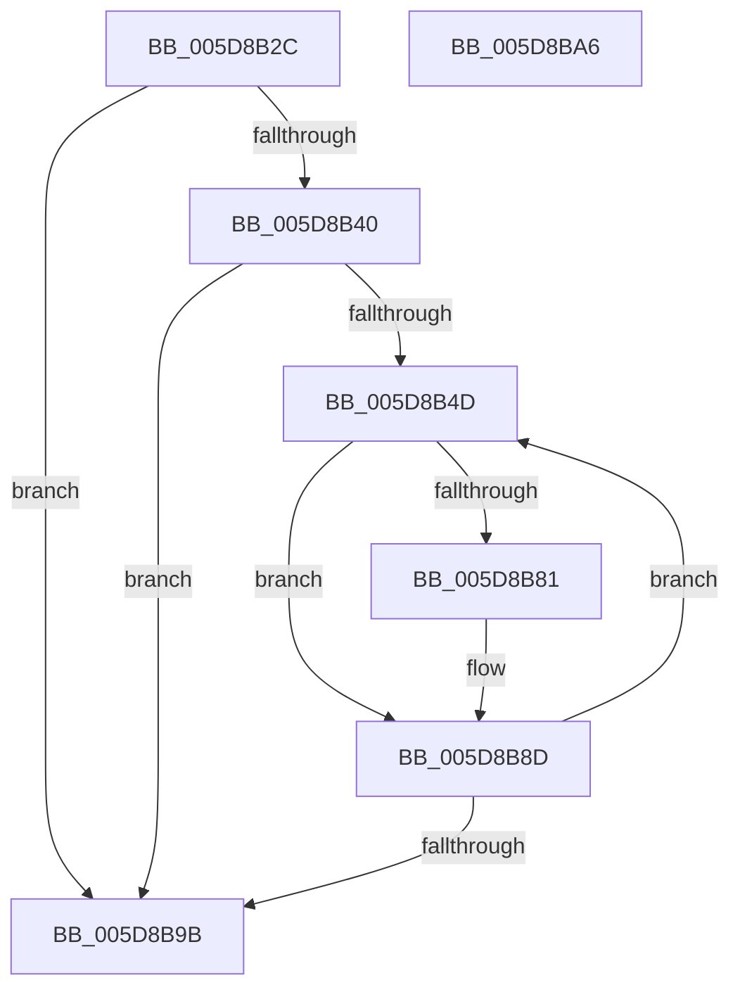

# PpmHeteroHgsEvalAndRegisterContainmentGroups

- RVA: `0x005D8B2C`–`0x005D8BA7` (길이 `123` bytes)
- VA: `0x00000001405D8B2C`
- 실행 섹션: `.text`
- PDB 이름 있음: `예`; PDB Function 태그: `아니요`
- unwind 정보 RVA: `0x0006E5F8`
- 디코드: `33`개 명령, `123/123` bytes 표시
- 미해석 바이트: `0` (있으면 어셈블리에 `.byte`로 보존)

> 이 문서는 커널 이미지의 기계어와 PDB 기호를 분석해 생성했습니다. 4번과 5번은 함수 원형과 자료형을 바이너리 사용 방식에서 추정한 C 해석이며 원본 소스 복구 결과는 아닙니다.

## 1. Dependencies

- 직접 호출 지점: **1**; 고유 호출 대상: **1**
- 직접 호출자로 확인된 함수: **1**
- RIP 상대 이미지 참조: **3**

### Outgoing calls
- `0x005D8B88` → [PpmHeteroHgsRegisterContainmentGroups](PpmHeteroHgsRegisterContainmentGroups_function_005D8D14.md) (function, `0x005D8D14`)

### Direct callers
- [PpmHeteroUpdateHgsConfiguration](../3B/PpmHeteroUpdateHgsConfiguration_function_003BF344.md) at `0x003BFC9B`

### Static image references
- `0x005D8B36` → RVA `0x00FC501C` (`ALMOSTRO`; read)
- `0x005D8B42` → RVA `0x00F083E0` (`.data`; read)
- `0x005D8B5F` → RVA `0x00F083D8` (`.data`; read)

## 2. Other-region calls and transfers

- 다른 실행 섹션으로 향하는 call: **0**
- 별도 외부 분기/꼬리 이동을 확인하지 못했습니다.

## 3. Assembly (complete function range)

```asm
005D8B2C  48 89 5C 24 08                  mov qword ptr [rsp + 8], rbx
005D8B31  57                              push rdi
005D8B32  48 83 EC 30                     sub rsp, 0x30
005D8B36  8B 05 E0 C4 9E 00               mov eax, dword ptr [rip + 0x9ec4e0]
005D8B3C  A8 02                           test al, 2
005D8B3E  74 5B                           je 0x1405d8b9b
005D8B40  33 FF                           xor edi, edi
005D8B42  39 3D 98 F8 92 00               cmp dword ptr [rip + 0x92f898], edi
005D8B48  0F B7 DF                        movzx ebx, di
005D8B4B  74 4E                           je 0x1405d8b9b
005D8B4D  0F B7 C3                        movzx eax, bx
005D8B50  0F 57 C0                        xorps xmm0, xmm0
005D8B53  48 69 C8 10 05 00 00            imul rcx, rax, 0x510
005D8B5A  0F 11 44 24 20                  movups xmmword ptr [rsp + 0x20], xmm0
005D8B5F  48 03 0D 72 F8 92 00            add rcx, qword ptr [rip + 0x92f872]
005D8B66  0F B7 41 04                     movzx eax, word ptr [rcx + 4]
005D8B6A  66 89 44 24 28                  mov word ptr [rsp + 0x28], ax
005D8B6F  48 8B 41 10                     mov rax, qword ptr [rcx + 0x10]
005D8B73  48 89 44 24 20                  mov qword ptr [rsp + 0x20], rax
005D8B78  48 39 B9 00 05 00 00            cmp qword ptr [rcx + 0x500], rdi
005D8B7F  75 0C                           jne 0x1405d8b8d
005D8B81  4C 8D 44 24 20                  lea r8, [rsp + 0x20]
005D8B86  33 D2                           xor edx, edx
005D8B88  E8 87 01 00 00                  call 0x1405d8d14
005D8B8D  66 FF C3                        inc bx
005D8B90  0F B7 C3                        movzx eax, bx
005D8B93  3B 05 47 F8 92 00               cmp eax, dword ptr [rip + 0x92f847]
005D8B99  72 B2                           jb 0x1405d8b4d
005D8B9B  48 8B 5C 24 40                  mov rbx, qword ptr [rsp + 0x40]
005D8BA0  48 83 C4 30                     add rsp, 0x30
005D8BA4  5F                              pop rdi
005D8BA5  C3                              ret
005D8BA6  CC                              int3
```

## 4. C-style interpretation (structured pseudocode)

```c
__int64 __fastcall PpmHeteroHgsEvalAndRegisterContainmentGroups(__int64 a1, int a2)
{
    __int64 result;
    __int64 v_rbx;
    __int64 v_rdi;
    __int64 v_rsp;
    unsigned __int16 v_stack_m10;
    unsigned __int64 v_stack_m18;
    unsigned __int64 v_stack_p8;

    v_stack_p8 = v_rbx;
    v_rsp = (v_rsp) - (48);
    if ((((unsigned __int8)((unsigned int)(*(unsigned int *)(v_rip + 10405088)))) & (2)) == 0) goto loc_005D8B9B;
    v_rdi = 0;
    if ((*(unsigned int *)(v_rip + 9631896)) == 0) goto loc_005D8B9B;
loc_005D8B4D:
    a1 = (a1) * (0);
    v_stack_m18 = v_xmm0;
    a1 = (a1) + (*(unsigned __int64 *)(v_rip + 9631858));
    v_stack_m10 = (unsigned __int16)(*(unsigned __int16 *)(a1 + 4));
    v_stack_m18 = *(unsigned __int64 *)(a1 + 16);
    result = *(unsigned __int64 *)(a1 + 16);
    if ((*(unsigned __int64 *)(a1 + 1280)) == 0) {
        a3 = v_stack_m18;
        a2 = 0;
        result = PpmHeteroHgsRegisterContainmentGroups(a1, a2, a3, a4);
    }
    v_rbx = (unsigned __int16)((0) + 1);
    if (((unsigned int)((unsigned __int16)(v_rbx))) < (*(unsigned int *)(v_rip + 9631815))) goto loc_005D8B4D;
loc_005D8B9B:
    v_rsp = (v_rsp) + (48);
    return (unsigned __int16)(v_rbx);
}
```

## 5. (Beta) C Style

```c
int64_t PpmHeteroHgsEvalAndRegisterContainmentGroups(int64_t Arg1, int32_t Arg2)
{
    int64_t result;
    int64_t local_rbx;
    int64_t local_rdi;
    int64_t local_rsp;
    uint16_t v_stack_m10;
    uint64_t v_stack_m18;
    uint64_t v_stack_p8;

    v_stack_p8 = local_rbx;
    local_rsp = (local_rsp) - (48);
    if ((((uint8_t)((uint32_t)(*(uint32_t *)(v_rip + 0x9EC4E0)))) & (2)) == 0) goto loc_005D8B9B;
    local_rdi = 0;
    if ((*(uint32_t *)(v_rip + 0x92F898)) == 0) goto loc_005D8B9B;
loc_005D8B4D:
    Arg1 = (Arg1) * (0);
    v_stack_m18 = v_xmm0;
    Arg1 = (Arg1) + (*(uint64_t *)(v_rip + 0x92F872));
    v_stack_m10 = (uint16_t)(*(uint16_t *)(Arg1 + 0x4));
    v_stack_m18 = *(uint64_t *)(Arg1 + 0x10);
    result = *(uint64_t *)(Arg1 + 0x10);
    if ((*(uint64_t *)(Arg1 + 0x500)) == 0) {
        a3 = v_stack_m18;
        Arg2 = 0;
        result = PpmHeteroHgsRegisterContainmentGroups(Arg1, Arg2, a3, a4);
    }
    local_rbx = (uint16_t)((0) + 1);
    if (((uint32_t)((uint16_t)(local_rbx))) < (*(uint32_t *)(v_rip + 0x92F847))) goto loc_005D8B4D;
loc_005D8B9B:
    local_rsp = (local_rsp) + (48);
    return (uint16_t)(local_rbx);
}
```

## 6. Execution-region graph

[열기: 2D/3D 그래프와 함수 탐색 컨트롤 패널](../../../control-panel.html?section=text&rva=0x005D8B2C&view=graph)

- 2D 그래프는 위에서 아래로 흐르고, 3D 그래프는 빈 공간을 드래그해 회전합니다. Shift+드래그는 이동, 휠은 확대·축소, 함수 노드 선택은 대상 보고서 이동입니다.

### Static fallback


