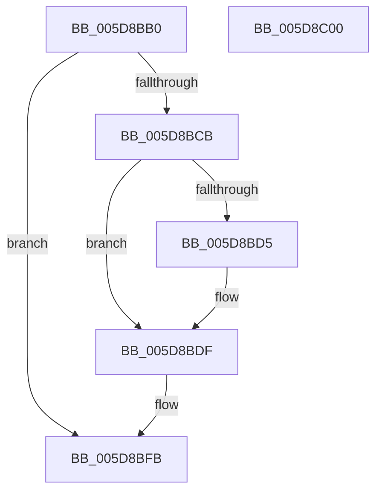

# PpmHeteroHgsGetWpsHint

- RVA: `0x005D8BB0`–`0x005D8C01` (길이 `81` bytes)
- VA: `0x00000001405D8BB0`
- 실행 섹션: `.text`
- PDB 이름 있음: `예`; PDB Function 태그: `아니요`
- unwind 정보 RVA: `0x0005C788`
- 디코드: `21`개 명령, `81/81` bytes 표시
- 미해석 바이트: `0` (있으면 어셈블리에 `.byte`로 보존)

> 이 문서는 커널 이미지의 기계어와 PDB 기호를 분석해 생성했습니다. 4번과 5번은 함수 원형과 자료형을 바이너리 사용 방식에서 추정한 C 해석이며 원본 소스 복구 결과는 아닙니다.

## 1. Dependencies

- 직접 호출 지점: **1**; 고유 호출 대상: **1**
- 직접 호출자로 확인된 함수: **1**
- RIP 상대 이미지 참조: **0**

### Outgoing calls
- `0x005D8BF6` → [KiCopyAffinityEx](../2C/KiCopyAffinityEx_function_002CE860.md) (function, `0x002CE860`)

### Direct callers
- [PpmEventTraceControlCallback](../../page/A5/PpmEventTraceControlCallback_function_00A51F60.md) at `0x00A521E0`

### Static image references
- 디코드된 RIP-relative 메모리 참조가 없습니다.

## 2. Other-region calls and transfers

- 다른 실행 섹션으로 향하는 call: **0**
- 별도 외부 분기/꼬리 이동을 확인하지 못했습니다.

## 3. Assembly (complete function range)

```asm
005D8BB0  48 83 EC 28                     sub rsp, 0x28
005D8BB4  4C 8B 89 00 05 00 00            mov r9, qword ptr [rcx + 0x500]
005D8BBB  B8 02 00 00 00                  mov eax, 2
005D8BC0  41 89 00                        mov dword ptr [r8], eax
005D8BC3  4C 8B D2                        mov r10, rdx
005D8BC6  4D 85 C9                        test r9, r9
005D8BC9  74 30                           je 0x1405d8bfb
005D8BCB  41 80 B9 28 03 00 00 00         cmp byte ptr [r9 + 0x328], 0
005D8BD3  74 0A                           je 0x1405d8bdf
005D8BD5  41 8B 81 2C 03 00 00            mov eax, dword ptr [r9 + 0x32c]
005D8BDC  41 89 00                        mov dword ptr [r8], eax
005D8BDF  0F B7 52 02                     movzx edx, word ptr [rdx + 2]
005D8BE3  49 83 C1 10                     add r9, 0x10
005D8BE7  48 98                           cdqe
005D8BE9  49 8B CA                        mov rcx, r10
005D8BEC  4C 69 C0 08 01 00 00            imul r8, rax, 0x108
005D8BF3  4D 03 C1                        add r8, r9
005D8BF6  E8 65 5C CF FF                  call 0x1402ce860
005D8BFB  48 83 C4 28                     add rsp, 0x28
005D8BFF  C3                              ret
005D8C00  CC                              int3
```

## 4. C-style interpretation (structured pseudocode)

```c
__int64 __fastcall PpmHeteroHgsGetWpsHint(__int64 a1, __int64 a2, __int64 a3)
{
    __int64 result;
    __int64 v_rsp;

    v_rsp = (v_rsp) - (40);
    *(unsigned int *)(a3) = 2;
    if (*(unsigned __int64 *)(a1 + 1280) == 0) goto loc_005D8BFB;
    result = 2;
    if ((*(unsigned __int8 *)(*(unsigned __int64 *)(a1 + 1280) + 808)) != 0) {
        result = *(unsigned int *)(*(unsigned __int64 *)(a1 + 1280) + 812);
        *(unsigned int *)(a3) = (unsigned int)(result);
    }
    a4 = (*(unsigned __int64 *)(a1 + 1280)) + (16);
    a3 = (a3) * (result);
    a3 = (a3) + (a4);
    result = KiCopyAffinityEx(a2, *(unsigned __int16 *)(a2 + 2), a3, a4);
loc_005D8BFB:
    v_rsp = (v_rsp) + (40);
    return result;
}
```

## 5. (Beta) C Style

```c
int64_t PpmHeteroHgsGetWpsHint(void *Arg1, void *Arg2, void *Arg3)
{
    uint8_t *arg1 = (uint8_t *)Arg1;
    uint8_t *arg2 = (uint8_t *)Arg2;
    uint8_t *arg3 = (uint8_t *)Arg3;

    int64_t result;
    int64_t local_rsp;

    local_rsp = (local_rsp) - (40);
    *(uint32_t *)(arg3) = 2;
    if (*(uint64_t *)(arg1 + 0x500) == 0) goto loc_005D8BFB;
    result = 2;
    if ((*(uint8_t *)(*(uint64_t *)(arg1 + 0x500) + 0x328)) != 0) {
        result = *(uint32_t *)(*(uint64_t *)(arg1 + 0x500) + 0x32C);
        *(uint32_t *)(arg3) = (uint32_t)(result);
    }
    a4 = (*(uint64_t *)(arg1 + 0x500)) + (16);
    Arg3 = (Arg3) * (result);
    Arg3 = (Arg3) + (a4);
    result = KiCopyAffinityEx(Arg2, *(uint16_t *)(arg2 + 0x2), Arg3, a4);
loc_005D8BFB:
    local_rsp = (local_rsp) + (40);
    return result;
}
```

### 관측된 메모리 오프셋

구조체 형식이 확인되지 않은 접근은 인자 기준의 오프셋으로만 기록했습니다.

| 기준 인자 | 오프셋 표현 | 폭 (bit) | 접근 |
|---|---:|---:|---|
| `Arg1` | `+ 0x500` | `64` | `R` |
| `Arg2` | `+ 0x2` | `16` | `R` |
| `Arg3` | `+ 0x0` | `32` | `W` |

## 6. Execution-region graph

[열기: 2D/3D 그래프와 함수 탐색 컨트롤 패널](../../../control-panel.html?section=text&rva=0x005D8BB0&view=graph)

- 2D 그래프는 위에서 아래로 흐르고, 3D 그래프는 빈 공간을 드래그해 회전합니다. Shift+드래그는 이동, 휠은 확대·축소, 함수 노드 선택은 대상 보고서 이동입니다.

### Static fallback


