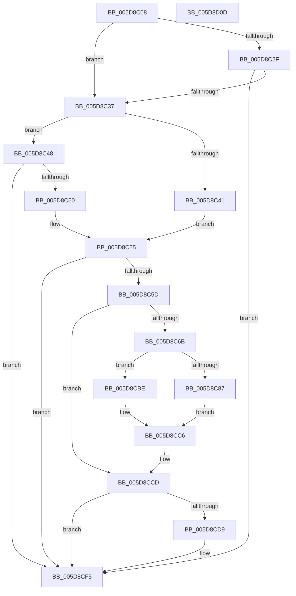

# PpmHeteroHgsProcessorInit

- RVA: `0x005D8C08`–`0x005D8D0E` (길이 `262` bytes)
- VA: `0x00000001405D8C08`
- 실행 섹션: `.text`
- PDB 이름 있음: `예`; PDB Function 태그: `아니요`
- unwind 정보 RVA: `0x000BE828`
- 디코드: `68`개 명령, `262/262` bytes 표시
- 미해석 바이트: `0` (있으면 어셈블리에 `.byte`로 보존)

> 이 문서는 커널 이미지의 기계어와 PDB 기호를 분석해 생성했습니다. 4번과 5번은 함수 원형과 자료형을 바이너리 사용 방식에서 추정한 C 해석이며 원본 소스 복구 결과는 아닙니다.

## 1. Dependencies

- 직접 호출 지점: **6**; 고유 호출 대상: **6**
- 직접 호출자로 확인된 함수: **2**
- RIP 상대 이미지 참조: **6**

### Outgoing calls
- `0x005D8C41` → [PpmHeteroIntelProcessorInit](../../pagelk/B7/PpmHeteroIntelProcessorInit_function_00B718D4.md) (function, `0x00B718D4`)
- `0x005D8C50` → [PpmHeteroAmdProcessorInit](../../pagelk/B7/PpmHeteroAmdProcessorInit_function_00B71848.md) (function, `0x00B71848`)
- `0x005D8C5D` → [PpmHeteroHgsProcessorThreadFeedbackInit](../4F/PpmHeteroHgsProcessorThreadFeedbackInit_function_004FC94C.md) (function, `0x004FC94C`)
- `0x005D8CD0` → [PpmHeteroInitializeFeedbackClass](PpmHeteroInitializeFeedbackClass_function_005D8FA4.md) (function, `0x005D8FA4`)
- `0x005D8CEF` → [KeBugCheckEx](../4F/KeBugCheckEx_function_004FD660.md) (function, `0x004FD660`)
- `0x005D8CFD` → [_security_check_cookie](../6A/_security_check_cookie_function_006AC640.md) (function, `0x006AC640`)

### Direct callers
- [PpmCheckProcessorInit](PpmCheckProcessorInit_function_005D84A0.md) at `0x005D84BA`
- [PoInitializePrcb](../../pagelk/B7/PoInitializePrcb_function_00B715E4.md) at `0x00B7166D`

### Static image references
- `0x005D8C12` → RVA `0x00E0A740` (`.data`; read)
- `0x005D8C21` → RVA `0x00FC6A94` (`ALMOSTRO`; read)
- `0x005D8C62` → RVA `0x00FC5003` (`ALMOSTRO`; read)
- `0x005D8C77` → RVA `0x00FC6A96` (`ALMOSTRO`; read)
- `0x005D8C87` → RVA `0x00FC6BC8` (`ALMOSTRO`; read)
- `0x005D8C94` → RVA `0x00FC6C2C` (`ALMOSTRO`; read)

## 2. Other-region calls and transfers

- 다른 실행 섹션으로 향하는 call: **2**
  - `0x005D8C41` → [PpmHeteroIntelProcessorInit](../../pagelk/B7/PpmHeteroIntelProcessorInit_function_00B718D4.md) (`.text` → `PAGELK`)
  - `0x005D8C50` → [PpmHeteroAmdProcessorInit](../../pagelk/B7/PpmHeteroAmdProcessorInit_function_00B71848.md) (`.text` → `PAGELK`)
- 별도 외부 분기/꼬리 이동을 확인하지 못했습니다.

## 3. Assembly (complete function range)

```asm
005D8C08  48 89 5C 24 10                  mov qword ptr [rsp + 0x10], rbx
005D8C0D  57                              push rdi
005D8C0E  48 83 EC 50                     sub rsp, 0x50
005D8C12  48 8B 05 27 1B 83 00            mov rax, qword ptr [rip + 0x831b27]
005D8C19  48 33 C4                        xor rax, rsp
005D8C1C  48 89 44 24 40                  mov qword ptr [rsp + 0x40], rax
005D8C21  80 3D 6C DE 9E 00 00            cmp byte ptr [rip + 0x9ede6c], 0
005D8C28  8A DA                           mov bl, dl
005D8C2A  48 8B F9                        mov rdi, rcx
005D8C2D  75 08                           jne 0x1405d8c37
005D8C2F  84 D2                           test dl, dl
005D8C31  0F 84 BE 00 00 00               je 0x1405d8cf5
005D8C37  8A 81 8D 00 00 00               mov al, byte ptr [rcx + 0x8d]
005D8C3D  3C 02                           cmp al, 2
005D8C3F  75 07                           jne 0x1405d8c48
005D8C41  E8 8E 8C 59 00                  call 0x140b718d4
005D8C46  EB 0D                           jmp 0x1405d8c55
005D8C48  3C 01                           cmp al, 1
005D8C4A  0F 85 A5 00 00 00               jne 0x1405d8cf5
005D8C50  E8 F3 8B 59 00                  call 0x140b71848
005D8C55  84 DB                           test bl, bl
005D8C57  0F 85 98 00 00 00               jne 0x1405d8cf5
005D8C5D  E8 EA 3C F2 FF                  call 0x1404fc94c
005D8C62  80 3D 9A C3 9E 00 02            cmp byte ptr [rip + 0x9ec39a], 2
005D8C69  75 62                           jne 0x1405d8ccd
005D8C6B  33 C9                           xor ecx, ecx
005D8C6D  B8 06 00 00 00                  mov eax, 6
005D8C72  0F A2                           cpuid
005D8C74  C1 EA 10                        shr edx, 0x10
005D8C77  80 3D 18 DE 9E 00 00            cmp byte ptr [rip + 0x9ede18], 0
005D8C7E  66 89 97 4E 8A 00 00            mov word ptr [rdi + 0x8a4e], dx
005D8C85  74 37                           je 0x1405d8cbe
005D8C87  48 8B 05 3A DF 9E 00            mov rax, qword ptr [rip + 0x9edf3a]
005D8C8E  41 B8 F8 FF 00 00               mov r8d, 0xfff8
005D8C94  0F B7 0D 91 DF 9E 00            movzx ecx, word ptr [rip + 0x9edf91]
005D8C9B  0F B7 58 04                     movzx ebx, word ptr [rax + 4]
005D8C9F  8B C2                           mov eax, edx
005D8CA1  0F AF D9                        imul ebx, ecx
005D8CA4  8D 4B 07                        lea ecx, [rbx + 7]
005D8CA7  66 83 C3 0F                     add bx, 0xf
005D8CAB  66 41 23 C8                     and cx, r8w
005D8CAF  66 41 23 D8                     and bx, r8w
005D8CB3  0F B7 D1                        movzx edx, cx
005D8CB6  0F AF D0                        imul edx, eax
005D8CB9  66 03 D3                        add dx, bx
005D8CBC  EB 08                           jmp 0x1405d8cc6
005D8CBE  66 83 C2 02                     add dx, 2
005D8CC2  66 C1 E2 03                     shl dx, 3
005D8CC6  66 89 97 4A 8A 00 00            mov word ptr [rdi + 0x8a4a], dx
005D8CCD  48 8B CF                        mov rcx, rdi
005D8CD0  E8 CF 02 00 00                  call 0x1405d8fa4
005D8CD5  85 C0                           test eax, eax
005D8CD7  79 1C                           jns 0x1405d8cf5
005D8CD9  48 83 64 24 20 00               and qword ptr [rsp + 0x20], 0
005D8CDF  45 33 C9                        xor r9d, r9d
005D8CE2  4C 63 C0                        movsxd r8, eax
005D8CE5  BA 01 02 00 00                  mov edx, 0x201
005D8CEA  B9 A0 00 00 00                  mov ecx, 0xa0
005D8CEF  E8 6C 49 F2 FF                  call 0x1404fd660
005D8CF4  CC                              int3
005D8CF5  48 8B 4C 24 40                  mov rcx, qword ptr [rsp + 0x40]
005D8CFA  48 33 CC                        xor rcx, rsp
005D8CFD  E8 3E 39 0D 00                  call 0x1406ac640
005D8D02  48 8B 5C 24 68                  mov rbx, qword ptr [rsp + 0x68]
005D8D07  48 83 C4 50                     add rsp, 0x50
005D8D0B  5F                              pop rdi
005D8D0C  C3                              ret
005D8D0D  CC                              int3
```

## 4. C-style interpretation (structured pseudocode)

```c
__int64 __fastcall PpmHeteroHgsProcessorInit(__int64 a1, int a2, __int64 a3, int a4)
{
    __int64 result;
    __int64 v_rbx;
    __int64 v_rsp;
    unsigned __int64 v_stack_m18;
    unsigned __int64 v_stack_m38;
    unsigned __int64 v_stack_p10;

    v_stack_p10 = v_rbx;
    v_rsp = (v_rsp) - (80);
    result = (*(unsigned __int64 *)(v_rip + 8592167)) ^ (v_rsp);
    v_stack_m18 = result;
    if ((*(unsigned __int8 *)(v_rip + 10411628)) != 0) goto loc_005D8C37;
    if ((unsigned __int8)(a2) == 0) goto loc_005D8CF5;
loc_005D8C37:
    if (((unsigned __int8)(*(unsigned __int8 *)(a1 + 141))) != 2) goto loc_005D8C48;
    result = PpmHeteroIntelProcessorInit(a1, a2, a3, a4);
    goto loc_005D8C55;
loc_005D8C48:
    if (((unsigned __int8)(result)) != 1) goto loc_005D8CF5;
    result = PpmHeteroAmdProcessorInit(a1, a2, a3, a4);
loc_005D8C55:
    if ((unsigned __int8)((unsigned __int8)(a2)) != 0) goto loc_005D8CF5;
    result = PpmHeteroHgsProcessorThreadFeedbackInit(a1, a2, a3, a4);
    if ((*(unsigned __int8 *)(v_rip + 10404762)) != 2) goto loc_005D8CCD;
    a1 = 0;
    a2 = (unsigned int)((a2) >> (16));
    *(unsigned __int16 *)(a1 + 35406) = (unsigned __int16)(a2);
    if ((*(unsigned __int8 *)(v_rip + 10411544)) == 0) goto loc_005D8CBE;
    v_rbx = (unsigned int)((*(unsigned __int16 *)(*(unsigned __int64 *)(v_rip + 10411834) + 4)) * ((unsigned int)(*(unsigned __int16 *)(v_rip + 10411921))));
    v_rbx = (unsigned __int16)((v_rbx) + (15));
    a1 = (unsigned __int16)((v_rbx + 7) & ((unsigned __int16)((unsigned int)(0xFFF8ULL))));
    v_rbx = (unsigned __int16)((v_rbx) & ((unsigned __int16)((unsigned int)(0xFFF8ULL))));
    a2 = (unsigned int)(((unsigned __int16)(a1)) * ((unsigned int)((unsigned int)(a2))));
    a2 = (unsigned __int16)((a2) + ((unsigned __int16)(v_rbx)));
    goto loc_005D8CC6;
loc_005D8CBE:
    a2 = (unsigned __int16)((a2) + (2));
    a2 = (unsigned __int16)((a2) << (3));
loc_005D8CC6:
    *(unsigned __int16 *)(a1 + 35402) = (unsigned __int16)(a2);
loc_005D8CCD:
    result = PpmHeteroInitializeFeedbackClass(a1, a2, (unsigned int)(0xFFF8ULL), a4);
    if (sign_flag) {
        a4 = 0;
        a3 = (int)((unsigned int)(result));
        a2 = 513;
        a1 = 160;
        result = KeBugCheckEx(a1, a2, a3, a4);
    }
    a1 = (v_stack_m18) ^ (v_rsp);
    result = _security_check_cookie(a1, a2, a3, a4);
    v_rsp = (v_rsp) + (80);
    return result;
}
```

## 5. (Beta) C Style

```c
int64_t PpmHeteroHgsProcessorInit(void *Arg1, int32_t Arg2, int64_t Arg3, int32_t Arg4)
{
    uint8_t *arg1 = (uint8_t *)Arg1;

    int64_t result;
    int64_t local_rbx;
    int64_t local_rsp;
    uint64_t v_stack_m18;
    uint64_t v_stack_m38;
    uint64_t v_stack_p10;

    v_stack_p10 = local_rbx;
    local_rsp = (local_rsp) - (80);
    result = (*(uint64_t *)(v_rip + 0x831B27)) ^ (local_rsp);
    v_stack_m18 = result;
    if ((*(uint8_t *)(v_rip + 0x9EDE6C)) != 0) goto loc_005D8C37;
    if ((uint8_t)(Arg2) == 0) goto loc_005D8CF5;
loc_005D8C37:
    if (((uint8_t)(*(uint8_t *)(arg1 + 0x8D))) != 2) goto loc_005D8C48;
    result = PpmHeteroIntelProcessorInit(Arg1, Arg2, Arg3, Arg4);
    goto loc_005D8C55;
loc_005D8C48:
    if (((uint8_t)(result)) != 1) goto loc_005D8CF5;
    result = PpmHeteroAmdProcessorInit(Arg1, Arg2, Arg3, Arg4);
loc_005D8C55:
    if ((uint8_t)((uint8_t)(Arg2)) != 0) goto loc_005D8CF5;
    result = PpmHeteroHgsProcessorThreadFeedbackInit(Arg1, Arg2, Arg3, Arg4);
    if ((*(uint8_t *)(v_rip + 0x9EC39A)) != 2) goto loc_005D8CCD;
    Arg1 = 0;
    Arg2 = (uint32_t)((Arg2) >> (16));
    *(uint16_t *)(arg1 + 0x8A4E) = (uint16_t)(Arg2);
    if ((*(uint8_t *)(v_rip + 0x9EDE18)) == 0) goto loc_005D8CBE;
    local_rbx = (uint32_t)((*(uint16_t *)(*(uint64_t *)(v_rip + 0x9EDF3A) + 0x4)) * ((uint32_t)(*(uint16_t *)(v_rip + 0x9EDF91))));
    local_rbx = (uint16_t)((local_rbx) + (15));
    Arg1 = (uint16_t)((local_rbx + 7) & ((uint16_t)((uint32_t)(0xFFF8ULL))));
    local_rbx = (uint16_t)((local_rbx) & ((uint16_t)((uint32_t)(0xFFF8ULL))));
    Arg2 = (uint32_t)(((uint16_t)(Arg1)) * ((uint32_t)((uint32_t)(Arg2))));
    Arg2 = (uint16_t)((Arg2) + ((uint16_t)(local_rbx)));
    goto loc_005D8CC6;
loc_005D8CBE:
    Arg2 = (uint16_t)((Arg2) + (2));
    Arg2 = (uint16_t)((Arg2) << (3));
loc_005D8CC6:
    *(uint16_t *)(arg1 + 0x8A4A) = (uint16_t)(Arg2);
loc_005D8CCD:
    result = PpmHeteroInitializeFeedbackClass(Arg1, Arg2, (uint32_t)(0xFFF8ULL), Arg4);
    if (sign_flag) {
        Arg4 = 0;
        Arg3 = (int32_t)((uint32_t)(result));
        Arg2 = 513;
        Arg1 = 160;
        result = KeBugCheckEx(Arg1, Arg2, Arg3, Arg4);
    }
    Arg1 = (v_stack_m18) ^ (local_rsp);
    result = _security_check_cookie(Arg1, Arg2, Arg3, Arg4);
    local_rsp = (local_rsp) + (80);
    return result;
}
```

### 관측된 메모리 오프셋

구조체 형식이 확인되지 않은 접근은 인자 기준의 오프셋으로만 기록했습니다.

| 기준 인자 | 오프셋 표현 | 폭 (bit) | 접근 |
|---|---:|---:|---|
| `Arg1` | `+ 0x8D` | `8` | `R` |
| `Arg1` | `+ 0x8A4A` | `16` | `W` |
| `Arg1` | `+ 0x8A4E` | `16` | `W` |

## 6. Execution-region graph

[열기: 2D/3D 그래프와 함수 탐색 컨트롤 패널](../../../control-panel.html?section=text&rva=0x005D8C08&view=graph)

- 2D 그래프는 위에서 아래로 흐르고, 3D 그래프는 빈 공간을 드래그해 회전합니다. Shift+드래그는 이동, 휠은 확대·축소, 함수 노드 선택은 대상 보고서 이동입니다.

### Static fallback


