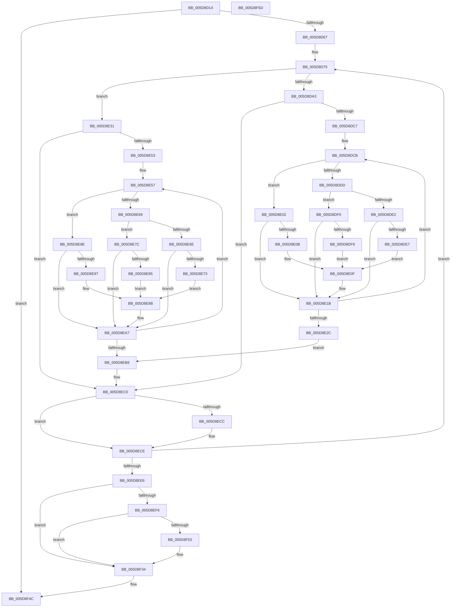

# PpmHeteroHgsRegisterContainmentGroups

- RVA: `0x005D8D14`–`0x005D8F5E` (길이 `586` bytes)
- VA: `0x00000001405D8D14`
- 실행 섹션: `.text`
- PDB 이름 있음: `예`; PDB Function 태그: `아니요`
- unwind 정보 RVA: `0x000CCC68`
- 디코드: `157`개 명령, `586/586` bytes 표시
- 미해석 바이트: `0` (있으면 어셈블리에 `.byte`로 보존)

> 이 문서는 커널 이미지의 기계어와 PDB 기호를 분석해 생성했습니다. 4번과 5번은 함수 원형과 자료형을 바이너리 사용 방식에서 추정한 C 해석이며 원본 소스 복구 결과는 아닙니다.

## 1. Dependencies

- 직접 호출 지점: **12**; 고유 호출 대상: **7**
- 직접 호출자로 확인된 함수: **3**
- RIP 상대 이미지 참조: **1**

### Outgoing calls
- `0x005D8D56` → [ExAllocatePool2](../../poolcode/B8/ExAllocatePool2_function_00B820F0.md) (function, `0x00B820F0`)
- `0x005D8D8D` → [memset](../6C/memset_function_006C6C40.md) (function, `0x006C6C40`)
- `0x005D8D92` → [Feature_PpmParkEx__private_IsEnabledDeviceUsageNoInline](../4F/Feature_PpmParkEx__private_IsEnabledDeviceUsageNoInline_function_004F135C.md) (function, `0x004F135C`)
- `0x005D8DBA` → [KeEnumerateNextProcessor](../41/KeEnumerateNextProcessor_function_00415480.md) (function, `0x00415480`)
- `0x005D8DD0` → [KeGetPrcb](../2D/KeGetPrcb_function_002D85D0.md) (function, `0x002D85D0`)
- `0x005D8E16` → [KeAddProcessorAffinityEx](../25/KeAddProcessorAffinityEx_function_0025B6F0.md) (function, `0x0025B6F0`)
- `0x005D8E23` → [KeEnumerateNextProcessor](../41/KeEnumerateNextProcessor_function_00415480.md) (function, `0x00415480`)
- `0x005D8E4A` → [KeEnumerateNextProcessor](../41/KeEnumerateNextProcessor_function_00415480.md) (function, `0x00415480`)
- `0x005D8E5C` → [KeGetPrcb](../2D/KeGetPrcb_function_002D85D0.md) (function, `0x002D85D0`)
- `0x005D8EA2` → [KeAddProcessorAffinityEx](../25/KeAddProcessorAffinityEx_function_0025B6F0.md) (function, `0x0025B6F0`)
- `0x005D8EAF` → [KeEnumerateNextProcessor](../41/KeEnumerateNextProcessor_function_00415480.md) (function, `0x00415480`)
- `0x005D8F47` → [PpmEventHgsContainmentGroupInfo](PpmEventHgsContainmentGroupInfo_function_005DA8DC.md) (function, `0x005DA8DC`)

### Direct callers
- [PpmHeteroHgsEvalAndRegisterContainmentGroups](PpmHeteroHgsEvalAndRegisterContainmentGroups_function_005D8B2C.md) at `0x005D8B88`
- [PpmParkRegisterParking](PpmParkRegisterParking_function_005DB508.md) at `0x005DB96E`
- [PpmParkInitParkNode](../5E/PpmParkInitParkNode_function_005E1444.md) at `0x005E16EC`

### Static image references
- `0x005D8F34` → RVA `0x00FC501C` (`ALMOSTRO`; read/write)

## 2. Other-region calls and transfers

- 다른 실행 섹션으로 향하는 call: **1**
  - `0x005D8D56` → [ExAllocatePool2](../../poolcode/B8/ExAllocatePool2_function_00B820F0.md) (`.text` → `POOLCODE`)
- 별도 외부 분기/꼬리 이동을 확인하지 못했습니다.

## 3. Assembly (complete function range)

```asm
005D8D14  4C 89 44 24 18                  mov qword ptr [rsp + 0x18], r8
005D8D19  48 89 54 24 10                  mov qword ptr [rsp + 0x10], rdx
005D8D1E  48 89 4C 24 08                  mov qword ptr [rsp + 8], rcx
005D8D23  55                              push rbp
005D8D24  53                              push rbx
005D8D25  56                              push rsi
005D8D26  57                              push rdi
005D8D27  41 54                           push r12
005D8D29  41 55                           push r13
005D8D2B  41 56                           push r14
005D8D2D  41 57                           push r15
005D8D2F  48 8B EC                        mov rbp, rsp
005D8D32  48 83 EC 48                     sub rsp, 0x48
005D8D36  33 FF                           xor edi, edi
005D8D38  49 8B F0                        mov rsi, r8
005D8D3B  4C 8B E9                        mov r13, rcx
005D8D3E  89 7D EA                        mov dword ptr [rbp - 0x16], edi
005D8D41  BA 40 03 00 00                  mov edx, 0x340
005D8D46  66 89 7D EE                     mov word ptr [rbp - 0x12], di
005D8D4A  41 B8 50 50 4D 70               mov r8d, 0x704d5050
005D8D50  89 7D 60                        mov dword ptr [rbp + 0x60], edi
005D8D53  8D 4F 40                        lea ecx, [rdi + 0x40]
005D8D56  E8 95 93 5A 00                  call 0x140b820f0
005D8D5B  48 8B D8                        mov rbx, rax
005D8D5E  48 85 C0                        test rax, rax
005D8D61  0F 84 E5 01 00 00               je 0x1405d8f4c
005D8D67  44 8B E7                        mov r12d, edi
005D8D6A  44 8B F7                        mov r14d, edi
005D8D6D  45 33 FF                        xor r15d, r15d
005D8D70  41 8D 7C 24 08                  lea edi, [r12 + 8]
005D8D75  48 8D 4B 18                     lea rcx, [rbx + 0x18]
005D8D79  49 C7 44 1C 10 01 00 20 00      mov qword ptr [r12 + rbx + 0x10], 0x200001
005D8D82  49 03 CC                        add rcx, r12
005D8D85  33 D2                           xor edx, edx
005D8D87  41 B8 00 01 00 00               mov r8d, 0x100
005D8D8D  E8 AE DE 0E 00                  call 0x1406c6c40
005D8D92  E8 C5 85 F1 FF                  call 0x1404f135c
005D8D97  48 8D 55 D8                     lea rdx, [rbp - 0x28]
005D8D9B  85 C0                           test eax, eax
005D8D9D  0F 85 8E 00 00 00               jne 0x1405d8e31
005D8DA3  0F B7 46 08                     movzx eax, word ptr [rsi + 8]
005D8DA7  48 8D 4D 60                     lea rcx, [rbp + 0x60]
005D8DAB  66 89 45 E8                     mov word ptr [rbp - 0x18], ax
005D8DAF  48 8B 06                        mov rax, qword ptr [rsi]
005D8DB2  48 89 45 E0                     mov qword ptr [rbp - 0x20], rax
005D8DB6  4C 89 7D D8                     mov qword ptr [rbp - 0x28], r15
005D8DBA  E8 C1 C6 E3 FF                  call 0x140415480
005D8DBF  85 C0                           test eax, eax
005D8DC1  0F 85 F9 00 00 00               jne 0x1405d8ec0
005D8DC7  44 8D 68 01                     lea r13d, [rax + 1]
005D8DCB  8B 75 60                        mov esi, dword ptr [rbp + 0x60]
005D8DCE  8B CE                           mov ecx, esi
005D8DD0  E8 FB F7 CF FF                  call 0x1402d85d0
005D8DD5  45 8B C6                        mov r8d, r14d
005D8DD8  45 85 F6                        test r14d, r14d
005D8DDB  74 25                           je 0x1405d8e02
005D8DDD  45 2B C5                        sub r8d, r13d
005D8DE0  74 0E                           je 0x1405d8df0
005D8DE2  45 3B C5                        cmp r8d, r13d
005D8DE5  75 34                           jne 0x1405d8e1b
005D8DE7  48 8D 8B 20 02 00 00            lea rcx, [rbx + 0x220]
005D8DEE  EB 1F                           jmp 0x1405d8e0f
005D8DF0  44 38 A8 68 8A 00 00            cmp byte ptr [rax + 0x8a68], r13b
005D8DF7  75 22                           jne 0x1405d8e1b
005D8DF9  48 8D 8B 18 01 00 00            lea rcx, [rbx + 0x118]
005D8E00  EB 0D                           jmp 0x1405d8e0f
005D8E02  44 38 B8 68 8A 00 00            cmp byte ptr [rax + 0x8a68], r15b
005D8E09  75 10                           jne 0x1405d8e1b
005D8E0B  48 8D 4B 10                     lea rcx, [rbx + 0x10]
005D8E0F  66 44 01 2C 1F                  add word ptr [rdi + rbx], r13w
005D8E14  8B D6                           mov edx, esi
005D8E16  E8 D5 28 C8 FF                  call 0x14025b6f0
005D8E1B  48 8D 55 D8                     lea rdx, [rbp - 0x28]
005D8E1F  48 8D 4D 60                     lea rcx, [rbp + 0x60]
005D8E23  E8 58 C6 E3 FF                  call 0x140415480
005D8E28  85 C0                           test eax, eax
005D8E2A  74 9F                           je 0x1405d8dcb
005D8E2C  E9 87 00 00 00                  jmp 0x1405d8eb8
005D8E31  49 8D 4D 30                     lea rcx, [r13 + 0x30]
005D8E35  66 44 89 7D E8                  mov word ptr [rbp - 0x18], r15w
005D8E3A  48 8B 41 08                     mov rax, qword ptr [rcx + 8]
005D8E3E  48 89 4D D8                     mov qword ptr [rbp - 0x28], rcx
005D8E42  48 8D 4D 60                     lea rcx, [rbp + 0x60]
005D8E46  48 89 45 E0                     mov qword ptr [rbp - 0x20], rax
005D8E4A  E8 31 C6 E3 FF                  call 0x140415480
005D8E4F  85 C0                           test eax, eax
005D8E51  75 6D                           jne 0x1405d8ec0
005D8E53  44 8D 68 01                     lea r13d, [rax + 1]
005D8E57  8B 75 60                        mov esi, dword ptr [rbp + 0x60]
005D8E5A  8B CE                           mov ecx, esi
005D8E5C  E8 6F F7 CF FF                  call 0x1402d85d0
005D8E61  45 8B C6                        mov r8d, r14d
005D8E64  45 85 F6                        test r14d, r14d
005D8E67  74 25                           je 0x1405d8e8e
005D8E69  45 2B C5                        sub r8d, r13d
005D8E6C  74 0E                           je 0x1405d8e7c
005D8E6E  45 3B C5                        cmp r8d, r13d
005D8E71  75 34                           jne 0x1405d8ea7
005D8E73  48 8D 8B 20 02 00 00            lea rcx, [rbx + 0x220]
005D8E7A  EB 1F                           jmp 0x1405d8e9b
005D8E7C  44 38 A8 68 8A 00 00            cmp byte ptr [rax + 0x8a68], r13b
005D8E83  75 22                           jne 0x1405d8ea7
005D8E85  48 8D 8B 18 01 00 00            lea rcx, [rbx + 0x118]
005D8E8C  EB 0D                           jmp 0x1405d8e9b
005D8E8E  44 38 B8 68 8A 00 00            cmp byte ptr [rax + 0x8a68], r15b
005D8E95  75 10                           jne 0x1405d8ea7
005D8E97  48 8D 4B 10                     lea rcx, [rbx + 0x10]
005D8E9B  66 44 01 2C 1F                  add word ptr [rdi + rbx], r13w
005D8EA0  8B D6                           mov edx, esi
005D8EA2  E8 49 28 C8 FF                  call 0x14025b6f0
005D8EA7  48 8D 55 D8                     lea rdx, [rbp - 0x28]
005D8EAB  48 8D 4D 60                     lea rcx, [rbp + 0x60]
005D8EAF  E8 CC C5 E3 FF                  call 0x140415480
005D8EB4  85 C0                           test eax, eax
005D8EB6  74 9F                           je 0x1405d8e57
005D8EB8  48 8B 75 58                     mov rsi, qword ptr [rbp + 0x58]
005D8EBC  4C 8B 6D 48                     mov r13, qword ptr [rbp + 0x48]
005D8EC0  B8 01 00 00 00                  mov eax, 1
005D8EC5  66 44 39 3C 1F                  cmp word ptr [rdi + rbx], r15w
005D8ECA  74 02                           je 0x1405d8ece
005D8ECC  01 03                           add dword ptr [rbx], eax
005D8ECE  44 03 F0                        add r14d, eax
005D8ED1  49 81 C4 08 01 00 00            add r12, 0x108
005D8ED8  48 83 C7 02                     add rdi, 2
005D8EDC  41 83 FE 03                     cmp r14d, 3
005D8EE0  0F 8C 8F FE FF FF               jl 0x1405d8d75
005D8EE6  4C 8B 7D 50                     mov r15, qword ptr [rbp + 0x50]
005D8EEA  C7 43 04 02 00 00 00            mov dword ptr [rbx + 4], 2
005D8EF1  4D 85 FF                        test r15, r15
005D8EF4  74 3E                           je 0x1405d8f34
005D8EF6  49 8B 87 00 05 00 00            mov rax, qword ptr [r15 + 0x500]
005D8EFD  48 85 C0                        test rax, rax
005D8F00  74 32                           je 0x1405d8f34
005D8F02  8B 80 2C 03 00 00               mov eax, dword ptr [rax + 0x32c]
005D8F08  89 83 2C 03 00 00               mov dword ptr [rbx + 0x32c], eax
005D8F0E  49 8B 87 00 05 00 00            mov rax, qword ptr [r15 + 0x500]
005D8F15  8A 88 28 03 00 00               mov cl, byte ptr [rax + 0x328]
005D8F1B  88 8B 28 03 00 00               mov byte ptr [rbx + 0x328], cl
005D8F21  49 8B 87 00 05 00 00            mov rax, qword ptr [r15 + 0x500]
005D8F28  8A 88 3B 03 00 00               mov cl, byte ptr [rax + 0x33b]
005D8F2E  88 8B 3B 03 00 00               mov byte ptr [rbx + 0x33b], cl
005D8F34  83 0D E1 C0 9E 00 04            or dword ptr [rip + 0x9ec0e1], 4
005D8F3B  33 D2                           xor edx, edx
005D8F3D  49 8B CD                        mov rcx, r13
005D8F40  49 89 9D 00 05 00 00            mov qword ptr [r13 + 0x500], rbx
005D8F47  E8 90 19 00 00                  call 0x1405da8dc
005D8F4C  48 83 C4 48                     add rsp, 0x48
005D8F50  41 5F                           pop r15
005D8F52  41 5E                           pop r14
005D8F54  41 5D                           pop r13
005D8F56  41 5C                           pop r12
005D8F58  5F                              pop rdi
005D8F59  5E                              pop rsi
005D8F5A  5B                              pop rbx
005D8F5B  5D                              pop rbp
005D8F5C  C3                              ret
005D8F5D  CC                              int3
```

## 4. C-style interpretation (structured pseudocode)

```c
__int64 __fastcall PpmHeteroHgsRegisterContainmentGroups(__int64 a1, __int64 a2, __int64 a3)
{
    __int64 result;
    __int64 v_r12;
    __int64 v_r14;
    __int64 v_r15;
    __int64 v_rdi;
    __int64 v_rsp;
    unsigned __int16 v_stack_m52;
    unsigned int v_stack_m56;
    unsigned __int16 v_stack_m58;
    unsigned __int64 v_stack_m60;
    unsigned __int64 v_stack_m68;
    unsigned __int64 v_stack_p10;
    unsigned __int64 v_stack_p18;
    unsigned int v_stack_p20;
    unsigned __int64 v_stack_p8;

    v_stack_p18 = a3;
    v_stack_p10 = a2;
    v_stack_p8 = a1;
    v_rsp = (v_rsp) - (72);
    v_rdi = 0;
    v_stack_m56 = 0;
    v_stack_m52 = 0;
    v_stack_p20 = 0;
    result = ExAllocatePool2(v_rdi + 64, 832, (unsigned int)(0x704D5050ULL), a4);
    if (result == 0) goto loc_005D8F4C;
    v_r15 = 0;
loc_005D8D75:
    *(unsigned __int64 *)(0 + result * 1 + 16) = 0x200001ULL;
    a1 = (result + 24) + (0);
    a2 = 0;
    result = memset(a1, a2, 256, a4);
    result = Feature_PpmParkEx__private_IsEnabledDeviceUsageNoInline(a1, a2, 256, a4);
    if ((unsigned int)(result) != 0) goto loc_005D8E31;
    v_stack_m58 = (unsigned __int16)(*(unsigned __int16 *)(a3 + 8));
    v_stack_m60 = *(unsigned __int64 *)(a3);
    v_stack_m68 = 0;
    result = KeEnumerateNextProcessor(v_stack_p20, v_stack_m68, 256, a4);
    if ((unsigned int)(result) != 0) goto loc_005D8EC0;
loc_005D8DCB:
    result = KeGetPrcb((unsigned int)((unsigned int)((unsigned int)(v_stack_p20))), v_stack_m68, 256, a4);
    if (0 == 0) goto loc_005D8E02;
    a3 = (unsigned int)((0) - ((unsigned int)(result + 1)));
    if (condition_is_equal) goto loc_005D8DF0;
    if (((unsigned int)(a3)) != ((unsigned int)(result + 1))) goto loc_005D8E1B;
    goto loc_005D8E0F;
loc_005D8DF0:
    if ((*(unsigned __int8 *)(result + 35432)) != ((unsigned __int8)(result + 1))) goto loc_005D8E1B;
    goto loc_005D8E0F;
loc_005D8E02:
    if ((*(unsigned __int8 *)(result + 35432)) != 0) goto loc_005D8E1B;
loc_005D8E0F:
    result = KeAddProcessorAffinityEx(result + 16, (unsigned int)((unsigned int)((unsigned int)(v_stack_p20))), a3, a4);
loc_005D8E1B:
    result = KeEnumerateNextProcessor(v_stack_p20, v_stack_m68, a3, a4);
    if ((unsigned int)(result) == 0) goto loc_005D8DCB;
    goto loc_005D8EB8;
loc_005D8E31:
    v_stack_m58 = 0;
    v_stack_m68 = result + 1 + 48;
    v_stack_m60 = *(unsigned __int64 *)(result + 1 + 48 + 8);
    result = KeEnumerateNextProcessor(v_stack_p20, v_stack_m68, a3, a4);
    if ((unsigned int)(result) != 0) goto loc_005D8EC0;
loc_005D8E57:
    result = KeGetPrcb((unsigned int)((unsigned int)((unsigned int)(v_stack_p20))), v_stack_m68, a3, a4);
    if (0 == 0) goto loc_005D8E8E;
    a3 = (unsigned int)((0) - ((unsigned int)(result + 1)));
    if (condition_is_equal) goto loc_005D8E7C;
    if (((unsigned int)(a3)) != ((unsigned int)(result + 1))) goto loc_005D8EA7;
    goto loc_005D8E9B;
loc_005D8E7C:
    if ((*(unsigned __int8 *)(result + 35432)) != ((unsigned __int8)(result + 1))) goto loc_005D8EA7;
    goto loc_005D8E9B;
loc_005D8E8E:
    if ((*(unsigned __int8 *)(result + 35432)) != 0) goto loc_005D8EA7;
loc_005D8E9B:
    result = KeAddProcessorAffinityEx(result + 16, (unsigned int)((unsigned int)((unsigned int)(v_stack_p20))), a3, a4);
loc_005D8EA7:
    result = KeEnumerateNextProcessor(v_stack_p20, v_stack_m68, a3, a4);
    if ((unsigned int)(result) == 0) goto loc_005D8E57;
loc_005D8EB8:
loc_005D8EC0:
    if ((*(unsigned __int16 *)(0 + 8 + result * 1)) != 0) {
    }
    v_r14 = (unsigned int)((0) + (1));
    v_r12 = (0) + (264);
    v_rdi = (0 + 8) + (2);
    if (((unsigned int)(v_r14)) < 3) goto loc_005D8D75;
    *(unsigned int *)(result + 4) = 2;
    if (v_stack_p10 == 0) goto loc_005D8F34;
    result = *(unsigned __int64 *)(v_stack_p10 + 1280);
    if (*(unsigned __int64 *)(v_stack_p10 + 1280) != 0) {
        result = *(unsigned int *)(*(unsigned __int64 *)(v_stack_p10 + 1280) + 812);
        *(unsigned int *)(result + 812) = (unsigned int)(result);
        result = *(unsigned __int64 *)(v_stack_p10 + 1280);
        a1 = *(unsigned __int8 *)(result + 808);
        *(unsigned __int8 *)(result + 808) = (unsigned __int8)(a1);
        result = *(unsigned __int64 *)(v_stack_p10 + 1280);
        a1 = *(unsigned __int8 *)(result + 827);
        *(unsigned __int8 *)(result + 827) = (unsigned __int8)(a1);
    }
    a2 = 0;
    *(unsigned __int64 *)(v_stack_p8 + 1280) = result;
    result = PpmEventHgsContainmentGroupInfo(v_stack_p8, a2, a3, a4);
loc_005D8F4C:
    v_rsp = (v_rsp) + (72);
    return result;
}
```

## 5. (Beta) C Style

```c
int64_t PpmHeteroHgsRegisterContainmentGroups(int64_t Arg1, int64_t Arg2, int64_t Arg3)
{
    int64_t result;
    int64_t local_r12;
    int64_t local_r14;
    int64_t local_r15;
    int64_t local_rdi;
    int64_t local_rsp;
    uint16_t v_stack_m52;
    uint32_t v_stack_m56;
    uint16_t v_stack_m58;
    uint64_t v_stack_m60;
    uint64_t v_stack_m68;
    uint64_t v_stack_p10;
    uint64_t v_stack_p18;
    uint32_t v_stack_p20;
    uint64_t v_stack_p8;

    v_stack_p18 = Arg3;
    v_stack_p10 = Arg2;
    v_stack_p8 = Arg1;
    local_rsp = (local_rsp) - (72);
    local_rdi = 0;
    v_stack_m56 = 0;
    v_stack_m52 = 0;
    v_stack_p20 = 0;
    result = ExAllocatePool2(local_rdi + 64, 832, (uint32_t)(0x704D5050ULL), a4);
    if (result == 0) goto loc_005D8F4C;
    local_r15 = 0;
loc_005D8D75:
    *(uint64_t *)(0 + result * 1 + 0x10) = 0x200001ULL;
    Arg1 = (result + 24) + (0);
    Arg2 = 0;
    result = memset(Arg1, Arg2, 256, a4);
    result = Feature_PpmParkEx__private_IsEnabledDeviceUsageNoInline(Arg1, Arg2, 256, a4);
    if ((uint32_t)(result) != 0) goto loc_005D8E31;
    v_stack_m58 = (uint16_t)(*(uint16_t *)(Arg3 + 0x8));
    v_stack_m60 = *(uint64_t *)(Arg3);
    v_stack_m68 = 0;
    result = KeEnumerateNextProcessor(v_stack_p20, v_stack_m68, 256, a4);
    if ((uint32_t)(result) != 0) goto loc_005D8EC0;
loc_005D8DCB:
    result = KeGetPrcb((uint32_t)((uint32_t)((uint32_t)(v_stack_p20))), v_stack_m68, 256, a4);
    if (0 == 0) goto loc_005D8E02;
    Arg3 = (uint32_t)((0) - ((uint32_t)(result + 1)));
    if (condition_is_equal) goto loc_005D8DF0;
    if (((uint32_t)(Arg3)) != ((uint32_t)(result + 1))) goto loc_005D8E1B;
    goto loc_005D8E0F;
loc_005D8DF0:
    if ((*(uint8_t *)(result + 0x8A68)) != ((uint8_t)(result + 1))) goto loc_005D8E1B;
    goto loc_005D8E0F;
loc_005D8E02:
    if ((*(uint8_t *)(result + 0x8A68)) != 0) goto loc_005D8E1B;
loc_005D8E0F:
    result = KeAddProcessorAffinityEx(result + 16, (uint32_t)((uint32_t)((uint32_t)(v_stack_p20))), Arg3, a4);
loc_005D8E1B:
    result = KeEnumerateNextProcessor(v_stack_p20, v_stack_m68, Arg3, a4);
    if ((uint32_t)(result) == 0) goto loc_005D8DCB;
    goto loc_005D8EB8;
loc_005D8E31:
    v_stack_m58 = 0;
    v_stack_m68 = result + 1 + 48;
    v_stack_m60 = *(uint64_t *)(result + 0x1 + 0x30 + 0x8);
    result = KeEnumerateNextProcessor(v_stack_p20, v_stack_m68, Arg3, a4);
    if ((uint32_t)(result) != 0) goto loc_005D8EC0;
loc_005D8E57:
    result = KeGetPrcb((uint32_t)((uint32_t)((uint32_t)(v_stack_p20))), v_stack_m68, Arg3, a4);
    if (0 == 0) goto loc_005D8E8E;
    Arg3 = (uint32_t)((0) - ((uint32_t)(result + 1)));
    if (condition_is_equal) goto loc_005D8E7C;
    if (((uint32_t)(Arg3)) != ((uint32_t)(result + 1))) goto loc_005D8EA7;
    goto loc_005D8E9B;
loc_005D8E7C:
    if ((*(uint8_t *)(result + 0x8A68)) != ((uint8_t)(result + 1))) goto loc_005D8EA7;
    goto loc_005D8E9B;
loc_005D8E8E:
    if ((*(uint8_t *)(result + 0x8A68)) != 0) goto loc_005D8EA7;
loc_005D8E9B:
    result = KeAddProcessorAffinityEx(result + 16, (uint32_t)((uint32_t)((uint32_t)(v_stack_p20))), Arg3, a4);
loc_005D8EA7:
    result = KeEnumerateNextProcessor(v_stack_p20, v_stack_m68, Arg3, a4);
    if ((uint32_t)(result) == 0) goto loc_005D8E57;
loc_005D8EB8:
loc_005D8EC0:
    if ((*(uint16_t *)(0 + 0x8 + result * 1)) != 0) {
    }
    local_r14 = (uint32_t)((0) + (1));
    local_r12 = (0) + (264);
    local_rdi = (0 + 8) + (2);
    if (((uint32_t)(local_r14)) < 3) goto loc_005D8D75;
    *(uint32_t *)(result + 0x4) = 2;
    if (v_stack_p10 == 0) goto loc_005D8F34;
    result = *(uint64_t *)(v_stack_p10 + 0x500);
    if (*(uint64_t *)(v_stack_p10 + 0x500) != 0) {
        result = *(uint32_t *)(*(uint64_t *)(v_stack_p10 + 0x500) + 0x32C);
        *(uint32_t *)(result + 0x32C) = (uint32_t)(result);
        result = *(uint64_t *)(v_stack_p10 + 0x500);
        Arg1 = *(uint8_t *)(result + 0x328);
        *(uint8_t *)(result + 0x328) = (uint8_t)(Arg1);
        result = *(uint64_t *)(v_stack_p10 + 0x500);
        Arg1 = *(uint8_t *)(result + 0x33B);
        *(uint8_t *)(result + 0x33B) = (uint8_t)(Arg1);
    }
    Arg2 = 0;
    *(uint64_t *)(v_stack_p8 + 0x500) = result;
    result = PpmEventHgsContainmentGroupInfo(v_stack_p8, Arg2, Arg3, a4);
loc_005D8F4C:
    local_rsp = (local_rsp) + (72);
    return result;
}
```

## 6. Execution-region graph

[열기: 2D/3D 그래프와 함수 탐색 컨트롤 패널](../../../control-panel.html?section=text&rva=0x005D8D14&view=graph)

- 2D 그래프는 위에서 아래로 흐르고, 3D 그래프는 빈 공간을 드래그해 회전합니다. Shift+드래그는 이동, 휠은 확대·축소, 함수 노드 선택은 대상 보고서 이동입니다.

### Static fallback


