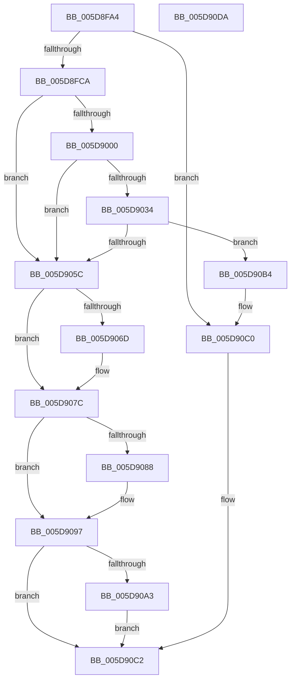

# PpmHeteroInitializeFeedbackClass

- RVA: `0x005D8FA4`–`0x005D90DB` (길이 `311` bytes)
- VA: `0x00000001405D8FA4`
- 실행 섹션: `.text`
- PDB 이름 있음: `예`; PDB Function 태그: `아니요`
- unwind 정보 RVA: `0x000C90FC`
- 디코드: `77`개 명령, `311/311` bytes 표시
- 미해석 바이트: `0` (있으면 어셈블리에 `.byte`로 보존)

> 이 문서는 커널 이미지의 기계어와 PDB 기호를 분석해 생성했습니다. 4번과 5번은 함수 원형과 자료형을 바이너리 사용 방식에서 추정한 C 해석이며 원본 소스 복구 결과는 아닙니다.

## 1. Dependencies

- 직접 호출 지점: **6**; 고유 호출 대상: **2**
- 직접 호출자로 확인된 함수: **1**
- RIP 상대 이미지 참조: **1**

### Outgoing calls
- `0x005D8FEC` → [ExAllocatePool2](../../poolcode/B8/ExAllocatePool2_function_00B820F0.md) (function, `0x00B820F0`)
- `0x005D9020` → [ExAllocatePool2](../../poolcode/B8/ExAllocatePool2_function_00B820F0.md) (function, `0x00B820F0`)
- `0x005D9048` → [ExAllocatePool2](../../poolcode/B8/ExAllocatePool2_function_00B820F0.md) (function, `0x00B820F0`)
- `0x005D906F` → [ExFreePoolWithTag](../../poolcode/B8/ExFreePoolWithTag_function_00B82870.md) (function, `0x00B82870`)
- `0x005D908A` → [ExFreePoolWithTag](../../poolcode/B8/ExFreePoolWithTag_function_00B82870.md) (function, `0x00B82870`)
- `0x005D90A5` → [ExFreePoolWithTag](../../poolcode/B8/ExFreePoolWithTag_function_00B82870.md) (function, `0x00B82870`)

### Direct callers
- [PpmHeteroHgsProcessorInit](PpmHeteroHgsProcessorInit_function_005D8C08.md) at `0x005D8CD0`

### Static image references
- `0x005D8FCA` → RVA `0x00FC6BC8` (`ALMOSTRO`; read)

## 2. Other-region calls and transfers

- 다른 실행 섹션으로 향하는 call: **6**
  - `0x005D8FEC` → [ExAllocatePool2](../../poolcode/B8/ExAllocatePool2_function_00B820F0.md) (`.text` → `POOLCODE`)
  - `0x005D9020` → [ExAllocatePool2](../../poolcode/B8/ExAllocatePool2_function_00B820F0.md) (`.text` → `POOLCODE`)
  - `0x005D9048` → [ExAllocatePool2](../../poolcode/B8/ExAllocatePool2_function_00B820F0.md) (`.text` → `POOLCODE`)
  - `0x005D906F` → [ExFreePoolWithTag](../../poolcode/B8/ExFreePoolWithTag_function_00B82870.md) (`.text` → `POOLCODE`)
  - `0x005D908A` → [ExFreePoolWithTag](../../poolcode/B8/ExFreePoolWithTag_function_00B82870.md) (`.text` → `POOLCODE`)
  - `0x005D90A5` → [ExFreePoolWithTag](../../poolcode/B8/ExFreePoolWithTag_function_00B82870.md) (`.text` → `POOLCODE`)
- 별도 외부 분기/꼬리 이동을 확인하지 못했습니다.

## 3. Assembly (complete function range)

```asm
005D8FA4  48 89 5C 24 08                  mov qword ptr [rsp + 8], rbx
005D8FA9  48 89 6C 24 10                  mov qword ptr [rsp + 0x10], rbp
005D8FAE  48 89 7C 24 18                  mov qword ptr [rsp + 0x18], rdi
005D8FB3  41 56                           push r14
005D8FB5  48 83 EC 20                     sub rsp, 0x20
005D8FB9  48 83 B9 50 8A 00 00 00         cmp qword ptr [rcx + 0x8a50], 0
005D8FC1  48 8B F9                        mov rdi, rcx
005D8FC4  0F 85 F6 00 00 00               jne 0x1405d90c0
005D8FCA  48 8B 05 F7 DB 9E 00            mov rax, qword ptr [rip + 0x9edbf7]
005D8FD1  BD 50 50 4D 70                  mov ebp, 0x704d5050
005D8FD6  41 BE 40 00 00 00               mov r14d, 0x40
005D8FDC  44 8B C5                        mov r8d, ebp
005D8FDF  8B 48 04                        mov ecx, dword ptr [rax + 4]
005D8FE2  8D 14 8D 04 00 00 00            lea edx, [rcx*4 + 4]
005D8FE9  41 8B CE                        mov ecx, r14d
005D8FEC  E8 FF 90 5A 00                  call 0x140b820f0
005D8FF1  48 89 87 50 8A 00 00            mov qword ptr [rdi + 0x8a50], rax
005D8FF8  48 8B D0                        mov rdx, rax
005D8FFB  48 85 C0                        test rax, rax
005D8FFE  74 5C                           je 0x1405d905c
005D9000  48 8B 0D C1 DB 9E 00            mov rcx, qword ptr [rip + 0x9edbc1]
005D9007  44 8B C5                        mov r8d, ebp
005D900A  8B 41 04                        mov eax, dword ptr [rcx + 4]
005D900D  89 02                           mov dword ptr [rdx], eax
005D900F  8B 41 04                        mov eax, dword ptr [rcx + 4]
005D9012  41 8B CE                        mov ecx, r14d
005D9015  8D 04 C5 08 00 00 00            lea eax, [rax*8 + 8]
005D901C  8B D0                           mov edx, eax
005D901E  8B D8                           mov ebx, eax
005D9020  E8 CB 90 5A 00                  call 0x140b820f0
005D9025  48 89 87 58 8A 00 00            mov qword ptr [rdi + 0x8a58], rax
005D902C  48 8B C8                        mov rcx, rax
005D902F  48 85 C0                        test rax, rax
005D9032  74 28                           je 0x1405d905c
005D9034  48 8B 05 8D DB 9E 00            mov rax, qword ptr [rip + 0x9edb8d]
005D903B  44 8B C5                        mov r8d, ebp
005D903E  8B 50 04                        mov edx, dword ptr [rax + 4]
005D9041  89 11                           mov dword ptr [rcx], edx
005D9043  8B D3                           mov edx, ebx
005D9045  41 8B CE                        mov ecx, r14d
005D9048  E8 A3 90 5A 00                  call 0x140b820f0
005D904D  48 89 87 60 8A 00 00            mov qword ptr [rdi + 0x8a60], rax
005D9054  48 8B D0                        mov rdx, rax
005D9057  48 85 C0                        test rax, rax
005D905A  75 58                           jne 0x1405d90b4
005D905C  48 8B 8F 50 8A 00 00            mov rcx, qword ptr [rdi + 0x8a50]
005D9063  BB 9A 00 00 C0                  mov ebx, 0xc000009a
005D9068  48 85 C9                        test rcx, rcx
005D906B  74 0F                           je 0x1405d907c
005D906D  8B D5                           mov edx, ebp
005D906F  E8 FC 97 5A 00                  call 0x140b82870
005D9074  48 83 A7 50 8A 00 00 00         and qword ptr [rdi + 0x8a50], 0
005D907C  48 8B 8F 58 8A 00 00            mov rcx, qword ptr [rdi + 0x8a58]
005D9083  48 85 C9                        test rcx, rcx
005D9086  74 0F                           je 0x1405d9097
005D9088  8B D5                           mov edx, ebp
005D908A  E8 E1 97 5A 00                  call 0x140b82870
005D908F  48 83 A7 58 8A 00 00 00         and qword ptr [rdi + 0x8a58], 0
005D9097  48 8B 8F 60 8A 00 00            mov rcx, qword ptr [rdi + 0x8a60]
005D909E  48 85 C9                        test rcx, rcx
005D90A1  74 1F                           je 0x1405d90c2
005D90A3  8B D5                           mov edx, ebp
005D90A5  E8 C6 97 5A 00                  call 0x140b82870
005D90AA  48 83 A7 60 8A 00 00 00         and qword ptr [rdi + 0x8a60], 0
005D90B2  EB 0E                           jmp 0x1405d90c2
005D90B4  48 8B 05 0D DB 9E 00            mov rax, qword ptr [rip + 0x9edb0d]
005D90BB  8B 48 04                        mov ecx, dword ptr [rax + 4]
005D90BE  89 0A                           mov dword ptr [rdx], ecx
005D90C0  33 DB                           xor ebx, ebx
005D90C2  48 8B 6C 24 38                  mov rbp, qword ptr [rsp + 0x38]
005D90C7  8B C3                           mov eax, ebx
005D90C9  48 8B 5C 24 30                  mov rbx, qword ptr [rsp + 0x30]
005D90CE  48 8B 7C 24 40                  mov rdi, qword ptr [rsp + 0x40]
005D90D3  48 83 C4 20                     add rsp, 0x20
005D90D7  41 5E                           pop r14
005D90D9  C3                              ret
005D90DA  CC                              int3
```

## 4. C-style interpretation (structured pseudocode)

```c
__int64 __fastcall PpmHeteroInitializeFeedbackClass(__int64 a1)
{
    __int64 result;
    __int64 v_rbx;
    __int64 v_rsp;
    unsigned __int64 v_stack_p10;
    unsigned __int64 v_stack_p18;
    unsigned __int64 v_stack_p8;

    v_stack_p8 = v_rbx;
    v_stack_p10 = v_rbp;
    v_stack_p18 = v_rdi;
    v_rsp = (v_rsp) - (32);
    if ((*(unsigned __int64 *)(a1 + 35408)) != 0) goto loc_005D90C0;
    result = ExAllocatePool2(64, (unsigned int)(*(unsigned int *)(*(unsigned __int64 *)(v_rip + 10410999) + 4)) * 4 + 4, (unsigned int)((unsigned int)((unsigned int)(0x704D5050ULL))), a4);
    *(unsigned __int64 *)(a1 + 35408) = result;
    if (result == 0) goto loc_005D905C;
    *(unsigned int *)(result) = (unsigned int)((unsigned int)(*(unsigned int *)(*(unsigned __int64 *)(v_rip + 10410945) + 4)));
    result = ExAllocatePool2(64, (unsigned int)((unsigned int)((unsigned int)(*(unsigned int *)(*(unsigned __int64 *)(v_rip + 10410945) + 4)) * 8 + 8)), (unsigned int)((unsigned int)((unsigned int)(0x704D5050ULL))), a4);
    *(unsigned __int64 *)(a1 + 35416) = result;
    if (result == 0) goto loc_005D905C;
    *(unsigned int *)(result) = (unsigned int)((unsigned int)(*(unsigned int *)(*(unsigned __int64 *)(v_rip + 10410893) + 4)));
    result = ExAllocatePool2(64, (unsigned int)((unsigned int)((unsigned int)((unsigned int)((unsigned int)(*(unsigned int *)(*(unsigned __int64 *)(v_rip + 10410945) + 4)) * 8 + 8)))), (unsigned int)((unsigned int)((unsigned int)(0x704D5050ULL))), a4);
    *(unsigned __int64 *)(a1 + 35424) = result;
    if (result != 0) goto loc_005D90B4;
loc_005D905C:
    if (*(unsigned __int64 *)(a1 + 35408) != 0) {
        a2 = (unsigned int)((unsigned int)(0x704D5050ULL));
        result = ExFreePoolWithTag(*(unsigned __int64 *)(a1 + 35408), a2, (unsigned int)((unsigned int)((unsigned int)(0x704D5050ULL))), a4);
    }
    if (*(unsigned __int64 *)(a1 + 35416) != 0) {
        a2 = (unsigned int)((unsigned int)(0x704D5050ULL));
        result = ExFreePoolWithTag(*(unsigned __int64 *)(a1 + 35416), a2, (unsigned int)((unsigned int)((unsigned int)(0x704D5050ULL))), a4);
    }
    if (*(unsigned __int64 *)(a1 + 35424) == 0) goto loc_005D90C2;
    result = ExFreePoolWithTag(*(unsigned __int64 *)(a1 + 35424), (unsigned int)((unsigned int)((unsigned int)(0x704D5050ULL))), (unsigned int)((unsigned int)((unsigned int)(0x704D5050ULL))), a4);
    goto loc_005D90C2;
loc_005D90B4:
    *(unsigned int *)((unsigned int)((unsigned int)((unsigned int)(0x704D5050ULL)))) = (unsigned int)((unsigned int)(*(unsigned int *)(*(unsigned __int64 *)(v_rip + 10410765) + 4)));
loc_005D90C0:
    v_rbx = 0;
loc_005D90C2:
    v_rsp = (v_rsp) + (32);
    return 0;
}
```

## 5. (Beta) C Style

```c
int64_t PpmHeteroInitializeFeedbackClass(void *Arg1)
{
    uint8_t *arg1 = (uint8_t *)Arg1;

    int64_t result;
    int64_t local_rbx;
    int64_t local_rsp;
    uint64_t v_stack_p10;
    uint64_t v_stack_p18;
    uint64_t v_stack_p8;

    v_stack_p8 = local_rbx;
    v_stack_p10 = local_rbp;
    v_stack_p18 = local_rdi;
    local_rsp = (local_rsp) - (32);
    if ((*(uint64_t *)(arg1 + 0x8A50)) != 0) goto loc_005D90C0;
    result = ExAllocatePool2(64, (uint32_t)(*(uint32_t *)(*(uint64_t *)(v_rip + 0x9EDBF7) + 0x4)) * 4 + 4, (uint32_t)((uint32_t)((uint32_t)(0x704D5050ULL))), a4);
    *(uint64_t *)(arg1 + 0x8A50) = result;
    if (result == 0) goto loc_005D905C;
    *(uint32_t *)(result) = (uint32_t)((uint32_t)(*(uint32_t *)(*(uint64_t *)(v_rip + 0x9EDBC1) + 0x4)));
    result = ExAllocatePool2(64, (uint32_t)((uint32_t)((uint32_t)(*(uint32_t *)(*(uint64_t *)(v_rip + 0x9EDBC1) + 0x4)) * 8 + 8)), (uint32_t)((uint32_t)((uint32_t)(0x704D5050ULL))), a4);
    *(uint64_t *)(arg1 + 0x8A58) = result;
    if (result == 0) goto loc_005D905C;
    *(uint32_t *)(result) = (uint32_t)((uint32_t)(*(uint32_t *)(*(uint64_t *)(v_rip + 0x9EDB8D) + 0x4)));
    result = ExAllocatePool2(64, (uint32_t)((uint32_t)((uint32_t)((uint32_t)((uint32_t)(*(uint32_t *)(*(uint64_t *)(v_rip + 0x9EDBC1) + 0x4)) * 8 + 8)))), (uint32_t)((uint32_t)((uint32_t)(0x704D5050ULL))), a4);
    *(uint64_t *)(arg1 + 0x8A60) = result;
    if (result != 0) goto loc_005D90B4;
loc_005D905C:
    if (*(uint64_t *)(arg1 + 0x8A50) != 0) {
        a2 = (uint32_t)((uint32_t)(0x704D5050ULL));
        result = ExFreePoolWithTag(*(uint64_t *)(arg1 + 0x8A50), a2, (uint32_t)((uint32_t)((uint32_t)(0x704D5050ULL))), a4);
    }
    if (*(uint64_t *)(arg1 + 0x8A58) != 0) {
        a2 = (uint32_t)((uint32_t)(0x704D5050ULL));
        result = ExFreePoolWithTag(*(uint64_t *)(arg1 + 0x8A58), a2, (uint32_t)((uint32_t)((uint32_t)(0x704D5050ULL))), a4);
    }
    if (*(uint64_t *)(arg1 + 0x8A60) == 0) goto loc_005D90C2;
    result = ExFreePoolWithTag(*(uint64_t *)(arg1 + 0x8A60), (uint32_t)((uint32_t)((uint32_t)(0x704D5050ULL))), (uint32_t)((uint32_t)((uint32_t)(0x704D5050ULL))), a4);
    goto loc_005D90C2;
loc_005D90B4:
    *(uint32_t *)((uint32_t)((uint32_t)((uint32_t)(0x704D5050ULL)))) = (uint32_t)((uint32_t)(*(uint32_t *)(*(uint64_t *)(v_rip + 0x9EDB0D) + 0x4)));
loc_005D90C0:
    local_rbx = 0;
loc_005D90C2:
    local_rsp = (local_rsp) + (32);
    return 0;
}
```

### 관측된 메모리 오프셋

구조체 형식이 확인되지 않은 접근은 인자 기준의 오프셋으로만 기록했습니다.

| 기준 인자 | 오프셋 표현 | 폭 (bit) | 접근 |
|---|---:|---:|---|
| `Arg1` | `+ 0x8A50` | `64` | `R` |
| `Arg1` | `+ 0x8A50` | `64` | `R/W` |
| `Arg1` | `+ 0x8A50` | `64` | `W` |
| `Arg1` | `+ 0x8A58` | `64` | `R` |
| `Arg1` | `+ 0x8A58` | `64` | `R/W` |
| `Arg1` | `+ 0x8A58` | `64` | `W` |
| `Arg1` | `+ 0x8A60` | `64` | `R` |
| `Arg1` | `+ 0x8A60` | `64` | `R/W` |
| `Arg1` | `+ 0x8A60` | `64` | `W` |

## 6. Execution-region graph

[열기: 2D/3D 그래프와 함수 탐색 컨트롤 패널](../../../control-panel.html?section=text&rva=0x005D8FA4&view=graph)

- 2D 그래프는 위에서 아래로 흐르고, 3D 그래프는 빈 공간을 드래그해 회전합니다. Shift+드래그는 이동, 휠은 확대·축소, 함수 노드 선택은 대상 보고서 이동입니다.

### Static fallback


