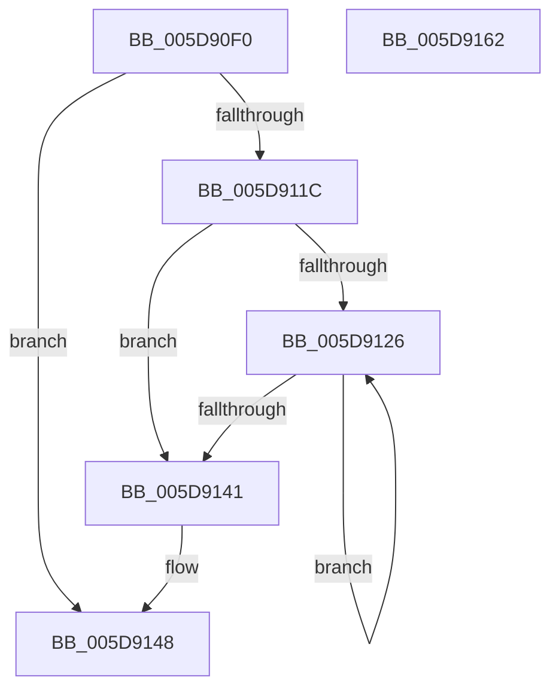

# PpmHighPerfRequestExpiration

- RVA: `0x005D90F0`–`0x005D9163` (길이 `115` bytes)
- VA: `0x00000001405D90F0`
- 실행 섹션: `.text`
- PDB 이름 있음: `예`; PDB Function 태그: `아니요`
- unwind 정보 RVA: `0x0005CAAC`
- 디코드: `27`개 명령, `115/115` bytes 표시
- 미해석 바이트: `0` (있으면 어셈블리에 `.byte`로 보존)

> 이 문서는 커널 이미지의 기계어와 PDB 기호를 분석해 생성했습니다. 4번과 5번은 함수 원형과 자료형을 바이너리 사용 방식에서 추정한 C 해석이며 원본 소스 복구 결과는 아닙니다.

## 1. Dependencies

- 직접 호출 지점: **3**; 고유 호출 대상: **3**
- 직접 호출자로 확인된 함수: **0**
- RIP 상대 이미지 참조: **5**

### Outgoing calls
- `0x005D9101` → [KeAcquireSpinLockRaiseToDpc](../20/KeAcquireSpinLockRaiseToDpc_function_00208470.md) (function, `0x00208470`)
- `0x005D9132` → [PopPowerRequestReferenceRelease](../47/PopPowerRequestReferenceRelease_function_004775B0.md) (function, `0x004775B0`)
- `0x005D9152` → [KeReleaseSpinLock](../39/KeReleaseSpinLock_function_00392BA0.md) (function, `0x00392BA0`)

### Direct callers
- 이 함수 시작 RVA로 연결되는 직접 call은 확인되지 않았습니다. 간접 호출은 완전히 역산할 수 없습니다.

### Static image references
- `0x005D90FA` → RVA `0x00F0CFA0` (`.data`; read)
- `0x005D9113` → RVA `0x00F0C8B8` (`.data`; read)
- `0x005D911E` → RVA `0x00F0C8C0` (`.data`; read)
- `0x005D9126` → RVA `0x00F0CFB8` (`.data`; read)
- `0x005D9141` → RVA `0x00F0C8C0` (`.data`; read/write)

## 2. Other-region calls and transfers

- 다른 실행 섹션으로 향하는 call: **0**
- 별도 외부 분기/꼬리 이동을 확인하지 못했습니다.

## 3. Assembly (complete function range)

```asm
005D90F0  48 89 5C 24 08                  mov qword ptr [rsp + 8], rbx
005D90F5  57                              push rdi
005D90F6  48 83 EC 20                     sub rsp, 0x20
005D90FA  48 8D 0D 9F 3E 93 00            lea rcx, [rip + 0x933e9f]
005D9101  E8 6A F3 C2 FF                  call 0x140208470
005D9106  40 8A F8                        mov dil, al
005D9109  48 A1 08 00 00 00 80 F7 FF FF   movabs rax, qword ptr [0xfffff78000000008]
005D9113  48 3B 05 9E 37 93 00            cmp rax, qword ptr [rip + 0x93379e]
005D911A  72 2C                           jb 0x1405d9148
005D911C  33 DB                           xor ebx, ebx
005D911E  39 1D 9C 37 93 00               cmp dword ptr [rip + 0x93379c], ebx
005D9124  76 1B                           jbe 0x1405d9141
005D9126  48 8B 0D 8B 3E 93 00            mov rcx, qword ptr [rip + 0x933e8b]
005D912D  BA 04 00 00 00                  mov edx, 4
005D9132  E8 79 E4 E9 FF                  call 0x1404775b0
005D9137  FF C3                           inc ebx
005D9139  3B 1D 81 37 93 00               cmp ebx, dword ptr [rip + 0x933781]
005D913F  72 E5                           jb 0x1405d9126
005D9141  83 25 78 37 93 00 00            and dword ptr [rip + 0x933778], 0
005D9148  40 8A D7                        mov dl, dil
005D914B  48 8D 0D 4E 3E 93 00            lea rcx, [rip + 0x933e4e]
005D9152  E8 49 9A DB FF                  call 0x140392ba0
005D9157  48 8B 5C 24 30                  mov rbx, qword ptr [rsp + 0x30]
005D915C  48 83 C4 20                     add rsp, 0x20
005D9160  5F                              pop rdi
005D9161  C3                              ret
005D9162  CC                              int3
```

## 4. C-style interpretation (structured pseudocode)

```c
__int64 __fastcall PpmHighPerfRequestExpiration(void)
{
    __int64 result;
    __int64 v_rbx;
    __int64 v_rsp;
    unsigned __int64 v_stack_p8;

    v_stack_p8 = v_rbx;
    v_rsp = (v_rsp) - (32);
    result = KeAcquireSpinLockRaiseToDpc(v_rip + 9649823, a2, a3, a4);
    if (result < (*(unsigned __int64 *)(v_rip + 9648030))) goto loc_005D9148;
    v_rbx = 0;
    if ((*(unsigned int *)(v_rip + 9648028)) <= 0) goto loc_005D9141;
loc_005D9126:
    result = PopPowerRequestReferenceRelease(*(unsigned __int64 *)(v_rip + 9649803), 4, a3, a4);
    v_rbx = (unsigned int)((v_rbx) + 1);
    if (((unsigned int)(v_rbx)) < (*(unsigned int *)(v_rip + 9648001))) goto loc_005D9126;
loc_005D9141:
loc_005D9148:
    result = KeReleaseSpinLock(v_rip + 9649742, (unsigned __int8)((unsigned __int8)(result)), a3, a4);
    v_rsp = (v_rsp) + (32);
    return result;
}
```

## 5. (Beta) C Style

```c
void PpmHighPerfRequestExpiration(void)
{
    int64_t result;
    int64_t local_rbx;
    int64_t local_rsp;
    uint64_t v_stack_p8;

    v_stack_p8 = local_rbx;
    local_rsp = (local_rsp) - (32);
    result = KeAcquireSpinLockRaiseToDpc(v_rip + 9649823, a2, a3, a4);
    if (result < (*(uint64_t *)(v_rip + 0x93379E))) goto loc_005D9148;
    local_rbx = 0;
    if ((*(uint32_t *)(v_rip + 0x93379C)) <= 0) goto loc_005D9141;
loc_005D9126:
    result = PopPowerRequestReferenceRelease(*(uint64_t *)(v_rip + 0x933E8B), 4, a3, a4);
    local_rbx = (uint32_t)((local_rbx) + 1);
    if (((uint32_t)(local_rbx)) < (*(uint32_t *)(v_rip + 0x933781))) goto loc_005D9126;
loc_005D9141:
loc_005D9148:
    result = KeReleaseSpinLock(v_rip + 9649742, (uint8_t)((uint8_t)(result)), a3, a4);
    local_rsp = (local_rsp) + (32);
    return result;
}
```

## 6. Execution-region graph

[열기: 2D/3D 그래프와 함수 탐색 컨트롤 패널](../../../control-panel.html?section=text&rva=0x005D90F0&view=graph)

- 2D 그래프는 위에서 아래로 흐르고, 3D 그래프는 빈 공간을 드래그해 회전합니다. Shift+드래그는 이동, 휠은 확대·축소, 함수 노드 선택은 대상 보고서 이동입니다.

### Static fallback


