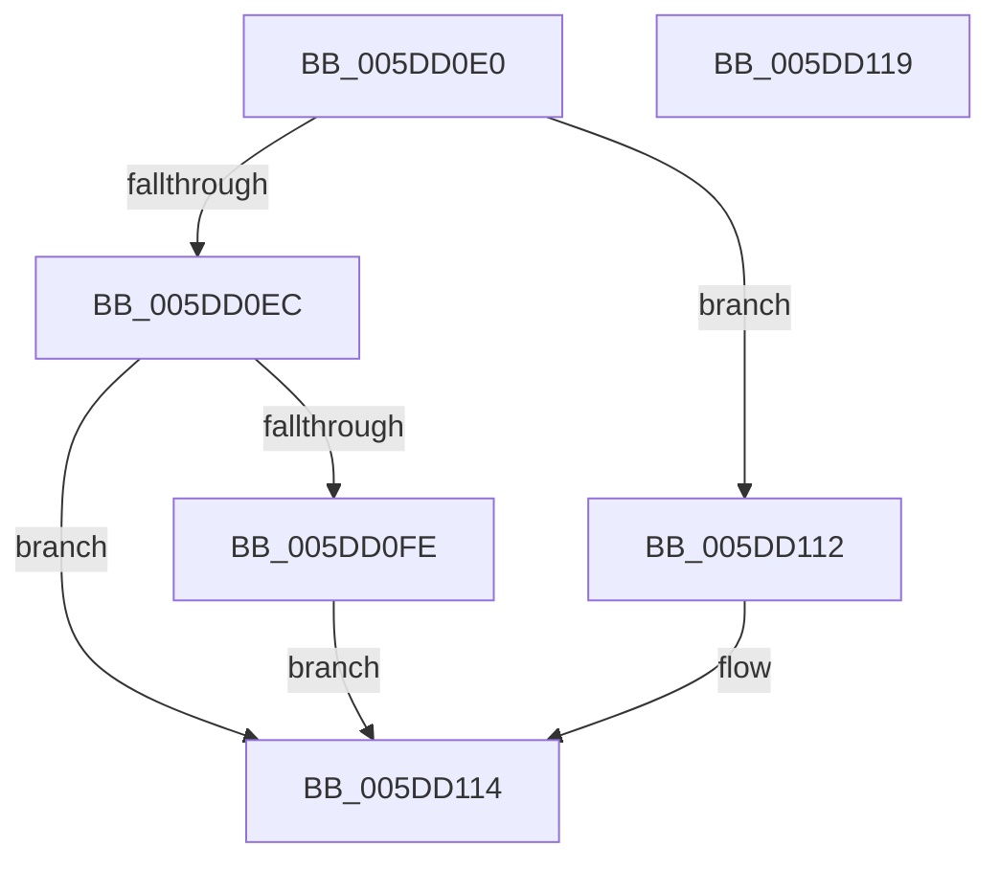

# PpmIdleGuestPreExecute

- RVA: `0x005DD0E0`–`0x005DD11A` (길이 `58` bytes)
- VA: `0x00000001405DD0E0`
- 실행 섹션: `.text`
- PDB 이름 있음: `예`; PDB Function 태그: `아니요`
- unwind 정보 RVA: `0x0005D2F4`
- 디코드: `18`개 명령, `58/58` bytes 표시
- 미해석 바이트: `0` (있으면 어셈블리에 `.byte`로 보존)

> 이 문서는 커널 이미지의 기계어와 PDB 기호를 분석해 생성했습니다. 4번과 5번은 함수 원형과 자료형을 바이너리 사용 방식에서 추정한 C 해석이며 원본 소스 복구 결과는 아닙니다.

## 1. Dependencies

- 직접 호출 지점: **1**; 고유 호출 대상: **1**
- 직접 호출자로 확인된 함수: **0**
- RIP 상대 이미지 참조: **1**

### Outgoing calls
- `0x005DD10B` → [guard_dispatch_icall](../6B/guard_dispatch_icall_function_006BAAD0.md) (function, `0x006BAAD0`)

### Direct callers
- 이 함수 시작 RVA로 연결되는 직접 call은 확인되지 않았습니다. 간접 호출은 완전히 역산할 수 없습니다.

### Static image references
- `0x005DD0EC` → RVA `0x00FC6AD0` (`ALMOSTRO`; read)

## 2. Other-region calls and transfers

- 다른 실행 섹션으로 향하는 call: **0**
- 별도 외부 분기/꼬리 이동을 확인하지 못했습니다.

## 3. Assembly (complete function range)

```asm
005DD0E0  48 83 EC 38                     sub rsp, 0x38
005DD0E4  83 CA FF                        or edx, 0xffffffff
005DD0E7  44 3B C2                        cmp r8d, edx
005DD0EA  74 26                           je 0x1405dd112
005DD0EC  48 8B 05 DD 99 9E 00            mov rax, qword ptr [rip + 0x9e99dd]
005DD0F3  4C 8B 50 18                     mov r10, qword ptr [rax + 0x18]
005DD0F7  33 C0                           xor eax, eax
005DD0F9  4D 85 D2                        test r10, r10
005DD0FC  74 16                           je 0x1405dd114
005DD0FE  48 8B 44 24 60                  mov rax, qword ptr [rsp + 0x60]
005DD103  48 89 44 24 20                  mov qword ptr [rsp + 0x20], rax
005DD108  49 8B C2                        mov rax, r10
005DD10B  E8 C0 D9 0D 00                  call 0x1406baad0
005DD110  EB 02                           jmp 0x1405dd114
005DD112  33 C0                           xor eax, eax
005DD114  48 83 C4 38                     add rsp, 0x38
005DD118  C3                              ret
005DD119  CC                              int3
```

## 4. C-style interpretation (structured pseudocode)

```c
__int64 __fastcall PpmIdleGuestPreExecute(__int64 a1, int a2, int a3, __int64 a4, __int64 a5)
{
    __int64 result;
    __int64 v_rsp;
    unsigned __int64 v_stack_m18;

    v_rsp = (v_rsp) - (56);
    a2 = (unsigned int)((a2) | (0xFFFFFFFFULL));
    if (a3 == a2) goto loc_005DD112;
    result = 0;
    if (*(unsigned __int64 *)(*(unsigned __int64 *)(v_rip + 10394077) + 24) == 0) goto loc_005DD114;
    v_stack_m18 = a5;
    result = guard_dispatch_icall(a1, a2, a3, a4);
    goto loc_005DD114;
loc_005DD112:
    result = 0;
loc_005DD114:
    v_rsp = (v_rsp) + (56);
    return result;
}
```

## 5. (Beta) C Style

```c
int64_t PpmIdleGuestPreExecute(int64_t Arg1, int32_t Arg2, int32_t Arg3, int64_t Arg4, int64_t Arg5)
{
    int64_t result;
    int64_t local_rsp;
    uint64_t v_stack_m18;

    local_rsp = (local_rsp) - (56);
    Arg2 = (uint32_t)((Arg2) | (0xFFFFFFFFULL));
    if (Arg3 == Arg2) goto loc_005DD112;
    result = 0;
    if (*(uint64_t *)(*(uint64_t *)(v_rip + 0x9E99DD) + 0x18) == 0) goto loc_005DD114;
    v_stack_m18 = Arg5;
    result = guard_dispatch_icall(Arg1, Arg2, Arg3, Arg4);
    goto loc_005DD114;
loc_005DD112:
    result = 0;
loc_005DD114:
    local_rsp = (local_rsp) + (56);
    return result;
}
```

## 6. Execution-region graph

[열기: 2D/3D 그래프와 함수 탐색 컨트롤 패널](../../../control-panel.html?section=text&rva=0x005DD0E0&view=graph)

- 2D 그래프는 위에서 아래로 흐르고, 3D 그래프는 빈 공간을 드래그해 회전합니다. Shift+드래그는 이동, 휠은 확대·축소, 함수 노드 선택은 대상 보고서 이동입니다.

### Static fallback


