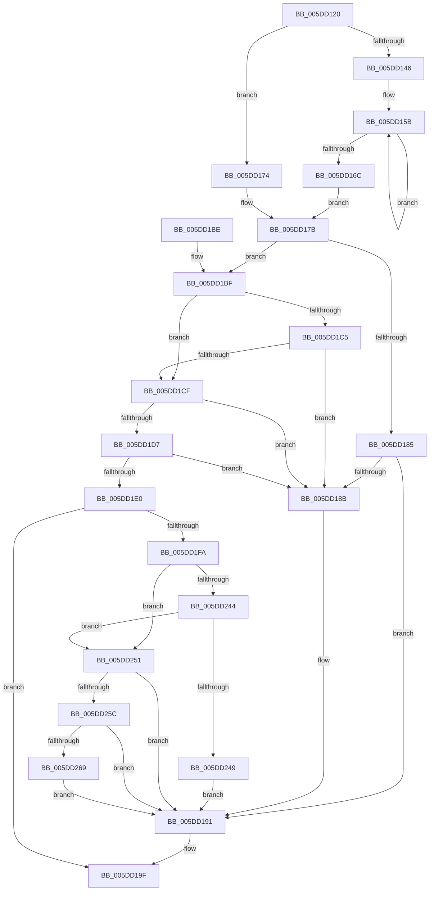

# PpmIdleGuestPreselect

- RVA: `0x005DD120`–`0x005DD271` (길이 `337` bytes)
- VA: `0x00000001405DD120`
- 실행 섹션: `.text`
- PDB 이름 있음: `예`; PDB Function 태그: `아니요`
- unwind 정보 RVA: `0x000CD6EC`
- 디코드: `85`개 명령, `337/337` bytes 표시
- 미해석 바이트: `0` (있으면 어셈블리에 `.byte`로 보존)

> 이 문서는 커널 이미지의 기계어와 PDB 기호를 분석해 생성했습니다. 4번과 5번은 함수 원형과 자료형을 바이너리 사용 방식에서 추정한 C 해석이며 원본 소스 복구 결과는 아닙니다.

## 1. Dependencies

- 직접 호출 지점: **0**; 고유 호출 대상: **0**
- 직접 호출자로 확인된 함수: **0**
- RIP 상대 이미지 참조: **2**

### Outgoing calls
- 직접 디코드된 call 명령이 없습니다.

### Direct callers
- 이 함수 시작 RVA로 연결되는 직접 call은 확인되지 않았습니다. 간접 호출은 완전히 역산할 수 없습니다.

### Static image references
- `0x005DD14D` → RVA `0x00E3EDD0` (`.data`; read)
- `0x005DD154` → RVA `0x00E3EDD4` (`.data`; read)

## 2. Other-region calls and transfers

- 다른 실행 섹션으로 향하는 call: **0**
- 별도 외부 분기/꼬리 이동을 확인하지 못했습니다.

## 3. Assembly (complete function range)

```asm
005DD120  48 8B C4                        mov rax, rsp
005DD123  48 89 58 08                     mov qword ptr [rax + 8], rbx
005DD127  48 89 68 10                     mov qword ptr [rax + 0x10], rbp
005DD12B  48 89 70 18                     mov qword ptr [rax + 0x18], rsi
005DD12F  48 89 78 20                     mov qword ptr [rax + 0x20], rdi
005DD133  65 4C 8B 0C 25 20 00 00 00      mov r9, qword ptr gs:[0x20]
005DD13C  41 83 B9 20 89 00 00 02         cmp dword ptr [r9 + 0x8920], 2
005DD144  7C 2E                           jl 0x1405dd174
005DD146  49 8B 89 D0 8B 00 00            mov rcx, qword ptr [r9 + 0x8bd0]
005DD14D  44 8B 05 7C 1C 86 00            mov r8d, dword ptr [rip + 0x861c7c]
005DD154  44 8B 1D 79 1C 86 00            mov r11d, dword ptr [rip + 0x861c79]
005DD15B  4E 8B 14 C1                     mov r10, qword ptr [rcx + r8*8]
005DD15F  4A 8B 1C D9                     mov rbx, qword ptr [rcx + r11*8]
005DD163  4A 8B 04 C1                     mov rax, qword ptr [rcx + r8*8]
005DD167  4C 3B D0                        cmp r10, rax
005DD16A  75 EF                           jne 0x1405dd15b
005DD16C  4D 8B DA                        mov r11, r10
005DD16F  4C 2B DB                        sub r11, rbx
005DD172  EB 07                           jmp 0x1405dd17b
005DD174  4C 8B 12                        mov r10, qword ptr [rdx]
005DD177  4C 8B 5A 08                     mov r11, qword ptr [rdx + 8]
005DD17B  44 8B 42 20                     mov r8d, dword ptr [rdx + 0x20]
005DD17F  41 83 F8 FF                     cmp r8d, -1
005DD183  74 3A                           je 0x1405dd1bf
005DD185  41 83 F8 02                     cmp r8d, 2
005DD189  72 06                           jb 0x1405dd191
005DD18B  41 B8 01 00 00 00               mov r8d, 1
005DD191  4D 89 91 A0 89 00 00            mov qword ptr [r9 + 0x89a0], r10
005DD198  4D 89 99 A8 89 00 00            mov qword ptr [r9 + 0x89a8], r11
005DD19F  48 8B 5C 24 08                  mov rbx, qword ptr [rsp + 8]
005DD1A4  41 8B C0                        mov eax, r8d
005DD1A7  48 8B 6C 24 10                  mov rbp, qword ptr [rsp + 0x10]
005DD1AC  48 8B 74 24 18                  mov rsi, qword ptr [rsp + 0x18]
005DD1B1  48 8B 7C 24 20                  mov rdi, qword ptr [rsp + 0x20]
005DD1B6  45 88 81 7E 88 00 00            mov byte ptr [r9 + 0x887e], r8b
005DD1BD  C3                              ret
005DD1BE  CC                              int3
005DD1BF  80 7A 2A 00                     cmp byte ptr [rdx + 0x2a], 0
005DD1C3  74 0A                           je 0x1405dd1cf
005DD1C5  41 83 B9 20 89 00 00 02         cmp dword ptr [r9 + 0x8920], 2
005DD1CD  7C BC                           jl 0x1405dd18b
005DD1CF  0F B6 4A 29                     movzx ecx, byte ptr [rdx + 0x29]
005DD1D3  84 C9                           test cl, cl
005DD1D5  74 B4                           je 0x1405dd18b
005DD1D7  0F B6 7A 28                     movzx edi, byte ptr [rdx + 0x28]
005DD1DB  40 84 FF                        test dil, dil
005DD1DE  74 AB                           je 0x1405dd18b
005DD1E0  8B 42 24                        mov eax, dword ptr [rdx + 0x24]
005DD1E3  49 8B DA                        mov rbx, r10
005DD1E6  49 2B 99 A0 89 00 00            sub rbx, qword ptr [r9 + 0x89a0]
005DD1ED  45 0F B6 81 7E 88 00 00         movzx r8d, byte ptr [r9 + 0x887e]
005DD1F5  48 3B D8                        cmp rbx, rax
005DD1F8  72 A5                           jb 0x1405dd19f
005DD1FA  48 0F AF FB                     imul rdi, rbx
005DD1FE  48 0F AF CB                     imul rcx, rbx
005DD202  48 BD 15 AE 47 E1 7A 14 AE 47   movabs rbp, 0x47ae147ae147ae15
005DD20C  49 8B F3                        mov rsi, r11
005DD20F  49 2B B1 A8 89 00 00            sub rsi, qword ptr [r9 + 0x89a8]
005DD216  48 8B C5                        mov rax, rbp
005DD219  48 F7 E7                        mul rdi
005DD21C  48 8B C5                        mov rax, rbp
005DD21F  48 2B FA                        sub rdi, rdx
005DD222  48 D1 EF                        shr rdi, 1
005DD225  48 03 FA                        add rdi, rdx
005DD228  48 F7 E1                        mul rcx
005DD22B  48 C1 EF 06                     shr rdi, 6
005DD22F  48 2B CA                        sub rcx, rdx
005DD232  48 D1 E9                        shr rcx, 1
005DD235  48 8D 04 0A                     lea rax, [rdx + rcx]
005DD239  48 C1 E8 06                     shr rax, 6
005DD23D  8B C0                           mov eax, eax
005DD23F  48 3B F0                        cmp rsi, rax
005DD242  73 0D                           jae 0x1405dd251
005DD244  45 85 C0                        test r8d, r8d
005DD247  74 08                           je 0x1405dd251
005DD249  41 FF C8                        dec r8d
005DD24C  E9 40 FF FF FF                  jmp 0x1405dd191
005DD251  8B C7                           mov eax, edi
005DD253  48 3B F0                        cmp rsi, rax
005DD256  0F 82 35 FF FF FF               jb 0x1405dd191
005DD25C  41 8D 40 01                     lea eax, [r8 + 1]
005DD260  83 F8 02                        cmp eax, 2
005DD263  0F 83 28 FF FF FF               jae 0x1405dd191
005DD269  44 8B C0                        mov r8d, eax
005DD26C  E9 20 FF FF FF                  jmp 0x1405dd191
```

## 4. C-style interpretation (structured pseudocode)

```c
__int64 __fastcall PpmIdleGuestPreselect(__int64 a1, __int64 a2)
{
    __int64 result;
    __int64 v_r11;
    __int64 v_rbx;
    __int64 v_rdi;
    __int64 v_rsi;
    unsigned __int64 v_stack_p10;
    unsigned __int64 v_stack_p18;
    unsigned __int64 v_stack_p20;
    unsigned __int64 v_stack_p8;

    *(unsigned __int64 *)(v_rsp + 8) = v_rbx;
    *(unsigned __int64 *)(v_rsp + 16) = v_rbp;
    *(unsigned __int64 *)(v_rsp + 24) = v_rsi;
    *(unsigned __int64 *)(v_rsp + 32) = v_rdi;
    if ((*(unsigned int *)(*(unsigned __int64 *)(gs_base + (0 + 32)) + 35104)) < 2) goto loc_005DD174;
loc_005DD15B:
    if ((*(unsigned __int64 *)(*(unsigned __int64 *)(*(unsigned __int64 *)(gs_base + (0 + 32)) + 35792) + (unsigned int)(*(unsigned int *)(v_rip + 8789116)) * 8)) != (*(unsigned __int64 *)(*(unsigned __int64 *)(*(unsigned __int64 *)(gs_base + (0 + 32)) + 35792) + (unsigned int)(*(unsigned int *)(v_rip + 8789116)) * 8))) goto loc_005DD15B;
    v_r11 = (*(unsigned __int64 *)(*(unsigned __int64 *)(*(unsigned __int64 *)(gs_base + (0 + 32)) + 35792) + (unsigned int)(*(unsigned int *)(v_rip + 8789116)) * 8)) - (*(unsigned __int64 *)(*(unsigned __int64 *)(*(unsigned __int64 *)(gs_base + (0 + 32)) + 35792) + (unsigned int)(*(unsigned int *)(v_rip + 8789113)) * 8));
    goto loc_005DD17B;
loc_005DD174:
loc_005DD17B:
    if (((unsigned int)((unsigned int)(*(unsigned int *)(a2 + 32)))) == -1) goto loc_005DD1BF;
    if (((unsigned int)((unsigned int)(*(unsigned int *)(a2 + 32)))) >= 2) {
        a3 = 1;
    }
    *(unsigned __int64 *)(*(unsigned __int64 *)(gs_base + (0 + 32)) + 35232) = *(unsigned __int64 *)(a2);
    *(unsigned __int64 *)(*(unsigned __int64 *)(gs_base + (0 + 32)) + 35240) = *(unsigned __int64 *)(a2 + 8);
loc_005DD19F:
    *(unsigned __int8 *)(*(unsigned __int64 *)(gs_base + (0 + 32)) + 34942) = (unsigned __int8)(a3);
    return (unsigned int)((unsigned int)(a3));
loc_005DD1BF:
    if ((*(unsigned __int8 *)(a2 + 42)) == 0) goto loc_005DD1CF;
    if ((*(unsigned int *)(*(unsigned __int64 *)(gs_base + (0 + 32)) + 35104)) < 2) goto loc_005DD18B;
loc_005DD1CF:
    if ((unsigned __int8)(*(unsigned __int8 *)(a2 + 41)) == 0) goto loc_005DD18B;
    if ((unsigned __int8)(*(unsigned __int8 *)(a2 + 40)) == 0) goto loc_005DD18B;
    v_rbx = (*(unsigned __int64 *)(a2)) - (*(unsigned __int64 *)(*(unsigned __int64 *)(gs_base + (0 + 32)) + 35232));
    if (v_rbx < ((unsigned int)(*(unsigned int *)(a2 + 36)))) goto loc_005DD19F;
    v_rdi = (*(unsigned __int8 *)(a2 + 40)) * (v_rbx);
    a1 = (*(unsigned __int8 *)(a2 + 41)) * (v_rbx);
    v_rsi = (*(unsigned __int64 *)(a2 + 8)) - (*(unsigned __int64 *)(*(unsigned __int64 *)(gs_base + (0 + 32)) + 35240));
    v_rdi = (v_rdi) - (a2);
    v_rdi = (v_rdi) >> (1);
    v_rdi = (v_rdi) + (a2);
    v_rdi = (v_rdi) >> (6);
    a1 = (a1) - (a2);
    a1 = (a1) >> (1);
    result = (a2 + a1 * 1) >> (6);
    if (v_rsi >= ((unsigned int)((unsigned int)(result)))) goto loc_005DD251;
    if ((unsigned int)(*(unsigned __int8 *)(*(unsigned __int64 *)(gs_base + (0 + 32)) + 34942)) == 0) goto loc_005DD251;
    a3 = (unsigned int)((*(unsigned __int8 *)(*(unsigned __int64 *)(gs_base + (0 + 32)) + 34942)) - 1);
    goto loc_005DD191;
loc_005DD251:
    if (v_rsi < ((unsigned int)((unsigned int)(v_rdi)))) goto loc_005DD191;
    if (((unsigned int)(a3 + 1)) >= 2) goto loc_005DD191;
    goto loc_005DD191;
}
```

## 5. (Beta) C Style

```c
int64_t PpmIdleGuestPreselect(int64_t Arg1, void *Arg2)
{
    uint8_t *arg2 = (uint8_t *)Arg2;

    int64_t result;
    int64_t local_r11;
    int64_t local_rbx;
    int64_t local_rdi;
    int64_t local_rsi;
    uint64_t v_stack_p10;
    uint64_t v_stack_p18;
    uint64_t v_stack_p20;
    uint64_t v_stack_p8;

    *(uint64_t *)(local_rsp + 0x8) = local_rbx;
    *(uint64_t *)(local_rsp + 0x10) = local_rbp;
    *(uint64_t *)(local_rsp + 0x18) = local_rsi;
    *(uint64_t *)(local_rsp + 0x20) = local_rdi;
    if ((*(uint32_t *)(*(uint64_t *)(gs_base + (0 + 0x20)) + 0x8920)) < 2) goto loc_005DD174;
loc_005DD15B:
    if ((*(uint64_t *)(*(uint64_t *)(*(uint64_t *)(gs_base + (0 + 0x20)) + 0x8BD0) + (uint32_t)(*(uint32_t *)(v_rip + 0x861C7C)) * 8)) != (*(uint64_t *)(*(uint64_t *)(*(uint64_t *)(gs_base + (0 + 0x20)) + 0x8BD0) + (uint32_t)(*(uint32_t *)(v_rip + 0x861C7C)) * 8))) goto loc_005DD15B;
    local_r11 = (*(uint64_t *)(*(uint64_t *)(*(uint64_t *)(gs_base + (0 + 0x20)) + 0x8BD0) + (uint32_t)(*(uint32_t *)(v_rip + 0x861C7C)) * 8)) - (*(uint64_t *)(*(uint64_t *)(*(uint64_t *)(gs_base + (0 + 0x20)) + 0x8BD0) + (uint32_t)(*(uint32_t *)(v_rip + 0x861C79)) * 8));
    goto loc_005DD17B;
loc_005DD174:
loc_005DD17B:
    if (((uint32_t)((uint32_t)(*(uint32_t *)(arg2 + 0x20)))) == -1) goto loc_005DD1BF;
    if (((uint32_t)((uint32_t)(*(uint32_t *)(arg2 + 0x20)))) >= 2) {
        a3 = 1;
    }
    *(uint64_t *)(*(uint64_t *)(gs_base + (0 + 0x20)) + 0x89A0) = *(uint64_t *)(arg2);
    *(uint64_t *)(*(uint64_t *)(gs_base + (0 + 0x20)) + 0x89A8) = *(uint64_t *)(arg2 + 0x8);
loc_005DD19F:
    *(uint8_t *)(*(uint64_t *)(gs_base + (0 + 0x20)) + 0x887E) = (uint8_t)(a3);
    return (uint32_t)((uint32_t)(a3));
loc_005DD1BF:
    if ((*(uint8_t *)(arg2 + 0x2A)) == 0) goto loc_005DD1CF;
    if ((*(uint32_t *)(*(uint64_t *)(gs_base + (0 + 0x20)) + 0x8920)) < 2) goto loc_005DD18B;
loc_005DD1CF:
    if ((uint8_t)(*(uint8_t *)(arg2 + 0x29)) == 0) goto loc_005DD18B;
    if ((uint8_t)(*(uint8_t *)(arg2 + 0x28)) == 0) goto loc_005DD18B;
    local_rbx = (*(uint64_t *)(arg2)) - (*(uint64_t *)(*(uint64_t *)(gs_base + (0 + 0x20)) + 0x89A0));
    if (local_rbx < ((uint32_t)(*(uint32_t *)(arg2 + 0x24)))) goto loc_005DD19F;
    local_rdi = (*(uint8_t *)(arg2 + 0x28)) * (local_rbx);
    Arg1 = (*(uint8_t *)(arg2 + 0x29)) * (local_rbx);
    local_rsi = (*(uint64_t *)(arg2 + 0x8)) - (*(uint64_t *)(*(uint64_t *)(gs_base + (0 + 0x20)) + 0x89A8));
    local_rdi = (local_rdi) - (Arg2);
    local_rdi = (local_rdi) >> (1);
    local_rdi = (local_rdi) + (Arg2);
    local_rdi = (local_rdi) >> (6);
    Arg1 = (Arg1) - (Arg2);
    Arg1 = (Arg1) >> (1);
    result = (Arg2 + Arg1 * 1) >> (6);
    if (local_rsi >= ((uint32_t)((uint32_t)(result)))) goto loc_005DD251;
    if ((uint32_t)(*(uint8_t *)(*(uint64_t *)(gs_base + (0 + 0x20)) + 0x887E)) == 0) goto loc_005DD251;
    a3 = (uint32_t)((*(uint8_t *)(*(uint64_t *)(gs_base + (0 + 0x20)) + 0x887E)) - 1);
    goto loc_005DD191;
loc_005DD251:
    if (local_rsi < ((uint32_t)((uint32_t)(local_rdi)))) goto loc_005DD191;
    if (((uint32_t)(a3 + 1)) >= 2) goto loc_005DD191;
    goto loc_005DD191;
}
```

### 관측된 메모리 오프셋

구조체 형식이 확인되지 않은 접근은 인자 기준의 오프셋으로만 기록했습니다.

| 기준 인자 | 오프셋 표현 | 폭 (bit) | 접근 |
|---|---:|---:|---|
| `Arg2` | `+ 0x0` | `64` | `R` |
| `Arg2` | `+ 0x0 + rcx*1` | `64` | `R` |
| `Arg2` | `+ 0x8` | `64` | `R` |
| `Arg2` | `+ 0x20` | `32` | `R` |
| `Arg2` | `+ 0x24` | `32` | `R` |
| `Arg2` | `+ 0x28` | `8` | `R` |
| `Arg2` | `+ 0x29` | `8` | `R` |
| `Arg2` | `+ 0x2A` | `8` | `R` |

## 6. Execution-region graph

[열기: 2D/3D 그래프와 함수 탐색 컨트롤 패널](../../../control-panel.html?section=text&rva=0x005DD120&view=graph)

- 2D 그래프는 위에서 아래로 흐르고, 3D 그래프는 빈 공간을 드래그해 회전합니다. Shift+드래그는 이동, 휠은 확대·축소, 함수 노드 선택은 대상 보고서 이동입니다.

### Static fallback


