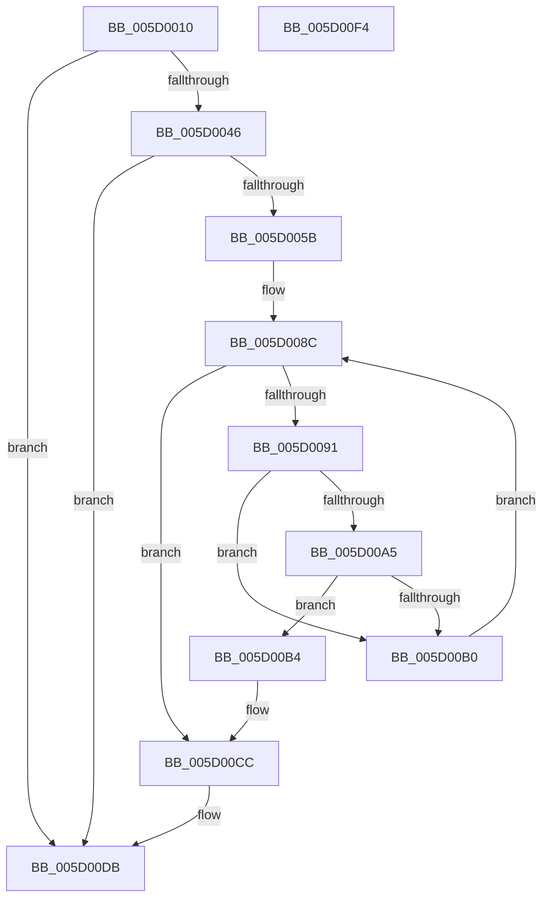

# PpmIdlePrevetoWatchdog

- RVA: `0x005D0010`–`0x005D00F5` (길이 `229` bytes)
- VA: `0x00000001405D0010`
- 실행 섹션: `.text`
- PDB 이름 있음: `예`; PDB Function 태그: `아니요`
- unwind 정보 RVA: `0x00095AD0`
- 디코드: `60`개 명령, `229/229` bytes 표시
- 미해석 바이트: `0` (있으면 어셈블리에 `.byte`로 보존)

> 이 문서는 커널 이미지의 기계어와 PDB 기호를 분석해 생성했습니다. 4번과 5번은 함수 원형과 자료형을 바이너리 사용 방식에서 추정한 C 해석이며 원본 소스 복구 결과는 아닙니다.

## 1. Dependencies

- 직접 호출 지점: **3**; 고유 호출 대상: **3**
- 직접 호출자로 확인된 함수: **1**
- RIP 상대 이미지 참조: **4**

### Outgoing calls
- `0x005D0062` → [KeAcquireSpinLockRaiseToDpc](../20/KeAcquireSpinLockRaiseToDpc_function_00208470.md) (function, `0x00208470`)
- `0x005D006F` → [RtlGetInterruptTimePrecise](../20/RtlGetInterruptTimePrecise_function_0020A4C0.md) (function, `0x0020A4C0`)
- `0x005D00D6` → [KeReleaseSpinLock](../39/KeReleaseSpinLock_function_00392BA0.md) (function, `0x00392BA0`)

### Direct callers
- [PopDripsWatchdogTakeAction](../../page/77/PopDripsWatchdogTakeAction_function_007732D0.md) at `0x00773417`

### Static image references
- `0x005D0035` → RVA `0x00FC6AD0` (`ALMOSTRO`; read)
- `0x005D0046` → RVA `0x00E27EC0` (`.data`; read)
- `0x005D005B` → RVA `0x00F0CA68` (`.data`; read)
- `0x005D00BD` → RVA `0x00E67678` (`.data`; read)

## 2. Other-region calls and transfers

- 다른 실행 섹션으로 향하는 call: **0**
- 별도 외부 분기/꼬리 이동을 확인하지 못했습니다.

## 3. Assembly (complete function range)

```asm
005D0010  48 89 5C 24 08                  mov qword ptr [rsp + 8], rbx
005D0015  48 89 6C 24 18                  mov qword ptr [rsp + 0x18], rbp
005D001A  48 89 74 24 20                  mov qword ptr [rsp + 0x20], rsi
005D001F  57                              push rdi
005D0020  41 56                           push r14
005D0022  41 57                           push r15
005D0024  48 83 EC 20                     sub rsp, 0x20
005D0028  83 22 00                        and dword ptr [rdx], 0
005D002B  49 8B D8                        mov rbx, r8
005D002E  49 83 20 00                     and qword ptr [r8], 0
005D0032  48 8B FA                        mov rdi, rdx
005D0035  48 83 3D 93 6A 9F 00 00         cmp qword ptr [rip + 0x9f6a93], 0
005D003D  48 8B E9                        mov rbp, rcx
005D0040  0F 84 95 00 00 00               je 0x1405d00db
005D0046  8B 35 74 7E 85 00               mov esi, dword ptr [rip + 0x857e74]
005D004C  8B 05 6E 7E 85 00               mov eax, dword ptr [rip + 0x857e6e]
005D0052  83 F8 FF                        cmp eax, -1
005D0055  0F 84 80 00 00 00               je 0x1405d00db
005D005B  48 8D 0D 06 CA 93 00            lea rcx, [rip + 0x93ca06]
005D0062  E8 09 84 C3 FF                  call 0x140208470
005D0067  48 8D 4C 24 48                  lea rcx, [rsp + 0x48]
005D006C  44 8A F0                        mov r14b, al
005D006F  E8 4C A4 C3 FF                  call 0x14020a4c0
005D0074  4C 69 DE C0 01 00 00            imul r11, rsi, 0x1c0
005D007B  48 8B 35 4E 6A 9F 00            mov rsi, qword ptr [rip + 0x9f6a4e]
005D0082  4C 8B F8                        mov r15, rax
005D0085  33 D2                           xor edx, edx
005D0087  45 8B 54 33 6C                  mov r10d, dword ptr [r11 + rsi + 0x6c]
005D008C  41 3B D2                        cmp edx, r10d
005D008F  73 3B                           jae 0x1405d00cc
005D0091  8B CA                           mov ecx, edx
005D0093  48 C1 E1 06                     shl rcx, 6
005D0097  49 03 4C 33 70                  add rcx, qword ptr [r11 + rsi + 0x70]
005D009C  4C 8B 49 20                     mov r9, qword ptr [rcx + 0x20]
005D00A0  4D 85 C9                        test r9, r9
005D00A3  74 0B                           je 0x1405d00b0
005D00A5  49 8B C7                        mov rax, r15
005D00A8  49 2B C1                        sub rax, r9
005D00AB  48 3B C5                        cmp rax, rbp
005D00AE  73 04                           jae 0x1405d00b4
005D00B0  FF C2                           inc edx
005D00B2  EB D8                           jmp 0x1405d008c
005D00B4  8B 41 10                        mov eax, dword ptr [rcx + 0x10]
005D00B7  48 8D 14 52                     lea rdx, [rdx + rdx*2]
005D00BB  89 07                           mov dword ptr [rdi], eax
005D00BD  48 8B 05 B4 75 89 00            mov rax, qword ptr [rip + 0x8975b4]
005D00C4  48 8B 54 D0 18                  mov rdx, qword ptr [rax + rdx*8 + 0x18]
005D00C9  48 89 13                        mov qword ptr [rbx], rdx
005D00CC  41 8A D6                        mov dl, r14b
005D00CF  48 8D 0D 92 C9 93 00            lea rcx, [rip + 0x93c992]
005D00D6  E8 C5 2A DC FF                  call 0x140392ba0
005D00DB  48 8B 5C 24 40                  mov rbx, qword ptr [rsp + 0x40]
005D00E0  48 8B 6C 24 50                  mov rbp, qword ptr [rsp + 0x50]
005D00E5  48 8B 74 24 58                  mov rsi, qword ptr [rsp + 0x58]
005D00EA  48 83 C4 20                     add rsp, 0x20
005D00EE  41 5F                           pop r15
005D00F0  41 5E                           pop r14
005D00F2  5F                              pop rdi
005D00F3  C3                              ret
005D00F4  CC                              int3
```

## 4. C-style interpretation (structured pseudocode)

```c
__int64 __fastcall PpmIdlePrevetoWatchdog(__int64 a1, __int64 a2, __int64 a3)
{
    __int64 result;
    __int64 v_r11;
    __int64 v_rsp;
    unsigned __int64 v_stack_p10;
    unsigned __int64 v_stack_p18;
    unsigned __int64 v_stack_p20;
    unsigned __int64 v_stack_p8;

    v_stack_p8 = v_rbx;
    v_stack_p18 = v_rbp;
    v_stack_p20 = v_rsi;
    v_rsp = (v_rsp) - (32);
    if ((*(unsigned __int64 *)(v_rip + 10447507)) == 0) goto loc_005D00DB;
    if (((unsigned int)((unsigned int)(*(unsigned int *)(v_rip + 8748654)))) == -1) goto loc_005D00DB;
    result = KeAcquireSpinLockRaiseToDpc(v_rip + 9685510, a2, a3, a4);
    result = RtlGetInterruptTimePrecise(v_stack_p10, a2, a3, a4);
    v_r11 = (v_r11) * ((unsigned int)(*(unsigned int *)(v_rip + 8748660)));
    a2 = 0;
loc_005D008C:
    if (0 >= ((unsigned int)((unsigned int)(*(unsigned int *)(v_r11 + *(unsigned __int64 *)(v_rip + 10447438) * 1 + 108))))) goto loc_005D00CC;
    a1 = (0) << (6);
    a1 = (a1) + (*(unsigned __int64 *)(v_r11 + *(unsigned __int64 *)(v_rip + 10447438) * 1 + 112));
    if (*(unsigned __int64 *)(a1 + 32) == 0) goto loc_005D00B0;
    result = (result) - (*(unsigned __int64 *)(a1 + 32));
    if (result >= a1) goto loc_005D00B4;
loc_005D00B0:
    a2 = (unsigned int)((a2) + 1);
    goto loc_005D008C;
loc_005D00B4:
    *(unsigned int *)(a2) = (unsigned int)((unsigned int)(*(unsigned int *)(a1 + 16)));
    *(unsigned __int64 *)(a3) = *(unsigned __int64 *)(*(unsigned __int64 *)(v_rip + 9008564) + a2 + a2 * 2 * 8 + 24);
loc_005D00CC:
    result = KeReleaseSpinLock(v_rip + 9685394, (unsigned __int8)((unsigned __int8)(result)), a3, *(unsigned __int64 *)(a1 + 32));
loc_005D00DB:
    v_rsp = (v_rsp) + (32);
    return result;
}
```

## 5. (Beta) C Style

```c
int64_t PpmIdlePrevetoWatchdog(int64_t Arg1, void *Arg2, void *Arg3)
{
    uint8_t *arg2 = (uint8_t *)Arg2;
    uint8_t *arg3 = (uint8_t *)Arg3;

    int64_t result;
    int64_t local_r11;
    int64_t local_rsp;
    uint64_t v_stack_p10;
    uint64_t v_stack_p18;
    uint64_t v_stack_p20;
    uint64_t v_stack_p8;

    v_stack_p8 = local_rbx;
    v_stack_p18 = local_rbp;
    v_stack_p20 = local_rsi;
    local_rsp = (local_rsp) - (32);
    if ((*(uint64_t *)(v_rip + 0x9F6A93)) == 0) goto loc_005D00DB;
    if (((uint32_t)((uint32_t)(*(uint32_t *)(v_rip + 0x857E6E)))) == -1) goto loc_005D00DB;
    result = KeAcquireSpinLockRaiseToDpc(v_rip + 9685510, Arg2, Arg3, a4);
    result = RtlGetInterruptTimePrecise(v_stack_p10, Arg2, Arg3, a4);
    local_r11 = (local_r11) * ((uint32_t)(*(uint32_t *)(v_rip + 0x857E74)));
    Arg2 = 0;
loc_005D008C:
    if (0 >= ((uint32_t)((uint32_t)(*(uint32_t *)(local_r11 + *(uint64_t *)(v_rip + 0x9F6A4E) * 1 + 0x6C))))) goto loc_005D00CC;
    Arg1 = (0) << (6);
    Arg1 = (Arg1) + (*(uint64_t *)(local_r11 + *(uint64_t *)(v_rip + 0x9F6A4E) * 1 + 0x70));
    if (*(uint64_t *)(Arg1 + 0x20) == 0) goto loc_005D00B0;
    result = (result) - (*(uint64_t *)(Arg1 + 0x20));
    if (result >= Arg1) goto loc_005D00B4;
loc_005D00B0:
    Arg2 = (uint32_t)((Arg2) + 1);
    goto loc_005D008C;
loc_005D00B4:
    *(uint32_t *)(arg2) = (uint32_t)((uint32_t)(*(uint32_t *)(Arg1 + 0x10)));
    *(uint64_t *)(arg3) = *(uint64_t *)(*(uint64_t *)(v_rip + 0x8975B4) + arg2 + arg2 * 2 * 8 + 0x18);
loc_005D00CC:
    result = KeReleaseSpinLock(v_rip + 9685394, (uint8_t)((uint8_t)(result)), Arg3, *(uint64_t *)(Arg1 + 0x20));
loc_005D00DB:
    local_rsp = (local_rsp) + (32);
    return result;
}
```

### 관측된 메모리 오프셋

구조체 형식이 확인되지 않은 접근은 인자 기준의 오프셋으로만 기록했습니다.

| 기준 인자 | 오프셋 표현 | 폭 (bit) | 접근 |
|---|---:|---:|---|
| `Arg2` | `+ 0x0` | `32` | `R/W` |
| `Arg2` | `+ 0x0` | `32` | `W` |
| `Arg3` | `+ 0x0` | `64` | `R/W` |
| `Arg3` | `+ 0x0` | `64` | `W` |

## 6. Execution-region graph

[열기: 2D/3D 그래프와 함수 탐색 컨트롤 패널](../../../control-panel.html?section=text&rva=0x005D0010&view=graph)

- 2D 그래프는 위에서 아래로 흐르고, 3D 그래프는 빈 공간을 드래그해 회전합니다. Shift+드래그는 이동, 휠은 확대·축소, 함수 노드 선택은 대상 보고서 이동입니다.

### Static fallback


