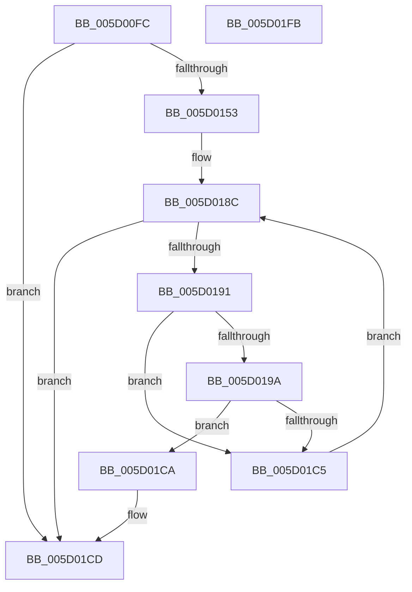

# PpmIdleRecheckCoordinatedIdleMask

- RVA: `0x005D00FC`–`0x005D01FC` (길이 `256` bytes)
- VA: `0x00000001405D00FC`
- 실행 섹션: `.text`
- PDB 이름 있음: `예`; PDB Function 태그: `아니요`
- unwind 정보 RVA: `0x000CBF7C`
- 디코드: `69`개 명령, `256/256` bytes 표시
- 미해석 바이트: `0` (있으면 어셈블리에 `.byte`로 보존)

> 이 문서는 커널 이미지의 기계어와 PDB 기호를 분석해 생성했습니다. 4번과 5번은 함수 원형과 자료형을 바이너리 사용 방식에서 추정한 C 해석이며 원본 소스 복구 결과는 아닙니다.

## 1. Dependencies

- 직접 호출 지점: **5**; 고유 호출 대상: **4**
- 직접 호출자로 확인된 함수: **1**
- RIP 상대 이미지 참조: **2**

### Outgoing calls
- `0x005D0140` → [memset](../6C/memset_function_006C6C40.md) (function, `0x006C6C40`)
- `0x005D016A` → [memset](../6C/memset_function_006C6C40.md) (function, `0x006C6C40`)
- `0x005D017A` → [KeAddGroupAffinityEx](../25/KeAddGroupAffinityEx_function_0025B6C0.md) (function, `0x0025B6C0`)
- `0x005D01BC` → [KeIsSubsetAffinityEx](../2C/KeIsSubsetAffinityEx_function_002CDC80.md) (function, `0x002CDC80`)
- `0x005D01DA` → [_security_check_cookie](../6A/_security_check_cookie_function_006AC640.md) (function, `0x006AC640`)

### Direct callers
- [sub_006DCEEE](../6D/Unknown_function_006DCEEE.md) at `0x006DCFF7`

### Static image references
- `0x005D0115` → RVA `0x00E0A740` (`.data`; read)
- `0x005D0145` → RVA `0x00FC6AD0` (`ALMOSTRO`; read)

## 2. Other-region calls and transfers

- 다른 실행 섹션으로 향하는 call: **0**
- 별도 외부 분기/꼬리 이동을 확인하지 못했습니다.

## 3. Assembly (complete function range)

```asm
005D00FC  48 89 5C 24 08                  mov qword ptr [rsp + 8], rbx
005D0101  48 89 6C 24 18                  mov qword ptr [rsp + 0x18], rbp
005D0106  56                              push rsi
005D0107  57                              push rdi
005D0108  41 54                           push r12
005D010A  41 56                           push r14
005D010C  41 57                           push r15
005D010E  48 81 EC 40 01 00 00            sub rsp, 0x140
005D0115  48 8B 05 24 A6 83 00            mov rax, qword ptr [rip + 0x83a624]
005D011C  48 33 C4                        xor rax, rsp
005D011F  48 89 84 24 30 01 00 00         mov qword ptr [rsp + 0x130], rax
005D0127  49 8B F8                        mov rdi, r8
005D012A  0F B7 EA                        movzx ebp, dx
005D012D  4C 8B F1                        mov r14, rcx
005D0130  41 BF 00 01 00 00               mov r15d, 0x100
005D0136  45 8B C7                        mov r8d, r15d
005D0139  48 8D 4C 24 28                  lea rcx, [rsp + 0x28]
005D013E  33 D2                           xor edx, edx
005D0140  E8 FB 6A 0F 00                  call 0x1406c6c40
005D0145  48 8B 35 84 69 9F 00            mov rsi, qword ptr [rip + 0x9f6984]
005D014C  33 DB                           xor ebx, ebx
005D014E  48 85 F6                        test rsi, rsi
005D0151  74 7A                           je 0x1405d01cd
005D0153  45 8B C7                        mov r8d, r15d
005D0156  48 C7 44 24 20 01 00 20 00      mov qword ptr [rsp + 0x20], 0x200001
005D015F  33 D2                           xor edx, edx
005D0161  48 8D 4C 24 28                  lea rcx, [rsp + 0x28]
005D0166  44 8D 63 01                     lea r12d, [rbx + 1]
005D016A  E8 D1 6A 0F 00                  call 0x1406c6c40
005D016F  4C 8B C7                        mov r8, rdi
005D0172  48 8D 4C 24 20                  lea rcx, [rsp + 0x20]
005D0177  0F B7 D5                        movzx edx, bp
005D017A  E8 41 B5 C8 FF                  call 0x14025b6c0
005D017F  49 8B AE E0 03 00 00            mov rbp, qword ptr [r14 + 0x3e0]
005D0186  8B FB                           mov edi, ebx
005D0188  44 8B 7D 04                     mov r15d, dword ptr [rbp + 4]
005D018C  41 3B FF                        cmp edi, r15d
005D018F  73 3C                           jae 0x1405d01cd
005D0191  8B C7                           mov eax, edi
005D0193  83 7C 85 08 FF                  cmp dword ptr [rbp + rax*4 + 8], -1
005D0198  75 2B                           jne 0x1405d01c5
005D019A  48 8D 0C 40                     lea rcx, [rax + rax*2]
005D019E  49 8B 86 00 04 00 00            mov rax, qword ptr [r14 + 0x400]
005D01A5  48 8D 54 24 20                  lea rdx, [rsp + 0x20]
005D01AA  8B 4C C8 04                     mov ecx, dword ptr [rax + rcx*8 + 4]
005D01AE  48 69 C9 C0 01 00 00            imul rcx, rcx, 0x1c0
005D01B5  48 83 E9 80                     sub rcx, -0x80
005D01B9  48 03 CE                        add rcx, rsi
005D01BC  E8 BF DA CF FF                  call 0x1402cdc80
005D01C1  85 C0                           test eax, eax
005D01C3  75 05                           jne 0x1405d01ca
005D01C5  41 03 FC                        add edi, r12d
005D01C8  EB C2                           jmp 0x1405d018c
005D01CA  41 8A DC                        mov bl, r12b
005D01CD  8A C3                           mov al, bl
005D01CF  48 8B 8C 24 30 01 00 00         mov rcx, qword ptr [rsp + 0x130]
005D01D7  48 33 CC                        xor rcx, rsp
005D01DA  E8 61 C4 0D 00                  call 0x1406ac640
005D01DF  4C 8D 9C 24 40 01 00 00         lea r11, [rsp + 0x140]
005D01E7  49 8B 5B 30                     mov rbx, qword ptr [r11 + 0x30]
005D01EB  49 8B 6B 40                     mov rbp, qword ptr [r11 + 0x40]
005D01EF  49 8B E3                        mov rsp, r11
005D01F2  41 5F                           pop r15
005D01F4  41 5E                           pop r14
005D01F6  41 5C                           pop r12
005D01F8  5F                              pop rdi
005D01F9  5E                              pop rsi
005D01FA  C3                              ret
005D01FB  CC                              int3
```

## 4. C-style interpretation (structured pseudocode)

```c
__int64 __fastcall PpmIdleRecheckCoordinatedIdleMask(__int64 a1, int a2, __int64 a3)
{
    __int64 result;
    __int64 v_rbx;
    __int64 v_rdi;
    __int64 v_rsp;
    unsigned __int64 v_stack_m140;
    unsigned __int64 v_stack_m148;
    unsigned __int64 v_stack_m28;
    unsigned __int64 v_stack_m38;
    unsigned __int64 v_stack_p18;
    unsigned __int64 v_stack_p8;

    v_stack_p8 = v_rbx;
    v_stack_p18 = v_rbp;
    v_rsp = (v_rsp) - (320);
    result = (*(unsigned __int64 *)(v_rip + 8627748)) ^ (v_rsp);
    v_stack_m38 = result;
    a2 = 0;
    result = memset(v_stack_m140, a2, 256, a4);
    v_rbx = 0;
    if (*(unsigned __int64 *)(v_rip + 10447236) == 0) goto loc_005D01CD;
    v_stack_m148 = 0x200001ULL;
    a2 = 0;
    result = memset(v_stack_m140, a2, 256, a4);
    result = KeAddGroupAffinityEx(v_stack_m148, (unsigned __int16)((unsigned __int16)(a2)), a3, a4);
loc_005D018C:
    if (0 >= ((unsigned int)((unsigned int)(*(unsigned int *)(*(unsigned __int64 *)(a1 + 992) + 4))))) goto loc_005D01CD;
    if ((*(unsigned int *)(*(unsigned __int64 *)(a1 + 992) + 0 * 4 + 8)) != -1) goto loc_005D01C5;
    a1 = ((unsigned int)(*(unsigned int *)(*(unsigned __int64 *)(a1 + 1024) + 0 + 0 * 2 * 8 + 4))) * ((unsigned int)(*(unsigned int *)(*(unsigned __int64 *)(a1 + 1024) + 0 + 0 * 2 * 8 + 4)));
    a1 = (a1) - (-128);
    a1 = (a1) + (*(unsigned __int64 *)(v_rip + 10447236));
    result = KeIsSubsetAffinityEx(a1, v_stack_m148, a3, a4);
    if ((unsigned int)(result) != 0) goto loc_005D01CA;
loc_005D01C5:
    v_rdi = (unsigned int)((0) + ((unsigned int)(v_rbx + 1)));
    goto loc_005D018C;
loc_005D01CA:
loc_005D01CD:
    a1 = (v_stack_m38) ^ (v_rsp);
    result = _security_check_cookie(a1, v_stack_m148, a3, a4);
    return result;
}
```

## 5. (Beta) C Style

```c
int64_t PpmIdleRecheckCoordinatedIdleMask(void *Arg1, int32_t Arg2, int64_t Arg3)
{
    uint8_t *arg1 = (uint8_t *)Arg1;

    int64_t result;
    int64_t local_rbx;
    int64_t local_rdi;
    int64_t local_rsp;
    uint64_t v_stack_m140;
    uint64_t v_stack_m148;
    uint64_t v_stack_m28;
    uint64_t v_stack_m38;
    uint64_t v_stack_p18;
    uint64_t v_stack_p8;

    v_stack_p8 = local_rbx;
    v_stack_p18 = local_rbp;
    local_rsp = (local_rsp) - (320);
    result = (*(uint64_t *)(v_rip + 0x83A624)) ^ (local_rsp);
    v_stack_m38 = result;
    Arg2 = 0;
    result = memset(v_stack_m140, Arg2, 256, a4);
    local_rbx = 0;
    if (*(uint64_t *)(v_rip + 0x9F6984) == 0) goto loc_005D01CD;
    v_stack_m148 = 0x200001ULL;
    Arg2 = 0;
    result = memset(v_stack_m140, Arg2, 256, a4);
    result = KeAddGroupAffinityEx(v_stack_m148, (uint16_t)((uint16_t)(Arg2)), Arg3, a4);
loc_005D018C:
    if (0 >= ((uint32_t)((uint32_t)(*(uint32_t *)(*(uint64_t *)(arg1 + 0x3E0) + 0x4))))) goto loc_005D01CD;
    if ((*(uint32_t *)(*(uint64_t *)(arg1 + 0x3E0) + 0x0 * 4 + 0x8)) != -1) goto loc_005D01C5;
    Arg1 = ((uint32_t)(*(uint32_t *)(*(uint64_t *)(arg1 + 0x400) + 0x0 + 0x0 * 2 * 8 + 0x4))) * ((uint32_t)(*(uint32_t *)(*(uint64_t *)(arg1 + 0x400) + 0x0 + 0x0 * 2 * 8 + 0x4)));
    Arg1 = (Arg1) - (-128);
    Arg1 = (Arg1) + (*(uint64_t *)(v_rip + 0x9F6984));
    result = KeIsSubsetAffinityEx(Arg1, v_stack_m148, Arg3, a4);
    if ((uint32_t)(result) != 0) goto loc_005D01CA;
loc_005D01C5:
    local_rdi = (uint32_t)((0) + ((uint32_t)(local_rbx + 1)));
    goto loc_005D018C;
loc_005D01CA:
loc_005D01CD:
    Arg1 = (v_stack_m38) ^ (local_rsp);
    result = _security_check_cookie(Arg1, v_stack_m148, Arg3, a4);
    return result;
}
```

### 관측된 메모리 오프셋

구조체 형식이 확인되지 않은 접근은 인자 기준의 오프셋으로만 기록했습니다.

| 기준 인자 | 오프셋 표현 | 폭 (bit) | 접근 |
|---|---:|---:|---|
| `Arg1` | `+ 0x3E0` | `64` | `R` |
| `Arg1` | `+ 0x400` | `64` | `R` |

## 6. Execution-region graph

[열기: 2D/3D 그래프와 함수 탐색 컨트롤 패널](../../../control-panel.html?section=text&rva=0x005D00FC&view=graph)

- 2D 그래프는 위에서 아래로 흐르고, 3D 그래프는 빈 공간을 드래그해 회전합니다. Shift+드래그는 이동, 휠은 확대·축소, 함수 노드 선택은 대상 보고서 이동입니다.

### Static fallback


