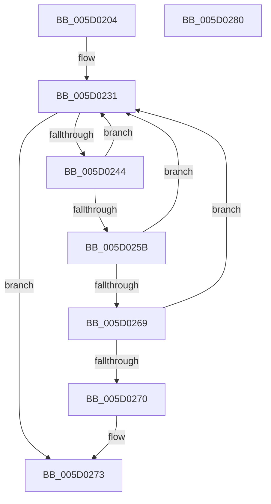

# PpmIdleRecheckSecondaryProcessors

- RVA: `0x005D0204`–`0x005D0281` (길이 `125` bytes)
- VA: `0x00000001405D0204`
- 실행 섹션: `.text`
- PDB 이름 있음: `예`; PDB Function 태그: `아니요`
- unwind 정보 RVA: `0x000CBEE8`
- 디코드: `37`개 명령, `125/125` bytes 표시
- 미해석 바이트: `0` (있으면 어셈블리에 `.byte`로 보존)

> 이 문서는 커널 이미지의 기계어와 PDB 기호를 분석해 생성했습니다. 4번과 5번은 함수 원형과 자료형을 바이너리 사용 방식에서 추정한 C 해석이며 원본 소스 복구 결과는 아닙니다.

## 1. Dependencies

- 직접 호출 지점: **2**; 고유 호출 대상: **2**
- 직접 호출자로 확인된 함수: **1**
- RIP 상대 이미지 참조: **0**

### Outgoing calls
- `0x005D023B` → [KeEnumerateNextProcessor](../41/KeEnumerateNextProcessor_function_00415480.md) (function, `0x00415480`)
- `0x005D0248` → [KeGetPrcb](../2D/KeGetPrcb_function_002D85D0.md) (function, `0x002D85D0`)

### Direct callers
- [PpmIdleSelectStates](../2C/PpmIdleSelectStates_function_002CFFE8.md) at `0x002D0437`

### Static image references
- 디코드된 RIP-relative 메모리 참조가 없습니다.

## 2. Other-region calls and transfers

- 다른 실행 섹션으로 향하는 call: **0**
- 별도 외부 분기/꼬리 이동을 확인하지 못했습니다.

## 3. Assembly (complete function range)

```asm
005D0204  48 8B C4                        mov rax, rsp
005D0207  48 89 58 10                     mov qword ptr [rax + 0x10], rbx
005D020B  57                              push rdi
005D020C  48 83 EC 40                     sub rsp, 0x40
005D0210  33 FF                           xor edi, edi
005D0212  89 78 EA                        mov dword ptr [rax - 0x16], edi
005D0215  66 89 78 EE                     mov word ptr [rax - 0x12], di
005D0219  66 89 78 E8                     mov word ptr [rax - 0x18], di
005D021D  89 78 08                        mov dword ptr [rax + 8], edi
005D0220  8D 5F 01                        lea ebx, [rdi + 1]
005D0223  48 8B 41 08                     mov rax, qword ptr [rcx + 8]
005D0227  48 89 44 24 28                  mov qword ptr [rsp + 0x28], rax
005D022C  48 89 4C 24 20                  mov qword ptr [rsp + 0x20], rcx
005D0231  48 8D 54 24 20                  lea rdx, [rsp + 0x20]
005D0236  48 8D 4C 24 50                  lea rcx, [rsp + 0x50]
005D023B  E8 40 52 E4 FF                  call 0x140415480
005D0240  85 C0                           test eax, eax
005D0242  75 2F                           jne 0x1405d0273
005D0244  8B 4C 24 50                     mov ecx, dword ptr [rsp + 0x50]
005D0248  E8 83 83 D0 FF                  call 0x1402d85d0
005D024D  65 48 8B 0C 25 20 00 00 00      mov rcx, qword ptr gs:[0x20]
005D0256  48 3B C1                        cmp rax, rcx
005D0259  74 D6                           je 0x1405d0231
005D025B  8B 80 8C 88 00 00               mov eax, dword ptr [rax + 0x888c]
005D0261  C1 E8 18                        shr eax, 0x18
005D0264  83 F8 03                        cmp eax, 3
005D0267  74 C8                           je 0x1405d0231
005D0269  83 C0 FC                        add eax, -4
005D026C  3B C3                           cmp eax, ebx
005D026E  76 C1                           jbe 0x1405d0231
005D0270  40 8A DF                        mov bl, dil
005D0273  8A C3                           mov al, bl
005D0275  48 8B 5C 24 58                  mov rbx, qword ptr [rsp + 0x58]
005D027A  48 83 C4 40                     add rsp, 0x40
005D027E  5F                              pop rdi
005D027F  C3                              ret
005D0280  CC                              int3
```

## 4. C-style interpretation (structured pseudocode)

```c
__int64 __fastcall PpmIdleRecheckSecondaryProcessors(__int64 a1)
{
    __int64 result;
    __int64 v_rdi;
    __int64 v_rsp;
    unsigned __int64 v_stack_m20;
    unsigned __int64 v_stack_m28;
    unsigned __int64 v_stack_p10;
    unsigned __int64 v_stack_p8;

    *(unsigned __int64 *)(v_rsp + 16) = v_rbx;
    v_rsp = (v_rsp) - (64);
    v_rdi = 0;
    *(unsigned int *)(v_rsp - 22) = 0;
    *(unsigned __int16 *)(v_rsp - 18) = 0;
    *(unsigned __int16 *)(v_rsp - 24) = 0;
    *(unsigned int *)(v_rsp + 8) = 0;
    v_stack_m20 = *(unsigned __int64 *)(a1 + 8);
    v_stack_m28 = a1;
loc_005D0231:
    result = KeEnumerateNextProcessor(v_stack_p8, v_stack_m28, a3, a4);
    if ((unsigned int)(result) != 0) goto loc_005D0273;
    result = KeGetPrcb((unsigned int)(v_stack_p8), v_stack_m28, a3, a4);
    if (result == (*(unsigned __int64 *)(gs_base + (0 + 32)))) goto loc_005D0231;
    result = (unsigned int)(((unsigned int)(*(unsigned int *)(result + 34956))) >> (24));
    if (((unsigned int)(result)) == 3) goto loc_005D0231;
    result = (unsigned int)((result) + (-4));
    if (((unsigned int)(result)) <= ((unsigned int)(v_rdi + 1))) goto loc_005D0231;
loc_005D0273:
    v_rsp = (v_rsp) + (64);
    return 0;
}
```

## 5. (Beta) C Style

```c
int64_t PpmIdleRecheckSecondaryProcessors(void *Arg1)
{
    uint8_t *arg1 = (uint8_t *)Arg1;

    int64_t result;
    int64_t local_rdi;
    int64_t local_rsp;
    uint64_t v_stack_m20;
    uint64_t v_stack_m28;
    uint64_t v_stack_p10;
    uint64_t v_stack_p8;

    *(uint64_t *)(local_rsp + 0x10) = local_rbx;
    local_rsp = (local_rsp) - (64);
    local_rdi = 0;
    *(uint32_t *)(local_rsp - 0x16) = 0;
    *(uint16_t *)(local_rsp - 0x12) = 0;
    *(uint16_t *)(local_rsp - 0x18) = 0;
    *(uint32_t *)(local_rsp + 0x8) = 0;
    v_stack_m20 = *(uint64_t *)(arg1 + 0x8);
    v_stack_m28 = Arg1;
loc_005D0231:
    result = KeEnumerateNextProcessor(v_stack_p8, v_stack_m28, a3, a4);
    if ((uint32_t)(result) != 0) goto loc_005D0273;
    result = KeGetPrcb((uint32_t)(v_stack_p8), v_stack_m28, a3, a4);
    if (result == (*(uint64_t *)(gs_base + (0 + 0x20)))) goto loc_005D0231;
    result = (uint32_t)(((uint32_t)(*(uint32_t *)(result + 0x888C))) >> (24));
    if (((uint32_t)(result)) == 3) goto loc_005D0231;
    result = (uint32_t)((result) + (-4));
    if (((uint32_t)(result)) <= ((uint32_t)(local_rdi + 1))) goto loc_005D0231;
loc_005D0273:
    local_rsp = (local_rsp) + (64);
    return 0;
}
```

### 관측된 메모리 오프셋

구조체 형식이 확인되지 않은 접근은 인자 기준의 오프셋으로만 기록했습니다.

| 기준 인자 | 오프셋 표현 | 폭 (bit) | 접근 |
|---|---:|---:|---|
| `Arg1` | `+ 0x8` | `64` | `R` |

## 6. Execution-region graph

[열기: 2D/3D 그래프와 함수 탐색 컨트롤 패널](../../../control-panel.html?section=text&rva=0x005D0204&view=graph)

- 2D 그래프는 위에서 아래로 흐르고, 3D 그래프는 빈 공간을 드래그해 회전합니다. Shift+드래그는 이동, 휠은 확대·축소, 함수 노드 선택은 대상 보고서 이동입니다.

### Static fallback


