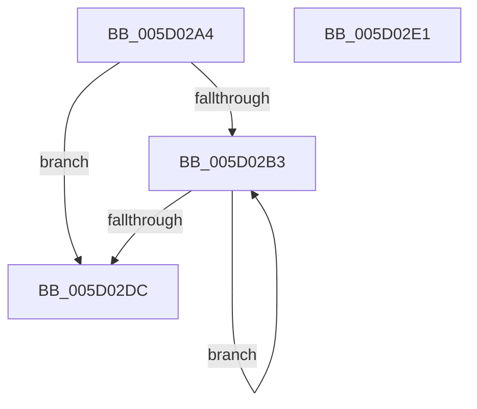

# PpmIdleRollbackCoordinatedSelection

- RVA: `0x005D02A4`–`0x005D02E2` (길이 `62` bytes)
- VA: `0x00000001405D02A4`
- 실행 섹션: `.text`
- PDB 이름 있음: `예`; PDB Function 태그: `아니요`
- unwind 정보 RVA: `0x000DB714`
- 디코드: `16`개 명령, `62/62` bytes 표시
- 미해석 바이트: `0` (있으면 어셈블리에 `.byte`로 보존)

> 이 문서는 커널 이미지의 기계어와 PDB 기호를 분석해 생성했습니다. 4번과 5번은 함수 원형과 자료형을 바이너리 사용 방식에서 추정한 C 해석이며 원본 소스 복구 결과는 아닙니다.

## 1. Dependencies

- 직접 호출 지점: **0**; 고유 호출 대상: **0**
- 직접 호출자로 확인된 함수: **3**
- RIP 상대 이미지 참조: **1**

### Outgoing calls
- 직접 디코드된 call 명령이 없습니다.

### Direct callers
- [PpmIdleSelectStates](../2C/PpmIdleSelectStates_function_002CFFE8.md) at `0x002D04C1`
- [PpmIdleCheckCoordinatedDependency](../5C/PpmIdleCheckCoordinatedDependency_function_005CF72C.md) at `0x005CF9D5`
- [PpmIdleCheckCoordinatedStateEligibility](../5C/PpmIdleCheckCoordinatedStateEligibility_function_005CFACC.md) at `0x005CFD2D`

### Static image references
- `0x005D02BE` → RVA `0x00FC6AD0` (`ALMOSTRO`; read)

## 2. Other-region calls and transfers

- 다른 실행 섹션으로 향하는 call: **0**
- 별도 외부 분기/꼬리 이동을 확인하지 못했습니다.

## 3. Assembly (complete function range)

```asm
005D02A4  44 8B 59 04                     mov r11d, dword ptr [rcx + 4]
005D02A8  44 8B CA                        mov r9d, edx
005D02AB  4C 8B D1                        mov r10, rcx
005D02AE  44 3B DA                        cmp r11d, edx
005D02B1  76 29                           jbe 0x1405d02dc
005D02B3  49 8B 42 10                     mov rax, qword ptr [r10 + 0x10]
005D02B7  41 FF CB                        dec r11d
005D02BA  42 8B 0C 98                     mov ecx, dword ptr [rax + r11*4]
005D02BE  48 8B 05 0B 68 9F 00            mov rax, qword ptr [rip + 0x9f680b]
005D02C5  48 69 D1 C0 01 00 00            imul rdx, rcx, 0x1c0
005D02CC  C7 84 02 A0 01 00 00 00 00 00 00  mov dword ptr [rdx + rax + 0x1a0], 0
005D02D7  45 3B D9                        cmp r11d, r9d
005D02DA  77 D7                           ja 0x1405d02b3
005D02DC  45 89 4A 04                     mov dword ptr [r10 + 4], r9d
005D02E0  C3                              ret
005D02E1  CC                              int3
```

## 4. C-style interpretation (structured pseudocode)

```c
__int64 __fastcall PpmIdleRollbackCoordinatedSelection(__int64 a1, int a2)
{
    __int64 v_r11;

    if (((unsigned int)((unsigned int)(*(unsigned int *)(a1 + 4)))) <= a2) goto loc_005D02DC;
loc_005D02B3:
    v_r11 = (unsigned int)(((unsigned int)(*(unsigned int *)(a1 + 4))) - 1);
    a2 = (a2) * ((unsigned int)(*(unsigned int *)(*(unsigned __int64 *)(a1 + 16) + v_r11 * 4)));
    *(unsigned int *)(a2 + *(unsigned __int64 *)(v_rip + 10446859) * 1 + 416) = 0;
    if (((unsigned int)(v_r11)) > ((unsigned int)((unsigned int)(a2)))) goto loc_005D02B3;
loc_005D02DC:
    *(unsigned int *)(a1 + 4) = (unsigned int)((unsigned int)(a2));
    return *(unsigned __int64 *)(v_rip + 10446859);
}
```

## 5. (Beta) C Style

```c
int64_t PpmIdleRollbackCoordinatedSelection(void *Arg1, void *Arg2)
{
    uint8_t *arg1 = (uint8_t *)Arg1;
    uint8_t *arg2 = (uint8_t *)Arg2;

    int64_t local_r11;

    if (((uint32_t)((uint32_t)(*(uint32_t *)(arg1 + 0x4)))) <= Arg2) goto loc_005D02DC;
loc_005D02B3:
    local_r11 = (uint32_t)(((uint32_t)(*(uint32_t *)(arg1 + 0x4))) - 1);
    Arg2 = (Arg2) * ((uint32_t)(*(uint32_t *)(*(uint64_t *)(arg1 + 0x10) + local_r11 * 4)));
    *(uint32_t *)(arg2 + *(uint64_t *)(v_rip + 0x9F680B) * 1 + 0x1A0) = 0;
    if (((uint32_t)(local_r11)) > ((uint32_t)((uint32_t)(Arg2)))) goto loc_005D02B3;
loc_005D02DC:
    *(uint32_t *)(arg1 + 0x4) = (uint32_t)((uint32_t)(Arg2));
    return *(uint64_t *)(v_rip + 0x9F680B);
}
```

### 관측된 메모리 오프셋

구조체 형식이 확인되지 않은 접근은 인자 기준의 오프셋으로만 기록했습니다.

| 기준 인자 | 오프셋 표현 | 폭 (bit) | 접근 |
|---|---:|---:|---|
| `Arg1` | `+ 0x4` | `32` | `R` |
| `Arg1` | `+ 0x4` | `32` | `W` |
| `Arg1` | `+ 0x10` | `64` | `R` |
| `Arg2` | `+ 0x1A0 + rax*1` | `32` | `W` |

## 6. Execution-region graph

[열기: 2D/3D 그래프와 함수 탐색 컨트롤 패널](../../../control-panel.html?section=text&rva=0x005D02A4&view=graph)

- 2D 그래프는 위에서 아래로 흐르고, 3D 그래프는 빈 공간을 드래그해 회전합니다. Shift+드래그는 이동, 휠은 확대·축소, 함수 노드 선택은 대상 보고서 이동입니다.

### Static fallback


