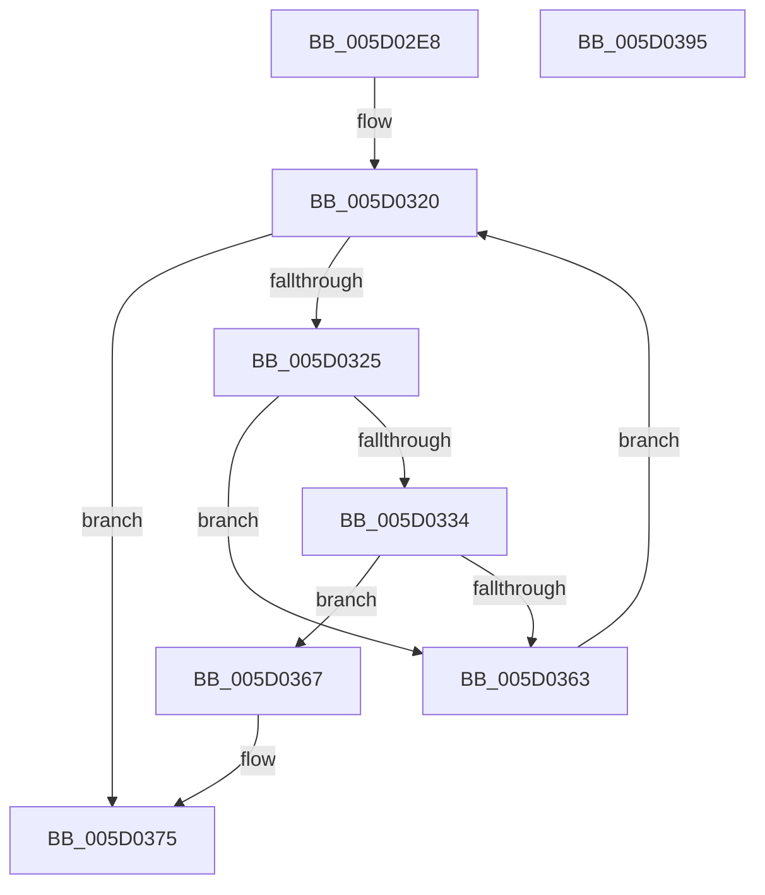

# PpmIdleSelectCoordinatedProcessorDependency

- RVA: `0x005D02E8`–`0x005D0396` (길이 `174` bytes)
- VA: `0x00000001405D02E8`
- 실행 섹션: `.text`
- PDB 이름 있음: `예`; PDB Function 태그: `아니요`
- unwind 정보 RVA: `0x0008C20C`
- 디코드: `52`개 명령, `174/174` bytes 표시
- 미해석 바이트: `0` (있으면 어셈블리에 `.byte`로 보존)

> 이 문서는 커널 이미지의 기계어와 PDB 기호를 분석해 생성했습니다. 4번과 5번은 함수 원형과 자료형을 바이너리 사용 방식에서 추정한 C 해석이며 원본 소스 복구 결과는 아닙니다.

## 1. Dependencies

- 직접 호출 지점: **1**; 고유 호출 대상: **1**
- 직접 호출자로 확인된 함수: **1**
- RIP 상대 이미지 참조: **1**

### Outgoing calls
- `0x005D0356` → [PpmIdleCheckProcessorStateEligibility](../5C/PpmIdleCheckProcessorStateEligibility_function_005CFD54.md) (function, `0x005CFD54`)

### Direct callers
- [PpmIdleCheckCoordinatedDependencies](../5C/PpmIdleCheckCoordinatedDependencies_function_005CF5B8.md) at `0x005CF6B0`

### Static image references
- `0x005D0334` → RVA `0x00FC6B47` (`ALMOSTRO`; read)

## 2. Other-region calls and transfers

- 다른 실행 섹션으로 향하는 call: **0**
- 별도 외부 분기/꼬리 이동을 확인하지 못했습니다.

## 3. Assembly (complete function range)

```asm
005D02E8  48 89 5C 24 08                  mov qword ptr [rsp + 8], rbx
005D02ED  48 89 6C 24 10                  mov qword ptr [rsp + 0x10], rbp
005D02F2  48 89 74 24 18                  mov qword ptr [rsp + 0x18], rsi
005D02F7  57                              push rdi
005D02F8  41 54                           push r12
005D02FA  41 55                           push r13
005D02FC  41 56                           push r14
005D02FE  41 57                           push r15
005D0300  48 83 EC 30                     sub rsp, 0x30
005D0304  48 8B AC 24 80 00 00 00         mov rbp, qword ptr [rsp + 0x80]
005D030C  4D 8B F1                        mov r14, r9
005D030F  45 8B F8                        mov r15d, r8d
005D0312  44 8B E2                        mov r12d, edx
005D0315  4C 8B E9                        mov r13, rcx
005D0318  33 DB                           xor ebx, ebx
005D031A  41 BA 01 00 00 80               mov r10d, 0x80000001
005D0320  3B 5D 00                        cmp ebx, dword ptr [rbp]
005D0323  73 50                           jae 0x1405d0375
005D0325  48 8B 75 08                     mov rsi, qword ptr [rbp + 8]
005D0329  48 8D 3C 5B                     lea rdi, [rbx + rbx*2]
005D032D  80 7C FE 01 00                  cmp byte ptr [rsi + rdi*8 + 1], 0
005D0332  74 2F                           je 0x1405d0363
005D0334  80 3D 0C 68 9F 00 00            cmp byte ptr [rip + 0x9f680c], 0
005D033B  4D 8B CE                        mov r9, r14
005D033E  45 8B C7                        mov r8d, r15d
005D0341  41 8B D4                        mov edx, r12d
005D0344  0F 94 C0                        sete al
005D0347  49 8B CD                        mov rcx, r13
005D034A  88 44 24 28                     mov byte ptr [rsp + 0x28], al
005D034E  8B 44 FE 04                     mov eax, dword ptr [rsi + rdi*8 + 4]
005D0352  89 44 24 20                     mov dword ptr [rsp + 0x20], eax
005D0356  E8 F9 F9 FF FF                  call 0x1405cfd54
005D035B  4C 8B D0                        mov r10, rax
005D035E  48 85 C0                        test rax, rax
005D0361  74 04                           je 0x1405d0367
005D0363  FF C3                           inc ebx
005D0365  EB B9                           jmp 0x1405d0320
005D0367  48 8B 84 24 88 00 00 00         mov rax, qword ptr [rsp + 0x88]
005D036F  8B 4C FE 04                     mov ecx, dword ptr [rsi + rdi*8 + 4]
005D0373  89 08                           mov dword ptr [rax], ecx
005D0375  48 8B 5C 24 60                  mov rbx, qword ptr [rsp + 0x60]
005D037A  49 8B C2                        mov rax, r10
005D037D  48 8B 6C 24 68                  mov rbp, qword ptr [rsp + 0x68]
005D0382  48 8B 74 24 70                  mov rsi, qword ptr [rsp + 0x70]
005D0387  48 83 C4 30                     add rsp, 0x30
005D038B  41 5F                           pop r15
005D038D  41 5E                           pop r14
005D038F  41 5D                           pop r13
005D0391  41 5C                           pop r12
005D0393  5F                              pop rdi
005D0394  C3                              ret
005D0395  CC                              int3
```

## 4. C-style interpretation (structured pseudocode)

```c
__int64 __fastcall PpmIdleSelectCoordinatedProcessorDependency(__int64 a1, int a2, int a3, __int64 a4, __int64 a5, __int64 a6)
{
    __int64 result;
    __int64 v_rbx;
    __int64 v_rsp;
    unsigned __int8 v_stack_m30;
    unsigned int v_stack_m38;
    unsigned __int64 v_stack_p10;
    unsigned __int64 v_stack_p18;
    unsigned __int64 v_stack_p8;

    v_stack_p8 = v_rbx;
    v_stack_p10 = v_rbp;
    v_stack_p18 = v_rsi;
    v_rsp = (v_rsp) - (48);
    v_rbx = 0;
loc_005D0320:
    if (0 >= (*(unsigned int *)(a5))) goto loc_005D0375;
    if ((*(unsigned __int8 *)(*(unsigned __int64 *)(a5 + 8) + v_rbx + v_rbx * 2 * 8 + 1)) == 0) goto loc_005D0363;
    result = ((*(unsigned __int8 *)(v_rip + 10446860)) == 0) ? 1 : 0;
    v_stack_m30 = (unsigned __int8)(result);
    v_stack_m38 = (unsigned int)((unsigned int)(*(unsigned int *)(*(unsigned __int64 *)(a5 + 8) + v_rbx + v_rbx * 2 * 8 + 4)));
    result = PpmIdleCheckProcessorStateEligibility(a1, (unsigned int)((unsigned int)((unsigned int)(a2))), (unsigned int)((unsigned int)((unsigned int)(a3))), a4);
    if (result == 0) goto loc_005D0367;
loc_005D0363:
    v_rbx = (unsigned int)((v_rbx) + 1);
    goto loc_005D0320;
loc_005D0367:
    *(unsigned int *)(a6) = (unsigned int)((unsigned int)(*(unsigned int *)(*(unsigned __int64 *)(a5 + 8) + v_rbx + v_rbx * 2 * 8 + 4)));
loc_005D0375:
    v_rsp = (v_rsp) + (48);
    return result;
}
```

## 5. (Beta) C Style

```c
int64_t PpmIdleSelectCoordinatedProcessorDependency(int64_t Arg1, int32_t Arg2, int32_t Arg3, int64_t Arg4, void *Arg5, void *Arg6)
{
    uint8_t *arg5 = (uint8_t *)Arg5;
    uint8_t *arg6 = (uint8_t *)Arg6;

    int64_t result;
    int64_t local_rbx;
    int64_t local_rsp;
    uint8_t v_stack_m30;
    uint32_t v_stack_m38;
    uint64_t v_stack_p10;
    uint64_t v_stack_p18;
    uint64_t v_stack_p8;

    v_stack_p8 = local_rbx;
    v_stack_p10 = local_rbp;
    v_stack_p18 = local_rsi;
    local_rsp = (local_rsp) - (48);
    local_rbx = 0;
loc_005D0320:
    if (0 >= (*(uint32_t *)(arg5))) goto loc_005D0375;
    if ((*(uint8_t *)(*(uint64_t *)(arg5 + 0x8) + local_rbx + local_rbx * 2 * 8 + 0x1)) == 0) goto loc_005D0363;
    result = ((*(uint8_t *)(v_rip + 0x9F680C)) == 0) ? 1 : 0;
    v_stack_m30 = (uint8_t)(result);
    v_stack_m38 = (uint32_t)((uint32_t)(*(uint32_t *)(*(uint64_t *)(arg5 + 0x8) + local_rbx + local_rbx * 2 * 8 + 0x4)));
    result = PpmIdleCheckProcessorStateEligibility(Arg1, (uint32_t)((uint32_t)((uint32_t)(Arg2))), (uint32_t)((uint32_t)((uint32_t)(Arg3))), Arg4);
    if (result == 0) goto loc_005D0367;
loc_005D0363:
    local_rbx = (uint32_t)((local_rbx) + 1);
    goto loc_005D0320;
loc_005D0367:
    *(uint32_t *)(arg6) = (uint32_t)((uint32_t)(*(uint32_t *)(*(uint64_t *)(arg5 + 0x8) + local_rbx + local_rbx * 2 * 8 + 0x4)));
loc_005D0375:
    local_rsp = (local_rsp) + (48);
    return result;
}
```

### 관측된 메모리 오프셋

구조체 형식이 확인되지 않은 접근은 인자 기준의 오프셋으로만 기록했습니다.

| 기준 인자 | 오프셋 표현 | 폭 (bit) | 접근 |
|---|---:|---:|---|
| `Arg5` | `+ 0x0` | `32` | `R` |
| `Arg5` | `+ 0x8` | `64` | `R` |
| `Arg6` | `+ 0x0` | `32` | `W` |

## 6. Execution-region graph

[열기: 2D/3D 그래프와 함수 탐색 컨트롤 패널](../../../control-panel.html?section=text&rva=0x005D02E8&view=graph)

- 2D 그래프는 위에서 아래로 흐르고, 3D 그래프는 빈 공간을 드래그해 회전합니다. Shift+드래그는 이동, 휠은 확대·축소, 함수 노드 선택은 대상 보고서 이동입니다.

### Static fallback


