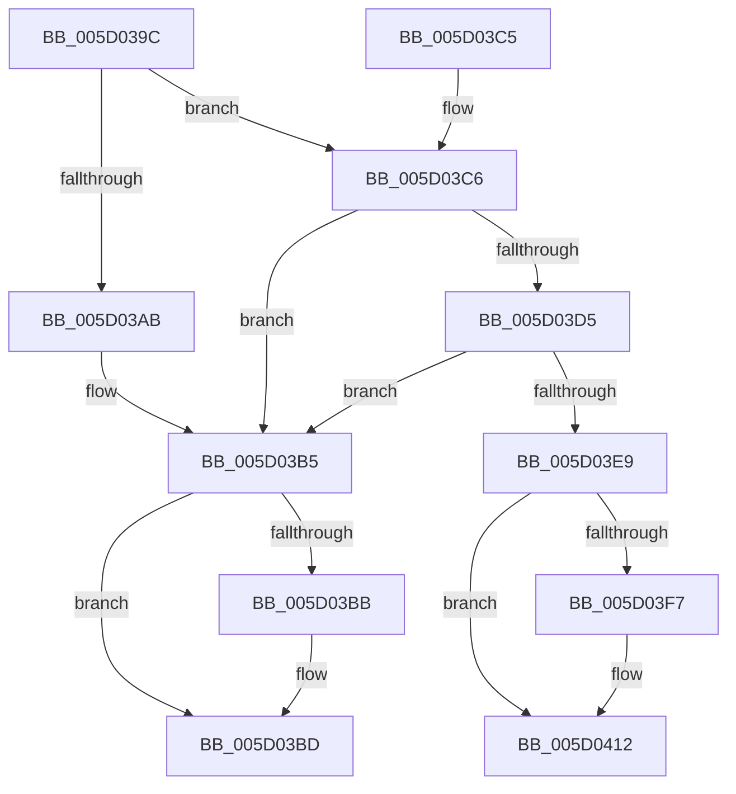

# PpmIdleTransitionStall

- RVA: `0x005D039C`–`0x005D0429` (길이 `141` bytes)
- VA: `0x00000001405D039C`
- 실행 섹션: `.text`
- PDB 이름 있음: `예`; PDB Function 태그: `아니요`
- unwind 정보 RVA: `0x000CBEF8`
- 디코드: `43`개 명령, `141/141` bytes 표시
- 미해석 바이트: `0` (있으면 어셈블리에 `.byte`로 보존)

> 이 문서는 커널 이미지의 기계어와 PDB 기호를 분석해 생성했습니다. 4번과 5번은 함수 원형과 자료형을 바이너리 사용 방식에서 추정한 C 해석이며 원본 소스 복구 결과는 아닙니다.

## 1. Dependencies

- 직접 호출 지점: **4**; 고유 호출 대상: **2**
- 직접 호출자로 확인된 함수: **5**
- RIP 상대 이미지 참조: **0**

### Outgoing calls
- `0x005D03AD` → [KeQueryPerformanceCounter](../37/KeQueryPerformanceCounter_function_0037E7E0.md) (function, `0x0037E7E0`)
- `0x005D03DB` → [KeQueryPerformanceCounter](../37/KeQueryPerformanceCounter_function_0037E7E0.md) (function, `0x0037E7E0`)
- `0x005D040C` → [KeBugCheckEx](../4F/KeBugCheckEx_function_004FD660.md) (function, `0x004FD660`)
- `0x005D0423` → [KeBugCheckEx](../4F/KeBugCheckEx_function_004FD660.md) (function, `0x004FD660`)

### Direct callers
- [PoInitiateProcessorWake](../5C/PoInitiateProcessorWake_function_005CF2D0.md) at `0x005CF42E`
- [PpmIdleCheckCoordinatedDependency](../5C/PpmIdleCheckCoordinatedDependency_function_005CF72C.md) at `0x005CF8AE`
- [PpmIdleWaitForDependentTransitions](PpmIdleWaitForDependentTransitions_function_005D0594.md) at `0x005D0635`
- [PpmTestAndLockProcessor](PpmTestAndLockProcessor_function_005D08B4.md) at `0x005D0914`
- [sub_006FB45A](../6F/Unknown_function_006FB45A.md) at `0x006FB48C`

### Static image references
- 디코드된 RIP-relative 메모리 참조가 없습니다.

## 2. Other-region calls and transfers

- 다른 실행 섹션으로 향하는 call: **0**
- 별도 외부 분기/꼬리 이동을 확인하지 못했습니다.

## 3. Assembly (complete function range)

```asm
005D039C  40 53                           push rbx
005D039E  48 83 EC 30                     sub rsp, 0x30
005D03A2  48 83 39 00                     cmp qword ptr [rcx], 0
005D03A6  48 8B D9                        mov rbx, rcx
005D03A9  75 1B                           jne 0x1405d03c6
005D03AB  33 C9                           xor ecx, ecx
005D03AD  E8 2E E4 DA FF                  call 0x14037e7e0
005D03B2  48 89 03                        mov qword ptr [rbx], rax
005D03B5  80 7B 1C 00                     cmp byte ptr [rbx + 0x1c], 0
005D03B9  74 02                           je 0x1405d03bd
005D03BB  F3 90                           pause
005D03BD  F3 90                           pause
005D03BF  48 83 C4 30                     add rsp, 0x30
005D03C3  5B                              pop rbx
005D03C4  C3                              ret
005D03C5  CC                              int3
005D03C6  8B 41 18                        mov eax, dword ptr [rcx + 0x18]
005D03C9  FF C0                           inc eax
005D03CB  89 41 18                        mov dword ptr [rcx + 0x18], eax
005D03CE  3D E8 03 00 00                  cmp eax, 0x3e8
005D03D3  75 E0                           jne 0x1405d03b5
005D03D5  83 61 18 00                     and dword ptr [rcx + 0x18], 0
005D03D9  33 C9                           xor ecx, ecx
005D03DB  E8 00 E4 DA FF                  call 0x14037e7e0
005D03E0  48 2B 03                        sub rax, qword ptr [rbx]
005D03E3  48 3B 43 08                     cmp rax, qword ptr [rbx + 8]
005D03E7  76 CC                           jbe 0x1405d03b5
005D03E9  4C 8B 4B 10                     mov r9, qword ptr [rbx + 0x10]
005D03ED  B9 A0 00 00 00                  mov ecx, 0xa0
005D03F2  4D 85 C9                        test r9, r9
005D03F5  74 1B                           je 0x1405d0412
005D03F7  41 8B 41 24                     mov eax, dword ptr [r9 + 0x24]
005D03FB  BA 01 07 00 00                  mov edx, 0x701
005D0400  45 8B 81 80 88 00 00            mov r8d, dword ptr [r9 + 0x8880]
005D0407  48 89 44 24 20                  mov qword ptr [rsp + 0x20], rax
005D040C  E8 4F D2 F2 FF                  call 0x1404fd660
005D0411  CC                              int3
005D0412  48 83 64 24 20 00               and qword ptr [rsp + 0x20], 0
005D0418  45 33 C9                        xor r9d, r9d
005D041B  45 33 C0                        xor r8d, r8d
005D041E  BA 04 07 00 00                  mov edx, 0x704
005D0423  E8 38 D2 F2 FF                  call 0x1404fd660
005D0428  CC                              int3
```

## 4. C-style interpretation (structured pseudocode)

```c
__int64 __fastcall PpmIdleTransitionStall(__int64 a1)
{
    __int64 result;
    __int64 v_rsp;
    unsigned __int64 v_stack_p20;

    v_rsp = (v_rsp) - (48);
    if ((*(unsigned __int64 *)(a1)) != 0) goto loc_005D03C6;
    a1 = 0;
    result = KeQueryPerformanceCounter(a1, a2, a3, a4);
    *(unsigned __int64 *)(a1) = result;
loc_005D03B5:
    if ((*(unsigned __int8 *)(a1 + 28)) != 0) {
    }
    v_rsp = (v_rsp) + (48);
    return result;
loc_005D03C6:
    result = (unsigned int)(((unsigned int)(*(unsigned int *)(a1 + 24))) + 1);
    *(unsigned int *)(a1 + 24) = (unsigned int)(result);
    if (((unsigned int)(result)) != 1000) goto loc_005D03B5;
    a1 = 0;
    result = KeQueryPerformanceCounter(a1, a2, a3, a4);
    result = (result) - (*(unsigned __int64 *)(a1));
    if (result <= (*(unsigned __int64 *)(a1 + 8))) goto loc_005D03B5;
    if (*(unsigned __int64 *)(a1 + 16) != 0) {
        result = *(unsigned int *)(*(unsigned __int64 *)(a1 + 16) + 36);
        a2 = 0x701ULL;
        a3 = *(unsigned int *)(*(unsigned __int64 *)(a1 + 16) + 34944);
        v_stack_p20 = result;
        result = KeBugCheckEx(160, a2, a3, *(unsigned __int64 *)(a1 + 16));
    }
    a4 = 0;
    a3 = 0;
    result = KeBugCheckEx(160, (unsigned int)(0x704ULL), a3, a4);
    return result;
}
```

## 5. (Beta) C Style

```c
int64_t PpmIdleTransitionStall(void *Arg1)
{
    uint8_t *arg1 = (uint8_t *)Arg1;

    int64_t result;
    int64_t local_rsp;
    uint64_t v_stack_p20;

    local_rsp = (local_rsp) - (48);
    if ((*(uint64_t *)(arg1)) != 0) goto loc_005D03C6;
    Arg1 = 0;
    result = KeQueryPerformanceCounter(Arg1, a2, a3, a4);
    *(uint64_t *)(arg1) = result;
loc_005D03B5:
    if ((*(uint8_t *)(arg1 + 0x1C)) != 0) {
    }
    local_rsp = (local_rsp) + (48);
    return result;
loc_005D03C6:
    result = (uint32_t)(((uint32_t)(*(uint32_t *)(arg1 + 0x18))) + 1);
    *(uint32_t *)(arg1 + 0x18) = (uint32_t)(result);
    if (((uint32_t)(result)) != 1000) goto loc_005D03B5;
    Arg1 = 0;
    result = KeQueryPerformanceCounter(Arg1, a2, a3, a4);
    result = (result) - (*(uint64_t *)(arg1));
    if (result <= (*(uint64_t *)(arg1 + 0x8))) goto loc_005D03B5;
    if (*(uint64_t *)(arg1 + 0x10) != 0) {
        result = *(uint32_t *)(*(uint64_t *)(arg1 + 0x10) + 0x24);
        a2 = 0x701ULL;
        a3 = *(uint32_t *)(*(uint64_t *)(arg1 + 0x10) + 0x8880);
        v_stack_p20 = result;
        result = KeBugCheckEx(160, a2, a3, *(uint64_t *)(arg1 + 0x10));
    }
    a4 = 0;
    a3 = 0;
    result = KeBugCheckEx(160, (uint32_t)(0x704ULL), a3, a4);
    return result;
}
```

### 관측된 메모리 오프셋

구조체 형식이 확인되지 않은 접근은 인자 기준의 오프셋으로만 기록했습니다.

| 기준 인자 | 오프셋 표현 | 폭 (bit) | 접근 |
|---|---:|---:|---|
| `Arg1` | `+ 0x0` | `64` | `R` |
| `Arg1` | `+ 0x0` | `64` | `W` |
| `Arg1` | `+ 0x8` | `64` | `R` |
| `Arg1` | `+ 0x10` | `64` | `R` |
| `Arg1` | `+ 0x18` | `32` | `R` |
| `Arg1` | `+ 0x18` | `32` | `R/W` |
| `Arg1` | `+ 0x18` | `32` | `W` |
| `Arg1` | `+ 0x1C` | `8` | `R` |

## 6. Execution-region graph

[열기: 2D/3D 그래프와 함수 탐색 컨트롤 패널](../../../control-panel.html?section=text&rva=0x005D039C&view=graph)

- 2D 그래프는 위에서 아래로 흐르고, 3D 그래프는 빈 공간을 드래그해 회전합니다. Shift+드래그는 이동, 휠은 확대·축소, 함수 노드 선택은 대상 보고서 이동입니다.

### Static fallback


