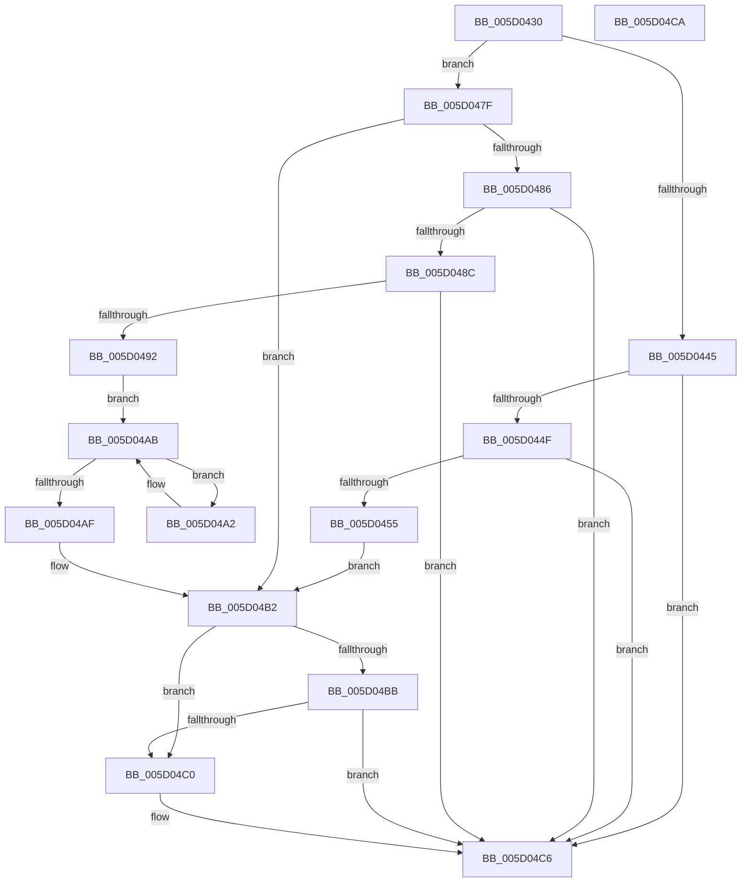

# PpmIdleUpdateIdleReevaluationDuration

- RVA: `0x005D0430`–`0x005D04CB` (길이 `155` bytes)
- VA: `0x00000001405D0430`
- 실행 섹션: `.text`
- PDB 이름 있음: `예`; PDB Function 태그: `아니요`
- unwind 정보 RVA: `0x000DB714`
- 디코드: `44`개 명령, `155/155` bytes 표시
- 미해석 바이트: `0` (있으면 어셈블리에 `.byte`로 보존)

> 이 문서는 커널 이미지의 기계어와 PDB 기호를 분석해 생성했습니다. 4번과 5번은 함수 원형과 자료형을 바이너리 사용 방식에서 추정한 C 해석이며 원본 소스 복구 결과는 아닙니다.

## 1. Dependencies

- 직접 호출 지점: **0**; 고유 호출 대상: **0**
- 직접 호출자로 확인된 함수: **1**
- RIP 상대 이미지 참조: **3**

### Outgoing calls
- 직접 디코드된 call 명령이 없습니다.

### Direct callers
- [PpmIdleSelectStates](../2C/PpmIdleSelectStates_function_002CFFE8.md) at `0x002D0497`
- [PpmIdleSelectStates](../2C/PpmIdleSelectStates_function_002CFFE8.md) at `0x002D0758`

### Static image references
- `0x005D0455` → RVA `0x00E08380` (`.data`; read)
- `0x005D045C` → RVA `0x00F0CE0C` (`.data`; read)
- `0x005D04A5` → RVA `0x00FC6AA0` (`ALMOSTRO`; read)

## 2. Other-region calls and transfers

- 다른 실행 섹션으로 향하는 call: **0**
- 별도 외부 분기/꼬리 이동을 확인하지 못했습니다.

## 3. Assembly (complete function range)

```asm
005D0430  4C 8B 5C 24 28                  mov r11, qword ptr [rsp + 0x28]
005D0435  48 8B C1                        mov rax, rcx
005D0438  B9 03 00 00 80                  mov ecx, 0x80000003
005D043D  45 33 D2                        xor r10d, r10d
005D0440  48 3B D1                        cmp rdx, rcx
005D0443  74 3A                           je 0x1405d047f
005D0445  B8 08 00 00 80                  mov eax, 0x80000008
005D044A  48 3B D0                        cmp rdx, rax
005D044D  75 77                           jne 0x1405d04c6
005D044F  45 38 53 08                     cmp byte ptr [r11 + 8], r10b
005D0453  75 71                           jne 0x1405d04c6
005D0455  48 8B 15 24 7F 83 00            mov rdx, qword ptr [rip + 0x837f24]
005D045C  48 63 05 A9 C9 93 00            movsxd rax, dword ptr [rip + 0x93c9a9]
005D0463  48 69 C8 E8 01 00 00            imul rcx, rax, 0x1e8
005D046A  41 C6 43 08 01                  mov byte ptr [r11 + 8], 1
005D046F  8B 84 11 D0 00 00 00            mov eax, dword ptr [rcx + rdx + 0xd0]
005D0476  8D 0C 80                        lea ecx, [rax + rax*4]
005D0479  44 8D 0C 09                     lea r9d, [rcx + rcx]
005D047D  EB 33                           jmp 0x1405d04b2
005D047F  41 0F BA E0 0D                  bt r8d, 0xd
005D0484  72 2C                           jb 0x1405d04b2
005D0486  41 F6 C0 01                     test r8b, 1
005D048A  74 3A                           je 0x1405d04c6
005D048C  45 38 53 0A                     cmp byte ptr [r11 + 0xa], r10b
005D0490  75 34                           jne 0x1405d04c6
005D0492  8B 80 A4 2D 00 00               mov eax, dword ptr [rax + 0x2da4]
005D0498  41 8B CA                        mov ecx, r10d
005D049B  41 C6 43 0A 01                  mov byte ptr [r11 + 0xa], 1
005D04A0  EB 09                           jmp 0x1405d04ab
005D04A2  C1 E8 04                        shr eax, 4
005D04A5  03 0D F5 65 9F 00               add ecx, dword ptr [rip + 0x9f65f5]
005D04AB  85 C0                           test eax, eax
005D04AD  75 F3                           jne 0x1405d04a2
005D04AF  44 8B C9                        mov r9d, ecx
005D04B2  49 8B 03                        mov rax, qword ptr [r11]
005D04B5  48 83 F8 FF                     cmp rax, -1
005D04B9  74 05                           je 0x1405d04c0
005D04BB  4C 3B C8                        cmp r9, rax
005D04BE  73 06                           jae 0x1405d04c6
005D04C0  4D 89 0B                        mov qword ptr [r11], r9
005D04C3  41 B2 01                        mov r10b, 1
005D04C6  41 8A C2                        mov al, r10b
005D04C9  C3                              ret
005D04CA  CC                              int3
```

## 4. C-style interpretation (structured pseudocode)

```c
__int64 __fastcall PpmIdleUpdateIdleReevaluationDuration(__int64 a1, __int64 a2, int a3, __int64 a4, __int64 a5)
{
    __int64 result;
    __int64 v_r10;

    v_r10 = 0;
    if (a2 == ((unsigned int)(0x80000003ULL))) goto loc_005D047F;
    if (a2 != ((unsigned int)(0x80000008ULL))) goto loc_005D04C6;
    if ((*(unsigned __int8 *)(a5 + 8)) != 0) goto loc_005D04C6;
    a1 = ((unsigned int)(0x80000003ULL)) * ((int)(*(unsigned int *)(v_rip + 9685417)));
    *(unsigned __int8 *)(a5 + 8) = 1;
    goto loc_005D04B2;
loc_005D047F:
    if (condition_is_below) goto loc_005D04B2;
    if ((((unsigned __int8)(a3)) & (1)) == 0) goto loc_005D04C6;
    if ((*(unsigned __int8 *)(a5 + 10)) != 0) goto loc_005D04C6;
    *(unsigned __int8 *)(a5 + 10) = 1;
    goto loc_005D04AB;
loc_005D04A2:
    result = (unsigned int)(((unsigned int)(*(unsigned int *)((unsigned int)(*(unsigned int *)(a1 + *(unsigned __int64 *)(v_rip + 8617764) * 1 + 208)) + 11684))) >> (4));
    a1 = (unsigned int)((0) + (*(unsigned int *)(v_rip + 10446325)));
loc_005D04AB:
    if ((unsigned int)(result) != 0) goto loc_005D04A2;
loc_005D04B2:
    if ((*(unsigned __int64 *)(a5)) == -1) goto loc_005D04C0;
    if (((unsigned int)((unsigned int)(a1))) < (*(unsigned __int64 *)(a5))) {
        *(unsigned __int64 *)(a5) = (unsigned int)((unsigned int)(a1));
        v_r10 = 1;
    }
    return (unsigned __int8)(v_r10);
}
```

## 5. (Beta) C Style

```c
int64_t PpmIdleUpdateIdleReevaluationDuration(void *Arg1, int64_t Arg2, int32_t Arg3, int64_t Arg4, void *Arg5)
{
    uint8_t *arg1 = (uint8_t *)Arg1;
    uint8_t *arg5 = (uint8_t *)Arg5;

    int64_t result;
    int64_t local_r10;

    local_r10 = 0;
    if (Arg2 == ((uint32_t)(0x80000003ULL))) goto loc_005D047F;
    if (Arg2 != ((uint32_t)(0x80000008ULL))) goto loc_005D04C6;
    if ((*(uint8_t *)(arg5 + 0x8)) != 0) goto loc_005D04C6;
    Arg1 = ((uint32_t)(0x80000003ULL)) * ((int32_t)(*(uint32_t *)(v_rip + 0x93C9A9)));
    *(uint8_t *)(arg5 + 0x8) = 1;
    goto loc_005D04B2;
loc_005D047F:
    if (condition_is_below) goto loc_005D04B2;
    if ((((uint8_t)(Arg3)) & (1)) == 0) goto loc_005D04C6;
    if ((*(uint8_t *)(arg5 + 0xA)) != 0) goto loc_005D04C6;
    *(uint8_t *)(arg5 + 0xA) = 1;
    goto loc_005D04AB;
loc_005D04A2:
    result = (uint32_t)(((uint32_t)(*(uint32_t *)((uint32_t)(*(uint32_t *)(arg1 + *(uint64_t *)(v_rip + 0x837F24) * 1 + 0xD0)) + 0x2DA4))) >> (4));
    Arg1 = (uint32_t)((0) + (*(uint32_t *)(v_rip + 0x9F65F5)));
loc_005D04AB:
    if ((uint32_t)(result) != 0) goto loc_005D04A2;
loc_005D04B2:
    if ((*(uint64_t *)(arg5)) == -1) goto loc_005D04C0;
    if (((uint32_t)((uint32_t)(Arg1))) < (*(uint64_t *)(arg5))) {
        *(uint64_t *)(arg5) = (uint32_t)((uint32_t)(Arg1));
        local_r10 = 1;
    }
    return (uint8_t)(local_r10);
}
```

### 관측된 메모리 오프셋

구조체 형식이 확인되지 않은 접근은 인자 기준의 오프셋으로만 기록했습니다.

| 기준 인자 | 오프셋 표현 | 폭 (bit) | 접근 |
|---|---:|---:|---|
| `Arg1` | `+ 0x2DA4` | `32` | `R` |
| `Arg5` | `+ 0x0` | `64` | `R` |
| `Arg5` | `+ 0x0` | `64` | `W` |
| `Arg5` | `+ 0x8` | `8` | `R` |
| `Arg5` | `+ 0x8` | `8` | `W` |
| `Arg5` | `+ 0xA` | `8` | `R` |
| `Arg5` | `+ 0xA` | `8` | `W` |

## 6. Execution-region graph

[열기: 2D/3D 그래프와 함수 탐색 컨트롤 패널](../../../control-panel.html?section=text&rva=0x005D0430&view=graph)

- 2D 그래프는 위에서 아래로 흐르고, 3D 그래프는 빈 공간을 드래그해 회전합니다. Shift+드래그는 이동, 휠은 확대·축소, 함수 노드 선택은 대상 보고서 이동입니다.

### Static fallback


