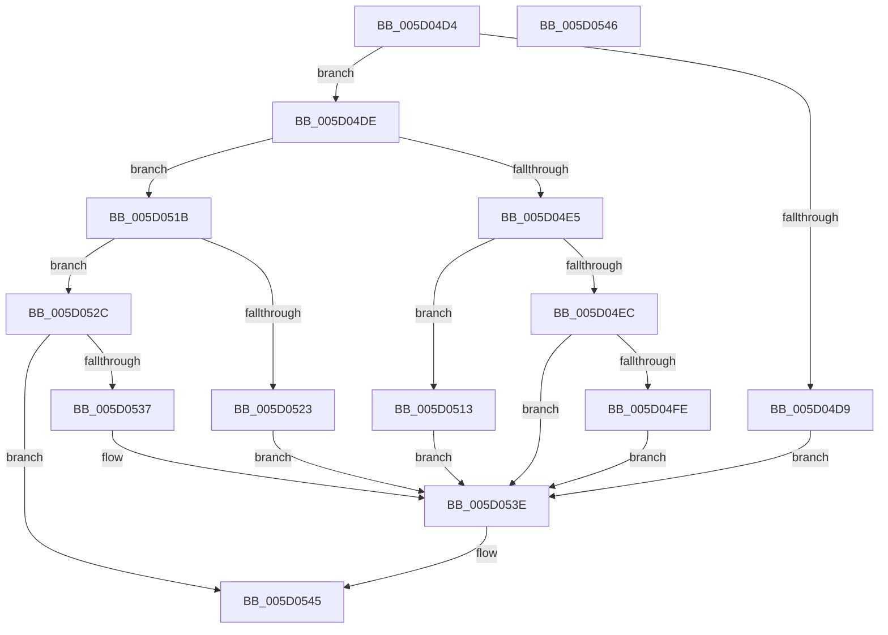

# PpmIdleUpdateSelectionStatistics

- RVA: `0x005D04D4`–`0x005D0547` (길이 `115` bytes)
- VA: `0x00000001405D04D4`
- 실행 섹션: `.text`
- PDB 이름 있음: `예`; PDB Function 태그: `아니요`
- unwind 정보 RVA: `0x000DB714`
- 디코드: `32`개 명령, `115/115` bytes 표시
- 미해석 바이트: `0` (있으면 어셈블리에 `.byte`로 보존)

> 이 문서는 커널 이미지의 기계어와 PDB 기호를 분석해 생성했습니다. 4번과 5번은 함수 원형과 자료형을 바이너리 사용 방식에서 추정한 C 해석이며 원본 소스 복구 결과는 아닙니다.

## 1. Dependencies

- 직접 호출 지점: **0**; 고유 호출 대상: **0**
- 직접 호출자로 확인된 함수: **1**
- RIP 상대 이미지 참조: **0**

### Outgoing calls
- 직접 디코드된 call 명령이 없습니다.

### Direct callers
- [PpmIdleSelectStates](../2C/PpmIdleSelectStates_function_002CFFE8.md) at `0x002D03E3`
- [PpmIdleSelectStates](../2C/PpmIdleSelectStates_function_002CFFE8.md) at `0x002D071B`

### Static image references
- 디코드된 RIP-relative 메모리 참조가 없습니다.

## 2. Other-region calls and transfers

- 다른 실행 섹션으로 향하는 call: **0**
- 별도 외부 분기/꼬리 이동을 확인하지 못했습니다.

## 3. Assembly (complete function range)

```asm
005D04D4  48 85 C9                        test rcx, rcx
005D04D7  75 05                           jne 0x1405d04de
005D04D9  45 33 C0                        xor r8d, r8d
005D04DC  EB 60                           jmp 0x1405d053e
005D04DE  48 0F BA E1 1F                  bt rcx, 0x1f
005D04E3  72 36                           jb 0x1405d051b
005D04E5  48 0F BA E1 20                  bt rcx, 0x20
005D04EA  73 27                           jae 0x1405d0513
005D04EC  48 8B 82 88 00 00 00            mov rax, qword ptr [rdx + 0x88]
005D04F3  41 B8 02 00 00 00               mov r8d, 2
005D04F9  48 85 C0                        test rax, rax
005D04FC  74 40                           je 0x1405d053e
005D04FE  48 8B 40 20                     mov rax, qword ptr [rax + 0x20]
005D0502  0F BA F1 1F                     btr ecx, 0x1f
005D0506  FF C9                           dec ecx
005D0508  48 C1 E1 06                     shl rcx, 6
005D050C  48 FF 44 01 18                  inc qword ptr [rcx + rax + 0x18]
005D0511  EB 2B                           jmp 0x1405d053e
005D0513  41 B8 01 00 00 00               mov r8d, 1
005D0519  EB 23                           jmp 0x1405d053e
005D051B  81 F9 0C 00 00 80               cmp ecx, 0x8000000c
005D0521  77 09                           ja 0x1405d052c
005D0523  44 8D 81 02 00 00 80            lea r8d, [rcx - 0x7ffffffe]
005D052A  EB 12                           jmp 0x1405d053e
005D052C  8D 81 F2 FF FF 7F               lea eax, [rcx + 0x7ffffff2]
005D0532  83 F8 01                        cmp eax, 1
005D0535  77 0E                           ja 0x1405d0545
005D0537  44 8D 81 01 00 00 80            lea r8d, [rcx - 0x7fffffff]
005D053E  41 8B C0                        mov eax, r8d
005D0541  48 FF 04 C2                     inc qword ptr [rdx + rax*8]
005D0545  C3                              ret
005D0546  CC                              int3
```

## 4. C-style interpretation (structured pseudocode)

```c
__int64 __fastcall PpmIdleUpdateSelectionStatistics(__int64 a1, __int64 a2, int a3)
{
    if (a1 != 0) goto loc_005D04DE;
    a3 = 0;
    goto loc_005D053E;
loc_005D04DE:
    if (condition_is_below) goto loc_005D051B;
    if (condition_is_above_or_equal) goto loc_005D0513;
    if (*(unsigned __int64 *)(a2 + 136) == 0) goto loc_005D053E;
    a1 = (unsigned int)((a1) - 1);
    a1 = (a1) << (6);
    goto loc_005D053E;
loc_005D0513:
    goto loc_005D053E;
loc_005D051B:
    if (((unsigned int)(a1)) > 0x8000000CULL) goto loc_005D052C;
    goto loc_005D053E;
loc_005D052C:
    if (((unsigned int)(a1 + 2147483634)) > 1) goto loc_005D0545;
loc_005D053E:
loc_005D0545:
    return (unsigned int)((unsigned int)(a1 - 2147483647));
}
```

## 5. (Beta) C Style

```c
int64_t PpmIdleUpdateSelectionStatistics(int64_t Arg1, void *Arg2, int32_t Arg3)
{
    uint8_t *arg2 = (uint8_t *)Arg2;

    if (Arg1 != 0) goto loc_005D04DE;
    Arg3 = 0;
    goto loc_005D053E;
loc_005D04DE:
    if (condition_is_below) goto loc_005D051B;
    if (condition_is_above_or_equal) goto loc_005D0513;
    if (*(uint64_t *)(arg2 + 0x88) == 0) goto loc_005D053E;
    Arg1 = (uint32_t)((Arg1) - 1);
    Arg1 = (Arg1) << (6);
    goto loc_005D053E;
loc_005D0513:
    goto loc_005D053E;
loc_005D051B:
    if (((uint32_t)(Arg1)) > 0x8000000CULL) goto loc_005D052C;
    goto loc_005D053E;
loc_005D052C:
    if (((uint32_t)(Arg1 + 2147483634)) > 1) goto loc_005D0545;
loc_005D053E:
loc_005D0545:
    return (uint32_t)((uint32_t)(Arg1 - 2147483647));
}
```

### 관측된 메모리 오프셋

구조체 형식이 확인되지 않은 접근은 인자 기준의 오프셋으로만 기록했습니다.

| 기준 인자 | 오프셋 표현 | 폭 (bit) | 접근 |
|---|---:|---:|---|
| `Arg2` | `+ 0x0 + rax*8` | `64` | `R/W` |
| `Arg2` | `+ 0x88` | `64` | `R` |

## 6. Execution-region graph

[열기: 2D/3D 그래프와 함수 탐색 컨트롤 패널](../../../control-panel.html?section=text&rva=0x005D04D4&view=graph)

- 2D 그래프는 위에서 아래로 흐르고, 3D 그래프는 빈 공간을 드래그해 회전합니다. Shift+드래그는 이동, 휠은 확대·축소, 함수 노드 선택은 대상 보고서 이동입니다.

### Static fallback


