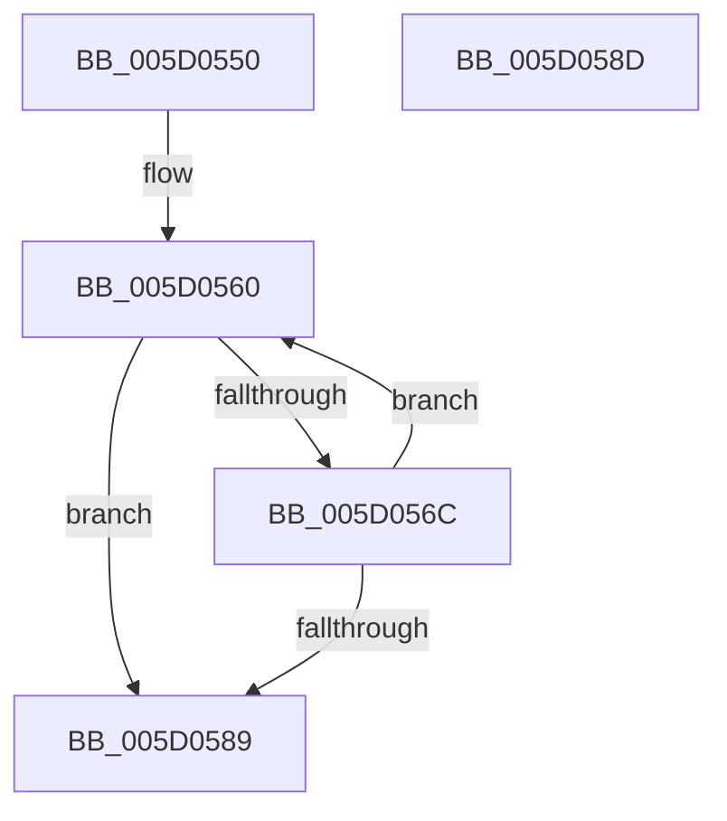

# PpmIdleUpdateSynchronizationState

- RVA: `0x005D0550`–`0x005D058E` (길이 `62` bytes)
- VA: `0x00000001405D0550`
- 실행 섹션: `.text`
- PDB 이름 있음: `예`; PDB Function 태그: `아니요`
- unwind 정보 RVA: `0x000DB714`
- 디코드: `21`개 명령, `62/62` bytes 표시
- 미해석 바이트: `0` (있으면 어셈블리에 `.byte`로 보존)

> 이 문서는 커널 이미지의 기계어와 PDB 기호를 분석해 생성했습니다. 4번과 5번은 함수 원형과 자료형을 바이너리 사용 방식에서 추정한 C 해석이며 원본 소스 복구 결과는 아닙니다.

## 1. Dependencies

- 직접 호출 지점: **0**; 고유 호출 대상: **0**
- 직접 호출자로 확인된 함수: **1**
- RIP 상대 이미지 참조: **0**

### Outgoing calls
- 직접 디코드된 call 명령이 없습니다.

### Direct callers
- [PoInitiateProcessorWake](../5C/PoInitiateProcessorWake_function_005CF2D0.md) at `0x005CF369`
- [PoInitiateProcessorWake](../5C/PoInitiateProcessorWake_function_005CF2D0.md) at `0x005CF3CD`

### Static image references
- 디코드된 RIP-relative 메모리 참조가 없습니다.

## 2. Other-region calls and transfers

- 다른 실행 섹션으로 향하는 call: **0**
- 별도 외부 분기/꼬리 이동을 확인하지 못했습니다.

## 3. Assembly (complete function range)

```asm
005D0550  44 0F B6 DA                     movzx r11d, dl
005D0554  4C 8B C9                        mov r9, rcx
005D0557  0F 0D 09                        prefetchw byte ptr [rcx]
005D055A  8B 01                           mov eax, dword ptr [rcx]
005D055C  45 0F B6 D0                     movzx r10d, r8b
005D0560  44 8B C0                        mov r8d, eax
005D0563  41 C1 E8 18                     shr r8d, 0x18
005D0567  45 3B C2                        cmp r8d, r10d
005D056A  75 1D                           jne 0x1405d0589
005D056C  41 8B CB                        mov ecx, r11d
005D056F  8B D0                           mov edx, eax
005D0571  C1 E1 18                        shl ecx, 0x18
005D0574  81 E2 FF FF FF 00               and edx, 0xffffff
005D057A  0B CA                           or ecx, edx
005D057C  44 8B C0                        mov r8d, eax
005D057F  F0 41 0F B1 09                  lock cmpxchg dword ptr [r9], ecx
005D0584  41 3B C0                        cmp eax, r8d
005D0587  75 D7                           jne 0x1405d0560
005D0589  C1 E8 18                        shr eax, 0x18
005D058C  C3                              ret
005D058D  CC                              int3
```

## 4. C-style interpretation (structured pseudocode)

```c
__int64 __fastcall PpmIdleUpdateSynchronizationState(__int64 a1, unsigned __int8 a2, unsigned __int8 a3)
{
    __int64 result;

loc_005D0560:
    a3 = (unsigned int)(((unsigned int)((unsigned int)((unsigned int)(*(unsigned int *)(a1))))) >> (24));
    if (a3 != a3) goto loc_005D0589;
    a1 = (unsigned int)(((unsigned int)(a2)) << (24));
    a2 = (unsigned int)(((unsigned int)((unsigned int)((unsigned int)(*(unsigned int *)(a1))))) & (0xFFFFFFULL));
    a1 = (unsigned int)((a1) | (a2));
    if (((unsigned int)((unsigned int)(*(unsigned int *)(a1)))) != ((unsigned int)((unsigned int)((unsigned int)((unsigned int)(*(unsigned int *)(a1))))))) goto loc_005D0560;
loc_005D0589:
    result = (unsigned int)(((unsigned int)(*(unsigned int *)(a1))) >> (24));
    return result;
}
```

## 5. (Beta) C Style

```c
int64_t PpmIdleUpdateSynchronizationState(void *Arg1, uint8_t Arg2, uint8_t Arg3)
{
    uint8_t *arg1 = (uint8_t *)Arg1;

    int64_t result;

loc_005D0560:
    Arg3 = (uint32_t)(((uint32_t)((uint32_t)((uint32_t)(*(uint32_t *)(arg1))))) >> (24));
    if (Arg3 != Arg3) goto loc_005D0589;
    Arg1 = (uint32_t)(((uint32_t)(Arg2)) << (24));
    Arg2 = (uint32_t)(((uint32_t)((uint32_t)((uint32_t)(*(uint32_t *)(arg1))))) & (0xFFFFFFULL));
    Arg1 = (uint32_t)((Arg1) | (Arg2));
    if (((uint32_t)((uint32_t)(*(uint32_t *)(arg1)))) != ((uint32_t)((uint32_t)((uint32_t)((uint32_t)(*(uint32_t *)(arg1))))))) goto loc_005D0560;
loc_005D0589:
    result = (uint32_t)(((uint32_t)(*(uint32_t *)(arg1))) >> (24));
    return result;
}
```

### 관측된 메모리 오프셋

구조체 형식이 확인되지 않은 접근은 인자 기준의 오프셋으로만 기록했습니다.

| 기준 인자 | 오프셋 표현 | 폭 (bit) | 접근 |
|---|---:|---:|---|
| `Arg1` | `+ 0x0` | `8` | `R` |
| `Arg1` | `+ 0x0` | `32` | `R` |

## 6. Execution-region graph

[열기: 2D/3D 그래프와 함수 탐색 컨트롤 패널](../../../control-panel.html?section=text&rva=0x005D0550&view=graph)

- 2D 그래프는 위에서 아래로 흐르고, 3D 그래프는 빈 공간을 드래그해 회전합니다. Shift+드래그는 이동, 휠은 확대·축소, 함수 노드 선택은 대상 보고서 이동입니다.

### Static fallback


