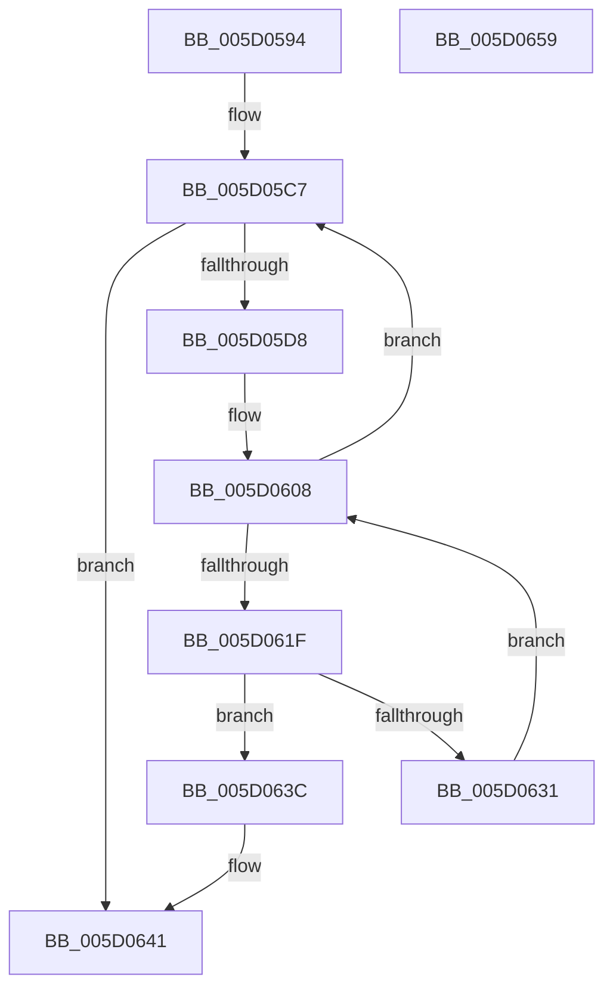

# PpmIdleWaitForDependentTransitions

- RVA: `0x005D0594`–`0x005D065A` (길이 `198` bytes)
- VA: `0x00000001405D0594`
- 실행 섹션: `.text`
- PDB 이름 있음: `예`; PDB Function 태그: `아니요`
- unwind 정보 RVA: `0x00093744`
- 디코드: `52`개 명령, `198/198` bytes 표시
- 미해석 바이트: `0` (있으면 어셈블리에 `.byte`로 보존)

> 이 문서는 커널 이미지의 기계어와 PDB 기호를 분석해 생성했습니다. 4번과 5번은 함수 원형과 자료형을 바이너리 사용 방식에서 추정한 C 해석이며 원본 소스 복구 결과는 아닙니다.

## 1. Dependencies

- 직접 호출 지점: **4**; 고유 호출 대상: **4**
- 직접 호출자로 확인된 함수: **1**
- RIP 상대 이미지 참조: **1**

### Outgoing calls
- `0x005D05CF` → [KeEnumerateNextProcessor](../41/KeEnumerateNextProcessor_function_00415480.md) (function, `0x00415480`)
- `0x005D05DB` → [KeGetPrcb](../2D/KeGetPrcb_function_002D85D0.md) (function, `0x002D85D0`)
- `0x005D0616` → [guard_dispatch_icall](../6B/guard_dispatch_icall_function_006BAAD0.md) (function, `0x006BAAD0`)
- `0x005D0635` → [PpmIdleTransitionStall](PpmIdleTransitionStall_function_005D039C.md) (function, `0x005D039C`)

### Direct callers
- [PpmIdleCheckCoordinatedStateEligibility](../5C/PpmIdleCheckCoordinatedStateEligibility_function_005CFACC.md) at `0x005CFD03`

### Static image references
- `0x005D05E0` → RVA `0x00FC6EC8` (`ALMOSTRO`; read)

## 2. Other-region calls and transfers

- 다른 실행 섹션으로 향하는 call: **0**
- 별도 외부 분기/꼬리 이동을 확인하지 못했습니다.

## 3. Assembly (complete function range)

```asm
005D0594  48 89 5C 24 10                  mov qword ptr [rsp + 0x10], rbx
005D0599  48 89 74 24 18                  mov qword ptr [rsp + 0x18], rsi
005D059E  48 89 7C 24 20                  mov qword ptr [rsp + 0x20], rdi
005D05A3  55                              push rbp
005D05A4  48 8B EC                        mov rbp, rsp
005D05A7  48 83 EC 60                     sub rsp, 0x60
005D05AB  48 8B 41 08                     mov rax, qword ptr [rcx + 8]
005D05AF  33 DB                           xor ebx, ebx
005D05B1  89 5D D2                        mov dword ptr [rbp - 0x2e], ebx
005D05B4  66 89 5D D6                     mov word ptr [rbp - 0x2a], bx
005D05B8  89 5D 10                        mov dword ptr [rbp + 0x10], ebx
005D05BB  66 89 5D D0                     mov word ptr [rbp - 0x30], bx
005D05BF  48 89 45 C8                     mov qword ptr [rbp - 0x38], rax
005D05C3  48 89 4D C0                     mov qword ptr [rbp - 0x40], rcx
005D05C7  48 8D 55 C0                     lea rdx, [rbp - 0x40]
005D05CB  48 8D 4D 10                     lea rcx, [rbp + 0x10]
005D05CF  E8 AC 4E E4 FF                  call 0x140415480
005D05D4  85 C0                           test eax, eax
005D05D6  75 69                           jne 0x1405d0641
005D05D8  8B 4D 10                        mov ecx, dword ptr [rbp + 0x10]
005D05DB  E8 F0 7F D0 FF                  call 0x1402d85d0
005D05E0  48 8B 0D E1 68 9F 00            mov rcx, qword ptr [rip + 0x9f68e1]
005D05E7  0F 57 C0                        xorps xmm0, xmm0
005D05EA  0F 11 45 E8                     movups xmmword ptr [rbp - 0x18], xmm0
005D05EE  C6 45 F4 01                     mov byte ptr [rbp - 0xc], 1
005D05F2  48 8B F8                        mov rdi, rax
005D05F5  48 8B B0 40 88 00 00            mov rsi, qword ptr [rax + 0x8840]
005D05FC  0F 11 45 D8                     movups xmmword ptr [rbp - 0x28], xmm0
005D0600  48 89 45 E8                     mov qword ptr [rbp - 0x18], rax
005D0604  48 89 4D E0                     mov qword ptr [rbp - 0x20], rcx
005D0608  48 8B 86 88 02 00 00            mov rax, qword ptr [rsi + 0x288]
005D060F  48 8B 8E 98 02 00 00            mov rcx, qword ptr [rsi + 0x298]
005D0616  E8 B5 A4 0E 00                  call 0x1406baad0
005D061B  84 C0                           test al, al
005D061D  75 A8                           jne 0x1405d05c7
005D061F  8B 87 8C 88 00 00               mov eax, dword ptr [rdi + 0x888c]
005D0625  25 00 00 00 FF                  and eax, 0xff000000
005D062A  3D 00 00 00 05                  cmp eax, 0x5000000
005D062F  75 0B                           jne 0x1405d063c
005D0631  48 8D 4D D8                     lea rcx, [rbp - 0x28]
005D0635  E8 62 FD FF FF                  call 0x1405d039c
005D063A  EB CC                           jmp 0x1405d0608
005D063C  BB 2A 00 00 C0                  mov ebx, 0xc000002a
005D0641  4C 8D 5C 24 60                  lea r11, [rsp + 0x60]
005D0646  8B C3                           mov eax, ebx
005D0648  49 8B 5B 18                     mov rbx, qword ptr [r11 + 0x18]
005D064C  49 8B 73 20                     mov rsi, qword ptr [r11 + 0x20]
005D0650  49 8B 7B 28                     mov rdi, qword ptr [r11 + 0x28]
005D0654  49 8B E3                        mov rsp, r11
005D0657  5D                              pop rbp
005D0658  C3                              ret
005D0659  CC                              int3
```

## 4. C-style interpretation (structured pseudocode)

```c
__int64 __fastcall PpmIdleWaitForDependentTransitions(__int64 a1)
{
    __int64 result;
    __int64 v_rbx;
    __int64 v_rsp;
    unsigned __int8 v_stack_m14;
    unsigned __int64 v_stack_m20;
    unsigned __int64 v_stack_m28;
    unsigned __int64 v_stack_m30;
    unsigned __int16 v_stack_m32;
    unsigned int v_stack_m36;
    unsigned __int16 v_stack_m38;
    unsigned __int64 v_stack_m40;
    unsigned __int64 v_stack_m48;
    unsigned __int64 v_stack_m8;
    unsigned __int64 v_stack_p10;
    unsigned __int64 v_stack_p18;
    unsigned __int64 v_stack_p20;
    unsigned int v_stack_p8;

    v_stack_p10 = v_rbx;
    v_stack_p18 = v_rsi;
    v_stack_p20 = v_rdi;
    v_rsp = (v_rsp) - (96);
    v_rbx = 0;
    v_stack_m36 = 0;
    v_stack_m32 = 0;
    v_stack_p8 = 0;
    v_stack_m38 = 0;
    v_stack_m40 = *(unsigned __int64 *)(a1 + 8);
    v_stack_m48 = a1;
loc_005D05C7:
    result = KeEnumerateNextProcessor(v_stack_p8, v_stack_m48, a3, a4);
    if ((unsigned int)(result) != 0) goto loc_005D0641;
    result = KeGetPrcb((unsigned int)(v_stack_p8), v_stack_m48, a3, a4);
    v_stack_m20 = v_xmm0;
    v_stack_m14 = 1;
    v_stack_m30 = v_xmm0;
    v_stack_m20 = result;
    v_stack_m28 = *(unsigned __int64 *)(v_rip + 10447073);
loc_005D0608:
    result = guard_dispatch_icall(*(unsigned __int64 *)(*(unsigned __int64 *)(result + 34880) + 664), v_stack_m48, a3, a4);
    if ((unsigned __int8)(result) != 0) goto loc_005D05C7;
    result = (unsigned int)(((unsigned int)(*(unsigned int *)(result + 34956))) & (0xFF000000ULL));
    if (((unsigned int)(result)) != 0x5000000ULL) goto loc_005D063C;
    result = PpmIdleTransitionStall(v_stack_m30, v_stack_m48, a3, a4);
    goto loc_005D0608;
loc_005D063C:
loc_005D0641:
    return (unsigned int)((unsigned int)((unsigned int)(0xC000002AULL)));
}
```

## 5. (Beta) C Style

```c
int64_t PpmIdleWaitForDependentTransitions(void *Arg1)
{
    uint8_t *arg1 = (uint8_t *)Arg1;

    int64_t result;
    int64_t local_rbx;
    int64_t local_rsp;
    uint8_t v_stack_m14;
    uint64_t v_stack_m20;
    uint64_t v_stack_m28;
    uint64_t v_stack_m30;
    uint16_t v_stack_m32;
    uint32_t v_stack_m36;
    uint16_t v_stack_m38;
    uint64_t v_stack_m40;
    uint64_t v_stack_m48;
    uint64_t v_stack_m8;
    uint64_t v_stack_p10;
    uint64_t v_stack_p18;
    uint64_t v_stack_p20;
    uint32_t v_stack_p8;

    v_stack_p10 = local_rbx;
    v_stack_p18 = local_rsi;
    v_stack_p20 = local_rdi;
    local_rsp = (local_rsp) - (96);
    local_rbx = 0;
    v_stack_m36 = 0;
    v_stack_m32 = 0;
    v_stack_p8 = 0;
    v_stack_m38 = 0;
    v_stack_m40 = *(uint64_t *)(arg1 + 0x8);
    v_stack_m48 = Arg1;
loc_005D05C7:
    result = KeEnumerateNextProcessor(v_stack_p8, v_stack_m48, a3, a4);
    if ((uint32_t)(result) != 0) goto loc_005D0641;
    result = KeGetPrcb((uint32_t)(v_stack_p8), v_stack_m48, a3, a4);
    v_stack_m20 = v_xmm0;
    v_stack_m14 = 1;
    v_stack_m30 = v_xmm0;
    v_stack_m20 = result;
    v_stack_m28 = *(uint64_t *)(v_rip + 0x9F68E1);
loc_005D0608:
    result = guard_dispatch_icall(*(uint64_t *)(*(uint64_t *)(result + 0x8840) + 0x298), v_stack_m48, a3, a4);
    if ((uint8_t)(result) != 0) goto loc_005D05C7;
    result = (uint32_t)(((uint32_t)(*(uint32_t *)(result + 0x888C))) & (0xFF000000ULL));
    if (((uint32_t)(result)) != 0x5000000ULL) goto loc_005D063C;
    result = PpmIdleTransitionStall(v_stack_m30, v_stack_m48, a3, a4);
    goto loc_005D0608;
loc_005D063C:
loc_005D0641:
    return (uint32_t)((uint32_t)((uint32_t)(0xC000002AULL)));
}
```

### 관측된 메모리 오프셋

구조체 형식이 확인되지 않은 접근은 인자 기준의 오프셋으로만 기록했습니다.

| 기준 인자 | 오프셋 표현 | 폭 (bit) | 접근 |
|---|---:|---:|---|
| `Arg1` | `+ 0x8` | `64` | `R` |

## 6. Execution-region graph

[열기: 2D/3D 그래프와 함수 탐색 컨트롤 패널](../../../control-panel.html?section=text&rva=0x005D0594&view=graph)

- 2D 그래프는 위에서 아래로 흐르고, 3D 그래프는 빈 공간을 드래그해 회전합니다. Shift+드래그는 이동, 휠은 확대·축소, 함수 노드 선택은 대상 보고서 이동입니다.

### Static fallback


