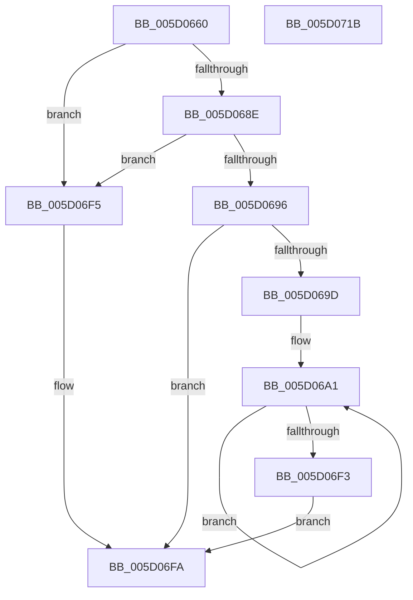

# PpmInstallNewIdleDomains

- RVA: `0x005D0660`–`0x005D071C` (길이 `188` bytes)
- VA: `0x00000001405D0660`
- 실행 섹션: `.text`
- PDB 이름 있음: `예`; PDB Function 태그: `아니요`
- unwind 정보 RVA: `0x0005FEF8`
- 디코드: `52`개 명령, `188/188` bytes 표시
- 미해석 바이트: `0` (있으면 어셈블리에 `.byte`로 보존)

> 이 문서는 커널 이미지의 기계어와 PDB 기호를 분석해 생성했습니다. 4번과 5번은 함수 원형과 자료형을 바이너리 사용 방식에서 추정한 C 해석이며 원본 소스 복구 결과는 아닙니다.

## 1. Dependencies

- 직접 호출 지점: **2**; 고유 호출 대상: **2**
- 직접 호출자로 확인된 함수: **0**
- RIP 상대 이미지 참조: **0**

### Outgoing calls
- `0x005D06C8` → [memset](../6C/memset_function_006C6C40.md) (function, `0x006C6C40`)
- `0x005D06E5` → [KiCopyAffinityEx](../2C/KiCopyAffinityEx_function_002CE860.md) (function, `0x002CE860`)

### Direct callers
- 이 함수 시작 RVA로 연결되는 직접 call은 확인되지 않았습니다. 간접 호출은 완전히 역산할 수 없습니다.

### Static image references
- 디코드된 RIP-relative 메모리 참조가 없습니다.

## 2. Other-region calls and transfers

- 다른 실행 섹션으로 향하는 call: **0**
- 별도 외부 분기/꼬리 이동을 확인하지 못했습니다.

## 3. Assembly (complete function range)

```asm
005D0660  48 8B C4                        mov rax, rsp
005D0663  48 89 58 08                     mov qword ptr [rax + 8], rbx
005D0667  48 89 68 10                     mov qword ptr [rax + 0x10], rbp
005D066B  48 89 70 18                     mov qword ptr [rax + 0x18], rsi
005D066F  48 89 78 20                     mov qword ptr [rax + 0x20], rdi
005D0673  41 54                           push r12
005D0675  41 56                           push r14
005D0677  41 57                           push r15
005D0679  48 83 EC 20                     sub rsp, 0x20
005D067D  48 8B A9 40 88 00 00            mov rbp, qword ptr [rcx + 0x8840]
005D0684  33 F6                           xor esi, esi
005D0686  4C 8B F2                        mov r14, rdx
005D0689  48 85 ED                        test rbp, rbp
005D068C  74 67                           je 0x1405d06f5
005D068E  8B 45 28                        mov eax, dword ptr [rbp + 0x28]
005D0691  3B 42 04                        cmp eax, dword ptr [rdx + 4]
005D0694  75 5F                           jne 0x1405d06f5
005D0696  44 8B FE                        mov r15d, esi
005D0699  85 C0                           test eax, eax
005D069B  74 5D                           je 0x1405d06fa
005D069D  44 8D 66 01                     lea r12d, [rsi + 1]
005D06A1  41 8B DF                        mov ebx, r15d
005D06A4  33 D2                           xor edx, edx
005D06A6  48 69 FB 58 01 00 00            imul rdi, rbx, 0x158
005D06AD  41 B8 00 01 00 00               mov r8d, 0x100
005D06B3  48 81 C7 20 04 00 00            add rdi, 0x420
005D06BA  48 03 FD                        add rdi, rbp
005D06BD  48 8D 4F 08                     lea rcx, [rdi + 8]
005D06C1  48 C7 07 01 00 20 00            mov qword ptr [rdi], 0x200001
005D06C8  E8 73 65 0F 00                  call 0x1406c6c40
005D06CD  0F B7 57 02                     movzx edx, word ptr [rdi + 2]
005D06D1  48 8B CF                        mov rcx, rdi
005D06D4  4C 69 C3 08 01 00 00            imul r8, rbx, 0x108
005D06DB  49 81 C0 10 01 00 00            add r8, 0x110
005D06E2  4D 03 C6                        add r8, r14
005D06E5  E8 76 E1 CF FF                  call 0x1402ce860
005D06EA  45 03 FC                        add r15d, r12d
005D06ED  44 3B 7D 28                     cmp r15d, dword ptr [rbp + 0x28]
005D06F1  72 AE                           jb 0x1405d06a1
005D06F3  EB 05                           jmp 0x1405d06fa
005D06F5  BE 0D 00 00 C0                  mov esi, 0xc000000d
005D06FA  48 8B 5C 24 40                  mov rbx, qword ptr [rsp + 0x40]
005D06FF  8B C6                           mov eax, esi
005D0701  48 8B 74 24 50                  mov rsi, qword ptr [rsp + 0x50]
005D0706  48 8B 6C 24 48                  mov rbp, qword ptr [rsp + 0x48]
005D070B  48 8B 7C 24 58                  mov rdi, qword ptr [rsp + 0x58]
005D0710  48 83 C4 20                     add rsp, 0x20
005D0714  41 5F                           pop r15
005D0716  41 5E                           pop r14
005D0718  41 5C                           pop r12
005D071A  C3                              ret
005D071B  CC                              int3
```

## 4. C-style interpretation (structured pseudocode)

```c
__int64 __fastcall PpmInstallNewIdleDomains(__int64 a1, __int64 a2)
{
    __int64 result;
    __int64 v_r15;
    __int64 v_rdi;
    __int64 v_rsi;
    __int64 v_rsp;
    unsigned __int64 v_stack_p10;
    unsigned __int64 v_stack_p18;
    unsigned __int64 v_stack_p20;
    unsigned __int64 v_stack_p8;

    *(unsigned __int64 *)(v_rsp + 8) = v_rbx;
    *(unsigned __int64 *)(v_rsp + 16) = v_rbp;
    *(unsigned __int64 *)(v_rsp + 24) = v_rsi;
    *(unsigned __int64 *)(v_rsp + 32) = v_rdi;
    v_rsp = (v_rsp) - (32);
    v_rsi = 0;
    if (*(unsigned __int64 *)(a1 + 34880) == 0) goto loc_005D06F5;
    if (((unsigned int)((unsigned int)(*(unsigned int *)(*(unsigned __int64 *)(a1 + 34880) + 40)))) != (*(unsigned int *)(a2 + 4))) goto loc_005D06F5;
    if ((unsigned int)((unsigned int)(*(unsigned int *)(*(unsigned __int64 *)(a1 + 34880) + 40))) == 0) goto loc_005D06FA;
loc_005D06A1:
    a2 = 0;
    v_rdi = (v_rdi) * (0);
    v_rdi = (v_rdi) + (0x420ULL);
    v_rdi = (v_rdi) + (*(unsigned __int64 *)(a1 + 34880));
    *(unsigned __int64 *)(v_rdi) = 0x200001ULL;
    result = memset(v_rdi + 8, a2, 256, a4);
    a3 = (256) * (0);
    a3 = (a3) + (272);
    a3 = (a3) + (0);
    result = KiCopyAffinityEx(v_rdi, *(unsigned __int16 *)(v_rdi + 2), a3, a4);
    v_r15 = (unsigned int)((0) + ((unsigned int)(v_rsi + 1)));
    if (((unsigned int)(v_r15)) < (*(unsigned int *)(*(unsigned __int64 *)(a1 + 34880) + 40))) goto loc_005D06A1;
    goto loc_005D06FA;
loc_005D06F5:
loc_005D06FA:
    v_rsp = (v_rsp) + (32);
    return (unsigned int)((unsigned int)((unsigned int)(0xC000000DULL)));
}
```

## 5. (Beta) C Style

```c
int64_t PpmInstallNewIdleDomains(void *Arg1, void *Arg2)
{
    uint8_t *arg1 = (uint8_t *)Arg1;
    uint8_t *arg2 = (uint8_t *)Arg2;

    int64_t result;
    int64_t local_r15;
    int64_t local_rdi;
    int64_t local_rsi;
    int64_t local_rsp;
    uint64_t v_stack_p10;
    uint64_t v_stack_p18;
    uint64_t v_stack_p20;
    uint64_t v_stack_p8;

    *(uint64_t *)(local_rsp + 0x8) = local_rbx;
    *(uint64_t *)(local_rsp + 0x10) = local_rbp;
    *(uint64_t *)(local_rsp + 0x18) = local_rsi;
    *(uint64_t *)(local_rsp + 0x20) = local_rdi;
    local_rsp = (local_rsp) - (32);
    local_rsi = 0;
    if (*(uint64_t *)(arg1 + 0x8840) == 0) goto loc_005D06F5;
    if (((uint32_t)((uint32_t)(*(uint32_t *)(*(uint64_t *)(arg1 + 0x8840) + 0x28)))) != (*(uint32_t *)(arg2 + 0x4))) goto loc_005D06F5;
    if ((uint32_t)((uint32_t)(*(uint32_t *)(*(uint64_t *)(arg1 + 0x8840) + 0x28))) == 0) goto loc_005D06FA;
loc_005D06A1:
    Arg2 = 0;
    local_rdi = (local_rdi) * (0);
    local_rdi = (local_rdi) + (0x420ULL);
    local_rdi = (local_rdi) + (*(uint64_t *)(arg1 + 0x8840));
    *(uint64_t *)(local_rdi) = 0x200001ULL;
    result = memset(local_rdi + 8, Arg2, 256, a4);
    a3 = (256) * (0);
    a3 = (a3) + (272);
    a3 = (a3) + (0);
    result = KiCopyAffinityEx(local_rdi, *(uint16_t *)(local_rdi + 0x2), a3, a4);
    local_r15 = (uint32_t)((0) + ((uint32_t)(local_rsi + 1)));
    if (((uint32_t)(local_r15)) < (*(uint32_t *)(*(uint64_t *)(arg1 + 0x8840) + 0x28))) goto loc_005D06A1;
    goto loc_005D06FA;
loc_005D06F5:
loc_005D06FA:
    local_rsp = (local_rsp) + (32);
    return (uint32_t)((uint32_t)((uint32_t)(0xC000000DULL)));
}
```

### 관측된 메모리 오프셋

구조체 형식이 확인되지 않은 접근은 인자 기준의 오프셋으로만 기록했습니다.

| 기준 인자 | 오프셋 표현 | 폭 (bit) | 접근 |
|---|---:|---:|---|
| `Arg1` | `+ 0x8840` | `64` | `R` |
| `Arg2` | `+ 0x4` | `32` | `R` |

## 6. Execution-region graph

[열기: 2D/3D 그래프와 함수 탐색 컨트롤 패널](../../../control-panel.html?section=text&rva=0x005D0660&view=graph)

- 2D 그래프는 위에서 아래로 흐르고, 3D 그래프는 빈 공간을 드래그해 회전합니다. Shift+드래그는 이동, 휠은 확대·축소, 함수 노드 선택은 대상 보고서 이동입니다.

### Static fallback


