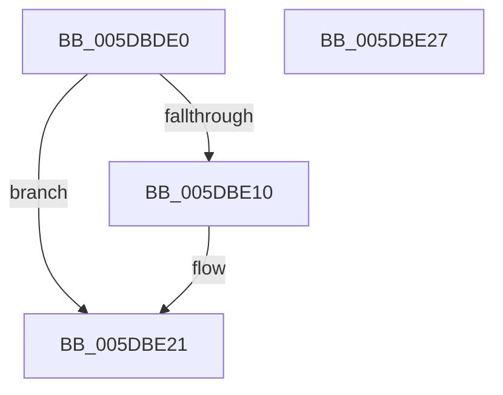

# PpmParkRegisterRestriction

- RVA: `0x005DBDE0`–`0x005DBE28` (길이 `72` bytes)
- VA: `0x00000001405DBDE0`
- 실행 섹션: `.text`
- PDB 이름 있음: `예`; PDB Function 태그: `아니요`
- unwind 정보 RVA: `0x0005CF00`
- 디코드: `17`개 명령, `72/72` bytes 표시
- 미해석 바이트: `0` (있으면 어셈블리에 `.byte`로 보존)

> 이 문서는 커널 이미지의 기계어와 PDB 기호를 분석해 생성했습니다. 4번과 5번은 함수 원형과 자료형을 바이너리 사용 방식에서 추정한 C 해석이며 원본 소스 복구 결과는 아닙니다.

## 1. Dependencies

- 직접 호출 지점: **1**; 고유 호출 대상: **1**
- 직접 호출자로 확인된 함수: **2**
- RIP 상대 이미지 참조: **0**

### Outgoing calls
- `0x005DBE06` → [ExAllocatePool2](../../poolcode/B8/ExAllocatePool2_function_00B820F0.md) (function, `0x00B820F0`)

### Direct callers
- [PpmParkRegisterParking](PpmParkRegisterParking_function_005DB508.md) at `0x005DBB08`
- [PpmParkInitParkNode](../5E/PpmParkInitParkNode_function_005E1444.md) at `0x005E1813`

### Static image references
- 디코드된 RIP-relative 메모리 참조가 없습니다.

## 2. Other-region calls and transfers

- 다른 실행 섹션으로 향하는 call: **1**
  - `0x005DBE06` → [ExAllocatePool2](../../poolcode/B8/ExAllocatePool2_function_00B820F0.md) (`.text` → `POOLCODE`)
- 별도 외부 분기/꼬리 이동을 확인하지 못했습니다.

## 3. Assembly (complete function range)

```asm
005DBDE0  40 53                           push rbx
005DBDE2  48 83 EC 20                     sub rsp, 0x20
005DBDE6  0F B7 51 0A                     movzx edx, word ptr [rcx + 0xa]
005DBDEA  48 8B D9                        mov rbx, rcx
005DBDED  C7 81 D0 04 00 00 01 00 00 00   mov dword ptr [rcx + 0x4d0], 1
005DBDF7  41 B8 50 50 4D 70               mov r8d, 0x704d5050
005DBDFD  48 C1 E2 02                     shl rdx, 2
005DBE01  B9 40 00 00 00                  mov ecx, 0x40
005DBE06  E8 E5 62 5A 00                  call 0x140b820f0
005DBE0B  48 85 C0                        test rax, rax
005DBE0E  74 11                           je 0x1405dbe21
005DBE10  48 89 83 E8 04 00 00            mov qword ptr [rbx + 0x4e8], rax
005DBE17  C7 83 D0 04 00 00 02 00 00 00   mov dword ptr [rbx + 0x4d0], 2
005DBE21  48 83 C4 20                     add rsp, 0x20
005DBE25  5B                              pop rbx
005DBE26  C3                              ret
005DBE27  CC                              int3
```

## 4. C-style interpretation (structured pseudocode)

```c
__int64 __fastcall PpmParkRegisterRestriction(__int64 a1)
{
    __int64 result;
    __int64 v_rsp;

    v_rsp = (v_rsp) - (32);
    *(unsigned int *)(a1 + 1232) = 1;
    a2 = (*(unsigned __int16 *)(a1 + 10)) << (2);
    result = ExAllocatePool2(64, a2, (unsigned int)(0x704D5050ULL), a4);
    if (result != 0) {
        *(unsigned __int64 *)(a1 + 1256) = result;
        *(unsigned int *)(a1 + 1232) = 2;
    }
    v_rsp = (v_rsp) + (32);
    return result;
}
```

## 5. (Beta) C Style

```c
int64_t PpmParkRegisterRestriction(void *Arg1)
{
    uint8_t *arg1 = (uint8_t *)Arg1;

    int64_t result;
    int64_t local_rsp;

    local_rsp = (local_rsp) - (32);
    *(uint32_t *)(arg1 + 0x4D0) = 1;
    a2 = (*(uint16_t *)(arg1 + 0xA)) << (2);
    result = ExAllocatePool2(64, a2, (uint32_t)(0x704D5050ULL), a4);
    if (result != 0) {
        *(uint64_t *)(arg1 + 0x4E8) = result;
        *(uint32_t *)(arg1 + 0x4D0) = 2;
    }
    local_rsp = (local_rsp) + (32);
    return result;
}
```

### 관측된 메모리 오프셋

구조체 형식이 확인되지 않은 접근은 인자 기준의 오프셋으로만 기록했습니다.

| 기준 인자 | 오프셋 표현 | 폭 (bit) | 접근 |
|---|---:|---:|---|
| `Arg1` | `+ 0xA` | `16` | `R` |
| `Arg1` | `+ 0x4D0` | `32` | `W` |
| `Arg1` | `+ 0x4E8` | `64` | `W` |

## 6. Execution-region graph

[열기: 2D/3D 그래프와 함수 탐색 컨트롤 패널](../../../control-panel.html?section=text&rva=0x005DBDE0&view=graph)

- 2D 그래프는 위에서 아래로 흐르고, 3D 그래프는 빈 공간을 드래그해 회전합니다. Shift+드래그는 이동, 휠은 확대·축소, 함수 노드 선택은 대상 보고서 이동입니다.

### Static fallback


