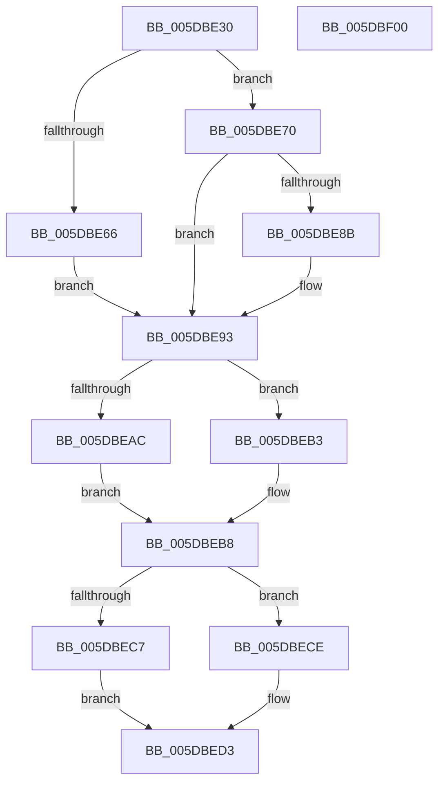

# PpmParkReportForceParkChange

- RVA: `0x005DBE30`–`0x005DBF01` (길이 `209` bytes)
- VA: `0x00000001405DBE30`
- 실행 섹션: `.text`
- PDB 이름 있음: `예`; PDB Function 태그: `아니요`
- unwind 정보 RVA: `0x0005E6B4`
- 디코드: `56`개 명령, `209/209` bytes 표시
- 미해석 바이트: `0` (있으면 어셈블리에 `.byte`로 보존)

> 이 문서는 커널 이미지의 기계어와 PDB 기호를 분석해 생성했습니다. 4번과 5번은 함수 원형과 자료형을 바이너리 사용 방식에서 추정한 C 해석이며 원본 소스 복구 결과는 아닙니다.

## 1. Dependencies

- 직접 호출 지점: **8**; 고유 호출 대상: **5**
- 직접 호출자로 확인된 함수: **1**
- RIP 상대 이미지 참조: **4**

### Outgoing calls
- `0x005DBE5D` → [KeCheckProcessorAffinityEx](../30/KeCheckProcessorAffinityEx_function_00305150.md) (function, `0x00305150`)
- `0x005DBE82` → [KeCheckProcessorAffinityEx](../30/KeCheckProcessorAffinityEx_function_00305150.md) (function, `0x00305150`)
- `0x005DBE98` → [KeTransitionProcessorParkState](../35/KeTransitionProcessorParkState_function_003527EC.md) (function, `0x003527EC`)
- `0x005DBEAC` → [KeInterlockedSetProcessorAffinityEx](../35/KeInterlockedSetProcessorAffinityEx_function_00352560.md) (function, `0x00352560`)
- `0x005DBEB3` → [KeInterlockedClearProcessorAffinityEx](../35/KeInterlockedClearProcessorAffinityEx_function_003524F0.md) (function, `0x003524F0`)
- `0x005DBEC7` → [KeInterlockedSetProcessorAffinityEx](../35/KeInterlockedSetProcessorAffinityEx_function_00352560.md) (function, `0x00352560`)
- `0x005DBECE` → [KeInterlockedClearProcessorAffinityEx](../35/KeInterlockedClearProcessorAffinityEx_function_003524F0.md) (function, `0x003524F0`)
- `0x005DBEE0` → [PpmEventCoreParkingForceParkedStateChange](PpmEventCoreParkingForceParkedStateChange_function_005DA74C.md) (function, `0x005DA74C`)

### Direct callers
- [PpmPerfAction](../2D/PpmPerfAction_function_002D7E70.md) at `0x002D7F21`

### Static image references
- `0x005DBE53` → RVA `0x00E0B870` (`.data`; read)
- `0x005DBE73` → RVA `0x00E0BCB0` (`.data`; read)
- `0x005DBEA0` → RVA `0x00E0BDC0` (`.data`; read)
- `0x005DBEBB` → RVA `0x00E0BFE0` (`.data`; read)

## 2. Other-region calls and transfers

- 다른 실행 섹션으로 향하는 call: **0**
- 별도 외부 분기/꼬리 이동을 확인하지 못했습니다.

## 3. Assembly (complete function range)

```asm
005DBE30  48 8B C4                        mov rax, rsp
005DBE33  48 89 58 08                     mov qword ptr [rax + 8], rbx
005DBE37  48 89 68 10                     mov qword ptr [rax + 0x10], rbp
005DBE3B  48 89 70 18                     mov qword ptr [rax + 0x18], rsi
005DBE3F  48 89 78 20                     mov qword ptr [rax + 0x20], rdi
005DBE43  41 56                           push r14
005DBE45  48 83 EC 20                     sub rsp, 0x20
005DBE49  44 8B 71 24                     mov r14d, dword ptr [rcx + 0x24]
005DBE4D  48 8B F9                        mov rdi, rcx
005DBE50  41 8B D6                        mov edx, r14d
005DBE53  48 8D 0D 16 FA 82 00            lea rcx, [rip + 0x82fa16]
005DBE5A  40 32 F6                        xor sil, sil
005DBE5D  E8 EE 92 D2 FF                  call 0x140305150
005DBE62  85 C0                           test eax, eax
005DBE64  74 0A                           je 0x1405dbe70
005DBE66  BD 01 00 00 00                  mov ebp, 1
005DBE6B  8D 5D 02                        lea ebx, [rbp + 2]
005DBE6E  EB 23                           jmp 0x1405dbe93
005DBE70  41 8B D6                        mov edx, r14d
005DBE73  48 8D 0D 36 FE 82 00            lea rcx, [rip + 0x82fe36]
005DBE7A  40 32 ED                        xor bpl, bpl
005DBE7D  BB 01 00 00 00                  mov ebx, 1
005DBE82  E8 C9 92 D2 FF                  call 0x140305150
005DBE87  85 C0                           test eax, eax
005DBE89  74 08                           je 0x1405dbe93
005DBE8B  40 8A F3                        mov sil, bl
005DBE8E  BB 02 00 00 00                  mov ebx, 2
005DBE93  8B D3                           mov edx, ebx
005DBE95  48 8B CF                        mov rcx, rdi
005DBE98  E8 4F 69 D7 FF                  call 0x1403527ec
005DBE9D  8B 57 24                        mov edx, dword ptr [rdi + 0x24]
005DBEA0  48 8D 0D 19 FF 82 00            lea rcx, [rip + 0x82ff19]
005DBEA7  40 84 ED                        test bpl, bpl
005DBEAA  74 07                           je 0x1405dbeb3
005DBEAC  E8 AF 66 D7 FF                  call 0x140352560
005DBEB1  EB 05                           jmp 0x1405dbeb8
005DBEB3  E8 38 66 D7 FF                  call 0x1403524f0
005DBEB8  8B 57 24                        mov edx, dword ptr [rdi + 0x24]
005DBEBB  48 8D 0D 1E 01 83 00            lea rcx, [rip + 0x83011e]
005DBEC2  40 84 F6                        test sil, sil
005DBEC5  74 07                           je 0x1405dbece
005DBEC7  E8 94 66 D7 FF                  call 0x140352560
005DBECC  EB 05                           jmp 0x1405dbed3
005DBECE  E8 1D 66 D7 FF                  call 0x1403524f0
005DBED3  40 8A D5                        mov dl, bpl
005DBED6  40 88 B7 0D 8A 00 00            mov byte ptr [rdi + 0x8a0d], sil
005DBEDD  48 8B CF                        mov rcx, rdi
005DBEE0  E8 67 E8 FF FF                  call 0x1405da74c
005DBEE5  48 8B 5C 24 30                  mov rbx, qword ptr [rsp + 0x30]
005DBEEA  48 8B 6C 24 38                  mov rbp, qword ptr [rsp + 0x38]
005DBEEF  48 8B 74 24 40                  mov rsi, qword ptr [rsp + 0x40]
005DBEF4  48 8B 7C 24 48                  mov rdi, qword ptr [rsp + 0x48]
005DBEF9  48 83 C4 20                     add rsp, 0x20
005DBEFD  41 5E                           pop r14
005DBEFF  C3                              ret
005DBF00  CC                              int3
```

## 4. C-style interpretation (structured pseudocode)

```c
__int64 __fastcall PpmParkReportForceParkChange(__int64 a1)
{
    __int64 result;
    __int64 v_rbp;
    __int64 v_rbx;
    __int64 v_rsi;
    __int64 v_rsp;
    unsigned __int64 v_stack_p10;
    unsigned __int64 v_stack_p18;
    unsigned __int64 v_stack_p20;
    unsigned __int64 v_stack_p8;

    *(unsigned __int64 *)(v_rsp + 8) = v_rbx;
    *(unsigned __int64 *)(v_rsp + 16) = v_rbp;
    *(unsigned __int64 *)(v_rsp + 24) = v_rsi;
    *(unsigned __int64 *)(v_rsp + 32) = v_rdi;
    v_rsp = (v_rsp) - (32);
    v_rsi = 0;
    result = KeCheckProcessorAffinityEx(v_rip + 8583702, (unsigned int)((unsigned int)((unsigned int)(*(unsigned int *)(a1 + 36)))), a3, a4);
    if ((unsigned int)(result) == 0) goto loc_005DBE70;
    goto loc_005DBE93;
loc_005DBE70:
    v_rbp = 0;
    result = KeCheckProcessorAffinityEx(v_rip + 8584758, (unsigned int)((unsigned int)((unsigned int)(*(unsigned int *)(a1 + 36)))), a3, a4);
    v_rbx = 1;
    if ((unsigned int)(result) != 0) {
        v_rsi = 1;
        v_rbx = 2;
    }
    result = KeTransitionProcessorParkState(a1, (unsigned int)((unsigned int)(v_rbx)), a3, a4);
    if (0 == 0) goto loc_005DBEB3;
    result = KeInterlockedSetProcessorAffinityEx(v_rip + 8584985, (unsigned int)(*(unsigned int *)(a1 + 36)), a3, a4);
    goto loc_005DBEB8;
loc_005DBEB3:
    result = KeInterlockedClearProcessorAffinityEx(v_rip + 8584985, (unsigned int)(*(unsigned int *)(a1 + 36)), a3, a4);
loc_005DBEB8:
    if ((unsigned __int8)(v_rsi) == 0) goto loc_005DBECE;
    result = KeInterlockedSetProcessorAffinityEx(v_rip + 8585502, (unsigned int)(*(unsigned int *)(a1 + 36)), a3, a4);
    goto loc_005DBED3;
loc_005DBECE:
    result = KeInterlockedClearProcessorAffinityEx(v_rip + 8585502, (unsigned int)(*(unsigned int *)(a1 + 36)), a3, a4);
loc_005DBED3:
    *(unsigned __int8 *)(a1 + 35341) = (unsigned __int8)(v_rsi);
    result = PpmEventCoreParkingForceParkedStateChange(a1, 0, a3, a4);
    v_rsp = (v_rsp) + (32);
    return result;
}
```

## 5. (Beta) C Style

```c
int64_t PpmParkReportForceParkChange(void *Arg1)
{
    uint8_t *arg1 = (uint8_t *)Arg1;

    int64_t result;
    int64_t local_rbp;
    int64_t local_rbx;
    int64_t local_rsi;
    int64_t local_rsp;
    uint64_t v_stack_p10;
    uint64_t v_stack_p18;
    uint64_t v_stack_p20;
    uint64_t v_stack_p8;

    *(uint64_t *)(local_rsp + 0x8) = local_rbx;
    *(uint64_t *)(local_rsp + 0x10) = local_rbp;
    *(uint64_t *)(local_rsp + 0x18) = local_rsi;
    *(uint64_t *)(local_rsp + 0x20) = local_rdi;
    local_rsp = (local_rsp) - (32);
    local_rsi = 0;
    result = KeCheckProcessorAffinityEx(v_rip + 8583702, (uint32_t)((uint32_t)((uint32_t)(*(uint32_t *)(arg1 + 0x24)))), a3, a4);
    if ((uint32_t)(result) == 0) goto loc_005DBE70;
    goto loc_005DBE93;
loc_005DBE70:
    local_rbp = 0;
    result = KeCheckProcessorAffinityEx(v_rip + 8584758, (uint32_t)((uint32_t)((uint32_t)(*(uint32_t *)(arg1 + 0x24)))), a3, a4);
    local_rbx = 1;
    if ((uint32_t)(result) != 0) {
        local_rsi = 1;
        local_rbx = 2;
    }
    result = KeTransitionProcessorParkState(Arg1, (uint32_t)((uint32_t)(local_rbx)), a3, a4);
    if (0 == 0) goto loc_005DBEB3;
    result = KeInterlockedSetProcessorAffinityEx(v_rip + 8584985, (uint32_t)(*(uint32_t *)(arg1 + 0x24)), a3, a4);
    goto loc_005DBEB8;
loc_005DBEB3:
    result = KeInterlockedClearProcessorAffinityEx(v_rip + 8584985, (uint32_t)(*(uint32_t *)(arg1 + 0x24)), a3, a4);
loc_005DBEB8:
    if ((uint8_t)(local_rsi) == 0) goto loc_005DBECE;
    result = KeInterlockedSetProcessorAffinityEx(v_rip + 8585502, (uint32_t)(*(uint32_t *)(arg1 + 0x24)), a3, a4);
    goto loc_005DBED3;
loc_005DBECE:
    result = KeInterlockedClearProcessorAffinityEx(v_rip + 8585502, (uint32_t)(*(uint32_t *)(arg1 + 0x24)), a3, a4);
loc_005DBED3:
    *(uint8_t *)(arg1 + 0x8A0D) = (uint8_t)(local_rsi);
    result = PpmEventCoreParkingForceParkedStateChange(Arg1, 0, a3, a4);
    local_rsp = (local_rsp) + (32);
    return result;
}
```

### 관측된 메모리 오프셋

구조체 형식이 확인되지 않은 접근은 인자 기준의 오프셋으로만 기록했습니다.

| 기준 인자 | 오프셋 표현 | 폭 (bit) | 접근 |
|---|---:|---:|---|
| `Arg1` | `+ 0x24` | `32` | `R` |
| `Arg1` | `+ 0x8A0D` | `8` | `W` |

## 6. Execution-region graph

[열기: 2D/3D 그래프와 함수 탐색 컨트롤 패널](../../../control-panel.html?section=text&rva=0x005DBE30&view=graph)

- 2D 그래프는 위에서 아래로 흐르고, 3D 그래프는 빈 공간을 드래그해 회전합니다. Shift+드래그는 이동, 휠은 확대·축소, 함수 노드 선택은 대상 보고서 이동입니다.

### Static fallback


