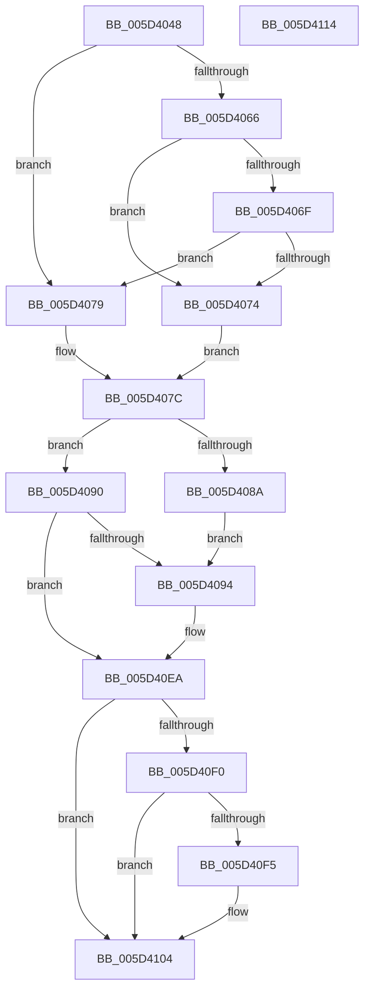

# PpmPerfApplyHiddenProcessorState

- RVA: `0x005D4048`–`0x005D4115` (길이 `205` bytes)
- VA: `0x00000001405D4048`
- 실행 섹션: `.text`
- PDB 이름 있음: `예`; PDB Function 태그: `아니요`
- unwind 정보 RVA: `0x000794E0`
- 디코드: `55`개 명령, `205/205` bytes 표시
- 미해석 바이트: `0` (있으면 어셈블리에 `.byte`로 보존)

> 이 문서는 커널 이미지의 기계어와 PDB 기호를 분석해 생성했습니다. 4번과 5번은 함수 원형과 자료형을 바이너리 사용 방식에서 추정한 C 해석이며 원본 소스 복구 결과는 아닙니다.

## 1. Dependencies

- 직접 호출 지점: **2**; 고유 호출 대상: **2**
- 직접 호출자로 확인된 함수: **2**
- RIP 상대 이미지 참조: **0**

### Outgoing calls
- `0x005D40E5` → [guard_dispatch_icall](../6B/guard_dispatch_icall_function_006BAAD0.md) (function, `0x006BAAD0`)
- `0x005D40FF` → [PpmEventProcessorPerfStateChange](../4C/PpmEventProcessorPerfStateChange_function_004C2470.md) (function, `0x004C2470`)

### Direct callers
- [PpmPerfApplyProcessorStates](../2D/PpmPerfApplyProcessorStates_function_002D8EF0.md) at `0x002D9197`
- [sub_006DDD4A](../6D/Unknown_function_006DDD4A.md) at `0x006DDD53`

### Static image references
- 디코드된 RIP-relative 메모리 참조가 없습니다.

## 2. Other-region calls and transfers

- 다른 실행 섹션으로 향하는 call: **0**
- 별도 외부 분기/꼬리 이동을 확인하지 못했습니다.

## 3. Assembly (complete function range)

```asm
005D4048  48 89 5C 24 08                  mov qword ptr [rsp + 8], rbx
005D404D  48 89 74 24 10                  mov qword ptr [rsp + 0x10], rsi
005D4052  57                              push rdi
005D4053  48 83 EC 30                     sub rsp, 0x30
005D4057  80 B9 EE 01 00 00 00            cmp byte ptr [rcx + 0x1ee], 0
005D405E  41 8A F8                        mov dil, r8b
005D4061  48 8B DA                        mov rbx, rdx
005D4064  75 13                           jne 0x1405d4079
005D4066  80 B9 E9 01 00 00 FD            cmp byte ptr [rcx + 0x1e9], 0xfd
005D406D  74 05                           je 0x1405d4074
005D406F  45 84 C0                        test r8b, r8b
005D4072  75 05                           jne 0x1405d4079
005D4074  40 32 F6                        xor sil, sil
005D4077  EB 03                           jmp 0x1405d407c
005D4079  40 B6 01                        mov sil, 1
005D407C  8B 81 24 03 00 00               mov eax, dword ptr [rcx + 0x324]
005D4082  8B 52 78                        mov edx, dword ptr [rdx + 0x78]
005D4085  40 84 FF                        test dil, dil
005D4088  74 06                           je 0x1405d4090
005D408A  83 63 78 00                     and dword ptr [rbx + 0x78], 0
005D408E  EB 04                           jmp 0x1405d4094
005D4090  3B D0                           cmp edx, eax
005D4092  74 56                           je 0x1405d40ea
005D4094  48 8D 53 40                     lea rdx, [rbx + 0x40]
005D4098  44 8A CF                        mov r9b, dil
005D409B  8B 42 10                        mov eax, dword ptr [rdx + 0x10]
005D409E  44 8A C6                        mov r8b, sil
005D40A1  89 83 80 00 00 00               mov dword ptr [rbx + 0x80], eax
005D40A7  8B 42 14                        mov eax, dword ptr [rdx + 0x14]
005D40AA  89 43 7C                        mov dword ptr [rbx + 0x7c], eax
005D40AD  0F 10 81 28 03 00 00            movups xmm0, xmmword ptr [rcx + 0x328]
005D40B4  0F 11 02                        movups xmmword ptr [rdx], xmm0
005D40B7  0F 10 89 38 03 00 00            movups xmm1, xmmword ptr [rcx + 0x338]
005D40BE  0F 11 4A 10                     movups xmmword ptr [rdx + 0x10], xmm1
005D40C2  0F 10 81 48 03 00 00            movups xmm0, xmmword ptr [rcx + 0x348]
005D40C9  0F 11 42 20                     movups xmmword ptr [rdx + 0x20], xmm0
005D40CD  F2 0F 10 89 58 03 00 00         movsd xmm1, qword ptr [rcx + 0x358]
005D40D5  F2 0F 11 4A 30                  movsd qword ptr [rdx + 0x30], xmm1
005D40DA  48 8B 81 90 01 00 00            mov rax, qword ptr [rcx + 0x190]
005D40E1  48 8B 4B 08                     mov rcx, qword ptr [rbx + 8]
005D40E5  E8 E6 69 0E 00                  call 0x1406baad0
005D40EA  83 7B 10 01                     cmp dword ptr [rbx + 0x10], 1
005D40EE  75 14                           jne 0x1405d4104
005D40F0  40 84 FF                        test dil, dil
005D40F3  75 0F                           jne 0x1405d4104
005D40F5  48 8B 0B                        mov rcx, qword ptr [rbx]
005D40F8  45 33 C0                        xor r8d, r8d
005D40FB  40 0F B6 D6                     movzx edx, sil
005D40FF  E8 6C E3 EE FF                  call 0x1404c2470
005D4104  48 8B 5C 24 40                  mov rbx, qword ptr [rsp + 0x40]
005D4109  48 8B 74 24 48                  mov rsi, qword ptr [rsp + 0x48]
005D410E  48 83 C4 30                     add rsp, 0x30
005D4112  5F                              pop rdi
005D4113  C3                              ret
005D4114  CC                              int3
```

## 4. C-style interpretation (structured pseudocode)

```c
__int64 __fastcall PpmPerfApplyHiddenProcessorState(__int64 a1, __int64 a2, unsigned __int8 a3)
{
    __int64 result;
    __int64 v_rsi;
    __int64 v_rsp;
    unsigned __int64 v_stack_p10;
    unsigned __int64 v_stack_p8;

    v_stack_p8 = v_rbx;
    v_stack_p10 = v_rsi;
    v_rsp = (v_rsp) - (48);
    if ((*(unsigned __int8 *)(a1 + 494)) != 0) goto loc_005D4079;
    if ((*(unsigned __int8 *)(a1 + 489)) == 253) goto loc_005D4074;
    if (a3 != 0) goto loc_005D4079;
loc_005D4074:
    v_rsi = 0;
    goto loc_005D407C;
loc_005D4079:
loc_005D407C:
    if (a3 == 0) goto loc_005D4090;
    goto loc_005D4094;
loc_005D4090:
    result = (unsigned int)(*(unsigned int *)(a1 + 804));
    if (((unsigned int)((unsigned int)(*(unsigned int *)(a2 + 120)))) != ((unsigned int)((unsigned int)(*(unsigned int *)(a1 + 804))))) {
        a2 = a2 + 64;
        a4 = a3;
        result = *(unsigned int *)(a2 + 16);
        a3 = 1;
        *(unsigned int *)(a2 + 128) = (unsigned int)(result);
        result = *(unsigned int *)(a2 + 20);
        *(unsigned int *)(a2 + 124) = (unsigned int)(result);
        *(unsigned __int64 *)(a2) = v_xmm0;
        *(unsigned __int64 *)(a2 + 16) = v_xmm1;
        *(unsigned __int64 *)(a2 + 32) = v_xmm0;
        *(unsigned __int64 *)(a2 + 48) = v_xmm1;
        result = *(unsigned __int64 *)(a1 + 400);
        a1 = *(unsigned __int64 *)(a2 + 8);
        result = guard_dispatch_icall(a1, a2, a3, a4);
    }
    if ((*(unsigned int *)(a2 + 16)) != 1) goto loc_005D4104;
    if (a3 == 0) {
        a1 = *(unsigned __int64 *)(a2);
        a3 = 0;
        a2 = 1;
        result = PpmEventProcessorPerfStateChange(a1, a2, a3, a4);
    }
    v_rsp = (v_rsp) + (48);
    return result;
}
```

## 5. (Beta) C Style

```c
int64_t PpmPerfApplyHiddenProcessorState(void *Arg1, void *Arg2, uint8_t Arg3)
{
    uint8_t *arg1 = (uint8_t *)Arg1;
    uint8_t *arg2 = (uint8_t *)Arg2;

    int64_t result;
    int64_t local_rsi;
    int64_t local_rsp;
    uint64_t v_stack_p10;
    uint64_t v_stack_p8;

    v_stack_p8 = local_rbx;
    v_stack_p10 = local_rsi;
    local_rsp = (local_rsp) - (48);
    if ((*(uint8_t *)(arg1 + 0x1EE)) != 0) goto loc_005D4079;
    if ((*(uint8_t *)(arg1 + 0x1E9)) == 253) goto loc_005D4074;
    if (Arg3 != 0) goto loc_005D4079;
loc_005D4074:
    local_rsi = 0;
    goto loc_005D407C;
loc_005D4079:
loc_005D407C:
    if (Arg3 == 0) goto loc_005D4090;
    goto loc_005D4094;
loc_005D4090:
    result = (uint32_t)(*(uint32_t *)(arg1 + 0x324));
    if (((uint32_t)((uint32_t)(*(uint32_t *)(arg2 + 0x78)))) != ((uint32_t)((uint32_t)(*(uint32_t *)(arg1 + 0x324))))) {
        Arg2 = Arg2 + 64;
        a4 = Arg3;
        result = *(uint32_t *)(arg2 + 0x10);
        Arg3 = 1;
        *(uint32_t *)(arg2 + 0x80) = (uint32_t)(result);
        result = *(uint32_t *)(arg2 + 0x14);
        *(uint32_t *)(arg2 + 0x7C) = (uint32_t)(result);
        *(uint64_t *)(arg2) = v_xmm0;
        *(uint64_t *)(arg2 + 0x10) = v_xmm1;
        *(uint64_t *)(arg2 + 0x20) = v_xmm0;
        *(uint64_t *)(arg2 + 0x30) = v_xmm1;
        result = *(uint64_t *)(arg1 + 0x190);
        Arg1 = *(uint64_t *)(arg2 + 0x8);
        result = guard_dispatch_icall(Arg1, Arg2, Arg3, a4);
    }
    if ((*(uint32_t *)(arg2 + 0x10)) != 1) goto loc_005D4104;
    if (Arg3 == 0) {
        Arg1 = *(uint64_t *)(arg2);
        Arg3 = 0;
        Arg2 = 1;
        result = PpmEventProcessorPerfStateChange(Arg1, Arg2, Arg3, a4);
    }
    local_rsp = (local_rsp) + (48);
    return result;
}
```

### 관측된 메모리 오프셋

구조체 형식이 확인되지 않은 접근은 인자 기준의 오프셋으로만 기록했습니다.

| 기준 인자 | 오프셋 표현 | 폭 (bit) | 접근 |
|---|---:|---:|---|
| `Arg1` | `+ 0x190` | `64` | `R` |
| `Arg1` | `+ 0x1E9` | `8` | `R` |
| `Arg1` | `+ 0x1EE` | `8` | `R` |
| `Arg1` | `+ 0x324` | `32` | `R` |
| `Arg1` | `+ 0x328` | `128` | `R` |
| `Arg1` | `+ 0x338` | `128` | `R` |
| `Arg1` | `+ 0x348` | `128` | `R` |
| `Arg1` | `+ 0x358` | `64` | `R` |
| `Arg2` | `+ 0x0` | `64` | `R` |
| `Arg2` | `+ 0x0` | `128` | `R` |
| `Arg2` | `+ 0x8` | `64` | `R` |
| `Arg2` | `+ 0x10` | `32` | `R` |
| `Arg2` | `+ 0x10` | `128` | `R` |
| `Arg2` | `+ 0x14` | `32` | `R` |
| `Arg2` | `+ 0x20` | `128` | `R` |
| `Arg2` | `+ 0x30` | `64` | `W` |
| `Arg2` | `+ 0x40` | `64` | `R` |
| `Arg2` | `+ 0x78` | `32` | `R` |
| `Arg2` | `+ 0x78` | `32` | `R/W` |
| `Arg2` | `+ 0x7C` | `32` | `W` |
| `Arg2` | `+ 0x80` | `32` | `W` |

## 6. Execution-region graph

[열기: 2D/3D 그래프와 함수 탐색 컨트롤 패널](../../../control-panel.html?section=text&rva=0x005D4048&view=graph)

- 2D 그래프는 위에서 아래로 흐르고, 3D 그래프는 빈 공간을 드래그해 회전합니다. Shift+드래그는 이동, 휠은 확대·축소, 함수 노드 선택은 대상 보고서 이동입니다.

### Static fallback


