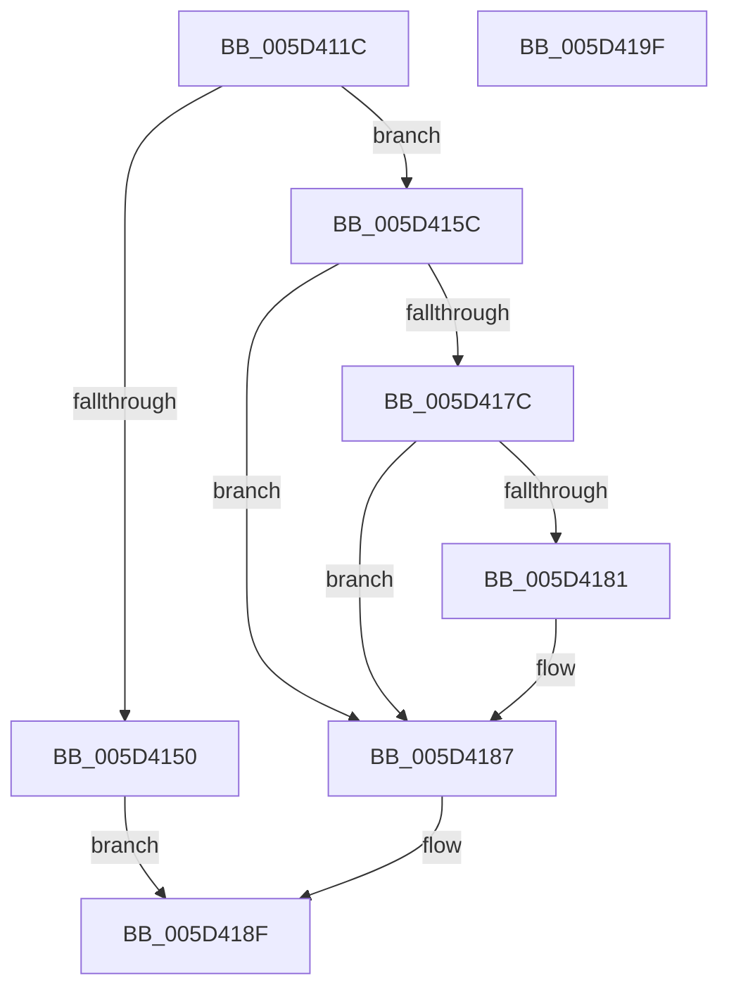

# PpmPerfFeedbackCounterUpdate

- RVA: `0x005D411C`–`0x005D41A0` (길이 `132` bytes)
- VA: `0x00000001405D411C`
- 실행 섹션: `.text`
- PDB 이름 있음: `예`; PDB Function 태그: `아니요`
- unwind 정보 RVA: `0x000937EC`
- 디코드: `38`개 명령, `132/132` bytes 표시
- 미해석 바이트: `0` (있으면 어셈블리에 `.byte`로 보존)

> 이 문서는 커널 이미지의 기계어와 PDB 기호를 분석해 생성했습니다. 4번과 5번은 함수 원형과 자료형을 바이너리 사용 방식에서 추정한 C 해석이며 원본 소스 복구 결과는 아닙니다.

## 1. Dependencies

- 직접 호출 지점: **2**; 고유 호출 대상: **1**
- 직접 호출자로 확인된 함수: **1**
- RIP 상대 이미지 참조: **0**

### Outgoing calls
- `0x005D4155` → [guard_dispatch_icall](../6B/guard_dispatch_icall_function_006BAAD0.md) (function, `0x006BAAD0`)
- `0x005D4168` → [guard_dispatch_icall](../6B/guard_dispatch_icall_function_006BAAD0.md) (function, `0x006BAAD0`)

### Direct callers
- [sub_006DD630](../6D/Unknown_function_006DD630.md) at `0x006DD6D8`

### Static image references
- 디코드된 RIP-relative 메모리 참조가 없습니다.

## 2. Other-region calls and transfers

- 다른 실행 섹션으로 향하는 call: **0**
- 별도 외부 분기/꼬리 이동을 확인하지 못했습니다.

## 3. Assembly (complete function range)

```asm
005D411C  48 8B C4                        mov rax, rsp
005D411F  48 89 58 10                     mov qword ptr [rax + 0x10], rbx
005D4123  48 89 70 18                     mov qword ptr [rax + 0x18], rsi
005D4127  57                              push rdi
005D4128  48 83 EC 40                     sub rsp, 0x40
005D412C  48 83 60 20 00                  and qword ptr [rax + 0x20], 0
005D4131  48 8B D9                        mov rbx, rcx
005D4134  48 83 60 E8 00                  and qword ptr [rax - 0x18], 0
005D4139  49 8B F8                        mov rdi, r8
005D413C  83 60 08 00                     and dword ptr [rax + 8], 0
005D4140  48 8B F2                        mov rsi, rdx
005D4143  48 8B 01                        mov rax, qword ptr [rcx]
005D4146  80 7B 21 00                     cmp byte ptr [rbx + 0x21], 0
005D414A  48 8B 49 28                     mov rcx, qword ptr [rcx + 0x28]
005D414E  75 0C                           jne 0x1405d415c
005D4150  48 8D 54 24 50                  lea rdx, [rsp + 0x50]
005D4155  E8 76 69 0E 00                  call 0x1406baad0
005D415A  EB 33                           jmp 0x1405d418f
005D415C  4C 8D 4C 24 68                  lea r9, [rsp + 0x68]
005D4161  33 D2                           xor edx, edx
005D4163  4C 8D 44 24 30                  lea r8, [rsp + 0x30]
005D4168  E8 63 69 0E 00                  call 0x1406baad0
005D416D  48 8B 44 24 68                  mov rax, qword ptr [rsp + 0x68]
005D4172  48 8B 4C 24 30                  mov rcx, qword ptr [rsp + 0x30]
005D4177  48 85 F6                        test rsi, rsi
005D417A  74 0B                           je 0x1405d4187
005D417C  48 85 FF                        test rdi, rdi
005D417F  74 06                           je 0x1405d4187
005D4181  48 89 06                        mov qword ptr [rsi], rax
005D4184  48 89 0F                        mov qword ptr [rdi], rcx
005D4187  48 89 4B 10                     mov qword ptr [rbx + 0x10], rcx
005D418B  48 89 43 08                     mov qword ptr [rbx + 8], rax
005D418F  48 8B 5C 24 58                  mov rbx, qword ptr [rsp + 0x58]
005D4194  48 8B 74 24 60                  mov rsi, qword ptr [rsp + 0x60]
005D4199  48 83 C4 40                     add rsp, 0x40
005D419D  5F                              pop rdi
005D419E  C3                              ret
005D419F  CC                              int3
```

## 4. C-style interpretation (structured pseudocode)

```c
__int64 __fastcall PpmPerfFeedbackCounterUpdate(__int64 a1, __int64 a2, __int64 a3)
{
    __int64 result;
    __int64 v_rsp;
    unsigned __int64 v_stack_m18;
    unsigned __int64 v_stack_p10;
    unsigned __int64 v_stack_p18;
    unsigned __int64 v_stack_p20;
    unsigned __int64 v_stack_p8;

    *(unsigned __int64 *)(v_rsp + 16) = v_rbx;
    *(unsigned __int64 *)(v_rsp + 24) = v_rsi;
    v_rsp = (v_rsp) - (64);
    if ((*(unsigned __int8 *)(a1 + 33)) != 0) goto loc_005D415C;
    result = guard_dispatch_icall(*(unsigned __int64 *)(a1 + 40), v_stack_p8, a3, a4);
    goto loc_005D418F;
loc_005D415C:
    a2 = 0;
    result = guard_dispatch_icall(*(unsigned __int64 *)(a1 + 40), a2, v_stack_m18, v_stack_p20);
    if (0 == 0) goto loc_005D4187;
    if (a3 != 0) {
        *(unsigned __int64 *)(a2) = v_stack_p20;
        *(unsigned __int64 *)(a3) = v_stack_m18;
    }
    *(unsigned __int64 *)(a1 + 16) = v_stack_m18;
    *(unsigned __int64 *)(a1 + 8) = v_stack_p20;
loc_005D418F:
    v_rsp = (v_rsp) + (64);
    return v_stack_p20;
}
```

## 5. (Beta) C Style

```c
int64_t PpmPerfFeedbackCounterUpdate(void *Arg1, int64_t Arg2, int64_t Arg3)
{
    uint8_t *arg1 = (uint8_t *)Arg1;

    int64_t result;
    int64_t local_rsp;
    uint64_t v_stack_m18;
    uint64_t v_stack_p10;
    uint64_t v_stack_p18;
    uint64_t v_stack_p20;
    uint64_t v_stack_p8;

    *(uint64_t *)(local_rsp + 0x10) = local_rbx;
    *(uint64_t *)(local_rsp + 0x18) = local_rsi;
    local_rsp = (local_rsp) - (64);
    if ((*(uint8_t *)(arg1 + 0x21)) != 0) goto loc_005D415C;
    result = guard_dispatch_icall(*(uint64_t *)(arg1 + 0x28), v_stack_p8, Arg3, a4);
    goto loc_005D418F;
loc_005D415C:
    Arg2 = 0;
    result = guard_dispatch_icall(*(uint64_t *)(arg1 + 0x28), Arg2, v_stack_m18, v_stack_p20);
    if (0 == 0) goto loc_005D4187;
    if (Arg3 != 0) {
        *(uint64_t *)(Arg2) = v_stack_p20;
        *(uint64_t *)(Arg3) = v_stack_m18;
    }
    *(uint64_t *)(arg1 + 0x10) = v_stack_m18;
    *(uint64_t *)(arg1 + 0x8) = v_stack_p20;
loc_005D418F:
    local_rsp = (local_rsp) + (64);
    return v_stack_p20;
}
```

### 관측된 메모리 오프셋

구조체 형식이 확인되지 않은 접근은 인자 기준의 오프셋으로만 기록했습니다.

| 기준 인자 | 오프셋 표현 | 폭 (bit) | 접근 |
|---|---:|---:|---|
| `Arg1` | `+ 0x0` | `64` | `R` |
| `Arg1` | `+ 0x8` | `64` | `W` |
| `Arg1` | `+ 0x10` | `64` | `W` |
| `Arg1` | `+ 0x21` | `8` | `R` |
| `Arg1` | `+ 0x28` | `64` | `R` |

## 6. Execution-region graph

[열기: 2D/3D 그래프와 함수 탐색 컨트롤 패널](../../../control-panel.html?section=text&rva=0x005D411C&view=graph)

- 2D 그래프는 위에서 아래로 흐르고, 3D 그래프는 빈 공간을 드래그해 회전합니다. Shift+드래그는 이동, 휠은 확대·축소, 함수 노드 선택은 대상 보고서 이동입니다.

### Static fallback


