# PpmPerfGetVmCppcConfig

- RVA: `0x005D41A8`–`0x005D444C` (길이 `676` bytes)
- VA: `0x00000001405D41A8`
- 실행 섹션: `.text`
- PDB 이름 있음: `예`; PDB Function 태그: `아니요`
- unwind 정보 RVA: `0x000BD2A0`
- 디코드: `180`개 명령, `676/676` bytes 표시
- 미해석 바이트: `0` (있으면 어셈블리에 `.byte`로 보존)

> 이 문서는 커널 이미지의 기계어와 PDB 기호를 분석해 생성했습니다. 4번과 5번은 함수 원형과 자료형을 바이너리 사용 방식에서 추정한 C 해석이며 원본 소스 복구 결과는 아닙니다.

## 1. Dependencies

- 직접 호출 지점: **6**; 고유 호출 대상: **4**
- 직접 호출자로 확인된 함수: **1**
- RIP 상대 이미지 참조: **2**

### Outgoing calls
- `0x005D41D6` → [PpmAcquireLock](../2D/PpmAcquireLock_function_002D9AA4.md) (function, `0x002D9AA4`)
- `0x005D429B` → [PpmPerfPercentageFromFrequency](../../page/75/PpmPerfPercentageFromFrequency_function_0075AD84.md) (function, `0x0075AD84`)
- `0x005D42F7` → [PpmPerfPercentageFromFrequency](../../page/75/PpmPerfPercentageFromFrequency_function_0075AD84.md) (function, `0x0075AD84`)
- `0x005D4377` → [PpmPerfPercentageFromFrequency](../../page/75/PpmPerfPercentageFromFrequency_function_0075AD84.md) (function, `0x0075AD84`)
- `0x005D4419` → [guard_dispatch_icall](../6B/guard_dispatch_icall_function_006BAAD0.md) (function, `0x006BAAD0`)
- `0x005D4425` → [PpmReleaseLock](../2D/PpmReleaseLock_function_002DA428.md) (function, `0x002DA428`)

### Direct callers
- [PopPowerInformationInternal](../../page/A8/PopPowerInformationInternal_function_00A8B7C0.md) at `0x00A8CB88`

### Static image references
- `0x005D41CA` → RVA `0x00F0CC00` (`.data`; read)
- `0x005D41DD` → RVA `0x00FC6AEC` (`ALMOSTRO`; read)

## 2. Other-region calls and transfers

- 다른 실행 섹션으로 향하는 call: **3**
  - `0x005D429B` → [PpmPerfPercentageFromFrequency](../../page/75/PpmPerfPercentageFromFrequency_function_0075AD84.md) (`.text` → `PAGE`)
  - `0x005D42F7` → [PpmPerfPercentageFromFrequency](../../page/75/PpmPerfPercentageFromFrequency_function_0075AD84.md) (`.text` → `PAGE`)
  - `0x005D4377` → [PpmPerfPercentageFromFrequency](../../page/75/PpmPerfPercentageFromFrequency_function_0075AD84.md) (`.text` → `PAGE`)
- 별도 외부 분기/꼬리 이동을 확인하지 못했습니다.

## 3. Assembly (complete function range)

```asm
005D41A8  48 8B C4                        mov rax, rsp
005D41AB  48 89 58 08                     mov qword ptr [rax + 8], rbx
005D41AF  48 89 68 10                     mov qword ptr [rax + 0x10], rbp
005D41B3  48 89 70 18                     mov qword ptr [rax + 0x18], rsi
005D41B7  48 89 78 20                     mov qword ptr [rax + 0x20], rdi
005D41BB  41 54                           push r12
005D41BD  41 56                           push r14
005D41BF  41 57                           push r15
005D41C1  48 83 EC 60                     sub rsp, 0x60
005D41C5  8B F1                           mov esi, ecx
005D41C7  45 8B E1                        mov r12d, r9d
005D41CA  48 8D 0D 2F 8A 93 00            lea rcx, [rip + 0x938a2f]
005D41D1  45 8B F0                        mov r14d, r8d
005D41D4  8B FA                           mov edi, edx
005D41D6  E8 C9 58 D0 FF                  call 0x1402d9aa4
005D41DB  33 DB                           xor ebx, ebx
005D41DD  38 1D 09 29 9F 00               cmp byte ptr [rip + 0x9f2909], bl
005D41E3  75 0A                           jne 0x1405d41ef
005D41E5  BB BB 00 00 C0                  mov ebx, 0xc00000bb
005D41EA  E9 2F 02 00 00                  jmp 0x1405d441e
005D41EF  41 83 C8 FF                     or r8d, 0xffffffff
005D41F3  85 F6                           test esi, esi
005D41F5  45 8B D8                        mov r11d, r8d
005D41F8  41 8B C8                        mov ecx, r8d
005D41FB  44 0F 45 DE                     cmovne r11d, esi
005D41FF  85 FF                           test edi, edi
005D4201  0F 45 CF                        cmovne ecx, edi
005D4204  45 3B D8                        cmp r11d, r8d
005D4207  75 29                           jne 0x1405d4232
005D4209  41 3B C8                        cmp ecx, r8d
005D420C  75 24                           jne 0x1405d4232
005D420E  45 3B F0                        cmp r14d, r8d
005D4211  75 1F                           jne 0x1405d4232
005D4213  45 3B E0                        cmp r12d, r8d
005D4216  75 1A                           jne 0x1405d4232
005D4218  44 39 84 24 A0 00 00 00         cmp dword ptr [rsp + 0xa0], r8d
005D4220  75 10                           jne 0x1405d4232
005D4222  48 8B 84 24 B0 00 00 00         mov rax, qword ptr [rsp + 0xb0]
005D422A  48 89 18                        mov qword ptr [rax], rbx
005D422D  E9 EC 01 00 00                  jmp 0x1405d441e
005D4232  65 48 8B 04 25 20 00 00 00      mov rax, qword ptr gs:[0x20]
005D423B  8B F3                           mov esi, ebx
005D423D  41 B9 64 00 00 00               mov r9d, 0x64
005D4243  4C 8B 90 B0 89 00 00            mov r10, qword ptr [rax + 0x89b0]
005D424A  45 8B BA C4 01 00 00            mov r15d, dword ptr [r10 + 0x1c4]
005D4251  41 8B AA CC 01 00 00            mov ebp, dword ptr [r10 + 0x1cc]
005D4258  41 38 9A 2E 02 00 00            cmp byte ptr [r10 + 0x22e], bl
005D425F  75 09                           jne 0x1405d426a
005D4261  41 8D 71 A4                     lea esi, [r9 - 0x5c]
005D4265  41 8B C1                        mov eax, r9d
005D4268  EB 03                           jmp 0x1405d426d
005D426A  41 8B C7                        mov eax, r15d
005D426D  41 8B 92 18 02 00 00            mov edx, dword ptr [r10 + 0x218]
005D4274  41 3B D1                        cmp edx, r9d
005D4277  73 05                           jae 0x1405d427e
005D4279  3B C2                           cmp eax, edx
005D427B  0F 43 C2                        cmovae eax, edx
005D427E  41 8B BA 1C 02 00 00            mov edi, dword ptr [r10 + 0x21c]
005D4285  3B C7                           cmp eax, edi
005D4287  0F 42 F8                        cmovb edi, eax
005D428A  41 3B C8                        cmp ecx, r8d
005D428D  75 05                           jne 0x1405d4294
005D428F  44 8B CF                        mov r9d, edi
005D4292  EB 13                           jmp 0x1405d42a7
005D4294  41 8B 92 C0 01 00 00            mov edx, dword ptr [r10 + 0x1c0]
005D429B  E8 E4 6A 18 00                  call 0x14075ad84
005D42A0  44 8B C8                        mov r9d, eax
005D42A3  41 83 C8 FF                     or r8d, 0xffffffff
005D42A7  38 9C 24 A8 00 00 00            cmp byte ptr [rsp + 0xa8], bl
005D42AE  75 07                           jne 0x1405d42b7
005D42B0  44 3B CF                        cmp r9d, edi
005D42B3  44 0F 43 CF                     cmovae r9d, edi
005D42B7  45 3B D8                        cmp r11d, r8d
005D42BA  75 25                           jne 0x1405d42e1
005D42BC  41 38 9A 2D 02 00 00            cmp byte ptr [r10 + 0x22d], bl
005D42C3  74 07                           je 0x1405d42cc
005D42C5  83 CE 01                        or esi, 1
005D42C8  8B CD                           mov ecx, ebp
005D42CA  EB 07                           jmp 0x1405d42d3
005D42CC  41 8B 8A C8 01 00 00            mov ecx, dword ptr [r10 + 0x1c8]
005D42D3  41 8B 82 20 02 00 00            mov eax, dword ptr [r10 + 0x220]
005D42DA  3B C8                           cmp ecx, eax
005D42DC  0F 46 C8                        cmovbe ecx, eax
005D42DF  EB 21                           jmp 0x1405d4302
005D42E1  41 38 9A EC 01 00 00            cmp byte ptr [r10 + 0x1ec], bl
005D42E8  74 03                           je 0x1405d42ed
005D42EA  83 CE 01                        or esi, 1
005D42ED  41 8B 92 C0 01 00 00            mov edx, dword ptr [r10 + 0x1c0]
005D42F4  41 8B CB                        mov ecx, r11d
005D42F7  E8 88 6A 18 00                  call 0x14075ad84
005D42FC  8B C8                           mov ecx, eax
005D42FE  41 83 C8 FF                     or r8d, 0xffffffff
005D4302  41 3B C9                        cmp ecx, r9d
005D4305  41 8B C1                        mov eax, r9d
005D4308  0F 42 C1                        cmovb eax, ecx
005D430B  3B E8                           cmp ebp, eax
005D430D  77 09                           ja 0x1405d4318
005D430F  41 3B C9                        cmp ecx, r9d
005D4312  8B E9                           mov ebp, ecx
005D4314  41 0F 43 E9                     cmovae ebp, r9d
005D4318  41 8B BA 10 02 00 00            mov edi, dword ptr [r10 + 0x210]
005D431F  41 8B C7                        mov eax, r15d
005D4322  3B EF                           cmp ebp, edi
005D4324  0F 42 FD                        cmovb edi, ebp
005D4327  45 3B CF                        cmp r9d, r15d
005D432A  41 0F 42 C1                     cmovb eax, r9d
005D432E  3B F8                           cmp edi, eax
005D4330  76 05                           jbe 0x1405d4337
005D4332  44 8B CF                        mov r9d, edi
005D4335  EB 07                           jmp 0x1405d433e
005D4337  45 3B CF                        cmp r9d, r15d
005D433A  45 0F 43 CF                     cmovae r9d, r15d
005D433E  45 8B D9                        mov r11d, r9d
005D4341  45 3B F0                        cmp r14d, r8d
005D4344  75 09                           jne 0x1405d434f
005D4346  41 38 9A 2C 02 00 00            cmp byte ptr [r10 + 0x22c], bl
005D434D  74 19                           je 0x1405d4368
005D434F  45 85 F6                        test r14d, r14d
005D4352  75 0A                           jne 0x1405d435e
005D4354  41 80 BA 09 02 00 00 01         cmp byte ptr [r10 + 0x209], 1
005D435C  74 0A                           je 0x1405d4368
005D435E  41 80 BA 09 02 00 00 02         cmp byte ptr [r10 + 0x209], 2
005D4366  75 05                           jne 0x1405d436d
005D4368  83 CE 04                        or esi, 4
005D436B  EB 2D                           jmp 0x1405d439a
005D436D  41 8B 92 C0 01 00 00            mov edx, dword ptr [r10 + 0x1c0]
005D4374  41 8B CE                        mov ecx, r14d
005D4377  E8 08 6A 18 00                  call 0x14075ad84
005D437C  44 3B C8                        cmp r9d, eax
005D437F  44 8B D8                        mov r11d, eax
005D4382  41 0F 42 C1                     cmovb eax, r9d
005D4386  3B F8                           cmp edi, eax
005D4388  76 05                           jbe 0x1405d438f
005D438A  44 8B DF                        mov r11d, edi
005D438D  EB 07                           jmp 0x1405d4396
005D438F  45 3B CB                        cmp r9d, r11d
005D4392  45 0F 42 D9                     cmovb r11d, r9d
005D4396  41 83 C8 FF                     or r8d, 0xffffffff
005D439A  45 3B E0                        cmp r12d, r8d
005D439D  75 07                           jne 0x1405d43a6
005D439F  45 8B A2 24 02 00 00            mov r12d, dword ptr [r10 + 0x224]
005D43A6  44 39 84 24 A0 00 00 00         cmp dword ptr [rsp + 0xa0], r8d
005D43AE  41 B8 64 00 00 00               mov r8d, 0x64
005D43B4  75 09                           jne 0x1405d43bf
005D43B6  41 8B 92 28 02 00 00            mov edx, dword ptr [r10 + 0x228]
005D43BD  EB 19                           jmp 0x1405d43d8
005D43BF  6B 8C 24 A0 00 00 00 64         imul ecx, dword ptr [rsp + 0xa0], 0x64
005D43C7  B8 81 80 80 80                  mov eax, 0x80808081
005D43CC  F7 E1                           mul ecx
005D43CE  C1 EA 07                        shr edx, 7
005D43D1  41 3B D0                        cmp edx, r8d
005D43D4  41 0F 47 D0                     cmova edx, r8d
005D43D8  48 8B 84 24 B0 00 00 00         mov rax, qword ptr [rsp + 0xb0]
005D43E0  49 8B 8A 38 01 00 00            mov rcx, qword ptr [r10 + 0x138]
005D43E7  48 89 5C 24 50                  mov qword ptr [rsp + 0x50], rbx
005D43EC  48 89 44 24 48                  mov qword ptr [rsp + 0x48], rax
005D43F1  49 8B 82 78 01 00 00            mov rax, qword ptr [r10 + 0x178]
005D43F8  48 8B 49 08                     mov rcx, qword ptr [rcx + 8]
005D43FC  48 89 5C 24 40                  mov qword ptr [rsp + 0x40], rbx
005D4401  89 74 24 38                     mov dword ptr [rsp + 0x38], esi
005D4405  44 89 44 24 30                  mov dword ptr [rsp + 0x30], r8d
005D440A  44 8B C7                        mov r8d, edi
005D440D  44 89 64 24 28                  mov dword ptr [rsp + 0x28], r12d
005D4412  89 54 24 20                     mov dword ptr [rsp + 0x20], edx
005D4416  41 8B D3                        mov edx, r11d
005D4419  E8 B2 66 0E 00                  call 0x1406baad0
005D441E  48 8D 0D DB 87 93 00            lea rcx, [rip + 0x9387db]
005D4425  E8 FE 5F D0 FF                  call 0x1402da428
005D442A  4C 8D 5C 24 60                  lea r11, [rsp + 0x60]
005D442F  8B C3                           mov eax, ebx
005D4431  49 8B 5B 20                     mov rbx, qword ptr [r11 + 0x20]
005D4435  49 8B 6B 28                     mov rbp, qword ptr [r11 + 0x28]
005D4439  49 8B 73 30                     mov rsi, qword ptr [r11 + 0x30]
005D443D  49 8B 7B 38                     mov rdi, qword ptr [r11 + 0x38]
005D4441  49 8B E3                        mov rsp, r11
005D4444  41 5F                           pop r15
005D4446  41 5E                           pop r14
005D4448  41 5C                           pop r12
005D444A  C3                              ret
005D444B  CC                              int3
```

## 4. C-style interpretation (structured pseudocode)

```c
__int64 __fastcall PpmPerfGetVmCppcConfig(int a1, int a2, int a3, int a4, unsigned int a5, unsigned __int8 a6, __int64 a7)
{
    __int64 result;
    __int64 v_r11;
    __int64 v_r12;
    __int64 v_rbp;
    __int64 v_rbx;
    __int64 v_rdi;
    __int64 v_rsi;
    __int64 v_rsp;
    unsigned __int64 v_stack_m18;
    unsigned __int64 v_stack_m28;
    unsigned __int64 v_stack_m30;
    unsigned __int64 v_stack_m38;
    unsigned int v_stack_m40;
    unsigned int v_stack_m48;
    unsigned int v_stack_m50;
    unsigned int v_stack_m58;

    *(unsigned __int64 *)(v_rsp + 8) = v_rbx;
    *(unsigned __int64 *)(v_rsp + 16) = v_rbp;
    *(unsigned __int64 *)(v_rsp + 24) = v_rsi;
    *(unsigned __int64 *)(v_rsp + 32) = v_rdi;
    v_rsp = (v_rsp) - (96);
    result = PpmAcquireLock(v_rip + 9669167, a2, a3, a4);
    v_rbx = 0;
    if ((*(unsigned __int8 *)(v_rip + 10430729)) != 0) goto loc_005D41EF;
    goto loc_005D441E;
loc_005D41EF:
    a3 = (unsigned int)((a3) | (0xFFFFFFFFULL));
    v_r11 = (unsigned int)(a3);
    if ((unsigned int)((unsigned int)(a1)) != 0) { v_r11 = (unsigned int)((unsigned int)(a1)); }
    a1 = (unsigned int)(a3);
    if ((unsigned int)((unsigned int)(a2)) != 0) { a1 = (unsigned int)((unsigned int)(a2)); }
    if (((unsigned int)(v_r11)) != a3) goto loc_005D4232;
    if (a1 != a3) goto loc_005D4232;
    if (((unsigned int)((unsigned int)(a3))) != a3) goto loc_005D4232;
    if (((unsigned int)((unsigned int)(a4))) != a3) goto loc_005D4232;
    if (a5 != a3) goto loc_005D4232;
    *(unsigned __int64 *)(a7) = (unsigned int)(0xC00000BBULL);
    goto loc_005D441E;
loc_005D4232:
    if ((*(unsigned __int8 *)(*(unsigned __int64 *)(*(unsigned __int64 *)(gs_base + (0 + 32)) + 35248) + 558)) != ((unsigned __int8)((unsigned int)(0xC00000BBULL)))) goto loc_005D426A;
    goto loc_005D426D;
loc_005D426A:
loc_005D426D:
    result = (unsigned int)((unsigned int)((unsigned int)(*(unsigned int *)(*(unsigned __int64 *)(*(unsigned __int64 *)(gs_base + (0 + 32)) + 35248) + 452))));
    if (((unsigned int)((unsigned int)(*(unsigned int *)(*(unsigned __int64 *)(*(unsigned __int64 *)(gs_base + (0 + 32)) + 35248) + 536)))) < 100) {
        result = (unsigned int)((unsigned int)((unsigned int)(*(unsigned int *)(*(unsigned __int64 *)(*(unsigned __int64 *)(gs_base + (0 + 32)) + 35248) + 452))));
        if (((unsigned int)((unsigned int)((unsigned int)((unsigned int)(*(unsigned int *)(*(unsigned __int64 *)(*(unsigned __int64 *)(gs_base + (0 + 32)) + 35248) + 452)))))) >= ((unsigned int)((unsigned int)(*(unsigned int *)(*(unsigned __int64 *)(*(unsigned __int64 *)(gs_base + (0 + 32)) + 35248) + 536))))) { result = (unsigned int)((unsigned int)(*(unsigned int *)(*(unsigned __int64 *)(*(unsigned __int64 *)(gs_base + (0 + 32)) + 35248) + 536))); }
    }
    v_rdi = (unsigned int)(*(unsigned int *)(*(unsigned __int64 *)(*(unsigned __int64 *)(gs_base + (0 + 32)) + 35248) + 540));
    if (((unsigned int)(result)) < ((unsigned int)((unsigned int)(*(unsigned int *)(*(unsigned __int64 *)(*(unsigned __int64 *)(gs_base + (0 + 32)) + 35248) + 540))))) { v_rdi = (unsigned int)(result); }
    if (a1 != a3) goto loc_005D4294;
    goto loc_005D42A7;
loc_005D4294:
    result = PpmPerfPercentageFromFrequency(a1, (unsigned int)(*(unsigned int *)(*(unsigned __int64 *)(*(unsigned __int64 *)(gs_base + (0 + 32)) + 35248) + 448)), a3, (unsigned int)((unsigned int)(v_rdi)));
    a3 = (unsigned int)((a3) | (0xFFFFFFFFULL));
loc_005D42A7:
    if (a6 == ((unsigned __int8)((unsigned int)(0xC00000BBULL)))) {
        a4 = (unsigned int)((unsigned int)(result));
        if (((unsigned int)((unsigned int)((unsigned int)(result)))) >= ((unsigned int)(v_rdi))) { a4 = (unsigned int)(v_rdi); }
    }
    if (((unsigned int)(v_r11)) != a3) goto loc_005D42E1;
    if ((*(unsigned __int8 *)(*(unsigned __int64 *)(*(unsigned __int64 *)(gs_base + (0 + 32)) + 35248) + 557)) == ((unsigned __int8)((unsigned int)(0xC00000BBULL)))) goto loc_005D42CC;
    v_rsi = (unsigned int)((100 - 92) | (1));
    goto loc_005D42D3;
loc_005D42CC:
loc_005D42D3:
    a1 = (unsigned int)(*(unsigned int *)(*(unsigned __int64 *)(*(unsigned __int64 *)(gs_base + (0 + 32)) + 35248) + 456));
    if (((unsigned int)((unsigned int)(*(unsigned int *)(*(unsigned __int64 *)(*(unsigned __int64 *)(gs_base + (0 + 32)) + 35248) + 456)))) <= ((unsigned int)((unsigned int)(*(unsigned int *)(*(unsigned __int64 *)(*(unsigned __int64 *)(gs_base + (0 + 32)) + 35248) + 544))))) { a1 = (unsigned int)((unsigned int)(*(unsigned int *)(*(unsigned __int64 *)(*(unsigned __int64 *)(gs_base + (0 + 32)) + 35248) + 544))); }
    goto loc_005D4302;
loc_005D42E1:
    if ((*(unsigned __int8 *)(*(unsigned __int64 *)(*(unsigned __int64 *)(gs_base + (0 + 32)) + 35248) + 492)) != ((unsigned __int8)((unsigned int)(0xC00000BBULL)))) {
        v_rsi = (unsigned int)((v_rsi) | (1));
    }
    result = PpmPerfPercentageFromFrequency((unsigned int)((unsigned int)(v_r11)), (unsigned int)(*(unsigned int *)(*(unsigned __int64 *)(*(unsigned __int64 *)(gs_base + (0 + 32)) + 35248) + 448)), a3, a4);
    a3 = (unsigned int)((a3) | (0xFFFFFFFFULL));
loc_005D4302:
    result = (unsigned int)(a4);
    if (((unsigned int)((unsigned int)((unsigned int)(result)))) < a4) { result = (unsigned int)((unsigned int)((unsigned int)(result))); }
    v_rbp = (unsigned int)(*(unsigned int *)(*(unsigned __int64 *)(*(unsigned __int64 *)(gs_base + (0 + 32)) + 35248) + 460));
    if (((unsigned int)((unsigned int)(*(unsigned int *)(*(unsigned __int64 *)(*(unsigned __int64 *)(gs_base + (0 + 32)) + 35248) + 460)))) <= ((unsigned int)(result))) {
        v_rbp = (unsigned int)((unsigned int)((unsigned int)(result)));
        if (((unsigned int)((unsigned int)((unsigned int)(result)))) >= a4) { v_rbp = a4; }
    }
    v_rdi = (unsigned int)(*(unsigned int *)(*(unsigned __int64 *)(*(unsigned __int64 *)(gs_base + (0 + 32)) + 35248) + 528));
    if (((unsigned int)(v_rbp)) < ((unsigned int)((unsigned int)(*(unsigned int *)(*(unsigned __int64 *)(*(unsigned __int64 *)(gs_base + (0 + 32)) + 35248) + 528))))) { v_rdi = (unsigned int)(v_rbp); }
    result = (unsigned int)((unsigned int)((unsigned int)(*(unsigned int *)(*(unsigned __int64 *)(*(unsigned __int64 *)(gs_base + (0 + 32)) + 35248) + 452))));
    if (a4 < ((unsigned int)((unsigned int)(*(unsigned int *)(*(unsigned __int64 *)(*(unsigned __int64 *)(gs_base + (0 + 32)) + 35248) + 452))))) { result = a4; }
    if (((unsigned int)(v_rdi)) <= ((unsigned int)(result))) goto loc_005D4337;
    goto loc_005D433E;
loc_005D4337:
    a4 = (unsigned int)((unsigned int)(v_rdi));
    if (((unsigned int)((unsigned int)((unsigned int)(v_rdi)))) >= ((unsigned int)((unsigned int)(*(unsigned int *)(*(unsigned __int64 *)(*(unsigned __int64 *)(gs_base + (0 + 32)) + 35248) + 452))))) { a4 = (unsigned int)((unsigned int)(*(unsigned int *)(*(unsigned __int64 *)(*(unsigned __int64 *)(gs_base + (0 + 32)) + 35248) + 452))); }
loc_005D433E:
    if (((unsigned int)((unsigned int)(a3))) != a3) goto loc_005D434F;
    if ((*(unsigned __int8 *)(*(unsigned __int64 *)(*(unsigned __int64 *)(gs_base + (0 + 32)) + 35248) + 556)) == ((unsigned __int8)((unsigned int)(0xC00000BBULL)))) goto loc_005D4368;
loc_005D434F:
    if ((unsigned int)((unsigned int)(a3)) != 0) goto loc_005D435E;
    if ((*(unsigned __int8 *)(*(unsigned __int64 *)(*(unsigned __int64 *)(gs_base + (0 + 32)) + 35248) + 521)) == 1) goto loc_005D4368;
loc_005D435E:
    if ((*(unsigned __int8 *)(*(unsigned __int64 *)(*(unsigned __int64 *)(gs_base + (0 + 32)) + 35248) + 521)) != 2) goto loc_005D436D;
loc_005D4368:
    v_rsi = (unsigned int)((v_rsi) | (4));
    goto loc_005D439A;
loc_005D436D:
    result = PpmPerfPercentageFromFrequency((unsigned int)((unsigned int)((unsigned int)(a3))), (unsigned int)(*(unsigned int *)(*(unsigned __int64 *)(*(unsigned __int64 *)(gs_base + (0 + 32)) + 35248) + 448)), a3, a4);
    if (a4 < ((unsigned int)(result))) { result = a4; }
    if (((unsigned int)(v_rdi)) <= ((unsigned int)(result))) goto loc_005D438F;
    goto loc_005D4396;
loc_005D438F:
    v_r11 = (unsigned int)((unsigned int)(v_rdi));
    if (a4 < ((unsigned int)((unsigned int)((unsigned int)(v_rdi))))) { v_r11 = a4; }
loc_005D4396:
    a3 = (unsigned int)((a3) | (0xFFFFFFFFULL));
loc_005D439A:
    v_r12 = (unsigned int)(a4);
    if (((unsigned int)((unsigned int)(a4))) == a3) {
        v_r12 = *(unsigned int *)(*(unsigned __int64 *)(*(unsigned __int64 *)(gs_base + (0 + 32)) + 35248) + 548);
    }
    if (a5 != a3) goto loc_005D43BF;
    goto loc_005D43D8;
loc_005D43BF:
    a1 = (unsigned int)(((unsigned int)((unsigned int)((unsigned int)(a3)))) * (a5));
    a2 = (unsigned int)(((unsigned int)(*(unsigned int *)(*(unsigned __int64 *)(*(unsigned __int64 *)(gs_base + (0 + 32)) + 35248) + 552))) >> (7));
    if (a2 > 100) { a2 = 100; }
loc_005D43D8:
    v_stack_m28 = (unsigned int)(0xC00000BBULL);
    v_stack_m30 = a7;
    v_stack_m38 = (unsigned int)(0xC00000BBULL);
    v_stack_m40 = (unsigned int)(v_rsi);
    v_stack_m48 = 100;
    v_stack_m50 = (unsigned int)(v_r12);
    v_stack_m58 = a2;
    result = guard_dispatch_icall(*(unsigned __int64 *)(*(unsigned __int64 *)(*(unsigned __int64 *)(*(unsigned __int64 *)(gs_base + (0 + 32)) + 35248) + 312) + 8), (unsigned int)((unsigned int)(v_r11)), (unsigned int)((unsigned int)(v_rdi)), a4);
loc_005D441E:
    result = PpmReleaseLock(v_rip + 9668571, (unsigned int)((unsigned int)(v_r11)), (unsigned int)((unsigned int)(v_rdi)), a4);
    return (unsigned int)((unsigned int)((unsigned int)(0xC00000BBULL)));
}
```

## 5. (Beta) C Style

```c
int64_t PpmPerfGetVmCppcConfig(int32_t Arg1, int32_t Arg2, int32_t Arg3, int32_t Arg4, uint32_t Arg5, uint8_t Arg6, void *Arg7)
{
    uint8_t *arg7 = (uint8_t *)Arg7;

    int64_t result;
    int64_t local_r11;
    int64_t local_r12;
    int64_t local_rbp;
    int64_t local_rbx;
    int64_t local_rdi;
    int64_t local_rsi;
    int64_t local_rsp;
    uint64_t v_stack_m18;
    uint64_t v_stack_m28;
    uint64_t v_stack_m30;
    uint64_t v_stack_m38;
    uint32_t v_stack_m40;
    uint32_t v_stack_m48;
    uint32_t v_stack_m50;
    uint32_t v_stack_m58;

    *(uint64_t *)(local_rsp + 0x8) = local_rbx;
    *(uint64_t *)(local_rsp + 0x10) = local_rbp;
    *(uint64_t *)(local_rsp + 0x18) = local_rsi;
    *(uint64_t *)(local_rsp + 0x20) = local_rdi;
    local_rsp = (local_rsp) - (96);
    result = PpmAcquireLock(v_rip + 9669167, Arg2, Arg3, Arg4);
    local_rbx = 0;
    if ((*(uint8_t *)(v_rip + 0x9F2909)) != 0) goto loc_005D41EF;
    goto loc_005D441E;
loc_005D41EF:
    Arg3 = (uint32_t)((Arg3) | (0xFFFFFFFFULL));
    local_r11 = (uint32_t)(Arg3);
    if ((uint32_t)((uint32_t)(Arg1)) != 0) { local_r11 = (uint32_t)((uint32_t)(Arg1)); }
    Arg1 = (uint32_t)(Arg3);
    if ((uint32_t)((uint32_t)(Arg2)) != 0) { Arg1 = (uint32_t)((uint32_t)(Arg2)); }
    if (((uint32_t)(local_r11)) != Arg3) goto loc_005D4232;
    if (Arg1 != Arg3) goto loc_005D4232;
    if (((uint32_t)((uint32_t)(Arg3))) != Arg3) goto loc_005D4232;
    if (((uint32_t)((uint32_t)(Arg4))) != Arg3) goto loc_005D4232;
    if (Arg5 != Arg3) goto loc_005D4232;
    *(uint64_t *)(arg7) = (uint32_t)(0xC00000BBULL);
    goto loc_005D441E;
loc_005D4232:
    if ((*(uint8_t *)(*(uint64_t *)(*(uint64_t *)(gs_base + (0 + 0x20)) + 0x89B0) + 0x22E)) != ((uint8_t)((uint32_t)(0xC00000BBULL)))) goto loc_005D426A;
    goto loc_005D426D;
loc_005D426A:
loc_005D426D:
    result = (uint32_t)((uint32_t)((uint32_t)(*(uint32_t *)(*(uint64_t *)(*(uint64_t *)(gs_base + (0 + 0x20)) + 0x89B0) + 0x1C4))));
    if (((uint32_t)((uint32_t)(*(uint32_t *)(*(uint64_t *)(*(uint64_t *)(gs_base + (0 + 0x20)) + 0x89B0) + 0x218)))) < 100) {
        result = (uint32_t)((uint32_t)((uint32_t)(*(uint32_t *)(*(uint64_t *)(*(uint64_t *)(gs_base + (0 + 0x20)) + 0x89B0) + 0x1C4))));
        if (((uint32_t)((uint32_t)((uint32_t)((uint32_t)(*(uint32_t *)(*(uint64_t *)(*(uint64_t *)(gs_base + (0 + 0x20)) + 0x89B0) + 0x1C4)))))) >= ((uint32_t)((uint32_t)(*(uint32_t *)(*(uint64_t *)(*(uint64_t *)(gs_base + (0 + 0x20)) + 0x89B0) + 0x218))))) { result = (uint32_t)((uint32_t)(*(uint32_t *)(*(uint64_t *)(*(uint64_t *)(gs_base + (0 + 0x20)) + 0x89B0) + 0x218))); }
    }
    local_rdi = (uint32_t)(*(uint32_t *)(*(uint64_t *)(*(uint64_t *)(gs_base + (0 + 0x20)) + 0x89B0) + 0x21C));
    if (((uint32_t)(result)) < ((uint32_t)((uint32_t)(*(uint32_t *)(*(uint64_t *)(*(uint64_t *)(gs_base + (0 + 0x20)) + 0x89B0) + 0x21C))))) { local_rdi = (uint32_t)(result); }
    if (Arg1 != Arg3) goto loc_005D4294;
    goto loc_005D42A7;
loc_005D4294:
    result = PpmPerfPercentageFromFrequency(Arg1, (uint32_t)(*(uint32_t *)(*(uint64_t *)(*(uint64_t *)(gs_base + (0 + 0x20)) + 0x89B0) + 0x1C0)), Arg3, (uint32_t)((uint32_t)(local_rdi)));
    Arg3 = (uint32_t)((Arg3) | (0xFFFFFFFFULL));
loc_005D42A7:
    if (Arg6 == ((uint8_t)((uint32_t)(0xC00000BBULL)))) {
        Arg4 = (uint32_t)((uint32_t)(result));
        if (((uint32_t)((uint32_t)((uint32_t)(result)))) >= ((uint32_t)(local_rdi))) { Arg4 = (uint32_t)(local_rdi); }
    }
    if (((uint32_t)(local_r11)) != Arg3) goto loc_005D42E1;
    if ((*(uint8_t *)(*(uint64_t *)(*(uint64_t *)(gs_base + (0 + 0x20)) + 0x89B0) + 0x22D)) == ((uint8_t)((uint32_t)(0xC00000BBULL)))) goto loc_005D42CC;
    local_rsi = (uint32_t)((100 - 92) | (1));
    goto loc_005D42D3;
loc_005D42CC:
loc_005D42D3:
    Arg1 = (uint32_t)(*(uint32_t *)(*(uint64_t *)(*(uint64_t *)(gs_base + (0 + 0x20)) + 0x89B0) + 0x1C8));
    if (((uint32_t)((uint32_t)(*(uint32_t *)(*(uint64_t *)(*(uint64_t *)(gs_base + (0 + 0x20)) + 0x89B0) + 0x1C8)))) <= ((uint32_t)((uint32_t)(*(uint32_t *)(*(uint64_t *)(*(uint64_t *)(gs_base + (0 + 0x20)) + 0x89B0) + 0x220))))) { Arg1 = (uint32_t)((uint32_t)(*(uint32_t *)(*(uint64_t *)(*(uint64_t *)(gs_base + (0 + 0x20)) + 0x89B0) + 0x220))); }
    goto loc_005D4302;
loc_005D42E1:
    if ((*(uint8_t *)(*(uint64_t *)(*(uint64_t *)(gs_base + (0 + 0x20)) + 0x89B0) + 0x1EC)) != ((uint8_t)((uint32_t)(0xC00000BBULL)))) {
        local_rsi = (uint32_t)((local_rsi) | (1));
    }
    result = PpmPerfPercentageFromFrequency((uint32_t)((uint32_t)(local_r11)), (uint32_t)(*(uint32_t *)(*(uint64_t *)(*(uint64_t *)(gs_base + (0 + 0x20)) + 0x89B0) + 0x1C0)), Arg3, Arg4);
    Arg3 = (uint32_t)((Arg3) | (0xFFFFFFFFULL));
loc_005D4302:
    result = (uint32_t)(Arg4);
    if (((uint32_t)((uint32_t)((uint32_t)(result)))) < Arg4) { result = (uint32_t)((uint32_t)((uint32_t)(result))); }
    local_rbp = (uint32_t)(*(uint32_t *)(*(uint64_t *)(*(uint64_t *)(gs_base + (0 + 0x20)) + 0x89B0) + 0x1CC));
    if (((uint32_t)((uint32_t)(*(uint32_t *)(*(uint64_t *)(*(uint64_t *)(gs_base + (0 + 0x20)) + 0x89B0) + 0x1CC)))) <= ((uint32_t)(result))) {
        local_rbp = (uint32_t)((uint32_t)((uint32_t)(result)));
        if (((uint32_t)((uint32_t)((uint32_t)(result)))) >= Arg4) { local_rbp = Arg4; }
    }
    local_rdi = (uint32_t)(*(uint32_t *)(*(uint64_t *)(*(uint64_t *)(gs_base + (0 + 0x20)) + 0x89B0) + 0x210));
    if (((uint32_t)(local_rbp)) < ((uint32_t)((uint32_t)(*(uint32_t *)(*(uint64_t *)(*(uint64_t *)(gs_base + (0 + 0x20)) + 0x89B0) + 0x210))))) { local_rdi = (uint32_t)(local_rbp); }
    result = (uint32_t)((uint32_t)((uint32_t)(*(uint32_t *)(*(uint64_t *)(*(uint64_t *)(gs_base + (0 + 0x20)) + 0x89B0) + 0x1C4))));
    if (Arg4 < ((uint32_t)((uint32_t)(*(uint32_t *)(*(uint64_t *)(*(uint64_t *)(gs_base + (0 + 0x20)) + 0x89B0) + 0x1C4))))) { result = Arg4; }
    if (((uint32_t)(local_rdi)) <= ((uint32_t)(result))) goto loc_005D4337;
    goto loc_005D433E;
loc_005D4337:
    Arg4 = (uint32_t)((uint32_t)(local_rdi));
    if (((uint32_t)((uint32_t)((uint32_t)(local_rdi)))) >= ((uint32_t)((uint32_t)(*(uint32_t *)(*(uint64_t *)(*(uint64_t *)(gs_base + (0 + 0x20)) + 0x89B0) + 0x1C4))))) { Arg4 = (uint32_t)((uint32_t)(*(uint32_t *)(*(uint64_t *)(*(uint64_t *)(gs_base + (0 + 0x20)) + 0x89B0) + 0x1C4))); }
loc_005D433E:
    if (((uint32_t)((uint32_t)(Arg3))) != Arg3) goto loc_005D434F;
    if ((*(uint8_t *)(*(uint64_t *)(*(uint64_t *)(gs_base + (0 + 0x20)) + 0x89B0) + 0x22C)) == ((uint8_t)((uint32_t)(0xC00000BBULL)))) goto loc_005D4368;
loc_005D434F:
    if ((uint32_t)((uint32_t)(Arg3)) != 0) goto loc_005D435E;
    if ((*(uint8_t *)(*(uint64_t *)(*(uint64_t *)(gs_base + (0 + 0x20)) + 0x89B0) + 0x209)) == 1) goto loc_005D4368;
loc_005D435E:
    if ((*(uint8_t *)(*(uint64_t *)(*(uint64_t *)(gs_base + (0 + 0x20)) + 0x89B0) + 0x209)) != 2) goto loc_005D436D;
loc_005D4368:
    local_rsi = (uint32_t)((local_rsi) | (4));
    goto loc_005D439A;
loc_005D436D:
    result = PpmPerfPercentageFromFrequency((uint32_t)((uint32_t)((uint32_t)(Arg3))), (uint32_t)(*(uint32_t *)(*(uint64_t *)(*(uint64_t *)(gs_base + (0 + 0x20)) + 0x89B0) + 0x1C0)), Arg3, Arg4);
    if (Arg4 < ((uint32_t)(result))) { result = Arg4; }
    if (((uint32_t)(local_rdi)) <= ((uint32_t)(result))) goto loc_005D438F;
    goto loc_005D4396;
loc_005D438F:
    local_r11 = (uint32_t)((uint32_t)(local_rdi));
    if (Arg4 < ((uint32_t)((uint32_t)((uint32_t)(local_rdi))))) { local_r11 = Arg4; }
loc_005D4396:
    Arg3 = (uint32_t)((Arg3) | (0xFFFFFFFFULL));
loc_005D439A:
    local_r12 = (uint32_t)(Arg4);
    if (((uint32_t)((uint32_t)(Arg4))) == Arg3) {
        local_r12 = *(uint32_t *)(*(uint64_t *)(*(uint64_t *)(gs_base + (0 + 0x20)) + 0x89B0) + 0x224);
    }
    if (Arg5 != Arg3) goto loc_005D43BF;
    goto loc_005D43D8;
loc_005D43BF:
    Arg1 = (uint32_t)(((uint32_t)((uint32_t)((uint32_t)(Arg3)))) * (Arg5));
    Arg2 = (uint32_t)(((uint32_t)(*(uint32_t *)(*(uint64_t *)(*(uint64_t *)(gs_base + (0 + 0x20)) + 0x89B0) + 0x228))) >> (7));
    if (Arg2 > 100) { Arg2 = 100; }
loc_005D43D8:
    v_stack_m28 = (uint32_t)(0xC00000BBULL);
    v_stack_m30 = Arg7;
    v_stack_m38 = (uint32_t)(0xC00000BBULL);
    v_stack_m40 = (uint32_t)(local_rsi);
    v_stack_m48 = 100;
    v_stack_m50 = (uint32_t)(local_r12);
    v_stack_m58 = Arg2;
    result = guard_dispatch_icall(*(uint64_t *)(*(uint64_t *)(*(uint64_t *)(*(uint64_t *)(gs_base + (0 + 0x20)) + 0x89B0) + 0x138) + 0x8), (uint32_t)((uint32_t)(local_r11)), (uint32_t)((uint32_t)(local_rdi)), Arg4);
loc_005D441E:
    result = PpmReleaseLock(v_rip + 9668571, (uint32_t)((uint32_t)(local_r11)), (uint32_t)((uint32_t)(local_rdi)), Arg4);
    return (uint32_t)((uint32_t)((uint32_t)(0xC00000BBULL)));
}
```

### 관측된 메모리 오프셋

구조체 형식이 확인되지 않은 접근은 인자 기준의 오프셋으로만 기록했습니다.

| 기준 인자 | 오프셋 표현 | 폭 (bit) | 접근 |
|---|---:|---:|---|
| `Arg7` | `+ 0x0` | `64` | `W` |

## 6. Execution-region graph

[열기: 2D/3D 그래프와 함수 탐색 컨트롤 패널](../../../control-panel.html?section=text&rva=0x005D41A8&view=graph)

- 2D 그래프는 위에서 아래로 흐르고, 3D 그래프는 빈 공간을 드래그해 회전합니다. Shift+드래그는 이동, 휠은 확대·축소, 함수 노드 선택은 대상 보고서 이동입니다.

### Static fallback

```mermaid
flowchart TD
  bb_005D41A8[BB_005D41A8]
  bb_005D41E5[BB_005D41E5]
  bb_005D41EF[BB_005D41EF]
  bb_005D4209[BB_005D4209]
  bb_005D420E[BB_005D420E]
  bb_005D4213[BB_005D4213]
  bb_005D4218[BB_005D4218]
  bb_005D4222[BB_005D4222]
  bb_005D4232[BB_005D4232]
  bb_005D4261[BB_005D4261]
  bb_005D426A[BB_005D426A]
  bb_005D426D[BB_005D426D]
  bb_005D4279[BB_005D4279]
  bb_005D427E[BB_005D427E]
  bb_005D428F[BB_005D428F]
  bb_005D4294[BB_005D4294]
  bb_005D42A7[BB_005D42A7]
  bb_005D42B0[BB_005D42B0]
  bb_005D42B7[BB_005D42B7]
  bb_005D42BC[BB_005D42BC]
  bb_005D42C5[BB_005D42C5]
  bb_005D42CC[BB_005D42CC]
  bb_005D42D3[BB_005D42D3]
  bb_005D42E1[BB_005D42E1]
  bb_005D42EA[BB_005D42EA]
  bb_005D42ED[BB_005D42ED]
  bb_005D4302[BB_005D4302]
  bb_005D430F[BB_005D430F]
  bb_005D4318[BB_005D4318]
  bb_005D4332[BB_005D4332]
  bb_005D4337[BB_005D4337]
  bb_005D433E[BB_005D433E]
  bb_005D4346[BB_005D4346]
  bb_005D434F[BB_005D434F]
  bb_005D4354[BB_005D4354]
  bb_005D435E[BB_005D435E]
  bb_005D4368[BB_005D4368]
  bb_005D436D[BB_005D436D]
  bb_005D438A[BB_005D438A]
  bb_005D438F[BB_005D438F]
  bb_005D4396[BB_005D4396]
  bb_005D439A[BB_005D439A]
  bb_005D439F[BB_005D439F]
  bb_005D43A6[BB_005D43A6]
  bb_005D43B6[BB_005D43B6]
  bb_005D43BF[BB_005D43BF]
  bb_005D43D8[BB_005D43D8]
  bb_005D441E[BB_005D441E]
  bb_005D444B[BB_005D444B]
  bb_005D41A8 -->|branch| bb_005D41EF
  bb_005D41A8 -->|fallthrough| bb_005D41E5
  bb_005D41E5 -->|branch| bb_005D441E
  bb_005D41EF -->|branch| bb_005D4232
  bb_005D41EF -->|fallthrough| bb_005D4209
  bb_005D4209 -->|branch| bb_005D4232
  bb_005D4209 -->|fallthrough| bb_005D420E
  bb_005D420E -->|branch| bb_005D4232
  bb_005D420E -->|fallthrough| bb_005D4213
  bb_005D4213 -->|branch| bb_005D4232
  bb_005D4213 -->|fallthrough| bb_005D4218
  bb_005D4218 -->|branch| bb_005D4232
  bb_005D4218 -->|fallthrough| bb_005D4222
  bb_005D4222 -->|branch| bb_005D441E
  bb_005D4232 -->|branch| bb_005D426A
  bb_005D4232 -->|fallthrough| bb_005D4261
  bb_005D4261 -->|branch| bb_005D426D
  bb_005D426A -->|flow| bb_005D426D
  bb_005D426D -->|branch| bb_005D427E
  bb_005D426D -->|fallthrough| bb_005D4279
  bb_005D4279 -->|flow| bb_005D427E
  bb_005D427E -->|branch| bb_005D4294
  bb_005D427E -->|fallthrough| bb_005D428F
  bb_005D428F -->|branch| bb_005D42A7
  bb_005D4294 -->|flow| bb_005D42A7
  bb_005D42A7 -->|branch| bb_005D42B7
  bb_005D42A7 -->|fallthrough| bb_005D42B0
  bb_005D42B0 -->|flow| bb_005D42B7
  bb_005D42B7 -->|branch| bb_005D42E1
  bb_005D42B7 -->|fallthrough| bb_005D42BC
  bb_005D42BC -->|branch| bb_005D42CC
  bb_005D42BC -->|fallthrough| bb_005D42C5
  bb_005D42C5 -->|branch| bb_005D42D3
  bb_005D42CC -->|flow| bb_005D42D3
  bb_005D42D3 -->|branch| bb_005D4302
  bb_005D42E1 -->|branch| bb_005D42ED
  bb_005D42E1 -->|fallthrough| bb_005D42EA
  bb_005D42EA -->|flow| bb_005D42ED
  bb_005D42ED -->|flow| bb_005D4302
  bb_005D4302 -->|branch| bb_005D4318
  bb_005D4302 -->|fallthrough| bb_005D430F
  bb_005D430F -->|flow| bb_005D4318
  bb_005D4318 -->|branch| bb_005D4337
  bb_005D4318 -->|fallthrough| bb_005D4332
  bb_005D4332 -->|branch| bb_005D433E
  bb_005D4337 -->|flow| bb_005D433E
  bb_005D433E -->|branch| bb_005D434F
  bb_005D433E -->|fallthrough| bb_005D4346
  bb_005D4346 -->|branch| bb_005D4368
  bb_005D4346 -->|fallthrough| bb_005D434F
  bb_005D434F -->|branch| bb_005D435E
  bb_005D434F -->|fallthrough| bb_005D4354
  bb_005D4354 -->|branch| bb_005D4368
  bb_005D4354 -->|fallthrough| bb_005D435E
  bb_005D435E -->|branch| bb_005D436D
  bb_005D435E -->|fallthrough| bb_005D4368
  bb_005D4368 -->|branch| bb_005D439A
  bb_005D436D -->|branch| bb_005D438F
  bb_005D436D -->|fallthrough| bb_005D438A
  bb_005D438A -->|branch| bb_005D4396
  bb_005D438F -->|flow| bb_005D4396
  bb_005D4396 -->|flow| bb_005D439A
  bb_005D439A -->|branch| bb_005D43A6
  bb_005D439A -->|fallthrough| bb_005D439F
  bb_005D439F -->|flow| bb_005D43A6
  bb_005D43A6 -->|branch| bb_005D43BF
  bb_005D43A6 -->|fallthrough| bb_005D43B6
  bb_005D43B6 -->|branch| bb_005D43D8
  bb_005D43BF -->|flow| bb_005D43D8
  bb_005D43D8 -->|flow| bb_005D441E
```


