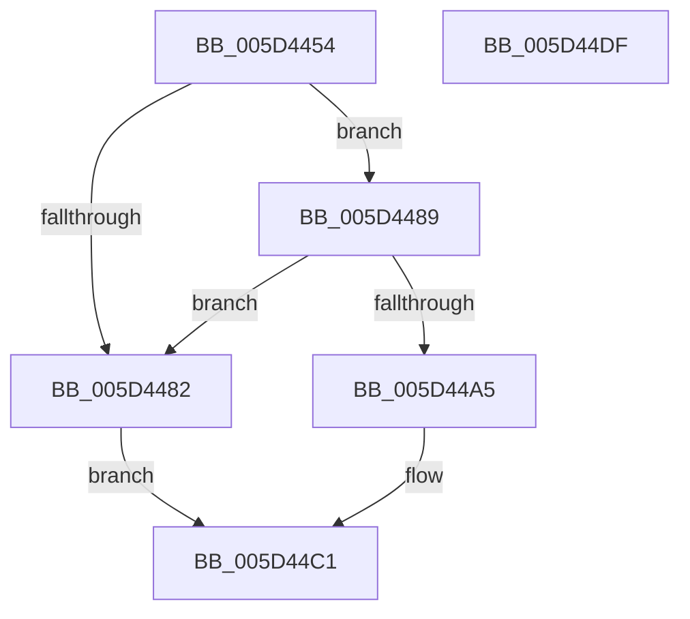

# PpmPerfGetVmPerfPriorityConfig

- RVA: `0x005D4454`–`0x005D44E0` (길이 `140` bytes)
- VA: `0x00000001405D4454`
- 실행 섹션: `.text`
- PDB 이름 있음: `예`; PDB Function 태그: `아니요`
- unwind 정보 RVA: `0x00060BC4`
- 디코드: `36`개 명령, `140/140` bytes 표시
- 미해석 바이트: `0` (있으면 어셈블리에 `.byte`로 보존)

> 이 문서는 커널 이미지의 기계어와 PDB 기호를 분석해 생성했습니다. 4번과 5번은 함수 원형과 자료형을 바이너리 사용 방식에서 추정한 C 해석이며 원본 소스 복구 결과는 아닙니다.

## 1. Dependencies

- 직접 호출 지점: **3**; 고유 호출 대상: **3**
- 직접 호출자로 확인된 함수: **1**
- RIP 상대 이미지 참조: **2**

### Outgoing calls
- `0x005D4474` → [PpmAcquireLock](../2D/PpmAcquireLock_function_002D9AA4.md) (function, `0x002D9AA4`)
- `0x005D44B5` → [guard_dispatch_icall](../6B/guard_dispatch_icall_function_006BAAD0.md) (function, `0x006BAAD0`)
- `0x005D44C8` → [PpmReleaseLock](../2D/PpmReleaseLock_function_002DA428.md) (function, `0x002DA428`)

### Direct callers
- [PopPowerInformationInternal](../../page/A8/PopPowerInformationInternal_function_00A8B7C0.md) at `0x00A8D1B5`

### Static image references
- `0x005D4467` → RVA `0x00F0CC00` (`.data`; read)
- `0x005D4479` → RVA `0x00FC6AEC` (`ALMOSTRO`; read)

## 2. Other-region calls and transfers

- 다른 실행 섹션으로 향하는 call: **0**
- 별도 외부 분기/꼬리 이동을 확인하지 못했습니다.

## 3. Assembly (complete function range)

```asm
005D4454  48 89 5C 24 08                  mov qword ptr [rsp + 8], rbx
005D4459  48 89 74 24 10                  mov qword ptr [rsp + 0x10], rsi
005D445E  57                              push rdi
005D445F  48 83 EC 20                     sub rsp, 0x20
005D4463  8B F9                           mov edi, ecx
005D4465  33 F6                           xor esi, esi
005D4467  48 8D 0D 92 87 93 00            lea rcx, [rip + 0x938792]
005D446E  48 89 32                        mov qword ptr [rdx], rsi
005D4471  48 8B DA                        mov rbx, rdx
005D4474  E8 2B 56 D0 FF                  call 0x1402d9aa4
005D4479  40 38 35 6C 26 9F 00            cmp byte ptr [rip + 0x9f266c], sil
005D4480  75 07                           jne 0x1405d4489
005D4482  BB BB 00 00 C0                  mov ebx, 0xc00000bb
005D4487  EB 38                           jmp 0x1405d44c1
005D4489  65 48 8B 04 25 20 00 00 00      mov rax, qword ptr gs:[0x20]
005D4492  48 8B 88 B0 89 00 00            mov rcx, qword ptr [rax + 0x89b0]
005D4499  48 8B 81 80 01 00 00            mov rax, qword ptr [rcx + 0x180]
005D44A0  48 85 C0                        test rax, rax
005D44A3  74 DD                           je 0x1405d4482
005D44A5  48 8B 89 38 01 00 00            mov rcx, qword ptr [rcx + 0x138]
005D44AC  4C 8B C3                        mov r8, rbx
005D44AF  8B D7                           mov edx, edi
005D44B1  48 8B 49 08                     mov rcx, qword ptr [rcx + 8]
005D44B5  E8 16 66 0E 00                  call 0x1406baad0
005D44BA  85 C0                           test eax, eax
005D44BC  8B D8                           mov ebx, eax
005D44BE  0F 49 DE                        cmovns ebx, esi
005D44C1  48 8D 0D 38 87 93 00            lea rcx, [rip + 0x938738]
005D44C8  E8 5B 5F D0 FF                  call 0x1402da428
005D44CD  48 8B 74 24 38                  mov rsi, qword ptr [rsp + 0x38]
005D44D2  8B C3                           mov eax, ebx
005D44D4  48 8B 5C 24 30                  mov rbx, qword ptr [rsp + 0x30]
005D44D9  48 83 C4 20                     add rsp, 0x20
005D44DD  5F                              pop rdi
005D44DE  C3                              ret
005D44DF  CC                              int3
```

## 4. C-style interpretation (structured pseudocode)

```c
__int64 __fastcall PpmPerfGetVmPerfPriorityConfig(int a1, __int64 a2)
{
    __int64 result;
    __int64 v_rbx;
    __int64 v_rsi;
    __int64 v_rsp;
    unsigned __int64 v_stack_p10;
    unsigned __int64 v_stack_p8;

    v_stack_p8 = v_rbx;
    v_stack_p10 = v_rsi;
    v_rsp = (v_rsp) - (32);
    v_rsi = 0;
    *(unsigned __int64 *)(a2) = 0;
    result = PpmAcquireLock(v_rip + 9668498, a2, a3, a4);
    if ((*(unsigned __int8 *)(v_rip + 10430060)) != 0) goto loc_005D4489;
loc_005D4482:
    goto loc_005D44C1;
loc_005D4489:
    if (*(unsigned __int64 *)(*(unsigned __int64 *)(*(unsigned __int64 *)(gs_base + (0 + 32)) + 35248) + 384) == 0) goto loc_005D4482;
    result = guard_dispatch_icall(*(unsigned __int64 *)(*(unsigned __int64 *)(*(unsigned __int64 *)(*(unsigned __int64 *)(gs_base + (0 + 32)) + 35248) + 312) + 8), (unsigned int)((unsigned int)((unsigned int)(a1))), (unsigned int)(0xC00000BBULL), a4);
    v_rbx = (unsigned int)((unsigned int)(result));
    if (!sign_flag) { v_rbx = 0; }
loc_005D44C1:
    result = PpmReleaseLock(v_rip + 9668408, (unsigned int)((unsigned int)((unsigned int)(a1))), (unsigned int)(0xC00000BBULL), a4);
    v_rsp = (v_rsp) + (32);
    return (unsigned int)((unsigned int)(v_rbx));
}
```

## 5. (Beta) C Style

```c
int64_t PpmPerfGetVmPerfPriorityConfig(int32_t Arg1, void *Arg2)
{
    uint8_t *arg2 = (uint8_t *)Arg2;

    int64_t result;
    int64_t local_rbx;
    int64_t local_rsi;
    int64_t local_rsp;
    uint64_t v_stack_p10;
    uint64_t v_stack_p8;

    v_stack_p8 = local_rbx;
    v_stack_p10 = local_rsi;
    local_rsp = (local_rsp) - (32);
    local_rsi = 0;
    *(uint64_t *)(arg2) = 0;
    result = PpmAcquireLock(v_rip + 9668498, Arg2, a3, a4);
    if ((*(uint8_t *)(v_rip + 0x9F266C)) != 0) goto loc_005D4489;
loc_005D4482:
    goto loc_005D44C1;
loc_005D4489:
    if (*(uint64_t *)(*(uint64_t *)(*(uint64_t *)(gs_base + (0 + 0x20)) + 0x89B0) + 0x180) == 0) goto loc_005D4482;
    result = guard_dispatch_icall(*(uint64_t *)(*(uint64_t *)(*(uint64_t *)(*(uint64_t *)(gs_base + (0 + 0x20)) + 0x89B0) + 0x138) + 0x8), (uint32_t)((uint32_t)((uint32_t)(Arg1))), (uint32_t)(0xC00000BBULL), a4);
    local_rbx = (uint32_t)((uint32_t)(result));
    if (!sign_flag) { local_rbx = 0; }
loc_005D44C1:
    result = PpmReleaseLock(v_rip + 9668408, (uint32_t)((uint32_t)((uint32_t)(Arg1))), (uint32_t)(0xC00000BBULL), a4);
    local_rsp = (local_rsp) + (32);
    return (uint32_t)((uint32_t)(local_rbx));
}
```

### 관측된 메모리 오프셋

구조체 형식이 확인되지 않은 접근은 인자 기준의 오프셋으로만 기록했습니다.

| 기준 인자 | 오프셋 표현 | 폭 (bit) | 접근 |
|---|---:|---:|---|
| `Arg2` | `+ 0x0` | `64` | `W` |

## 6. Execution-region graph

[열기: 2D/3D 그래프와 함수 탐색 컨트롤 패널](../../../control-panel.html?section=text&rva=0x005D4454&view=graph)

- 2D 그래프는 위에서 아래로 흐르고, 3D 그래프는 빈 공간을 드래그해 회전합니다. Shift+드래그는 이동, 휠은 확대·축소, 함수 노드 선택은 대상 보고서 이동입니다.

### Static fallback


