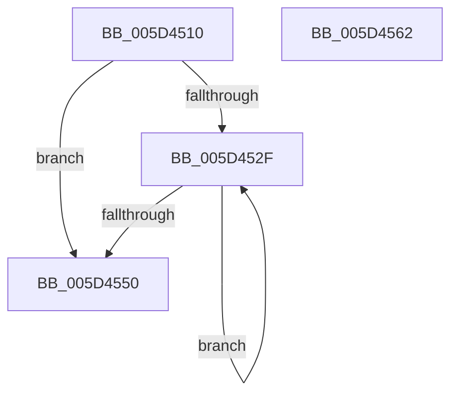

# PpmPerfQueryPackageProcessorCount

- RVA: `0x005D4510`–`0x005D4563` (길이 `83` bytes)
- VA: `0x00000001405D4510`
- 실행 섹션: `.text`
- PDB 이름 있음: `예`; PDB Function 태그: `아니요`
- unwind 정보 RVA: `0x00060BC4`
- 디코드: `27`개 명령, `83/83` bytes 표시
- 미해석 바이트: `0` (있으면 어셈블리에 `.byte`로 보존)

> 이 문서는 커널 이미지의 기계어와 PDB 기호를 분석해 생성했습니다. 4번과 5번은 함수 원형과 자료형을 바이너리 사용 방식에서 추정한 C 해석이며 원본 소스 복구 결과는 아닙니다.

## 1. Dependencies

- 직접 호출 지점: **1**; 고유 호출 대상: **1**
- 직접 호출자로 확인된 함수: **0**
- RIP 상대 이미지 참조: **1**

### Outgoing calls
- `0x005D4531` → [KeGetPrcb](../2D/KeGetPrcb_function_002D85D0.md) (function, `0x002D85D0`)

### Direct callers
- 이 함수 시작 RVA로 연결되는 직접 call은 확인되지 않았습니다. 간접 호출은 완전히 역산할 수 없습니다.

### Static image references
- `0x005D451F` → RVA `0x00FC6A80` (`ALMOSTRO`; read)

## 2. Other-region calls and transfers

- 다른 실행 섹션으로 향하는 call: **0**
- 별도 외부 분기/꼬리 이동을 확인하지 못했습니다.

## 3. Assembly (complete function range)

```asm
005D4510  48 89 5C 24 08                  mov qword ptr [rsp + 8], rbx
005D4515  48 89 74 24 10                  mov qword ptr [rsp + 0x10], rsi
005D451A  57                              push rdi
005D451B  48 83 EC 20                     sub rsp, 0x20
005D451F  8B 05 5B 25 9F 00               mov eax, dword ptr [rip + 0x9f255b]
005D4525  33 DB                           xor ebx, ebx
005D4527  8B F1                           mov esi, ecx
005D4529  8B FB                           mov edi, ebx
005D452B  85 C0                           test eax, eax
005D452D  74 21                           je 0x1405d4550
005D452F  8B CF                           mov ecx, edi
005D4531  E8 9A 40 D0 FF                  call 0x1402d85d0
005D4536  8B 0D 44 25 9F 00               mov ecx, dword ptr [rip + 0x9f2544]
005D453C  8D 53 01                        lea edx, [rbx + 1]
005D453F  3B B0 28 8E 00 00               cmp esi, dword ptr [rax + 0x8e28]
005D4545  0F 45 D3                        cmovne edx, ebx
005D4548  FF C7                           inc edi
005D454A  8B DA                           mov ebx, edx
005D454C  3B F9                           cmp edi, ecx
005D454E  72 DF                           jb 0x1405d452f
005D4550  48 8B 74 24 38                  mov rsi, qword ptr [rsp + 0x38]
005D4555  8B C3                           mov eax, ebx
005D4557  48 8B 5C 24 30                  mov rbx, qword ptr [rsp + 0x30]
005D455C  48 83 C4 20                     add rsp, 0x20
005D4560  5F                              pop rdi
005D4561  C3                              ret
005D4562  CC                              int3
```

## 4. C-style interpretation (structured pseudocode)

```c
__int64 __fastcall PpmPerfQueryPackageProcessorCount(int a1)
{
    __int64 result;
    __int64 v_rbx;
    __int64 v_rdi;
    __int64 v_rsp;
    unsigned __int64 v_stack_p10;
    unsigned __int64 v_stack_p8;

    v_stack_p8 = v_rbx;
    v_stack_p10 = v_rsi;
    v_rsp = (v_rsp) - (32);
    v_rbx = 0;
    if ((unsigned int)((unsigned int)(*(unsigned int *)(v_rip + 10429787))) == 0) goto loc_005D4550;
loc_005D452F:
    result = KeGetPrcb(0, a2, a3, a4);
    a2 = v_rbx + 1;
    if (((unsigned int)((unsigned int)(a1))) != (*(unsigned int *)(result + 36392))) { a2 = 0; }
    v_rdi = (unsigned int)((0) + 1);
    if (((unsigned int)(v_rdi)) < ((unsigned int)((unsigned int)(*(unsigned int *)(v_rip + 10429764))))) goto loc_005D452F;
loc_005D4550:
    v_rsp = (v_rsp) + (32);
    return (unsigned int)((unsigned int)((unsigned int)((unsigned int)(a2))));
}
```

## 5. (Beta) C Style

```c
int64_t PpmPerfQueryPackageProcessorCount(int32_t Arg1)
{
    int64_t result;
    int64_t local_rbx;
    int64_t local_rdi;
    int64_t local_rsp;
    uint64_t v_stack_p10;
    uint64_t v_stack_p8;

    v_stack_p8 = local_rbx;
    v_stack_p10 = local_rsi;
    local_rsp = (local_rsp) - (32);
    local_rbx = 0;
    if ((uint32_t)((uint32_t)(*(uint32_t *)(v_rip + 0x9F255B))) == 0) goto loc_005D4550;
loc_005D452F:
    result = KeGetPrcb(0, a2, a3, a4);
    a2 = local_rbx + 1;
    if (((uint32_t)((uint32_t)(Arg1))) != (*(uint32_t *)(result + 0x8E28))) { a2 = 0; }
    local_rdi = (uint32_t)((0) + 1);
    if (((uint32_t)(local_rdi)) < ((uint32_t)((uint32_t)(*(uint32_t *)(v_rip + 0x9F2544))))) goto loc_005D452F;
loc_005D4550:
    local_rsp = (local_rsp) + (32);
    return (uint32_t)((uint32_t)((uint32_t)((uint32_t)(a2))));
}
```

## 6. Execution-region graph

[열기: 2D/3D 그래프와 함수 탐색 컨트롤 패널](../../../control-panel.html?section=text&rva=0x005D4510&view=graph)

- 2D 그래프는 위에서 아래로 흐르고, 3D 그래프는 빈 공간을 드래그해 회전합니다. Shift+드래그는 이동, 휠은 확대·축소, 함수 노드 선택은 대상 보고서 이동입니다.

### Static fallback


