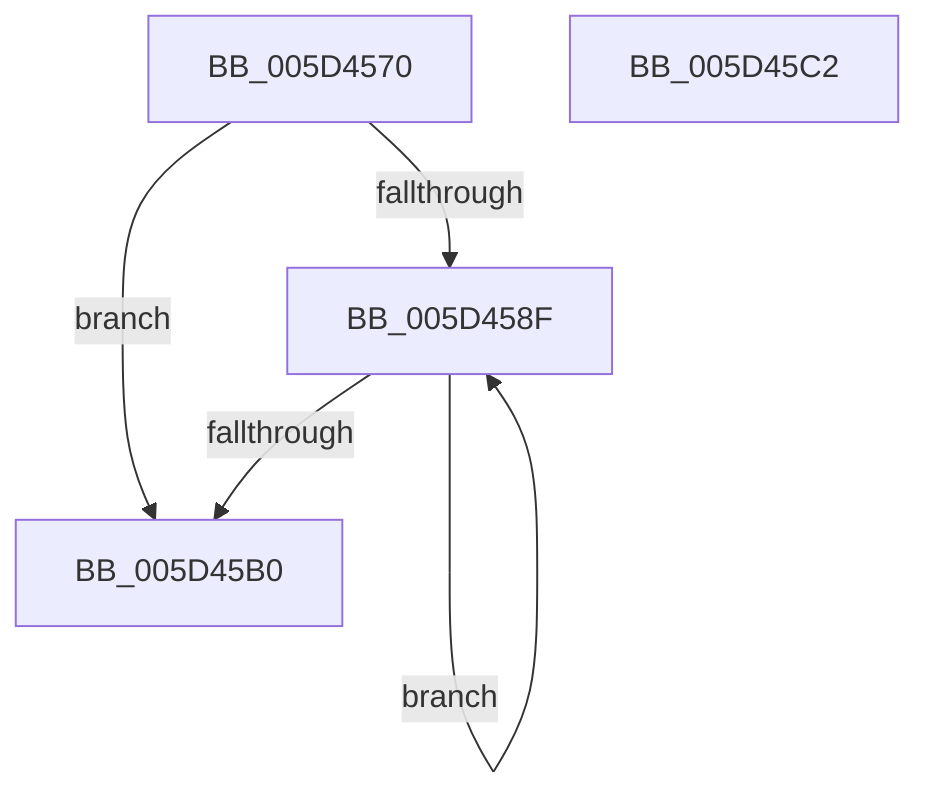

# PpmPerfQueryPhysicalCoreCount

- RVA: `0x005D4570`–`0x005D45C3` (길이 `83` bytes)
- VA: `0x00000001405D4570`
- 실행 섹션: `.text`
- PDB 이름 있음: `예`; PDB Function 태그: `아니요`
- unwind 정보 RVA: `0x00060BC4`
- 디코드: `27`개 명령, `83/83` bytes 표시
- 미해석 바이트: `0` (있으면 어셈블리에 `.byte`로 보존)

> 이 문서는 커널 이미지의 기계어와 PDB 기호를 분석해 생성했습니다. 4번과 5번은 함수 원형과 자료형을 바이너리 사용 방식에서 추정한 C 해석이며 원본 소스 복구 결과는 아닙니다.

## 1. Dependencies

- 직접 호출 지점: **1**; 고유 호출 대상: **1**
- 직접 호출자로 확인된 함수: **0**
- RIP 상대 이미지 참조: **1**

### Outgoing calls
- `0x005D4591` → [KeGetPrcb](../2D/KeGetPrcb_function_002D85D0.md) (function, `0x002D85D0`)

### Direct callers
- 이 함수 시작 RVA로 연결되는 직접 call은 확인되지 않았습니다. 간접 호출은 완전히 역산할 수 없습니다.

### Static image references
- `0x005D457F` → RVA `0x00FC6A80` (`ALMOSTRO`; read)

## 2. Other-region calls and transfers

- 다른 실행 섹션으로 향하는 call: **0**
- 별도 외부 분기/꼬리 이동을 확인하지 못했습니다.

## 3. Assembly (complete function range)

```asm
005D4570  48 89 5C 24 08                  mov qword ptr [rsp + 8], rbx
005D4575  48 89 74 24 10                  mov qword ptr [rsp + 0x10], rsi
005D457A  57                              push rdi
005D457B  48 83 EC 20                     sub rsp, 0x20
005D457F  8B 05 FB 24 9F 00               mov eax, dword ptr [rip + 0x9f24fb]
005D4585  33 DB                           xor ebx, ebx
005D4587  8B F1                           mov esi, ecx
005D4589  8B FB                           mov edi, ebx
005D458B  85 C0                           test eax, eax
005D458D  74 21                           je 0x1405d45b0
005D458F  8B CF                           mov ecx, edi
005D4591  E8 3A 40 D0 FF                  call 0x1402d85d0
005D4596  8B 0D E4 24 9F 00               mov ecx, dword ptr [rip + 0x9f24e4]
005D459C  8D 53 01                        lea edx, [rbx + 1]
005D459F  3B B0 1C 8E 00 00               cmp esi, dword ptr [rax + 0x8e1c]
005D45A5  0F 45 D3                        cmovne edx, ebx
005D45A8  FF C7                           inc edi
005D45AA  8B DA                           mov ebx, edx
005D45AC  3B F9                           cmp edi, ecx
005D45AE  72 DF                           jb 0x1405d458f
005D45B0  48 8B 74 24 38                  mov rsi, qword ptr [rsp + 0x38]
005D45B5  8B C3                           mov eax, ebx
005D45B7  48 8B 5C 24 30                  mov rbx, qword ptr [rsp + 0x30]
005D45BC  48 83 C4 20                     add rsp, 0x20
005D45C0  5F                              pop rdi
005D45C1  C3                              ret
005D45C2  CC                              int3
```

## 4. C-style interpretation (structured pseudocode)

```c
__int64 __fastcall PpmPerfQueryPhysicalCoreCount(int a1)
{
    __int64 result;
    __int64 v_rbx;
    __int64 v_rdi;
    __int64 v_rsp;
    unsigned __int64 v_stack_p10;
    unsigned __int64 v_stack_p8;

    v_stack_p8 = v_rbx;
    v_stack_p10 = v_rsi;
    v_rsp = (v_rsp) - (32);
    v_rbx = 0;
    if ((unsigned int)((unsigned int)(*(unsigned int *)(v_rip + 10429691))) == 0) goto loc_005D45B0;
loc_005D458F:
    result = KeGetPrcb(0, a2, a3, a4);
    a2 = v_rbx + 1;
    if (((unsigned int)((unsigned int)(a1))) != (*(unsigned int *)(result + 36380))) { a2 = 0; }
    v_rdi = (unsigned int)((0) + 1);
    if (((unsigned int)(v_rdi)) < ((unsigned int)((unsigned int)(*(unsigned int *)(v_rip + 10429668))))) goto loc_005D458F;
loc_005D45B0:
    v_rsp = (v_rsp) + (32);
    return (unsigned int)((unsigned int)((unsigned int)((unsigned int)(a2))));
}
```

## 5. (Beta) C Style

```c
int64_t PpmPerfQueryPhysicalCoreCount(int32_t Arg1)
{
    int64_t result;
    int64_t local_rbx;
    int64_t local_rdi;
    int64_t local_rsp;
    uint64_t v_stack_p10;
    uint64_t v_stack_p8;

    v_stack_p8 = local_rbx;
    v_stack_p10 = local_rsi;
    local_rsp = (local_rsp) - (32);
    local_rbx = 0;
    if ((uint32_t)((uint32_t)(*(uint32_t *)(v_rip + 0x9F24FB))) == 0) goto loc_005D45B0;
loc_005D458F:
    result = KeGetPrcb(0, a2, a3, a4);
    a2 = local_rbx + 1;
    if (((uint32_t)((uint32_t)(Arg1))) != (*(uint32_t *)(result + 0x8E1C))) { a2 = 0; }
    local_rdi = (uint32_t)((0) + 1);
    if (((uint32_t)(local_rdi)) < ((uint32_t)((uint32_t)(*(uint32_t *)(v_rip + 0x9F24E4))))) goto loc_005D458F;
loc_005D45B0:
    local_rsp = (local_rsp) + (32);
    return (uint32_t)((uint32_t)((uint32_t)((uint32_t)(a2))));
}
```

## 6. Execution-region graph

[열기: 2D/3D 그래프와 함수 탐색 컨트롤 패널](../../../control-panel.html?section=text&rva=0x005D4570&view=graph)

- 2D 그래프는 위에서 아래로 흐르고, 3D 그래프는 빈 공간을 드래그해 회전합니다. Shift+드래그는 이동, 휠은 확대·축소, 함수 노드 선택은 대상 보고서 이동입니다.

### Static fallback


