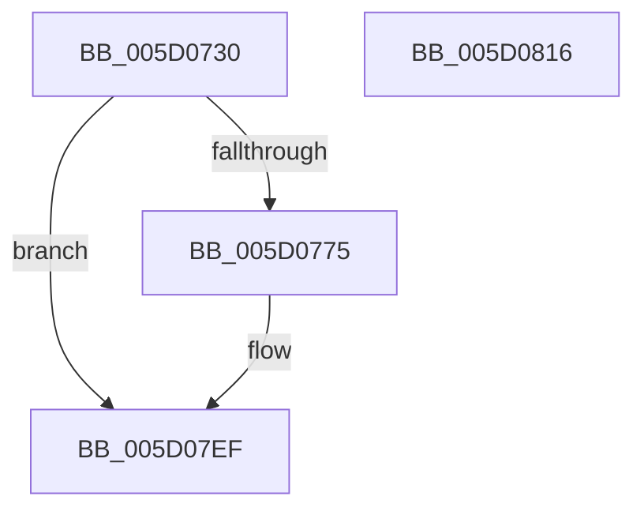

# PpmRemoveIdleStates

- RVA: `0x005D0730`–`0x005D0817` (길이 `231` bytes)
- VA: `0x00000001405D0730`
- 실행 섹션: `.text`
- PDB 이름 있음: `예`; PDB Function 태그: `아니요`
- unwind 정보 RVA: `0x000CBEC8`
- 디코드: `49`개 명령, `231/231` bytes 표시
- 미해석 바이트: `0` (있으면 어셈블리에 `.byte`로 보존)

> 이 문서는 커널 이미지의 기계어와 PDB 기호를 분석해 생성했습니다. 4번과 5번은 함수 원형과 자료형을 바이너리 사용 방식에서 추정한 C 해석이며 원본 소스 복구 결과는 아닙니다.

## 1. Dependencies

- 직접 호출 지점: **8**; 고유 호출 대상: **7**
- 직접 호출자로 확인된 함수: **0**
- RIP 상대 이미지 참조: **3**

### Outgoing calls
- `0x005D0764` → [memset](../6C/memset_function_006C6C40.md) (function, `0x006C6C40`)
- `0x005D0794` → [memset](../6C/memset_function_006C6C40.md) (function, `0x006C6C40`)
- `0x005D07A1` → [KeAddProcessorAffinityEx](../25/KeAddProcessorAffinityEx_function_0025B6F0.md) (function, `0x0025B6F0`)
- `0x005D07B5` → [guard_dispatch_icall](../6B/guard_dispatch_icall_function_006BAAD0.md) (function, `0x006BAAD0`)
- `0x005D07C1` → [KeAcquireSpinLockAtDpcLevel](../20/KeAcquireSpinLockAtDpcLevel_function_00208430.md) (function, `0x00208430`)
- `0x005D07D5` → [KxReleaseSpinLock](../20/KxReleaseSpinLock_function_00206670.md) (function, `0x00206670`)
- `0x005D07EA` → [ExFreePoolWithTag](../../poolcode/B8/ExFreePoolWithTag_function_00B82870.md) (function, `0x00B82870`)
- `0x005D07FC` → [_security_check_cookie](../6A/_security_check_cookie_function_006AC640.md) (function, `0x006AC640`)

### Direct callers
- 이 함수 시작 RVA로 연결되는 직접 call은 확인되지 않았습니다. 간접 호출은 완전히 역산할 수 없습니다.

### Static image references
- `0x005D0742` → RVA `0x00E0A740` (`.data`; read)
- `0x005D07A6` → RVA `0x00E00908` (`.data`; read)
- `0x005D07BA` → RVA `0x00F0CA68` (`.data`; read)

## 2. Other-region calls and transfers

- 다른 실행 섹션으로 향하는 call: **1**
  - `0x005D07EA` → [ExFreePoolWithTag](../../poolcode/B8/ExFreePoolWithTag_function_00B82870.md) (`.text` → `POOLCODE`)
- 별도 외부 분기/꼬리 이동을 확인하지 못했습니다.

## 3. Assembly (complete function range)

```asm
005D0730  48 89 5C 24 10                  mov qword ptr [rsp + 0x10], rbx
005D0735  48 89 74 24 18                  mov qword ptr [rsp + 0x18], rsi
005D073A  57                              push rdi
005D073B  48 81 EC 40 01 00 00            sub rsp, 0x140
005D0742  48 8B 05 F7 9F 83 00            mov rax, qword ptr [rip + 0x839ff7]
005D0749  48 33 C4                        xor rax, rsp
005D074C  48 89 84 24 30 01 00 00         mov qword ptr [rsp + 0x130], rax
005D0754  48 8B D9                        mov rbx, rcx
005D0757  33 D2                           xor edx, edx
005D0759  48 8D 4C 24 28                  lea rcx, [rsp + 0x28]
005D075E  41 B8 00 01 00 00               mov r8d, 0x100
005D0764  E8 D7 64 0F 00                  call 0x1406c6c40
005D0769  48 8B BB 40 88 00 00            mov rdi, qword ptr [rbx + 0x8840]
005D0770  48 85 FF                        test rdi, rdi
005D0773  74 7A                           je 0x1405d07ef
005D0775  83 64 24 24 00                  and dword ptr [rsp + 0x24], 0
005D077A  48 8D 4C 24 28                  lea rcx, [rsp + 0x28]
005D077F  33 D2                           xor edx, edx
005D0781  C7 44 24 20 01 00 20 00         mov dword ptr [rsp + 0x20], 0x200001
005D0789  41 B8 00 01 00 00               mov r8d, 0x100
005D078F  BE 01 00 00 00                  mov esi, 1
005D0794  E8 A7 64 0F 00                  call 0x1406c6c40
005D0799  8B 53 24                        mov edx, dword ptr [rbx + 0x24]
005D079C  48 8D 4C 24 20                  lea rcx, [rsp + 0x20]
005D07A1  E8 4A AF C8 FF                  call 0x14025b6f0
005D07A6  48 8B 05 5B 01 83 00            mov rax, qword ptr [rip + 0x83015b]
005D07AD  48 8D 54 24 20                  lea rdx, [rsp + 0x20]
005D07B2  40 8A CE                        mov cl, sil
005D07B5  E8 16 A3 0E 00                  call 0x1406baad0
005D07BA  48 8D 0D A7 C2 93 00            lea rcx, [rip + 0x93c2a7]
005D07C1  E8 6A 7C C3 FF                  call 0x140208430
005D07C6  48 83 A3 40 88 00 00 00         and qword ptr [rbx + 0x8840], 0
005D07CE  48 8D 0D 93 C2 93 00            lea rcx, [rip + 0x93c293]
005D07D5  E8 96 5E C3 FF                  call 0x140206670
005D07DA  48 83 A3 48 88 00 00 00         and qword ptr [rbx + 0x8848], 0
005D07E2  BA 50 50 4D 69                  mov edx, 0x694d5050
005D07E7  48 8B CF                        mov rcx, rdi
005D07EA  E8 81 20 5B 00                  call 0x140b82870
005D07EF  33 C0                           xor eax, eax
005D07F1  48 8B 8C 24 30 01 00 00         mov rcx, qword ptr [rsp + 0x130]
005D07F9  48 33 CC                        xor rcx, rsp
005D07FC  E8 3F BE 0D 00                  call 0x1406ac640
005D0801  4C 8D 9C 24 40 01 00 00         lea r11, [rsp + 0x140]
005D0809  49 8B 5B 18                     mov rbx, qword ptr [r11 + 0x18]
005D080D  49 8B 73 20                     mov rsi, qword ptr [r11 + 0x20]
005D0811  49 8B E3                        mov rsp, r11
005D0814  5F                              pop rdi
005D0815  C3                              ret
005D0816  CC                              int3
```

## 4. C-style interpretation (structured pseudocode)

```c
__int64 __fastcall PpmRemoveIdleStates(__int64 a1, int a2)
{
    __int64 result;
    __int64 v_rsi;
    __int64 v_rsp;
    unsigned __int64 v_stack_m120;
    unsigned int v_stack_m124;
    unsigned int v_stack_m128;
    unsigned __int64 v_stack_m18;
    unsigned __int64 v_stack_m8;
    unsigned __int64 v_stack_p10;
    unsigned __int64 v_stack_p18;

    v_stack_p10 = v_rbx;
    v_stack_p18 = v_rsi;
    v_rsp = (v_rsp) - (320);
    result = (*(unsigned __int64 *)(v_rip + 8626167)) ^ (v_rsp);
    v_stack_m18 = result;
    a2 = 0;
    result = memset(v_stack_m120, a2, 256, a4);
    if (*(unsigned __int64 *)(a1 + 34880) != 0) {
        a1 = v_stack_m120;
        a2 = 0;
        v_stack_m128 = 0x200001ULL;
        a3 = 256;
        v_rsi = 1;
        result = memset(a1, a2, a3, a4);
        a2 = *(unsigned int *)(a1 + 36);
        a1 = v_stack_m128;
        result = KeAddProcessorAffinityEx(a1, a2, a3, a4);
        result = *(unsigned __int64 *)(v_rip + 8585563);
        a2 = v_stack_m128;
        a1 = (unsigned __int8)(v_rsi);
        result = guard_dispatch_icall(a1, a2, a3, a4);
        a1 = v_rip + 9683623;
        result = KeAcquireSpinLockAtDpcLevel(a1, a2, a3, a4);
        a1 = v_rip + 9683603;
        result = KxReleaseSpinLock(a1, a2, a3, a4);
        a2 = 0x694D5050ULL;
        a1 = *(unsigned __int64 *)(a1 + 34880);
        result = ExFreePoolWithTag(a1, a2, a3, a4);
    }
    result = 0;
    a1 = (v_stack_m18) ^ (v_rsp);
    result = _security_check_cookie(a1, a2, a3, a4);
    return result;
}
```

## 5. (Beta) C Style

```c
int64_t PpmRemoveIdleStates(void *Arg1, int32_t Arg2)
{
    uint8_t *arg1 = (uint8_t *)Arg1;

    int64_t result;
    int64_t local_rsi;
    int64_t local_rsp;
    uint64_t v_stack_m120;
    uint32_t v_stack_m124;
    uint32_t v_stack_m128;
    uint64_t v_stack_m18;
    uint64_t v_stack_m8;
    uint64_t v_stack_p10;
    uint64_t v_stack_p18;

    v_stack_p10 = local_rbx;
    v_stack_p18 = local_rsi;
    local_rsp = (local_rsp) - (320);
    result = (*(uint64_t *)(v_rip + 0x839FF7)) ^ (local_rsp);
    v_stack_m18 = result;
    Arg2 = 0;
    result = memset(v_stack_m120, Arg2, 256, a4);
    if (*(uint64_t *)(arg1 + 0x8840) != 0) {
        Arg1 = v_stack_m120;
        Arg2 = 0;
        v_stack_m128 = 0x200001ULL;
        a3 = 256;
        local_rsi = 1;
        result = memset(Arg1, Arg2, a3, a4);
        Arg2 = *(uint32_t *)(arg1 + 0x24);
        Arg1 = v_stack_m128;
        result = KeAddProcessorAffinityEx(Arg1, Arg2, a3, a4);
        result = *(uint64_t *)(v_rip + 0x83015B);
        Arg2 = v_stack_m128;
        Arg1 = (uint8_t)(local_rsi);
        result = guard_dispatch_icall(Arg1, Arg2, a3, a4);
        Arg1 = v_rip + 9683623;
        result = KeAcquireSpinLockAtDpcLevel(Arg1, Arg2, a3, a4);
        Arg1 = v_rip + 9683603;
        result = KxReleaseSpinLock(Arg1, Arg2, a3, a4);
        Arg2 = 0x694D5050ULL;
        Arg1 = *(uint64_t *)(arg1 + 0x8840);
        result = ExFreePoolWithTag(Arg1, Arg2, a3, a4);
    }
    result = 0;
    Arg1 = (v_stack_m18) ^ (local_rsp);
    result = _security_check_cookie(Arg1, Arg2, a3, a4);
    return result;
}
```

### 관측된 메모리 오프셋

구조체 형식이 확인되지 않은 접근은 인자 기준의 오프셋으로만 기록했습니다.

| 기준 인자 | 오프셋 표현 | 폭 (bit) | 접근 |
|---|---:|---:|---|
| `Arg1` | `+ 0x24` | `32` | `R` |
| `Arg1` | `+ 0x8840` | `64` | `R` |
| `Arg1` | `+ 0x8840` | `64` | `R/W` |
| `Arg1` | `+ 0x8848` | `64` | `R/W` |

## 6. Execution-region graph

[열기: 2D/3D 그래프와 함수 탐색 컨트롤 패널](../../../control-panel.html?section=text&rva=0x005D0730&view=graph)

- 2D 그래프는 위에서 아래로 흐르고, 3D 그래프는 빈 공간을 드래그해 회전합니다. Shift+드래그는 이동, 휠은 확대·축소, 함수 노드 선택은 대상 보고서 이동입니다.

### Static fallback


