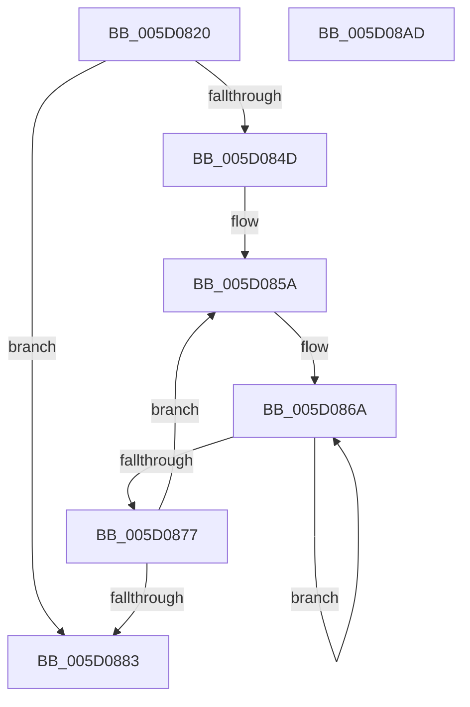

# PpmResetPlatformIdleAccounting

- RVA: `0x005D0820`–`0x005D08AE` (길이 `142` bytes)
- VA: `0x00000001405D0820`
- 실행 섹션: `.text`
- PDB 이름 있음: `예`; PDB Function 태그: `아니요`
- unwind 정보 RVA: `0x00060BC4`
- 디코드: `39`개 명령, `142/142` bytes 표시
- 미해석 바이트: `0` (있으면 어셈블리에 `.byte`로 보존)

> 이 문서는 커널 이미지의 기계어와 PDB 기호를 분석해 생성했습니다. 4번과 5번은 함수 원형과 자료형을 바이너리 사용 방식에서 추정한 C 해석이며 원본 소스 복구 결과는 아닙니다.

## 1. Dependencies

- 직접 호출 지점: **1**; 고유 호출 대상: **1**
- 직접 호출자로 확인된 함수: **2**
- RIP 상대 이미지 참조: **0**

### Outgoing calls
- `0x005D0844` → [memset](../6C/memset_function_006C6C40.md) (function, `0x006C6C40`)

### Direct callers
- [PpmInstallCoordinatedIdleStates](../../page/75/PpmInstallCoordinatedIdleStates_function_007552A0.md) at `0x00755464`
- [sub_00B3B244](../../page/B3/Unknown_function_00B3B244.md) at `0x00B3B322`

### Static image references
- 디코드된 RIP-relative 메모리 참조가 없습니다.

## 2. Other-region calls and transfers

- 다른 실행 섹션으로 향하는 call: **0**
- 별도 외부 분기/꼬리 이동을 확인하지 못했습니다.

## 3. Assembly (complete function range)

```asm
005D0820  48 89 5C 24 08                  mov qword ptr [rsp + 8], rbx
005D0825  48 89 74 24 10                  mov qword ptr [rsp + 0x10], rsi
005D082A  57                              push rdi
005D082B  48 83 EC 20                     sub rsp, 0x20
005D082F  8B 79 04                        mov edi, dword ptr [rcx + 4]
005D0832  33 D2                           xor edx, edx
005D0834  8B 31                           mov esi, dword ptr [rcx]
005D0836  44 8B C7                        mov r8d, edi
005D0839  41 C1 E0 0A                     shl r8d, 0xa
005D083D  48 8B D9                        mov rbx, rcx
005D0840  41 83 C0 28                     add r8d, 0x28
005D0844  E8 F7 63 0F 00                  call 0x1406c6c40
005D0849  85 FF                           test edi, edi
005D084B  74 36                           je 0x1405d0883
005D084D  48 8D 83 F0 00 00 00            lea rax, [rbx + 0xf0]
005D0854  8B D7                           mov edx, edi
005D0856  49 83 C9 FF                     or r9, 0xffffffffffffffff
005D085A  4C 89 88 50 FF FF FF            mov qword ptr [rax - 0xb0], r9
005D0861  48 8B C8                        mov rcx, rax
005D0864  41 B8 1A 00 00 00               mov r8d, 0x1a
005D086A  4C 89 09                        mov qword ptr [rcx], r9
005D086D  48 8D 49 20                     lea rcx, [rcx + 0x20]
005D0871  49 83 E8 01                     sub r8, 1
005D0875  75 F3                           jne 0x1405d086a
005D0877  48 05 00 04 00 00               add rax, 0x400
005D087D  48 83 EA 01                     sub rdx, 1
005D0881  75 D7                           jne 0x1405d085a
005D0883  8D 46 01                        lea eax, [rsi + 1]
005D0886  89 7B 04                        mov dword ptr [rbx + 4], edi
005D0889  48 8B 74 24 38                  mov rsi, qword ptr [rsp + 0x38]
005D088E  89 03                           mov dword ptr [rbx], eax
005D0890  48 A1 08 00 00 00 80 F7 FF FF   movabs rax, qword ptr [0xfffff78000000008]
005D089A  83 63 18 00                     and dword ptr [rbx + 0x18], 0
005D089E  48 89 43 20                     mov qword ptr [rbx + 0x20], rax
005D08A2  48 8B 5C 24 30                  mov rbx, qword ptr [rsp + 0x30]
005D08A7  48 83 C4 20                     add rsp, 0x20
005D08AB  5F                              pop rdi
005D08AC  C3                              ret
005D08AD  CC                              int3
```

## 4. C-style interpretation (structured pseudocode)

```c
__int64 __fastcall PpmResetPlatformIdleAccounting(__int64 a1, int a2, __int64 a3, __int64 a4)
{
    __int64 result;
    __int64 v_rsp;
    unsigned __int64 v_stack_p10;
    unsigned __int64 v_stack_p8;

    v_stack_p8 = v_rbx;
    v_stack_p10 = v_rsi;
    v_rsp = (v_rsp) - (32);
    a2 = 0;
    a3 = (unsigned int)(((unsigned int)((unsigned int)((unsigned int)(*(unsigned int *)(a1 + 4))))) << (10));
    a3 = (unsigned int)((a3) + (40));
    result = memset(a1, a2, a3, a4);
    if ((unsigned int)((unsigned int)(*(unsigned int *)(a1 + 4))) == 0) goto loc_005D0883;
    a4 = (a4) | (-1);
loc_005D085A:
    *(unsigned __int64 *)(a1 + 240 - 176) = a4;
loc_005D086A:
    *(unsigned __int64 *)(a1 + 240) = a4;
    a3 = (26) - (1);
    if (condition_is_not_equal) goto loc_005D086A;
    result = (a1 + 240) + (0x400ULL);
    a2 = ((unsigned int)((unsigned int)((unsigned int)(*(unsigned int *)(a1 + 4))))) - (1);
    if (condition_is_not_equal) goto loc_005D085A;
loc_005D0883:
    *(unsigned int *)(a1 + 4) = (unsigned int)((unsigned int)(*(unsigned int *)(a1 + 4)));
    *(unsigned int *)(a1) = (unsigned int)((unsigned int)(*(unsigned int *)(a1)) + 1);
    *(unsigned __int64 *)(a1 + 32) = (unsigned int)(*(unsigned int *)(a1)) + 1;
    v_rsp = (v_rsp) + (32);
    return (unsigned int)(*(unsigned int *)(a1)) + 1;
}
```

## 5. (Beta) C Style

```c
int64_t PpmResetPlatformIdleAccounting(void *Arg1, int32_t Arg2, int64_t Arg3, int64_t Arg4)
{
    uint8_t *arg1 = (uint8_t *)Arg1;

    int64_t result;
    int64_t local_rsp;
    uint64_t v_stack_p10;
    uint64_t v_stack_p8;

    v_stack_p8 = local_rbx;
    v_stack_p10 = local_rsi;
    local_rsp = (local_rsp) - (32);
    Arg2 = 0;
    Arg3 = (uint32_t)(((uint32_t)((uint32_t)((uint32_t)(*(uint32_t *)(arg1 + 0x4))))) << (10));
    Arg3 = (uint32_t)((Arg3) + (40));
    result = memset(Arg1, Arg2, Arg3, Arg4);
    if ((uint32_t)((uint32_t)(*(uint32_t *)(arg1 + 0x4))) == 0) goto loc_005D0883;
    Arg4 = (Arg4) | (-1);
loc_005D085A:
    *(uint64_t *)(arg1 + 0xF0 - 0xB0) = Arg4;
loc_005D086A:
    *(uint64_t *)(arg1 + 0xF0) = Arg4;
    Arg3 = (26) - (1);
    if (condition_is_not_equal) goto loc_005D086A;
    result = (Arg1 + 240) + (0x400ULL);
    Arg2 = ((uint32_t)((uint32_t)((uint32_t)(*(uint32_t *)(arg1 + 0x4))))) - (1);
    if (condition_is_not_equal) goto loc_005D085A;
loc_005D0883:
    *(uint32_t *)(arg1 + 0x4) = (uint32_t)((uint32_t)(*(uint32_t *)(arg1 + 0x4)));
    *(uint32_t *)(arg1) = (uint32_t)((uint32_t)(*(uint32_t *)(arg1)) + 1);
    *(uint64_t *)(arg1 + 0x20) = (uint32_t)(*(uint32_t *)(arg1)) + 1;
    local_rsp = (local_rsp) + (32);
    return (uint32_t)(*(uint32_t *)(arg1)) + 1;
}
```

### 관측된 메모리 오프셋

구조체 형식이 확인되지 않은 접근은 인자 기준의 오프셋으로만 기록했습니다.

| 기준 인자 | 오프셋 표현 | 폭 (bit) | 접근 |
|---|---:|---:|---|
| `Arg1` | `- 0xB0` | `64` | `W` |
| `Arg1` | `+ 0x0` | `32` | `R` |
| `Arg1` | `+ 0x0` | `32` | `W` |
| `Arg1` | `+ 0x0` | `64` | `W` |
| `Arg1` | `+ 0x4` | `32` | `R` |
| `Arg1` | `+ 0x4` | `32` | `W` |
| `Arg1` | `+ 0x18` | `32` | `R/W` |
| `Arg1` | `+ 0x20` | `64` | `R` |
| `Arg1` | `+ 0x20` | `64` | `W` |
| `Arg1` | `+ 0xF0` | `64` | `R` |

## 6. Execution-region graph

[열기: 2D/3D 그래프와 함수 탐색 컨트롤 패널](../../../control-panel.html?section=text&rva=0x005D0820&view=graph)

- 2D 그래프는 위에서 아래로 흐르고, 3D 그래프는 빈 공간을 드래그해 회전합니다. Shift+드래그는 이동, 휠은 확대·축소, 함수 노드 선택은 대상 보고서 이동입니다.

### Static fallback


