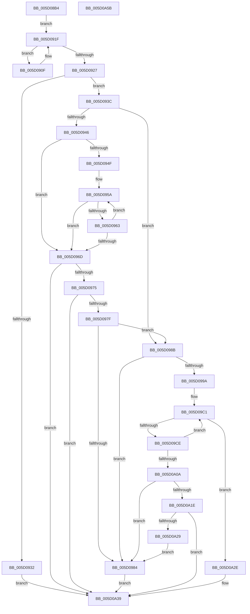

# PpmTestAndLockProcessor

- RVA: `0x005D08B4`–`0x005D0A5C` (길이 `424` bytes)
- VA: `0x00000001405D08B4`
- 실행 섹션: `.text`
- PDB 이름 있음: `예`; PDB Function 태그: `아니요`
- unwind 정보 RVA: `0x0008A668`
- 디코드: `118`개 명령, `424/424` bytes 표시
- 미해석 바이트: `0` (있으면 어셈블리에 `.byte`로 보존)

> 이 문서는 커널 이미지의 기계어와 PDB 기호를 분석해 생성했습니다. 4번과 5번은 함수 원형과 자료형을 바이너리 사용 방식에서 추정한 C 해석이며 원본 소스 복구 결과는 아닙니다.

## 1. Dependencies

- 직접 호출 지점: **5**; 고유 호출 대상: **5**
- 직접 호출자로 확인된 함수: **2**
- RIP 상대 이미지 참조: **1**

### Outgoing calls
- `0x005D0914` → [PpmIdleTransitionStall](PpmIdleTransitionStall_function_005D039C.md) (function, `0x005D039C`)
- `0x005D0991` → [KeCheckProcessorAffinityEx](../30/KeCheckProcessorAffinityEx_function_00305150.md) (function, `0x00305150`)
- `0x005D09AF` → [KeInterlockedSetProcessorAffinityEx](../35/KeInterlockedSetProcessorAffinityEx_function_00352560.md) (function, `0x00352560`)
- `0x005D0A10` → [KeAddProcessorAffinityEx](../25/KeAddProcessorAffinityEx_function_0025B6F0.md) (function, `0x0025B6F0`)
- `0x005D0A34` → [KeInterlockedClearProcessorAffinityEx](../35/KeInterlockedClearProcessorAffinityEx_function_003524F0.md) (function, `0x003524F0`)

### Direct callers
- [PpmIdleCheckCoordinatedDependency](../5C/PpmIdleCheckCoordinatedDependency_function_005CF72C.md) at `0x005CF9A8`
- [PpmIdleCheckCoordinatedProcessorDependency](../5C/PpmIdleCheckCoordinatedProcessorDependency_function_005CFA34.md) at `0x005CFA4F`

### Static image references
- `0x005D08F3` → RVA `0x00FC6EC8` (`ALMOSTRO`; read)

## 2. Other-region calls and transfers

- 다른 실행 섹션으로 향하는 call: **0**
- 별도 외부 분기/꼬리 이동을 확인하지 못했습니다.

## 3. Assembly (complete function range)

```asm
005D08B4  4C 8B DC                        mov r11, rsp
005D08B7  49 89 5B 08                     mov qword ptr [r11 + 8], rbx
005D08BB  49 89 6B 10                     mov qword ptr [r11 + 0x10], rbp
005D08BF  49 89 73 18                     mov qword ptr [r11 + 0x18], rsi
005D08C3  49 89 7B 20                     mov qword ptr [r11 + 0x20], rdi
005D08C7  41 54                           push r12
005D08C9  41 56                           push r14
005D08CB  41 57                           push r15
005D08CD  48 83 EC 40                     sub rsp, 0x40
005D08D1  8B 81 8C 88 00 00               mov eax, dword ptr [rcx + 0x888c]
005D08D7  0F 57 C0                        xorps xmm0, xmm0
005D08DA  0F 11 44 24 30                  movups xmmword ptr [rsp + 0x30], xmm0
005D08DF  C6 44 24 3C 01                  mov byte ptr [rsp + 0x3c], 1
005D08E4  48 8B D9                        mov rbx, rcx
005D08E7  0F 11 44 24 20                  movups xmmword ptr [rsp + 0x20], xmm0
005D08EC  49 89 4B D8                     mov qword ptr [r11 - 0x28], rcx
005D08F0  4D 8B F0                        mov r14, r8
005D08F3  48 8B 0D CE 65 9F 00            mov rcx, qword ptr [rip + 0x9f65ce]
005D08FA  4C 8B E2                        mov r12, rdx
005D08FD  49 89 4B D0                     mov qword ptr [r11 - 0x30], rcx
005D0901  33 F6                           xor esi, esi
005D0903  BF 00 00 00 FF                  mov edi, 0xff000000
005D0908  BD 00 00 00 02                  mov ebp, 0x2000000
005D090D  EB 10                           jmp 0x1405d091f
005D090F  48 8D 4C 24 20                  lea rcx, [rsp + 0x20]
005D0914  E8 83 FA FF FF                  call 0x1405d039c
005D0919  8B 83 8C 88 00 00               mov eax, dword ptr [rbx + 0x888c]
005D091F  8B C8                           mov ecx, eax
005D0921  23 CF                           and ecx, edi
005D0923  3B CD                           cmp ecx, ebp
005D0925  74 E8                           je 0x1405d090f
005D0927  C1 E8 18                        shr eax, 0x18
005D092A  83 E8 03                        sub eax, 3
005D092D  83 F8 02                        cmp eax, 2
005D0930  76 0A                           jbe 0x1405d093c
005D0932  BF FF FF FF FF                  mov edi, 0xffffffff
005D0937  E9 FD 00 00 00                  jmp 0x1405d0a39
005D093C  BF 05 00 00 80                  mov edi, 0x80000005
005D0941  4D 85 F6                        test r14, r14
005D0944  74 45                           je 0x1405d098b
005D0946  41 8B 16                        mov edx, dword ptr [r14]
005D0949  33 C9                           xor ecx, ecx
005D094B  85 D2                           test edx, edx
005D094D  74 1E                           je 0x1405d096d
005D094F  44 8B 83 80 88 00 00            mov r8d, dword ptr [rbx + 0x8880]
005D0956  49 8B 46 08                     mov rax, qword ptr [r14 + 8]
005D095A  48 8B F0                        mov rsi, rax
005D095D  44 39 40 04                     cmp dword ptr [rax + 4], r8d
005D0961  74 0A                           je 0x1405d096d
005D0963  FF C1                           inc ecx
005D0965  48 83 C0 18                     add rax, 0x18
005D0969  3B CA                           cmp ecx, edx
005D096B  72 ED                           jb 0x1405d095a
005D096D  3B CA                           cmp ecx, edx
005D096F  0F 84 C4 00 00 00               je 0x1405d0a39
005D0975  80 7E 02 00                     cmp byte ptr [rsi + 2], 0
005D0979  0F 84 BA 00 00 00               je 0x1405d0a39
005D097F  80 3E 00                        cmp byte ptr [rsi], 0
005D0982  75 07                           jne 0x1405d098b
005D0984  33 FF                           xor edi, edi
005D0986  E9 AE 00 00 00                  jmp 0x1405d0a39
005D098B  8B 53 24                        mov edx, dword ptr [rbx + 0x24]
005D098E  49 8B CC                        mov rcx, r12
005D0991  E8 BA 47 D3 FF                  call 0x140305150
005D0996  85 C0                           test eax, eax
005D0998  75 EA                           jne 0x1405d0984
005D099A  65 8B 2C 25 A4 01 00 00         mov ebp, dword ptr gs:[0x1a4]
005D09A2  8B D5                           mov edx, ebp
005D09A4  4C 8B BB 40 88 00 00            mov r15, qword ptr [rbx + 0x8840]
005D09AB  49 8D 4F 48                     lea rcx, [r15 + 0x48]
005D09AF  E8 AC 1B D8 FF                  call 0x140352560
005D09B4  0F 0D 8B 8C 88 00 00            prefetchw byte ptr [rbx + 0x888c]
005D09BB  8B 93 8C 88 00 00               mov edx, dword ptr [rbx + 0x888c]
005D09C1  8B C2                           mov eax, edx
005D09C3  C1 E8 18                        shr eax, 0x18
005D09C6  83 E8 04                        sub eax, 4
005D09C9  83 F8 01                        cmp eax, 1
005D09CC  77 60                           ja 0x1405d0a2e
005D09CE  8B C2                           mov eax, edx
005D09D0  44 8B CA                        mov r9d, edx
005D09D3  25 FF FF FF 00                  and eax, 0xffffff
005D09D8  0D 00 00 00 05                  or eax, 0x5000000
005D09DD  44 8B C0                        mov r8d, eax
005D09E0  41 C1 E0 08                     shl r8d, 8
005D09E4  41 C1 F8 08                     sar r8d, 8
005D09E8  41 FF C0                        inc r8d
005D09EB  41 8B C8                        mov ecx, r8d
005D09EE  33 C8                           xor ecx, eax
005D09F0  8B C2                           mov eax, edx
005D09F2  81 E1 00 00 00 FF               and ecx, 0xff000000
005D09F8  41 33 C8                        xor ecx, r8d
005D09FB  F0 0F B1 8B 8C 88 00 00         lock cmpxchg dword ptr [rbx + 0x888c], ecx
005D0A03  8B D0                           mov edx, eax
005D0A05  41 3B C1                        cmp eax, r9d
005D0A08  75 B7                           jne 0x1405d09c1
005D0A0A  8B 53 24                        mov edx, dword ptr [rbx + 0x24]
005D0A0D  49 8B CC                        mov rcx, r12
005D0A10  E8 DB AC C8 FF                  call 0x14025b6f0
005D0A15  4D 85 F6                        test r14, r14
005D0A18  0F 84 66 FF FF FF               je 0x1405d0984
005D0A1E  8B 83 80 88 00 00               mov eax, dword ptr [rbx + 0x8880]
005D0A24  39 46 04                        cmp dword ptr [rsi + 4], eax
005D0A27  75 10                           jne 0x1405d0a39
005D0A29  E9 56 FF FF FF                  jmp 0x1405d0984
005D0A2E  8B D5                           mov edx, ebp
005D0A30  49 8D 4F 48                     lea rcx, [r15 + 0x48]
005D0A34  E8 B7 1A D8 FF                  call 0x1403524f0
005D0A39  48 8B 5C 24 60                  mov rbx, qword ptr [rsp + 0x60]
005D0A3E  48 8B C7                        mov rax, rdi
005D0A41  48 8B 7C 24 78                  mov rdi, qword ptr [rsp + 0x78]
005D0A46  48 8B 6C 24 68                  mov rbp, qword ptr [rsp + 0x68]
005D0A4B  48 8B 74 24 70                  mov rsi, qword ptr [rsp + 0x70]
005D0A50  48 83 C4 40                     add rsp, 0x40
005D0A54  41 5F                           pop r15
005D0A56  41 5E                           pop r14
005D0A58  41 5C                           pop r12
005D0A5A  C3                              ret
005D0A5B  CC                              int3
```

## 4. C-style interpretation (structured pseudocode)

```c
__int64 __fastcall PpmTestAndLockProcessor(__int64 a1, __int64 a2, __int64 a3)
{
    __int64 result;
    __int64 v_rdi;
    __int64 v_rsi;
    __int64 v_rsp;
    unsigned __int8 v_stack_m1C;
    unsigned __int64 v_stack_m28;
    unsigned __int64 v_stack_m38;
    unsigned __int64 v_stack_p10;
    unsigned __int64 v_stack_p18;
    unsigned __int64 v_stack_p20;
    unsigned __int64 v_stack_p8;

    *(unsigned __int64 *)(v_rsp + 8) = v_rbx;
    *(unsigned __int64 *)(v_rsp + 16) = v_rbp;
    *(unsigned __int64 *)(v_rsp + 24) = v_rsi;
    *(unsigned __int64 *)(v_rsp + 32) = v_rdi;
    v_rsp = (v_rsp) - (64);
    v_stack_m28 = v_xmm0;
    v_stack_m1C = 1;
    v_stack_m38 = v_xmm0;
    *(unsigned __int64 *)(v_rsp - 40) = a1;
    *(unsigned __int64 *)(v_rsp - 48) = *(unsigned __int64 *)(v_rip + 10446286);
    v_rsi = 0;
    goto loc_005D091F;
loc_005D090F:
    result = PpmIdleTransitionStall(v_stack_m38, a2, a3, a4);
loc_005D091F:
    a1 = (unsigned int)(((unsigned int)((unsigned int)((unsigned int)(*(unsigned int *)(a1 + 34956))))) & ((unsigned int)((unsigned int)(0xFF000000ULL))));
    if (((unsigned int)(a1)) == ((unsigned int)((unsigned int)(0x2000000ULL)))) goto loc_005D090F;
    result = (unsigned int)(((unsigned int)(*(unsigned int *)(a1 + 34956))) >> (24));
    result = (unsigned int)((result) - (3));
    if (((unsigned int)(result)) <= 2) goto loc_005D093C;
    goto loc_005D0A39;
loc_005D093C:
    if (a3 == 0) goto loc_005D098B;
    a1 = 0;
    if ((unsigned int)((unsigned int)(*(unsigned int *)(a3))) == 0) goto loc_005D096D;
loc_005D095A:
    if ((*(unsigned int *)(*(unsigned __int64 *)(a3 + 8) + 4)) == ((unsigned int)((unsigned int)(*(unsigned int *)(a1 + 34944))))) goto loc_005D096D;
    a1 = (unsigned int)((a1) + 1);
    result = (*(unsigned __int64 *)(a3 + 8)) + (24);
    if (((unsigned int)(a1)) < ((unsigned int)((unsigned int)(*(unsigned int *)(a3))))) goto loc_005D095A;
loc_005D096D:
    if (((unsigned int)(a1)) == ((unsigned int)((unsigned int)(*(unsigned int *)(a3))))) goto loc_005D0A39;
    if ((*(unsigned __int8 *)(*(unsigned __int64 *)(a3 + 8) + 2)) == 0) goto loc_005D0A39;
    if ((*(unsigned __int8 *)(*(unsigned __int64 *)(a3 + 8))) != 0) goto loc_005D098B;
loc_005D0984:
    v_rdi = 0;
    goto loc_005D0A39;
loc_005D098B:
    result = KeCheckProcessorAffinityEx(a2, (unsigned int)(*(unsigned int *)(a1 + 36)), (unsigned int)(*(unsigned int *)(a1 + 34944)), a4);
    if ((unsigned int)(result) != 0) goto loc_005D0984;
    result = KeInterlockedSetProcessorAffinityEx(*(unsigned __int64 *)(a1 + 34880) + 72, (unsigned int)((unsigned int)((unsigned int)(*(unsigned int *)(gs_base + (0 + 420))))), (unsigned int)(*(unsigned int *)(a1 + 34944)), a4);
loc_005D09C1:
    result = (unsigned int)(((unsigned int)((unsigned int)((unsigned int)(*(unsigned int *)(a1 + 34956))))) >> (24));
    result = (unsigned int)((result) - (4));
    if (((unsigned int)(result)) > 1) goto loc_005D0A2E;
    result = (unsigned int)(((unsigned int)((unsigned int)((unsigned int)(*(unsigned int *)(a1 + 34956))))) & (0xFFFFFFULL));
    result = (unsigned int)((result) | (0x5000000ULL));
    a3 = (unsigned int)(((unsigned int)((unsigned int)(result))) << (8));
    a3 = (unsigned int)((a3) >> (8));
    a3 = (unsigned int)((a3) + 1);
    a1 = (unsigned int)(((unsigned int)((unsigned int)(a3))) ^ ((unsigned int)(result)));
    a1 = (unsigned int)((a1) & (0xFF000000ULL));
    a1 = (unsigned int)((a1) ^ ((unsigned int)(a3)));
    if (((unsigned int)((unsigned int)((unsigned int)((unsigned int)(*(unsigned int *)(a1 + 34956)))))) != ((unsigned int)((unsigned int)((unsigned int)((unsigned int)(*(unsigned int *)(a1 + 34956))))))) goto loc_005D09C1;
    result = KeAddProcessorAffinityEx(a2, (unsigned int)(*(unsigned int *)(a1 + 36)), a3, (unsigned int)((unsigned int)((unsigned int)(*(unsigned int *)(a1 + 34956)))));
    if (a3 == 0) goto loc_005D0984;
    if ((*(unsigned int *)(*(unsigned __int64 *)(a3 + 8) + 4)) != ((unsigned int)((unsigned int)(*(unsigned int *)(a1 + 34944))))) goto loc_005D0A39;
    goto loc_005D0984;
loc_005D0A2E:
    result = KeInterlockedClearProcessorAffinityEx(*(unsigned __int64 *)(a1 + 34880) + 72, (unsigned int)((unsigned int)((unsigned int)(*(unsigned int *)(gs_base + (0 + 420))))), a3, (unsigned int)((unsigned int)((unsigned int)(*(unsigned int *)(a1 + 34956)))));
loc_005D0A39:
    v_rsp = (v_rsp) + (64);
    return 0;
}
```

## 5. (Beta) C Style

```c
int64_t PpmTestAndLockProcessor(void *Arg1, int64_t Arg2, int64_t Arg3)
{
    uint8_t *arg1 = (uint8_t *)Arg1;

    int64_t result;
    int64_t local_rdi;
    int64_t local_rsi;
    int64_t local_rsp;
    uint8_t v_stack_m1C;
    uint64_t v_stack_m28;
    uint64_t v_stack_m38;
    uint64_t v_stack_p10;
    uint64_t v_stack_p18;
    uint64_t v_stack_p20;
    uint64_t v_stack_p8;

    *(uint64_t *)(local_rsp + 0x8) = local_rbx;
    *(uint64_t *)(local_rsp + 0x10) = local_rbp;
    *(uint64_t *)(local_rsp + 0x18) = local_rsi;
    *(uint64_t *)(local_rsp + 0x20) = local_rdi;
    local_rsp = (local_rsp) - (64);
    v_stack_m28 = v_xmm0;
    v_stack_m1C = 1;
    v_stack_m38 = v_xmm0;
    *(void **)(local_rsp - 0x28) = Arg1;
    *(uint64_t *)(local_rsp - 0x30) = *(uint64_t *)(v_rip + 0x9F65CE);
    local_rsi = 0;
    goto loc_005D091F;
loc_005D090F:
    result = PpmIdleTransitionStall(v_stack_m38, Arg2, Arg3, a4);
loc_005D091F:
    Arg1 = (uint32_t)(((uint32_t)((uint32_t)((uint32_t)(*(uint32_t *)(arg1 + 0x888C))))) & ((uint32_t)((uint32_t)(0xFF000000ULL))));
    if (((uint32_t)(Arg1)) == ((uint32_t)((uint32_t)(0x2000000ULL)))) goto loc_005D090F;
    result = (uint32_t)(((uint32_t)(*(uint32_t *)(arg1 + 0x888C))) >> (24));
    result = (uint32_t)((result) - (3));
    if (((uint32_t)(result)) <= 2) goto loc_005D093C;
    goto loc_005D0A39;
loc_005D093C:
    if (Arg3 == 0) goto loc_005D098B;
    Arg1 = 0;
    if ((uint32_t)((uint32_t)(*(uint32_t *)(Arg3))) == 0) goto loc_005D096D;
loc_005D095A:
    if ((*(uint32_t *)(*(uint64_t *)(Arg3 + 0x8) + 0x4)) == ((uint32_t)((uint32_t)(*(uint32_t *)(arg1 + 0x8880))))) goto loc_005D096D;
    Arg1 = (uint32_t)((Arg1) + 1);
    result = (*(uint64_t *)(Arg3 + 0x8)) + (24);
    if (((uint32_t)(Arg1)) < ((uint32_t)((uint32_t)(*(uint32_t *)(Arg3))))) goto loc_005D095A;
loc_005D096D:
    if (((uint32_t)(Arg1)) == ((uint32_t)((uint32_t)(*(uint32_t *)(Arg3))))) goto loc_005D0A39;
    if ((*(uint8_t *)(*(uint64_t *)(Arg3 + 0x8) + 0x2)) == 0) goto loc_005D0A39;
    if ((*(uint8_t *)(*(uint64_t *)(Arg3 + 0x8))) != 0) goto loc_005D098B;
loc_005D0984:
    local_rdi = 0;
    goto loc_005D0A39;
loc_005D098B:
    result = KeCheckProcessorAffinityEx(Arg2, (uint32_t)(*(uint32_t *)(arg1 + 0x24)), (uint32_t)(*(uint32_t *)(arg1 + 0x8880)), a4);
    if ((uint32_t)(result) != 0) goto loc_005D0984;
    result = KeInterlockedSetProcessorAffinityEx(*(uint64_t *)(arg1 + 0x8840) + 72, (uint32_t)((uint32_t)((uint32_t)(*(uint32_t *)(gs_base + (0 + 0x1A4))))), (uint32_t)(*(uint32_t *)(arg1 + 0x8880)), a4);
loc_005D09C1:
    result = (uint32_t)(((uint32_t)((uint32_t)((uint32_t)(*(uint32_t *)(arg1 + 0x888C))))) >> (24));
    result = (uint32_t)((result) - (4));
    if (((uint32_t)(result)) > 1) goto loc_005D0A2E;
    result = (uint32_t)(((uint32_t)((uint32_t)((uint32_t)(*(uint32_t *)(arg1 + 0x888C))))) & (0xFFFFFFULL));
    result = (uint32_t)((result) | (0x5000000ULL));
    Arg3 = (uint32_t)(((uint32_t)((uint32_t)(result))) << (8));
    Arg3 = (uint32_t)((Arg3) >> (8));
    Arg3 = (uint32_t)((Arg3) + 1);
    Arg1 = (uint32_t)(((uint32_t)((uint32_t)(Arg3))) ^ ((uint32_t)(result)));
    Arg1 = (uint32_t)((Arg1) & (0xFF000000ULL));
    Arg1 = (uint32_t)((Arg1) ^ ((uint32_t)(Arg3)));
    if (((uint32_t)((uint32_t)((uint32_t)((uint32_t)(*(uint32_t *)(arg1 + 0x888C)))))) != ((uint32_t)((uint32_t)((uint32_t)((uint32_t)(*(uint32_t *)(arg1 + 0x888C))))))) goto loc_005D09C1;
    result = KeAddProcessorAffinityEx(Arg2, (uint32_t)(*(uint32_t *)(arg1 + 0x24)), Arg3, (uint32_t)((uint32_t)((uint32_t)(*(uint32_t *)(arg1 + 0x888C)))));
    if (Arg3 == 0) goto loc_005D0984;
    if ((*(uint32_t *)(*(uint64_t *)(Arg3 + 0x8) + 0x4)) != ((uint32_t)((uint32_t)(*(uint32_t *)(arg1 + 0x8880))))) goto loc_005D0A39;
    goto loc_005D0984;
loc_005D0A2E:
    result = KeInterlockedClearProcessorAffinityEx(*(uint64_t *)(arg1 + 0x8840) + 72, (uint32_t)((uint32_t)((uint32_t)(*(uint32_t *)(gs_base + (0 + 0x1A4))))), Arg3, (uint32_t)((uint32_t)((uint32_t)(*(uint32_t *)(arg1 + 0x888C)))));
loc_005D0A39:
    local_rsp = (local_rsp) + (64);
    return 0;
}
```

### 관측된 메모리 오프셋

구조체 형식이 확인되지 않은 접근은 인자 기준의 오프셋으로만 기록했습니다.

| 기준 인자 | 오프셋 표현 | 폭 (bit) | 접근 |
|---|---:|---:|---|
| `Arg1` | `+ 0x24` | `32` | `R` |
| `Arg1` | `+ 0x8840` | `64` | `R` |
| `Arg1` | `+ 0x8880` | `32` | `R` |
| `Arg1` | `+ 0x888C` | `8` | `R` |
| `Arg1` | `+ 0x888C` | `32` | `R` |

## 6. Execution-region graph

[열기: 2D/3D 그래프와 함수 탐색 컨트롤 패널](../../../control-panel.html?section=text&rva=0x005D08B4&view=graph)

- 2D 그래프는 위에서 아래로 흐르고, 3D 그래프는 빈 공간을 드래그해 회전합니다. Shift+드래그는 이동, 휠은 확대·축소, 함수 노드 선택은 대상 보고서 이동입니다.

### Static fallback


