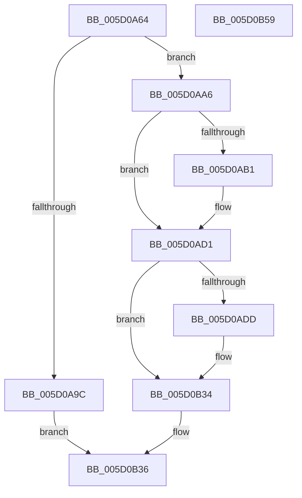

# PpmTraceExitLatency

- RVA: `0x005D0A64`–`0x005D0B5A` (길이 `246` bytes)
- VA: `0x00000001405D0A64`
- 실행 섹션: `.text`
- PDB 이름 있음: `예`; PDB Function 태그: `아니요`
- unwind 정보 RVA: `0x000CBF04`
- 디코드: `59`개 명령, `246/246` bytes 표시
- 미해석 바이트: `0` (있으면 어셈블리에 `.byte`로 보존)

> 이 문서는 커널 이미지의 기계어와 PDB 기호를 분석해 생성했습니다. 4번과 5번은 함수 원형과 자료형을 바이너리 사용 방식에서 추정한 C 해석이며 원본 소스 복구 결과는 아닙니다.

## 1. Dependencies

- 직접 호출 지점: **4**; 고유 호출 대상: **4**
- 직접 호출자로 확인된 함수: **1**
- RIP 상대 이미지 참조: **3**

### Outgoing calls
- `0x005D0AB3` → [KeQueryPerformanceCounter](../37/KeQueryPerformanceCounter_function_0037E7E0.md) (function, `0x0037E7E0`)
- `0x005D0AC8` → [PpmConvertTimeTo](../43/PpmConvertTimeTo_function_0043B3CC.md) (function, `0x0043B3CC`)
- `0x005D0B2F` → [EtwTraceKernelEvent](../23/EtwTraceKernelEvent_function_00235350.md) (function, `0x00235350`)
- `0x005D0B3E` → [_security_check_cookie](../6A/_security_check_cookie_function_006AC640.md) (function, `0x006AC640`)

### Direct callers
- [PpmIdleExecuteTransition](../2D/PpmIdleExecuteTransition_function_002D0A1C.md) at `0x002D1222`

### Static image references
- `0x005D0A78` → RVA `0x00E0A740` (`.data`; read)
- `0x005D0A87` → RVA `0x00E0B3E8` (`.data`; read)
- `0x005D0AD1` → RVA `0x00FC6B08` (`ALMOSTRO`; read)

## 2. Other-region calls and transfers

- 다른 실행 섹션으로 향하는 call: **0**
- 별도 외부 분기/꼬리 이동을 확인하지 못했습니다.

## 3. Assembly (complete function range)

```asm
005D0A64  48 89 5C 24 08                  mov qword ptr [rsp + 8], rbx
005D0A69  48 89 6C 24 10                  mov qword ptr [rsp + 0x10], rbp
005D0A6E  48 89 74 24 18                  mov qword ptr [rsp + 0x18], rsi
005D0A73  57                              push rdi
005D0A74  48 83 EC 60                     sub rsp, 0x60
005D0A78  48 8B 05 C1 9C 83 00            mov rax, qword ptr [rip + 0x839cc1]
005D0A7F  48 33 C4                        xor rax, rsp
005D0A82  48 89 44 24 58                  mov qword ptr [rsp + 0x58], rax
005D0A87  8B 05 5B A9 83 00               mov eax, dword ptr [rip + 0x83a95b]
005D0A8D  83 CD FF                        or ebp, 0xffffffff
005D0A90  41 8B F8                        mov edi, r8d
005D0A93  8B F2                           mov esi, edx
005D0A95  44 8B CD                        mov r9d, ebp
005D0A98  3B C5                           cmp eax, ebp
005D0A9A  75 0A                           jne 0x1405d0aa6
005D0A9C  B8 76 04 00 C0                  mov eax, 0xc0000476
005D0AA1  E9 90 00 00 00                  jmp 0x1405d0b36
005D0AA6  8B 9C 24 90 00 00 00            mov ebx, dword ptr [rsp + 0x90]
005D0AAD  3B DD                           cmp ebx, ebp
005D0AAF  74 20                           je 0x1405d0ad1
005D0AB1  33 C9                           xor ecx, ecx
005D0AB3  E8 28 DD DA FF                  call 0x14037e7e0
005D0AB8  48 2B 84 24 98 00 00 00         sub rax, qword ptr [rsp + 0x98]
005D0AC0  BA 80 96 98 00                  mov edx, 0x989680
005D0AC5  48 8B C8                        mov rcx, rax
005D0AC8  E8 FF A8 E6 FF                  call 0x14043b3cc
005D0ACD  44 8D 0C 03                     lea r9d, [rbx + rax]
005D0AD1  F7 05 2D 60 9F 00 00 00 00 04   test dword ptr [rip + 0x9f602d], 0x4000000
005D0ADB  74 57                           je 0x1405d0b34
005D0ADD  33 D2                           xor edx, edx
005D0ADF  44 89 4C 24 40                  mov dword ptr [rsp + 0x40], r9d
005D0AE4  3B DD                           cmp ebx, ebp
005D0AE6  89 7C 24 34                     mov dword ptr [rsp + 0x34], edi
005D0AEA  B9 04 00 00 00                  mov ecx, 4
005D0AEF  89 74 24 38                     mov dword ptr [rsp + 0x38], esi
005D0AF3  0F 45 CA                        cmovne ecx, edx
005D0AF6  89 5C 24 3C                     mov dword ptr [rsp + 0x3c], ebx
005D0AFA  89 4C 24 30                     mov dword ptr [rsp + 0x30], ecx
005D0AFE  48 8D 44 24 30                  lea rax, [rsp + 0x30]
005D0B03  48 8D 4C 24 48                  lea rcx, [rsp + 0x48]
005D0B08  48 89 44 24 48                  mov qword ptr [rsp + 0x48], rax
005D0B0D  41 B9 3C 12 00 00               mov r9d, 0x123c
005D0B13  48 C7 44 24 50 14 00 00 00      mov qword ptr [rsp + 0x50], 0x14
005D0B1C  BA 01 00 00 00                  mov edx, 1
005D0B21  C7 44 24 20 02 06 00 00         mov dword ptr [rsp + 0x20], 0x602
005D0B29  41 B8 00 00 00 44               mov r8d, 0x44000000
005D0B2F  E8 1C 48 C6 FF                  call 0x140235350
005D0B34  33 C0                           xor eax, eax
005D0B36  48 8B 4C 24 58                  mov rcx, qword ptr [rsp + 0x58]
005D0B3B  48 33 CC                        xor rcx, rsp
005D0B3E  E8 FD BA 0D 00                  call 0x1406ac640
005D0B43  4C 8D 5C 24 60                  lea r11, [rsp + 0x60]
005D0B48  49 8B 5B 10                     mov rbx, qword ptr [r11 + 0x10]
005D0B4C  49 8B 6B 18                     mov rbp, qword ptr [r11 + 0x18]
005D0B50  49 8B 73 20                     mov rsi, qword ptr [r11 + 0x20]
005D0B54  49 8B E3                        mov rsp, r11
005D0B57  5F                              pop rdi
005D0B58  C3                              ret
005D0B59  CC                              int3
```

## 4. C-style interpretation (structured pseudocode)

```c
__int64 __fastcall PpmTraceExitLatency(int a1, int a2, int a3, __int64 a4, unsigned int a5, __int64 a6)
{
    __int64 result;
    __int64 v_rbp;
    __int64 v_rsp;
    unsigned __int64 v_stack_m10;
    unsigned __int64 v_stack_m18;
    unsigned __int64 v_stack_m20;
    unsigned int v_stack_m28;
    unsigned int v_stack_m2C;
    unsigned int v_stack_m30;
    unsigned int v_stack_m34;
    unsigned int v_stack_m38;
    unsigned int v_stack_m48;
    unsigned __int64 v_stack_m8;
    unsigned __int64 v_stack_p10;
    unsigned __int64 v_stack_p18;
    unsigned __int64 v_stack_p8;

    v_stack_p8 = v_rbx;
    v_stack_p10 = v_rbp;
    v_stack_p18 = v_rsi;
    v_rsp = (v_rsp) - (96);
    result = (*(unsigned __int64 *)(v_rip + 8625345)) ^ (v_rsp);
    v_stack_m10 = result;
    v_rbp = (unsigned int)((v_rbp) | (0xFFFFFFFFULL));
    if (((unsigned int)((unsigned int)(*(unsigned int *)(v_rip + 8628571)))) != ((unsigned int)(v_rbp))) goto loc_005D0AA6;
    goto loc_005D0B36;
loc_005D0AA6:
    result = (unsigned int)(0xC0000476ULL);
    if (((unsigned int)((unsigned int)(a5))) != ((unsigned int)(v_rbp))) {
        a1 = 0;
        result = KeQueryPerformanceCounter(a1, a2, a3, (unsigned int)((unsigned int)(v_rbp)));
        result = (result) - (a6);
        a2 = 0x989680ULL;
        a1 = result;
        result = PpmConvertTimeTo(a1, a2, a3, (unsigned int)((unsigned int)(v_rbp)));
        a4 = (unsigned int)(a5) + result * 1;
    }
    if (((*(unsigned int *)(v_rip + 10444845)) & (0x4000000ULL)) != 0) {
        a2 = 0;
        v_stack_m28 = (unsigned int)(a4);
        v_stack_m34 = (unsigned int)((unsigned int)(a3));
        a1 = 4;
        v_stack_m30 = (unsigned int)((unsigned int)(a2));
        if (((unsigned int)((unsigned int)(a5))) != ((unsigned int)(v_rbp))) { a1 = 0; }
        v_stack_m2C = (unsigned int)((unsigned int)(a5));
        v_stack_m38 = a1;
        result = v_stack_m38;
        a1 = v_stack_m20;
        v_stack_m20 = result;
        a4 = 0x123CULL;
        v_stack_m18 = 20;
        a2 = 1;
        v_stack_m48 = 0x602ULL;
        a3 = 0x44000000ULL;
        result = EtwTraceKernelEvent(a1, a2, a3, a4);
    }
    result = 0;
loc_005D0B36:
    a1 = (v_stack_m10) ^ (v_rsp);
    result = _security_check_cookie(a1, a2, a3, a4);
    return result;
}
```

## 5. (Beta) C Style

```c
int64_t PpmTraceExitLatency(int32_t Arg1, int32_t Arg2, int32_t Arg3, int64_t Arg4, uint32_t Arg5, int64_t Arg6)
{
    int64_t result;
    int64_t local_rbp;
    int64_t local_rsp;
    uint64_t v_stack_m10;
    uint64_t v_stack_m18;
    uint64_t v_stack_m20;
    uint32_t v_stack_m28;
    uint32_t v_stack_m2C;
    uint32_t v_stack_m30;
    uint32_t v_stack_m34;
    uint32_t v_stack_m38;
    uint32_t v_stack_m48;
    uint64_t v_stack_m8;
    uint64_t v_stack_p10;
    uint64_t v_stack_p18;
    uint64_t v_stack_p8;

    v_stack_p8 = local_rbx;
    v_stack_p10 = local_rbp;
    v_stack_p18 = local_rsi;
    local_rsp = (local_rsp) - (96);
    result = (*(uint64_t *)(v_rip + 0x839CC1)) ^ (local_rsp);
    v_stack_m10 = result;
    local_rbp = (uint32_t)((local_rbp) | (0xFFFFFFFFULL));
    if (((uint32_t)((uint32_t)(*(uint32_t *)(v_rip + 0x83A95B)))) != ((uint32_t)(local_rbp))) goto loc_005D0AA6;
    goto loc_005D0B36;
loc_005D0AA6:
    result = (uint32_t)(0xC0000476ULL);
    if (((uint32_t)((uint32_t)(Arg5))) != ((uint32_t)(local_rbp))) {
        Arg1 = 0;
        result = KeQueryPerformanceCounter(Arg1, Arg2, Arg3, (uint32_t)((uint32_t)(local_rbp)));
        result = (result) - (Arg6);
        Arg2 = 0x989680ULL;
        Arg1 = result;
        result = PpmConvertTimeTo(Arg1, Arg2, Arg3, (uint32_t)((uint32_t)(local_rbp)));
        Arg4 = (uint32_t)(Arg5) + result * 1;
    }
    if (((*(uint32_t *)(v_rip + 0x9F602D)) & (0x4000000ULL)) != 0) {
        Arg2 = 0;
        v_stack_m28 = (uint32_t)(Arg4);
        v_stack_m34 = (uint32_t)((uint32_t)(Arg3));
        Arg1 = 4;
        v_stack_m30 = (uint32_t)((uint32_t)(Arg2));
        if (((uint32_t)((uint32_t)(Arg5))) != ((uint32_t)(local_rbp))) { Arg1 = 0; }
        v_stack_m2C = (uint32_t)((uint32_t)(Arg5));
        v_stack_m38 = Arg1;
        result = v_stack_m38;
        Arg1 = v_stack_m20;
        v_stack_m20 = result;
        Arg4 = 0x123CULL;
        v_stack_m18 = 20;
        Arg2 = 1;
        v_stack_m48 = 0x602ULL;
        Arg3 = 0x44000000ULL;
        result = EtwTraceKernelEvent(Arg1, Arg2, Arg3, Arg4);
    }
    result = 0;
loc_005D0B36:
    Arg1 = (v_stack_m10) ^ (local_rsp);
    result = _security_check_cookie(Arg1, Arg2, Arg3, Arg4);
    return result;
}
```

## 6. Execution-region graph

[열기: 2D/3D 그래프와 함수 탐색 컨트롤 패널](../../../control-panel.html?section=text&rva=0x005D0A64&view=graph)

- 2D 그래프는 위에서 아래로 흐르고, 3D 그래프는 빈 공간을 드래그해 회전합니다. Shift+드래그는 이동, 휠은 확대·축소, 함수 노드 선택은 대상 보고서 이동입니다.

### Static fallback


