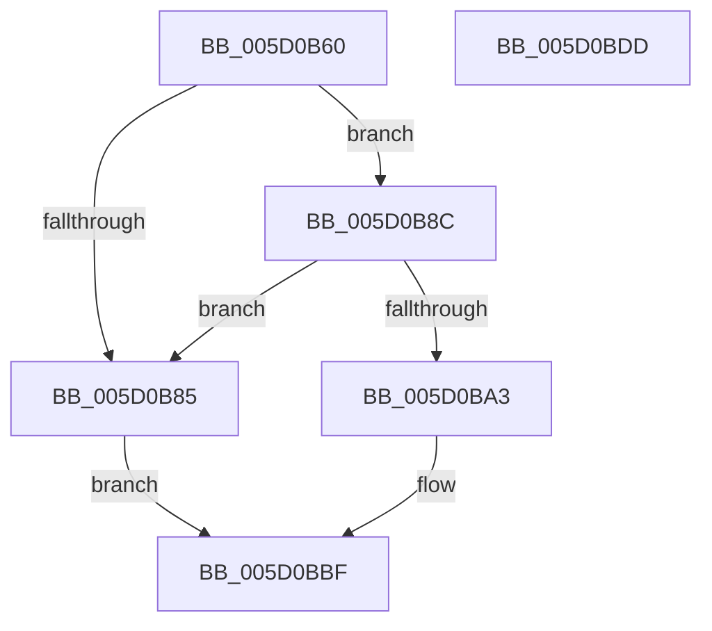

# PpmUpdateIdleDomains

- RVA: `0x005D0B60`–`0x005D0BDE` (길이 `126` bytes)
- VA: `0x00000001405D0B60`
- 실행 섹션: `.text`
- PDB 이름 있음: `예`; PDB Function 태그: `아니요`
- unwind 정보 RVA: `0x00060BC4`
- 디코드: `35`개 명령, `126/126` bytes 표시
- 미해석 바이트: `0` (있으면 어셈블리에 `.byte`로 보존)

> 이 문서는 커널 이미지의 기계어와 PDB 기호를 분석해 생성했습니다. 4번과 5번은 함수 원형과 자료형을 바이너리 사용 방식에서 추정한 C 해석이며 원본 소스 복구 결과는 아닙니다.

## 1. Dependencies

- 직접 호출 지점: **4**; 고유 호출 대상: **4**
- 직접 호출자로 확인된 함수: **0**
- RIP 상대 이미지 참조: **3**

### Outgoing calls
- `0x005D0B79` → [PopAcquireRwLockExclusive](../43/PopAcquireRwLockExclusive_function_00430B44.md) (function, `0x00430B44`)
- `0x005D0B9A` → [KeIsSubsetAffinityEx](../2C/KeIsSubsetAffinityEx_function_002CDC80.md) (function, `0x002CDC80`)
- `0x005D0BB3` → [PopExecuteOnTargetProcessors](../2D/PopExecuteOnTargetProcessors_function_002DD834.md) (function, `0x002DD834`)
- `0x005D0BC6` → [PopReleaseRwLock](../2D/PopReleaseRwLock_function_002DFBBC.md) (function, `0x002DFBBC`)

### Direct callers
- 이 함수 시작 RVA로 연결되는 직접 call은 확인되지 않았습니다. 간접 호출은 완전히 역산할 수 없습니다.

### Static image references
- `0x005D0B72` → RVA `0x00F0CA70` (`.data`; read)
- `0x005D0B93` → RVA `0x00FC7120` (`ALMOSTRO`; read)
- `0x005D0BA6` → RVA `0x005D0660` (`PpmInstallNewIdleDomains`; read)

## 2. Other-region calls and transfers

- 다른 실행 섹션으로 향하는 call: **0**
- 별도 외부 분기/꼬리 이동을 확인하지 못했습니다.

## 3. Assembly (complete function range)

```asm
005D0B60  48 89 5C 24 08                  mov qword ptr [rsp + 8], rbx
005D0B65  48 89 74 24 10                  mov qword ptr [rsp + 0x10], rsi
005D0B6A  57                              push rdi
005D0B6B  48 83 EC 20                     sub rsp, 0x20
005D0B6F  48 8B D9                        mov rbx, rcx
005D0B72  48 8D 0D F7 BE 93 00            lea rcx, [rip + 0x93bef7]
005D0B79  E8 C6 FF E5 FF                  call 0x140430b44
005D0B7E  33 F6                           xor esi, esi
005D0B80  48 85 DB                        test rbx, rbx
005D0B83  75 07                           jne 0x1405d0b8c
005D0B85  BB 0D 00 00 C0                  mov ebx, 0xc000000d
005D0B8A  EB 33                           jmp 0x1405d0bbf
005D0B8C  48 8D 7B 08                     lea rdi, [rbx + 8]
005D0B90  48 8B CF                        mov rcx, rdi
005D0B93  48 8D 15 86 65 9F 00            lea rdx, [rip + 0x9f6586]
005D0B9A  E8 E1 D0 CF FF                  call 0x1402cdc80
005D0B9F  85 C0                           test eax, eax
005D0BA1  74 E2                           je 0x1405d0b85
005D0BA3  4C 8B CF                        mov r9, rdi
005D0BA6  48 8D 15 B3 FA FF FF            lea rdx, [rip - 0x54d]
005D0BAD  4C 8B C3                        mov r8, rbx
005D0BB0  48 8B CF                        mov rcx, rdi
005D0BB3  E8 7C CC D0 FF                  call 0x1402dd834
005D0BB8  85 C0                           test eax, eax
005D0BBA  8B D8                           mov ebx, eax
005D0BBC  0F 49 DE                        cmovns ebx, esi
005D0BBF  48 8D 0D AA BE 93 00            lea rcx, [rip + 0x93beaa]
005D0BC6  E8 F1 EF D0 FF                  call 0x1402dfbbc
005D0BCB  48 8B 74 24 38                  mov rsi, qword ptr [rsp + 0x38]
005D0BD0  8B C3                           mov eax, ebx
005D0BD2  48 8B 5C 24 30                  mov rbx, qword ptr [rsp + 0x30]
005D0BD7  48 83 C4 20                     add rsp, 0x20
005D0BDB  5F                              pop rdi
005D0BDC  C3                              ret
005D0BDD  CC                              int3
```

## 4. C-style interpretation (structured pseudocode)

```c
__int64 __fastcall PpmUpdateIdleDomains(__int64 a1)
{
    __int64 result;
    __int64 v_rbx;
    __int64 v_rsi;
    __int64 v_rsp;
    unsigned __int64 v_stack_p10;
    unsigned __int64 v_stack_p8;

    v_stack_p8 = v_rbx;
    v_stack_p10 = v_rsi;
    v_rsp = (v_rsp) - (32);
    result = PopAcquireRwLockExclusive(v_rip + 9682679, a2, a3, a4);
    v_rsi = 0;
    if (a1 != 0) goto loc_005D0B8C;
loc_005D0B85:
    goto loc_005D0BBF;
loc_005D0B8C:
    result = KeIsSubsetAffinityEx((unsigned int)(0xC000000DULL) + 8, v_rip + 10446214, a3, a4);
    if ((unsigned int)(result) == 0) goto loc_005D0B85;
    result = PopExecuteOnTargetProcessors((unsigned int)(0xC000000DULL) + 8, v_rip - 1357, (unsigned int)(0xC000000DULL), (unsigned int)(0xC000000DULL) + 8);
    v_rbx = (unsigned int)((unsigned int)(result));
    if (!sign_flag) { v_rbx = 0; }
loc_005D0BBF:
    result = PopReleaseRwLock(v_rip + 9682602, v_rip - 1357, (unsigned int)(0xC000000DULL), (unsigned int)(0xC000000DULL) + 8);
    v_rsp = (v_rsp) + (32);
    return (unsigned int)((unsigned int)(v_rbx));
}
```

## 5. (Beta) C Style

```c
int64_t PpmUpdateIdleDomains(int64_t Arg1)
{
    int64_t result;
    int64_t local_rbx;
    int64_t local_rsi;
    int64_t local_rsp;
    uint64_t v_stack_p10;
    uint64_t v_stack_p8;

    v_stack_p8 = local_rbx;
    v_stack_p10 = local_rsi;
    local_rsp = (local_rsp) - (32);
    result = PopAcquireRwLockExclusive(v_rip + 9682679, a2, a3, a4);
    local_rsi = 0;
    if (Arg1 != 0) goto loc_005D0B8C;
loc_005D0B85:
    goto loc_005D0BBF;
loc_005D0B8C:
    result = KeIsSubsetAffinityEx((uint32_t)(0xC000000DULL) + 8, v_rip + 10446214, a3, a4);
    if ((uint32_t)(result) == 0) goto loc_005D0B85;
    result = PopExecuteOnTargetProcessors((uint32_t)(0xC000000DULL) + 8, v_rip - 1357, (uint32_t)(0xC000000DULL), (uint32_t)(0xC000000DULL) + 8);
    local_rbx = (uint32_t)((uint32_t)(result));
    if (!sign_flag) { local_rbx = 0; }
loc_005D0BBF:
    result = PopReleaseRwLock(v_rip + 9682602, v_rip - 1357, (uint32_t)(0xC000000DULL), (uint32_t)(0xC000000DULL) + 8);
    local_rsp = (local_rsp) + (32);
    return (uint32_t)((uint32_t)(local_rbx));
}
```

## 6. Execution-region graph

[열기: 2D/3D 그래프와 함수 탐색 컨트롤 패널](../../../control-panel.html?section=text&rva=0x005D0B60&view=graph)

- 2D 그래프는 위에서 아래로 흐르고, 3D 그래프는 빈 공간을 드래그해 회전합니다. Shift+드래그는 이동, 휠은 확대·축소, 함수 노드 선택은 대상 보고서 이동입니다.

### Static fallback


