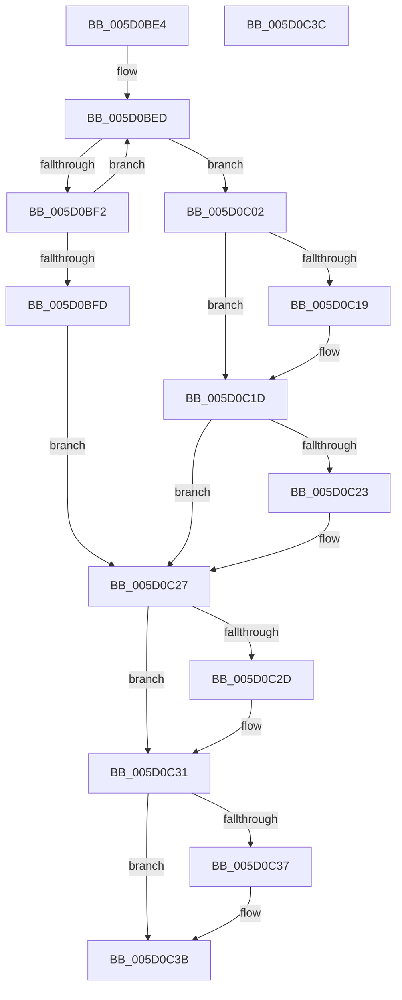

# PpmUpdatePlatformIdleAccounting

- RVA: `0x005D0BE4`–`0x005D0C3D` (길이 `89` bytes)
- VA: `0x00000001405D0BE4`
- 실행 섹션: `.text`
- PDB 이름 있음: `예`; PDB Function 태그: `아니요`
- unwind 정보 RVA: `0x000DB714`
- 디코드: `29`개 명령, `89/89` bytes 표시
- 미해석 바이트: `0` (있으면 어셈블리에 `.byte`로 보존)

> 이 문서는 커널 이미지의 기계어와 PDB 기호를 분석해 생성했습니다. 4번과 5번은 함수 원형과 자료형을 바이너리 사용 방식에서 추정한 C 해석이며 원본 소스 복구 결과는 아닙니다.

## 1. Dependencies

- 직접 호출 지점: **0**; 고유 호출 대상: **0**
- 직접 호출자로 확인된 함수: **1**
- RIP 상대 이미지 참조: **1**

### Outgoing calls
- 직접 디코드된 call 명령이 없습니다.

### Direct callers
- [sub_006DD378](../6D/Unknown_function_006DD378.md) at `0x006DD5F9`

### Static image references
- `0x005D0BE6` → RVA `0x00FC5730` (`ALMOSTRO`; read)

## 2. Other-region calls and transfers

- 다른 실행 섹션으로 향하는 call: **0**
- 별도 외부 분기/꼬리 이동을 확인하지 못했습니다.

## 3. Assembly (complete function range)

```asm
005D0BE4  33 C0                           xor eax, eax
005D0BE6  4C 8D 05 43 4B 9F 00            lea r8, [rip + 0x9f4b43]
005D0BED  49 3B 10                        cmp rdx, qword ptr [r8]
005D0BF0  72 10                           jb 0x1405d0c02
005D0BF2  FF C0                           inc eax
005D0BF4  49 83 C0 18                     add r8, 0x18
005D0BF8  83 F8 1A                        cmp eax, 0x1a
005D0BFB  72 F0                           jb 0x1405d0bed
005D0BFD  FF 41 28                        inc dword ptr [rcx + 0x28]
005D0C00  EB 25                           jmp 0x1405d0c27
005D0C02  48 83 C0 06                     add rax, 6
005D0C06  48 C1 E0 05                     shl rax, 5
005D0C0A  48 03 C1                        add rax, rcx
005D0C0D  48 01 10                        add qword ptr [rax], rdx
005D0C10  FF 40 18                        inc dword ptr [rax + 0x18]
005D0C13  48 3B 50 08                     cmp rdx, qword ptr [rax + 8]
005D0C17  73 04                           jae 0x1405d0c1d
005D0C19  48 89 50 08                     mov qword ptr [rax + 8], rdx
005D0C1D  48 3B 50 10                     cmp rdx, qword ptr [rax + 0x10]
005D0C21  76 04                           jbe 0x1405d0c27
005D0C23  48 89 50 10                     mov qword ptr [rax + 0x10], rdx
005D0C27  48 3B 51 18                     cmp rdx, qword ptr [rcx + 0x18]
005D0C2B  73 04                           jae 0x1405d0c31
005D0C2D  48 89 51 18                     mov qword ptr [rcx + 0x18], rdx
005D0C31  48 3B 51 10                     cmp rdx, qword ptr [rcx + 0x10]
005D0C35  76 04                           jbe 0x1405d0c3b
005D0C37  48 89 51 10                     mov qword ptr [rcx + 0x10], rdx
005D0C3B  C3                              ret
005D0C3C  CC                              int3
```

## 4. C-style interpretation (structured pseudocode)

```c
__int64 __fastcall PpmUpdatePlatformIdleAccounting(__int64 a1, __int64 a2)
{
    __int64 result;

    result = 0;
loc_005D0BED:
    if (a2 < (*(unsigned __int64 *)(v_rip + 10439491))) goto loc_005D0C02;
    result = (unsigned int)((result) + 1);
    a3 = (v_rip + 10439491) + (24);
    if (((unsigned int)(result)) < 26) goto loc_005D0BED;
    goto loc_005D0C27;
loc_005D0C02:
    result = (result) + (6);
    result = (result) << (5);
    result = (result) + (a1);
    if (a2 < (*(unsigned __int64 *)(result + 8))) {
        *(unsigned __int64 *)(result + 8) = a2;
    }
    if (a2 >= = (*(unsigned __int64 *)(result + 16))) {
        *(unsigned __int64 *)(result + 16) = a2;
    }
    if (a2 < (*(unsigned __int64 *)(a1 + 24))) {
        *(unsigned __int64 *)(a1 + 24) = a2;
    }
    if (a2 >= = (*(unsigned __int64 *)(a1 + 16))) {
        *(unsigned __int64 *)(a1 + 16) = a2;
    }
    return result;
}
```

## 5. (Beta) C Style

```c
int64_t PpmUpdatePlatformIdleAccounting(void *Arg1, int64_t Arg2)
{
    uint8_t *arg1 = (uint8_t *)Arg1;

    int64_t result;

    result = 0;
loc_005D0BED:
    if (Arg2 < (*(uint64_t *)(v_rip + 0x9F4B43))) goto loc_005D0C02;
    result = (uint32_t)((result) + 1);
    a3 = (v_rip + 10439491) + (24);
    if (((uint32_t)(result)) < 26) goto loc_005D0BED;
    goto loc_005D0C27;
loc_005D0C02:
    result = (result) + (6);
    result = (result) << (5);
    result = (result) + (Arg1);
    if (Arg2 < (*(uint64_t *)(result + 0x8))) {
        *(uint64_t *)(result + 0x8) = Arg2;
    }
    if (Arg2 >= = (*(uint64_t *)(result + 0x10))) {
        *(uint64_t *)(result + 0x10) = Arg2;
    }
    if (Arg2 < (*(uint64_t *)(arg1 + 0x18))) {
        *(uint64_t *)(arg1 + 0x18) = Arg2;
    }
    if (Arg2 >= = (*(uint64_t *)(arg1 + 0x10))) {
        *(uint64_t *)(arg1 + 0x10) = Arg2;
    }
    return result;
}
```

### 관측된 메모리 오프셋

구조체 형식이 확인되지 않은 접근은 인자 기준의 오프셋으로만 기록했습니다.

| 기준 인자 | 오프셋 표현 | 폭 (bit) | 접근 |
|---|---:|---:|---|
| `Arg1` | `+ 0x10` | `64` | `R` |
| `Arg1` | `+ 0x10` | `64` | `W` |
| `Arg1` | `+ 0x18` | `64` | `R` |
| `Arg1` | `+ 0x18` | `64` | `W` |
| `Arg1` | `+ 0x28` | `32` | `R/W` |

## 6. Execution-region graph

[열기: 2D/3D 그래프와 함수 탐색 컨트롤 패널](../../../control-panel.html?section=text&rva=0x005D0BE4&view=graph)

- 2D 그래프는 위에서 아래로 흐르고, 3D 그래프는 빈 공간을 드래그해 회전합니다. Shift+드래그는 이동, 휠은 확대·축소, 함수 노드 선택은 대상 보고서 이동입니다.

### Static fallback


