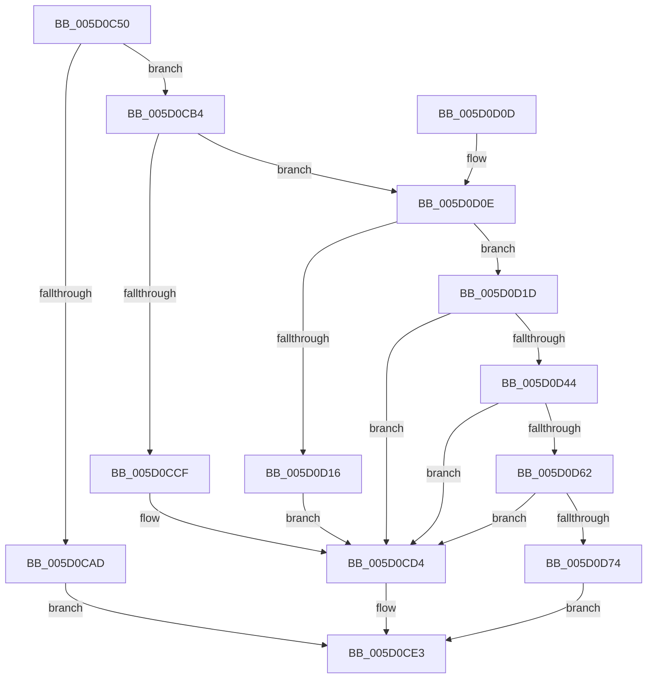

# PpmUpdateProcessorIdleVeto

- RVA: `0x005D0C50`–`0x005D0DCB` (길이 `379` bytes)
- VA: `0x00000001405D0C50`
- 실행 섹션: `.text`
- PDB 이름 있음: `예`; PDB Function 태그: `아니요`
- unwind 정보 RVA: `0x000CBEA4`
- 디코드: `91`개 명령, `379/379` bytes 표시
- 미해석 바이트: `0` (있으면 어셈블리에 `.byte`로 보존)

> 이 문서는 커널 이미지의 기계어와 PDB 기호를 분석해 생성했습니다. 4번과 5번은 함수 원형과 자료형을 바이너리 사용 방식에서 추정한 C 해석이며 원본 소스 복구 결과는 아닙니다.

## 1. Dependencies

- 직접 호출 지점: **12**; 고유 호출 대상: **10**
- 직접 호출자로 확인된 함수: **0**
- RIP 상대 이미지 참조: **3**

### Outgoing calls
- `0x005D0C8C` → [memset](../6C/memset_function_006C6C40.md) (function, `0x006C6C40`)
- `0x005D0C95` → [KeGetProcessorIndexFromNumber](../2D/KeGetProcessorIndexFromNumber_function_002DD2D0.md) (function, `0x002DD2D0`)
- `0x005D0C9F` → [KeGetPrcb](../2D/KeGetPrcb_function_002D85D0.md) (function, `0x002D85D0`)
- `0x005D0CBB` → [KeAcquireSpinLockRaiseToDpc](../20/KeAcquireSpinLockRaiseToDpc_function_00208470.md) (function, `0x00208470`)
- `0x005D0CDE` → [KeReleaseSpinLock](../39/KeReleaseSpinLock_function_00392BA0.md) (function, `0x00392BA0`)
- `0x005D0CF0` → [_security_check_cookie](../6A/_security_check_cookie_function_006AC640.md) (function, `0x006AC640`)
- `0x005D0D39` → [PpmUpdateIdleVeto](../30/PpmUpdateIdleVeto_function_00304930.md) (function, `0x00304930`)
- `0x005D0D52` → [PpmEventProcessorVetoRequest](PpmEventProcessorVetoRequest_function_005DB244.md) (function, `0x005DB244`)
- `0x005D0D7E` → [KeReleaseSpinLock](../39/KeReleaseSpinLock_function_00392BA0.md) (function, `0x00392BA0`)
- `0x005D0D9D` → [memset](../6C/memset_function_006C6C40.md) (function, `0x006C6C40`)
- `0x005D0DAA` → [KeAddProcessorAffinityEx](../25/KeAddProcessorAffinityEx_function_0025B6F0.md) (function, `0x0025B6F0`)
- `0x005D0DC1` → [PopExecuteOnTargetProcessors](../2D/PopExecuteOnTargetProcessors_function_002DD834.md) (function, `0x002DD834`)

### Direct callers
- 이 함수 시작 RVA로 연결되는 직접 call은 확인되지 않았습니다. 간접 호출은 완전히 역산할 수 없습니다.

### Static image references
- `0x005D0C65` → RVA `0x00E0A740` (`.data`; read)
- `0x005D0CB4` → RVA `0x00F0CA68` (`.data`; read)
- `0x005D0DB2` → RVA `0x0048FDC0` (`HalAdjustResourceList`; read)

## 2. Other-region calls and transfers

- 다른 실행 섹션으로 향하는 call: **0**
- 별도 외부 분기/꼬리 이동을 확인하지 못했습니다.

## 3. Assembly (complete function range)

```asm
005D0C50  48 89 5C 24 10                  mov qword ptr [rsp + 0x10], rbx
005D0C55  48 89 6C 24 18                  mov qword ptr [rsp + 0x18], rbp
005D0C5A  56                              push rsi
005D0C5B  57                              push rdi
005D0C5C  41 56                           push r14
005D0C5E  48 81 EC 50 01 00 00            sub rsp, 0x150
005D0C65  48 8B 05 D4 9A 83 00            mov rax, qword ptr [rip + 0x839ad4]
005D0C6C  48 33 C4                        xor rax, rsp
005D0C6F  48 89 84 24 40 01 00 00         mov qword ptr [rsp + 0x140], rax
005D0C77  48 8B F9                        mov rdi, rcx
005D0C7A  C6 44 24 20 00                  mov byte ptr [rsp + 0x20], 0
005D0C7F  48 8D 4C 24 38                  lea rcx, [rsp + 0x38]
005D0C84  33 D2                           xor edx, edx
005D0C86  41 B8 00 01 00 00               mov r8d, 0x100
005D0C8C  E8 AF 5F 0F 00                  call 0x1406c6c40
005D0C91  48 8D 4F 04                     lea rcx, [rdi + 4]
005D0C95  E8 36 C6 D0 FF                  call 0x1402dd2d0
005D0C9A  8B C8                           mov ecx, eax
005D0C9C  44 8B F0                        mov r14d, eax
005D0C9F  E8 2C 79 D0 FF                  call 0x1402d85d0
005D0CA4  48 8B F0                        mov rsi, rax
005D0CA7  41 83 FE FF                     cmp r14d, -1
005D0CAB  75 07                           jne 0x1405d0cb4
005D0CAD  BB 0D 00 00 C0                  mov ebx, 0xc000000d
005D0CB2  EB 2F                           jmp 0x1405d0ce3
005D0CB4  48 8D 0D AD BD 93 00            lea rcx, [rip + 0x93bdad]
005D0CBB  E8 B0 77 C3 FF                  call 0x140208470
005D0CC0  48 8B 96 40 88 00 00            mov rdx, qword ptr [rsi + 0x8840]
005D0CC7  40 8A E8                        mov bpl, al
005D0CCA  48 85 D2                        test rdx, rdx
005D0CCD  75 3F                           jne 0x1405d0d0e
005D0CCF  BB BB 00 00 C0                  mov ebx, 0xc00000bb
005D0CD4  40 8A D5                        mov dl, bpl
005D0CD7  48 8D 0D 8A BD 93 00            lea rcx, [rip + 0x93bd8a]
005D0CDE  E8 BD 1E DC FF                  call 0x140392ba0
005D0CE3  8B C3                           mov eax, ebx
005D0CE5  48 8B 8C 24 40 01 00 00         mov rcx, qword ptr [rsp + 0x140]
005D0CED  48 33 CC                        xor rcx, rsp
005D0CF0  E8 4B B9 0D 00                  call 0x1406ac640
005D0CF5  4C 8D 9C 24 50 01 00 00         lea r11, [rsp + 0x150]
005D0CFD  49 8B 5B 28                     mov rbx, qword ptr [r11 + 0x28]
005D0D01  49 8B 6B 30                     mov rbp, qword ptr [r11 + 0x30]
005D0D05  49 8B E3                        mov rsp, r11
005D0D08  41 5E                           pop r14
005D0D0A  5F                              pop rdi
005D0D0B  5E                              pop rsi
005D0D0C  C3                              ret
005D0D0D  CC                              int3
005D0D0E  8B 47 08                        mov eax, dword ptr [rdi + 8]
005D0D11  3B 42 28                        cmp eax, dword ptr [rdx + 0x28]
005D0D14  72 07                           jb 0x1405d0d1d
005D0D16  BB 0D 00 00 C0                  mov ebx, 0xc000000d
005D0D1B  EB B7                           jmp 0x1405d0cd4
005D0D1D  8A 4F 10                        mov cl, byte ptr [rdi + 0x10]
005D0D20  4C 8D 4C 24 20                  lea r9, [rsp + 0x20]
005D0D25  4C 69 C0 58 01 00 00            imul r8, rax, 0x158
005D0D2C  49 81 C0 48 05 00 00            add r8, 0x548
005D0D33  4C 03 C2                        add r8, rdx
005D0D36  8B 57 0C                        mov edx, dword ptr [rdi + 0xc]
005D0D39  E8 F2 3B D3 FF                  call 0x140304930
005D0D3E  8B D8                           mov ebx, eax
005D0D40  85 C0                           test eax, eax
005D0D42  78 90                           js 0x1405d0cd4
005D0D44  44 8A 4F 10                     mov r9b, byte ptr [rdi + 0x10]
005D0D48  48 8B CE                        mov rcx, rsi
005D0D4B  44 8B 47 0C                     mov r8d, dword ptr [rdi + 0xc]
005D0D4F  8B 57 08                        mov edx, dword ptr [rdi + 8]
005D0D52  E8 ED A4 00 00                  call 0x1405db244
005D0D57  80 7C 24 20 00                  cmp byte ptr [rsp + 0x20], 0
005D0D5C  0F 84 72 FF FF FF               je 0x1405d0cd4
005D0D62  65 48 8B 14 25 20 00 00 00      mov rdx, qword ptr gs:[0x20]
005D0D6B  48 3B F2                        cmp rsi, rdx
005D0D6E  0F 84 60 FF FF FF               je 0x1405d0cd4
005D0D74  40 8A D5                        mov dl, bpl
005D0D77  48 8D 0D EA BC 93 00            lea rcx, [rip + 0x93bcea]
005D0D7E  E8 1D 1E DC FF                  call 0x140392ba0
005D0D83  83 64 24 34 00                  and dword ptr [rsp + 0x34], 0
005D0D88  48 8D 4C 24 38                  lea rcx, [rsp + 0x38]
005D0D8D  33 D2                           xor edx, edx
005D0D8F  C7 44 24 30 01 00 20 00         mov dword ptr [rsp + 0x30], 0x200001
005D0D97  41 B8 00 01 00 00               mov r8d, 0x100
005D0D9D  E8 9E 5E 0F 00                  call 0x1406c6c40
005D0DA2  41 8B D6                        mov edx, r14d
005D0DA5  48 8D 4C 24 30                  lea rcx, [rsp + 0x30]
005D0DAA  E8 41 A9 C8 FF                  call 0x14025b6f0
005D0DAF  45 33 C9                        xor r9d, r9d
005D0DB2  48 8D 15 07 F0 EB FF            lea rdx, [rip - 0x140ff9]
005D0DB9  45 33 C0                        xor r8d, r8d
005D0DBC  48 8D 4C 24 30                  lea rcx, [rsp + 0x30]
005D0DC1  E8 6E CA D0 FF                  call 0x1402dd834
005D0DC6  E9 18 FF FF FF                  jmp 0x1405d0ce3
```

## 4. C-style interpretation (structured pseudocode)

```c
__int64 __fastcall PpmUpdateProcessorIdleVeto(__int64 a1, int a2)
{
    __int64 result;
    __int64 v_rsp;
    unsigned __int64 v_stack_m118;
    unsigned int v_stack_m11C;
    unsigned int v_stack_m120;
    unsigned __int64 v_stack_m130;
    unsigned __int8 v_stack_m148;
    unsigned __int64 v_stack_m18;
    unsigned __int64 v_stack_m28;
    unsigned __int64 v_stack_p10;
    unsigned __int64 v_stack_p18;

    v_stack_p10 = v_rbx;
    v_stack_p18 = v_rbp;
    v_rsp = (v_rsp) - (336);
    result = (*(unsigned __int64 *)(v_rip + 8624852)) ^ (v_rsp);
    v_stack_m28 = result;
    v_stack_m148 = 0;
    a2 = 0;
    result = memset(v_stack_m130, a2, 256, a4);
    result = KeGetProcessorIndexFromNumber(a1 + 4, a2, 256, a4);
    result = KeGetPrcb((unsigned int)((unsigned int)(result)), a2, 256, a4);
    if (((unsigned int)((unsigned int)((unsigned int)(result)))) != -1) goto loc_005D0CB4;
    goto loc_005D0CE3;
loc_005D0CB4:
    result = KeAcquireSpinLockRaiseToDpc(v_rip + 9682349, a2, 256, a4);
    if (*(unsigned __int64 *)(result + 34880) != 0) goto loc_005D0D0E;
loc_005D0CD4:
    result = KeReleaseSpinLock(v_rip + 9682314, (unsigned __int8)((unsigned __int8)(result)), 256, a4);
loc_005D0CE3:
    a1 = (v_stack_m28) ^ (v_rsp);
    result = _security_check_cookie(a1, (unsigned __int8)((unsigned __int8)(result)), 256, a4);
    return result;
loc_005D0D0E:
    if (((unsigned int)((unsigned int)(*(unsigned int *)(a1 + 8)))) < (*(unsigned int *)((unsigned __int8)((unsigned __int8)(result)) + 40))) goto loc_005D0D1D;
    goto loc_005D0CD4;
loc_005D0D1D:
    a3 = (256) * ((unsigned int)(*(unsigned int *)(a1 + 8)));
    a3 = (a3) + (0x548ULL);
    a3 = (a3) + ((unsigned __int8)((unsigned __int8)(result)));
    result = PpmUpdateIdleVeto(*(unsigned __int8 *)(a1 + 16), (unsigned int)(*(unsigned int *)(a1 + 12)), a3, v_stack_m130);
    if (sign_flag) goto loc_005D0CD4;
    result = PpmEventProcessorVetoRequest(result, (unsigned int)(*(unsigned int *)(a1 + 8)), (unsigned int)(*(unsigned int *)(a1 + 12)), *(unsigned __int8 *)(a1 + 16));
    if (v_stack_m130 == 0) goto loc_005D0CD4;
    if (result == (*(unsigned __int64 *)(gs_base + (0 + 32)))) goto loc_005D0CD4;
    result = KeReleaseSpinLock(v_rip + 9682154, (unsigned __int8)(*(unsigned __int64 *)(v_stack_m18 + 48)), (unsigned int)(*(unsigned int *)(a1 + 12)), *(unsigned __int8 *)(a1 + 16));
    a2 = 0;
    v_stack_m120 = 0x200001ULL;
    result = memset(v_stack_m118, a2, 256, *(unsigned __int8 *)(a1 + 16));
    result = KeAddProcessorAffinityEx(v_stack_m120, (unsigned int)((unsigned int)((unsigned int)((unsigned int)(result)))), 256, *(unsigned __int8 *)(a1 + 16));
    a4 = 0;
    a3 = 0;
    result = PopExecuteOnTargetProcessors(v_stack_m120, v_rip - 1314809, a3, a4);
    goto loc_005D0CE3;
}
```

## 5. (Beta) C Style

```c
int64_t PpmUpdateProcessorIdleVeto(void *Arg1, int32_t Arg2)
{
    uint8_t *arg1 = (uint8_t *)Arg1;

    int64_t result;
    int64_t local_rsp;
    uint64_t v_stack_m118;
    uint32_t v_stack_m11C;
    uint32_t v_stack_m120;
    uint64_t v_stack_m130;
    uint8_t v_stack_m148;
    uint64_t v_stack_m18;
    uint64_t v_stack_m28;
    uint64_t v_stack_p10;
    uint64_t v_stack_p18;

    v_stack_p10 = local_rbx;
    v_stack_p18 = local_rbp;
    local_rsp = (local_rsp) - (336);
    result = (*(uint64_t *)(v_rip + 0x839AD4)) ^ (local_rsp);
    v_stack_m28 = result;
    v_stack_m148 = 0;
    Arg2 = 0;
    result = memset(v_stack_m130, Arg2, 256, a4);
    result = KeGetProcessorIndexFromNumber(Arg1 + 4, Arg2, 256, a4);
    result = KeGetPrcb((uint32_t)((uint32_t)(result)), Arg2, 256, a4);
    if (((uint32_t)((uint32_t)((uint32_t)(result)))) != -1) goto loc_005D0CB4;
    goto loc_005D0CE3;
loc_005D0CB4:
    result = KeAcquireSpinLockRaiseToDpc(v_rip + 9682349, Arg2, 256, a4);
    if (*(uint64_t *)(result + 0x8840) != 0) goto loc_005D0D0E;
loc_005D0CD4:
    result = KeReleaseSpinLock(v_rip + 9682314, (uint8_t)((uint8_t)(result)), 256, a4);
loc_005D0CE3:
    Arg1 = (v_stack_m28) ^ (local_rsp);
    result = _security_check_cookie(Arg1, (uint8_t)((uint8_t)(result)), 256, a4);
    return result;
loc_005D0D0E:
    if (((uint32_t)((uint32_t)(*(uint32_t *)(arg1 + 0x8)))) < (*(uint32_t *)((uint8_t)((uint8_t)(result)) + 0x28))) goto loc_005D0D1D;
    goto loc_005D0CD4;
loc_005D0D1D:
    a3 = (256) * ((uint32_t)(*(uint32_t *)(arg1 + 0x8)));
    a3 = (a3) + (0x548ULL);
    a3 = (a3) + ((uint8_t)((uint8_t)(result)));
    result = PpmUpdateIdleVeto(*(uint8_t *)(arg1 + 0x10), (uint32_t)(*(uint32_t *)(arg1 + 0xC)), a3, v_stack_m130);
    if (sign_flag) goto loc_005D0CD4;
    result = PpmEventProcessorVetoRequest(result, (uint32_t)(*(uint32_t *)(arg1 + 0x8)), (uint32_t)(*(uint32_t *)(arg1 + 0xC)), *(uint8_t *)(arg1 + 0x10));
    if (v_stack_m130 == 0) goto loc_005D0CD4;
    if (result == (*(uint64_t *)(gs_base + (0 + 0x20)))) goto loc_005D0CD4;
    result = KeReleaseSpinLock(v_rip + 9682154, (uint8_t)(*(uint64_t *)(v_stack_m18 + 0x30)), (uint32_t)(*(uint32_t *)(arg1 + 0xC)), *(uint8_t *)(arg1 + 0x10));
    Arg2 = 0;
    v_stack_m120 = 0x200001ULL;
    result = memset(v_stack_m118, Arg2, 256, *(uint8_t *)(arg1 + 0x10));
    result = KeAddProcessorAffinityEx(v_stack_m120, (uint32_t)((uint32_t)((uint32_t)((uint32_t)(result)))), 256, *(uint8_t *)(arg1 + 0x10));
    a4 = 0;
    a3 = 0;
    result = PopExecuteOnTargetProcessors(v_stack_m120, v_rip - 1314809, a3, a4);
    goto loc_005D0CE3;
}
```

### 관측된 메모리 오프셋

구조체 형식이 확인되지 않은 접근은 인자 기준의 오프셋으로만 기록했습니다.

| 기준 인자 | 오프셋 표현 | 폭 (bit) | 접근 |
|---|---:|---:|---|
| `Arg1` | `+ 0x4` | `64` | `R` |
| `Arg1` | `+ 0x8` | `32` | `R` |
| `Arg1` | `+ 0xC` | `32` | `R` |
| `Arg1` | `+ 0x10` | `8` | `R` |

## 6. Execution-region graph

[열기: 2D/3D 그래프와 함수 탐색 컨트롤 패널](../../../control-panel.html?section=text&rva=0x005D0C50&view=graph)

- 2D 그래프는 위에서 아래로 흐르고, 3D 그래프는 빈 공간을 드래그해 회전합니다. Shift+드래그는 이동, 휠은 확대·축소, 함수 노드 선택은 대상 보고서 이동입니다.

### Static fallback


