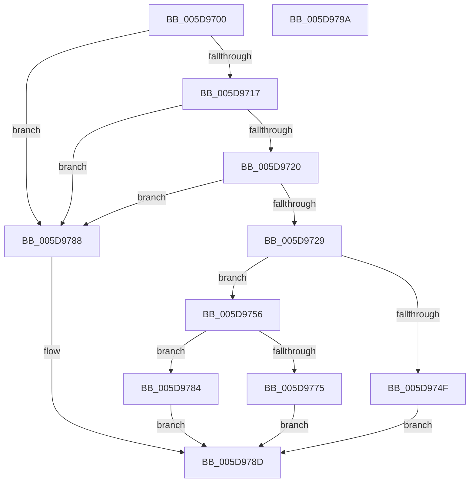

# PpmWmiFireIdleAccountingEvent

- RVA: `0x005D9700`–`0x005D979B` (길이 `155` bytes)
- VA: `0x00000001405D9700`
- 실행 섹션: `.text`
- PDB 이름 있음: `예`; PDB Function 태그: `아니요`
- unwind 정보 RVA: `0x0005CAAC`
- 디코드: `44`개 명령, `155/155` bytes 표시
- 미해석 바이트: `0` (있으면 어셈블리에 `.byte`로 보존)

> 이 문서는 커널 이미지의 기계어와 PDB 기호를 분석해 생성했습니다. 4번과 5번은 함수 원형과 자료형을 바이너리 사용 방식에서 추정한 C 해석이며 원본 소스 복구 결과는 아닙니다.

## 1. Dependencies

- 직접 호출 지점: **4**; 고유 호출 대상: **4**
- 직접 호출자로 확인된 함수: **0**
- RIP 상대 이미지 참조: **1**

### Outgoing calls
- `0x005D9742` → [PpmAllocWmiEvent](PpmAllocWmiEvent_function_005D95DC.md) (function, `0x005D95DC`)
- `0x005D9762` → [PpmTranslateIdleAccounting](../43/PpmTranslateIdleAccounting_function_0043A924.md) (function, `0x0043A924`)
- `0x005D976A` → [IoWMIWriteEvent](../38/IoWMIWriteEvent_function_00386480.md) (function, `0x00386480`)
- `0x005D977D` → [ExFreePoolWithTag](../../poolcode/B8/ExFreePoolWithTag_function_00B82870.md) (function, `0x00B82870`)

### Direct callers
- 이 함수 시작 RVA로 연결되는 직접 call은 확인되지 않았습니다. 간접 호출은 완전히 역산할 수 없습니다.

### Static image references
- `0x005D9737` → RVA `0x00024C88` (`.rdata`; read)

## 2. Other-region calls and transfers

- 다른 실행 섹션으로 향하는 call: **1**
  - `0x005D977D` → [ExFreePoolWithTag](../../poolcode/B8/ExFreePoolWithTag_function_00B82870.md) (`.text` → `POOLCODE`)
- 별도 외부 분기/꼬리 이동을 확인하지 못했습니다.

## 3. Assembly (complete function range)

```asm
005D9700  48 89 5C 24 08                  mov qword ptr [rsp + 8], rbx
005D9705  57                              push rdi
005D9706  48 83 EC 20                     sub rsp, 0x20
005D970A  48 8D 99 40 88 00 00            lea rbx, [rcx + 0x8840]
005D9711  48 83 3B 00                     cmp qword ptr [rbx], 0
005D9715  74 71                           je 0x1405d9788
005D9717  48 8B 43 08                     mov rax, qword ptr [rbx + 8]
005D971B  48 85 C0                        test rax, rax
005D971E  74 68                           je 0x1405d9788
005D9720  83 BB F0 00 00 00 00            cmp dword ptr [rbx + 0xf0], 0
005D9727  74 5F                           je 0x1405d9788
005D9729  44 69 00 A0 01 00 00            imul r8d, dword ptr [rax], 0x1a0
005D9730  48 8D 8B E8 00 00 00            lea rcx, [rbx + 0xe8]
005D9737  48 8D 15 4A B5 A4 FF            lea rdx, [rip - 0x5b4ab6]
005D973E  41 83 C0 18                     add r8d, 0x18
005D9742  E8 95 FE FF FF                  call 0x1405d95dc
005D9747  48 8B F8                        mov rdi, rax
005D974A  48 85 C0                        test rax, rax
005D974D  75 07                           jne 0x1405d9756
005D974F  BB 9A 00 00 C0                  mov ebx, 0xc000009a
005D9754  EB 37                           jmp 0x1405d978d
005D9756  8B 50 38                        mov edx, dword ptr [rax + 0x38]
005D9759  45 33 C0                        xor r8d, r8d
005D975C  48 03 D7                        add rdx, rdi
005D975F  48 8B CB                        mov rcx, rbx
005D9762  E8 BD 11 E6 FF                  call 0x14043a924
005D9767  48 8B CF                        mov rcx, rdi
005D976A  E8 11 CD DA FF                  call 0x140386480
005D976F  8B D8                           mov ebx, eax
005D9771  85 C0                           test eax, eax
005D9773  79 0F                           jns 0x1405d9784
005D9775  BA 50 50 4D 77                  mov edx, 0x774d5050
005D977A  48 8B CF                        mov rcx, rdi
005D977D  E8 EE 90 5A 00                  call 0x140b82870
005D9782  EB 09                           jmp 0x1405d978d
005D9784  33 DB                           xor ebx, ebx
005D9786  EB 05                           jmp 0x1405d978d
005D9788  BB 01 00 00 C0                  mov ebx, 0xc0000001
005D978D  8B C3                           mov eax, ebx
005D978F  48 8B 5C 24 30                  mov rbx, qword ptr [rsp + 0x30]
005D9794  48 83 C4 20                     add rsp, 0x20
005D9798  5F                              pop rdi
005D9799  C3                              ret
005D979A  CC                              int3
```

## 4. C-style interpretation (structured pseudocode)

```c
__int64 __fastcall PpmWmiFireIdleAccountingEvent(__int64 a1)
{
    __int64 result;
    __int64 v_rbx;
    __int64 v_rsp;
    unsigned __int64 v_stack_p8;

    v_stack_p8 = v_rbx;
    v_rsp = (v_rsp) - (32);
    if ((*(unsigned __int64 *)(a1 + 34880)) == 0) goto loc_005D9788;
    if (*(unsigned __int64 *)(a1 + 34880 + 8) == 0) goto loc_005D9788;
    if ((*(unsigned int *)(a1 + 34880 + 240)) == 0) goto loc_005D9788;
    a3 = (unsigned int)((a3) * (*(unsigned int *)(*(unsigned __int64 *)(a1 + 34880 + 8))));
    a3 = (unsigned int)((a3) + (24));
    result = PpmAllocWmiEvent(a1 + 34880 + 232, v_rip - 5982902, a3, a4);
    if (result != 0) goto loc_005D9756;
    goto loc_005D978D;
loc_005D9756:
    a3 = 0;
    a2 = ((unsigned int)(*(unsigned int *)(result + 56))) + (result);
    result = PpmTranslateIdleAccounting((unsigned int)(0xC000009AULL), a2, a3, a4);
    result = IoWMIWriteEvent(result, a2, a3, a4);
    if (!sign_flag) goto loc_005D9784;
    result = ExFreePoolWithTag(result, (unsigned int)(0x774D5050ULL), a3, a4);
    goto loc_005D978D;
loc_005D9784:
    v_rbx = 0;
    goto loc_005D978D;
loc_005D9788:
loc_005D978D:
    v_rsp = (v_rsp) + (32);
    return (unsigned int)((unsigned int)((unsigned int)(0xC0000001ULL)));
}
```

## 5. (Beta) C Style

```c
int64_t PpmWmiFireIdleAccountingEvent(void *Arg1)
{
    uint8_t *arg1 = (uint8_t *)Arg1;

    int64_t result;
    int64_t local_rbx;
    int64_t local_rsp;
    uint64_t v_stack_p8;

    v_stack_p8 = local_rbx;
    local_rsp = (local_rsp) - (32);
    if ((*(uint64_t *)(arg1 + 0x8840)) == 0) goto loc_005D9788;
    if (*(uint64_t *)(arg1 + 0x8840 + 0x8) == 0) goto loc_005D9788;
    if ((*(uint32_t *)(arg1 + 0x8840 + 0xF0)) == 0) goto loc_005D9788;
    a3 = (uint32_t)((a3) * (*(uint32_t *)(*(uint64_t *)(arg1 + 0x8840 + 0x8))));
    a3 = (uint32_t)((a3) + (24));
    result = PpmAllocWmiEvent(Arg1 + 34880 + 232, v_rip - 5982902, a3, a4);
    if (result != 0) goto loc_005D9756;
    goto loc_005D978D;
loc_005D9756:
    a3 = 0;
    a2 = ((uint32_t)(*(uint32_t *)(result + 0x38))) + (result);
    result = PpmTranslateIdleAccounting((uint32_t)(0xC000009AULL), a2, a3, a4);
    result = IoWMIWriteEvent(result, a2, a3, a4);
    if (!sign_flag) goto loc_005D9784;
    result = ExFreePoolWithTag(result, (uint32_t)(0x774D5050ULL), a3, a4);
    goto loc_005D978D;
loc_005D9784:
    local_rbx = 0;
    goto loc_005D978D;
loc_005D9788:
loc_005D978D:
    local_rsp = (local_rsp) + (32);
    return (uint32_t)((uint32_t)((uint32_t)(0xC0000001ULL)));
}
```

### 관측된 메모리 오프셋

구조체 형식이 확인되지 않은 접근은 인자 기준의 오프셋으로만 기록했습니다.

| 기준 인자 | 오프셋 표현 | 폭 (bit) | 접근 |
|---|---:|---:|---|
| `Arg1` | `+ 0x0` | `64` | `R` |
| `Arg1` | `+ 0x8` | `64` | `R` |
| `Arg1` | `+ 0xE8` | `64` | `R` |
| `Arg1` | `+ 0xF0` | `32` | `R` |
| `Arg1` | `+ 0x8840` | `64` | `R` |

## 6. Execution-region graph

[열기: 2D/3D 그래프와 함수 탐색 컨트롤 패널](../../../control-panel.html?section=text&rva=0x005D9700&view=graph)

- 2D 그래프는 위에서 아래로 흐르고, 3D 그래프는 빈 공간을 드래그해 회전합니다. Shift+드래그는 이동, 휠은 확대·축소, 함수 노드 선택은 대상 보고서 이동입니다.

### Static fallback


