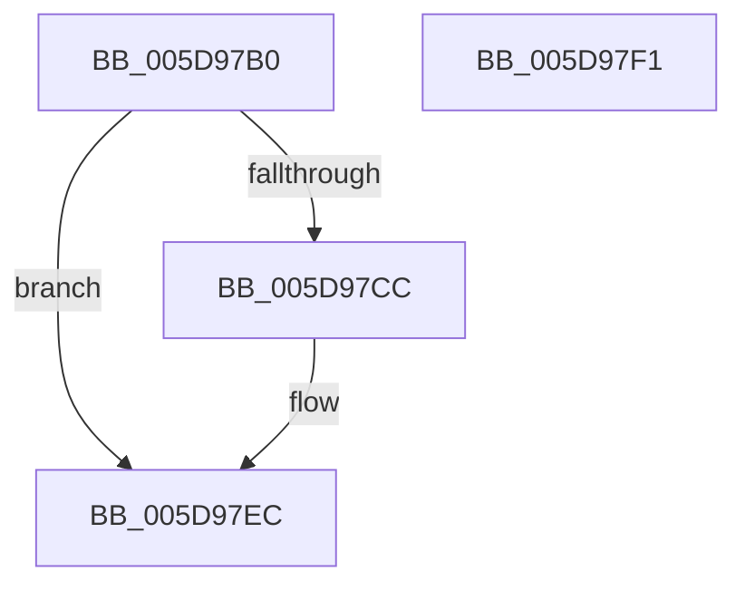

# PpmWmiIdleAccountingProcedure

- RVA: `0x005D97B0`–`0x005D97F2` (길이 `66` bytes)
- VA: `0x00000001405D97B0`
- 실행 섹션: `.text`
- PDB 이름 있음: `예`; PDB Function 태그: `아니요`
- unwind 정보 RVA: `0x0005C788`
- 디코드: `17`개 명령, `66/66` bytes 표시
- 미해석 바이트: `0` (있으면 어셈블리에 `.byte`로 보존)

> 이 문서는 커널 이미지의 기계어와 PDB 기호를 분석해 생성했습니다. 4번과 5번은 함수 원형과 자료형을 바이너리 사용 방식에서 추정한 C 해석이며 원본 소스 복구 결과는 아닙니다.

## 1. Dependencies

- 직접 호출 지점: **2**; 고유 호출 대상: **2**
- 직접 호출자로 확인된 함수: **0**
- RIP 상대 이미지 참조: **1**

### Outgoing calls
- `0x005D97C2` → [ExAllocatePool2](../../poolcode/B8/ExAllocatePool2_function_00B820F0.md) (function, `0x00B820F0`)
- `0x005D97E7` → [ExQueueWorkItem](../2F/ExQueueWorkItem_function_002F9520.md) (function, `0x002F9520`)

### Direct callers
- 이 함수 시작 RVA로 연결되는 직접 call은 확인되지 않았습니다. 간접 호출은 완전히 역산할 수 없습니다.

### Static image references
- `0x005D97D0` → RVA `0x00768670` (`PpmWmiIdleAccountingWork`; read)

## 2. Other-region calls and transfers

- 다른 실행 섹션으로 향하는 call: **1**
  - `0x005D97C2` → [ExAllocatePool2](../../poolcode/B8/ExAllocatePool2_function_00B820F0.md) (`.text` → `POOLCODE`)
- 별도 외부 분기/꼬리 이동을 확인하지 못했습니다.

## 3. Assembly (complete function range)

```asm
005D97B0  48 83 EC 28                     sub rsp, 0x28
005D97B4  BA 20 00 00 00                  mov edx, 0x20
005D97B9  41 B8 69 64 6C 65               mov r8d, 0x656c6469
005D97BF  8D 4A 20                        lea ecx, [rdx + 0x20]
005D97C2  E8 29 89 5A 00                  call 0x140b820f0
005D97C7  48 85 C0                        test rax, rax
005D97CA  74 20                           je 0x1405d97ec
005D97CC  48 83 20 00                     and qword ptr [rax], 0
005D97D0  48 8D 0D 99 EE 18 00            lea rcx, [rip + 0x18ee99]
005D97D7  48 89 48 10                     mov qword ptr [rax + 0x10], rcx
005D97DB  BA 01 00 00 00                  mov edx, 1
005D97E0  48 8B C8                        mov rcx, rax
005D97E3  48 89 40 18                     mov qword ptr [rax + 0x18], rax
005D97E7  E8 34 FD D1 FF                  call 0x1402f9520
005D97EC  48 83 C4 28                     add rsp, 0x28
005D97F0  C3                              ret
005D97F1  CC                              int3
```

## 4. C-style interpretation (structured pseudocode)

```c
__int64 __fastcall PpmWmiIdleAccountingProcedure(void)
{
    __int64 result;
    __int64 v_rsp;

    v_rsp = (v_rsp) - (40);
    result = ExAllocatePool2(32 + 32, 32, (unsigned int)(0x656C6469ULL), a4);
    if (result != 0) {
        a1 = v_rip + 1633945;
        *(unsigned __int64 *)(result + 16) = a1;
        a2 = 1;
        a1 = result;
        *(unsigned __int64 *)(result + 24) = result;
        result = ExQueueWorkItem(a1, a2, (unsigned int)(0x656C6469ULL), a4);
    }
    v_rsp = (v_rsp) + (40);
    return result;
}
```

## 5. (Beta) C Style

```c
void PpmWmiIdleAccountingProcedure(void)
{
    int64_t result;
    int64_t local_rsp;

    local_rsp = (local_rsp) - (40);
    result = ExAllocatePool2(32 + 32, 32, (uint32_t)(0x656C6469ULL), a4);
    if (result != 0) {
        a1 = v_rip + 1633945;
        *(uint64_t *)(result + 0x10) = a1;
        a2 = 1;
        a1 = result;
        *(uint64_t *)(result + 0x18) = result;
        result = ExQueueWorkItem(a1, a2, (uint32_t)(0x656C6469ULL), a4);
    }
    local_rsp = (local_rsp) + (40);
    return result;
}
```

## 6. Execution-region graph

[열기: 2D/3D 그래프와 함수 탐색 컨트롤 패널](../../../control-panel.html?section=text&rva=0x005D97B0&view=graph)

- 2D 그래프는 위에서 아래로 흐르고, 3D 그래프는 빈 공간을 드래그해 회전합니다. Shift+드래그는 이동, 휠은 확대·축소, 함수 노드 선택은 대상 보고서 이동입니다.

### Static fallback


