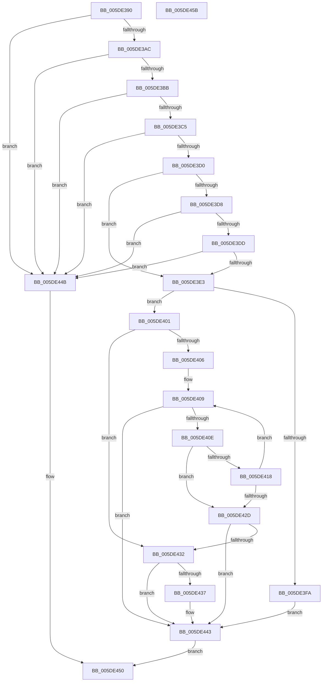

# RtlUnicodeStringCchCopyStringN

- RVA: `0x005DE390`–`0x005DE45C` (길이 `204` bytes)
- VA: `0x00000001405DE390`
- 실행 섹션: `.text`
- PDB 이름 있음: `예`; PDB Function 태그: `아니요`
- unwind 정보 RVA: `0x000950EC`
- 디코드: `59`개 명령, `204/204` bytes 표시
- 미해석 바이트: `0` (있으면 어셈블리에 `.byte`로 보존)

> 이 문서는 커널 이미지의 기계어와 PDB 기호를 분석해 생성했습니다. 4번과 5번은 함수 원형과 자료형을 바이너리 사용 방식에서 추정한 C 해석이며 원본 소스 복구 결과는 아닙니다.

## 1. Dependencies

- 직접 호출 지점: **0**; 고유 호출 대상: **0**
- 직접 호출자로 확인된 함수: **1**
- RIP 상대 이미지 참조: **0**

### Outgoing calls
- 직접 디코드된 call 명령이 없습니다.

### Direct callers
- [PopPlInitWString](../../page/77/PopPlInitWString_function_0077252C.md) at `0x007725BF`

### Static image references
- 디코드된 RIP-relative 메모리 참조가 없습니다.

## 2. Other-region calls and transfers

- 다른 실행 섹션으로 향하는 call: **0**
- 별도 외부 분기/꼬리 이동을 확인하지 못했습니다.

## 3. Assembly (complete function range)

```asm
005DE390  48 89 5C 24 08                  mov qword ptr [rsp + 8], rbx
005DE395  48 89 7C 24 10                  mov qword ptr [rsp + 0x10], rdi
005DE39A  4C 8B D2                        mov r10, rdx
005DE39D  48 8B D9                        mov rbx, rcx
005DE3A0  0F B7 11                        movzx edx, word ptr [rcx]
005DE3A3  F6 C2 01                        test dl, 1
005DE3A6  0F 85 9F 00 00 00               jne 0x1405de44b
005DE3AC  44 0F B7 49 02                  movzx r9d, word ptr [rcx + 2]
005DE3B1  41 F6 C1 01                     test r9b, 1
005DE3B5  0F 85 90 00 00 00               jne 0x1405de44b
005DE3BB  66 41 3B D1                     cmp dx, r9w
005DE3BF  0F 87 86 00 00 00               ja 0x1405de44b
005DE3C5  B8 FE FF 00 00                  mov eax, 0xfffe
005DE3CA  66 44 3B C8                     cmp r9w, ax
005DE3CE  77 7B                           ja 0x1405de44b
005DE3D0  33 C0                           xor eax, eax
005DE3D2  48 39 41 08                     cmp qword ptr [rcx + 8], rax
005DE3D6  75 0B                           jne 0x1405de3e3
005DE3D8  66 85 D2                        test dx, dx
005DE3DB  75 6E                           jne 0x1405de44b
005DE3DD  66 45 85 C9                     test r9w, r9w
005DE3E1  75 68                           jne 0x1405de44b
005DE3E3  0F B7 51 02                     movzx edx, word ptr [rcx + 2]
005DE3E7  48 8B 79 08                     mov rdi, qword ptr [rcx + 8]
005DE3EB  48 8B C8                        mov rcx, rax
005DE3EE  48 D1 EA                        shr rdx, 1
005DE3F1  49 81 F8 FF 7F 00 00            cmp r8, 0x7fff
005DE3F8  76 07                           jbe 0x1405de401
005DE3FA  B8 0D 00 00 C0                  mov eax, 0xc000000d
005DE3FF  EB 42                           jmp 0x1405de443
005DE401  48 85 D2                        test rdx, rdx
005DE404  74 2C                           je 0x1405de432
005DE406  49 2B FA                        sub rdi, r10
005DE409  4D 85 C0                        test r8, r8
005DE40C  74 35                           je 0x1405de443
005DE40E  45 0F B7 0A                     movzx r9d, word ptr [r10]
005DE412  66 45 85 C9                     test r9w, r9w
005DE416  74 15                           je 0x1405de42d
005DE418  66 46 89 0C 17                  mov word ptr [rdi + r10], r9w
005DE41D  49 FF C8                        dec r8
005DE420  49 83 C2 02                     add r10, 2
005DE424  48 FF C1                        inc rcx
005DE427  48 83 EA 01                     sub rdx, 1
005DE42B  75 DC                           jne 0x1405de409
005DE42D  48 85 D2                        test rdx, rdx
005DE430  75 11                           jne 0x1405de443
005DE432  4D 85 C0                        test r8, r8
005DE435  74 0C                           je 0x1405de443
005DE437  66 41 39 02                     cmp word ptr [r10], ax
005DE43B  BA 05 00 00 80                  mov edx, 0x80000005
005DE440  0F 45 C2                        cmovne eax, edx
005DE443  66 03 C9                        add cx, cx
005DE446  66 89 0B                        mov word ptr [rbx], cx
005DE449  EB 05                           jmp 0x1405de450
005DE44B  B8 0D 00 00 C0                  mov eax, 0xc000000d
005DE450  48 8B 5C 24 08                  mov rbx, qword ptr [rsp + 8]
005DE455  48 8B 7C 24 10                  mov rdi, qword ptr [rsp + 0x10]
005DE45A  C3                              ret
005DE45B  CC                              int3
```

## 4. C-style interpretation (structured pseudocode)

```c
__int64 __fastcall RtlUnicodeStringCchCopyStringN(__int64 a1, __int64 a2, __int64 a3)
{
    __int64 result;
    __int64 v_r10;
    __int64 v_rdi;
    unsigned __int64 v_stack_p10;
    unsigned __int64 v_stack_p8;

    v_stack_p8 = v_rbx;
    v_stack_p10 = v_rdi;
    if ((((unsigned __int8)(*(unsigned __int16 *)(a1))) & (1)) != 0) goto loc_005DE44B;
    if ((((unsigned __int8)(*(unsigned __int16 *)(a1 + 2))) & (1)) != 0) goto loc_005DE44B;
    if (((unsigned __int16)(*(unsigned __int16 *)(a1))) > ((unsigned __int16)(*(unsigned __int16 *)(a1 + 2)))) goto loc_005DE44B;
    if (((unsigned __int16)(*(unsigned __int16 *)(a1 + 2))) > ((unsigned __int16)((unsigned int)(0xFFFEULL)))) goto loc_005DE44B;
    result = 0;
    if ((*(unsigned __int64 *)(a1 + 8)) != 0) goto loc_005DE3E3;
    if ((unsigned __int16)(*(unsigned __int16 *)(a1)) != 0) goto loc_005DE44B;
    if ((unsigned __int16)(*(unsigned __int16 *)(a1 + 2)) != 0) goto loc_005DE44B;
loc_005DE3E3:
    a2 = (*(unsigned __int16 *)(a1 + 2)) >> (1);
    if (a3 <= 0x7FFFULL) goto loc_005DE401;
    goto loc_005DE443;
loc_005DE401:
    if (a2 == 0) goto loc_005DE432;
    v_rdi = (*(unsigned __int64 *)(a1 + 8)) - (a2);
loc_005DE409:
    if (a3 == 0) goto loc_005DE443;
    if ((unsigned __int16)(*(unsigned __int16 *)(a2)) == 0) goto loc_005DE42D;
    *(unsigned __int16 *)(v_rdi + a2 * 1) = (unsigned __int16)(*(unsigned __int16 *)(a2));
    a3 = (a3) - 1;
    v_r10 = (a2) + (2);
    a1 = (0) + 1;
    a2 = (a2) - (1);
    if (condition_is_not_equal) goto loc_005DE409;
loc_005DE42D:
    if (a2 != 0) goto loc_005DE443;
loc_005DE432:
    result = (unsigned int)(0xC000000DULL);
    if (a3 != 0) {
        a2 = 0x80000005ULL;
        result = (unsigned int)(0xC000000DULL);
        if ((*(unsigned __int16 *)(v_r10)) != ((unsigned __int16)((unsigned int)(0xC000000DULL)))) { result = (unsigned int)(a2); }
    }
    a1 = (unsigned __int16)((a1) + ((unsigned __int16)(a1)));
    *(unsigned __int16 *)(a1) = (unsigned __int16)(a1);
    goto loc_005DE450;
loc_005DE44B:
loc_005DE450:
    return (unsigned int)(0xC000000DULL);
}
```

## 5. (Beta) C Style

```c
int64_t RtlUnicodeStringCchCopyStringN(void *Arg1, void *Arg2, int64_t Arg3)
{
    uint8_t *arg1 = (uint8_t *)Arg1;
    uint8_t *arg2 = (uint8_t *)Arg2;

    int64_t result;
    int64_t local_r10;
    int64_t local_rdi;
    uint64_t v_stack_p10;
    uint64_t v_stack_p8;

    v_stack_p8 = local_rbx;
    v_stack_p10 = local_rdi;
    if ((((uint8_t)(*(uint16_t *)(arg1))) & (1)) != 0) goto loc_005DE44B;
    if ((((uint8_t)(*(uint16_t *)(arg1 + 0x2))) & (1)) != 0) goto loc_005DE44B;
    if (((uint16_t)(*(uint16_t *)(arg1))) > ((uint16_t)(*(uint16_t *)(arg1 + 0x2)))) goto loc_005DE44B;
    if (((uint16_t)(*(uint16_t *)(arg1 + 0x2))) > ((uint16_t)((uint32_t)(0xFFFEULL)))) goto loc_005DE44B;
    result = 0;
    if ((*(uint64_t *)(arg1 + 0x8)) != 0) goto loc_005DE3E3;
    if ((uint16_t)(*(uint16_t *)(arg1)) != 0) goto loc_005DE44B;
    if ((uint16_t)(*(uint16_t *)(arg1 + 0x2)) != 0) goto loc_005DE44B;
loc_005DE3E3:
    Arg2 = (*(uint16_t *)(arg1 + 0x2)) >> (1);
    if (Arg3 <= 0x7FFFULL) goto loc_005DE401;
    goto loc_005DE443;
loc_005DE401:
    if (Arg2 == NULL) goto loc_005DE432;
    local_rdi = (*(uint64_t *)(arg1 + 0x8)) - (Arg2);
loc_005DE409:
    if (Arg3 == 0) goto loc_005DE443;
    if ((uint16_t)(*(uint16_t *)(arg2)) == 0) goto loc_005DE42D;
    *(uint16_t *)(local_rdi + arg2 * 1) = (uint16_t)(*(uint16_t *)(arg2));
    Arg3 = (Arg3) - 1;
    local_r10 = (Arg2) + (2);
    Arg1 = (0) + 1;
    Arg2 = (Arg2) - (1);
    if (condition_is_not_equal) goto loc_005DE409;
loc_005DE42D:
    if (Arg2 != NULL) goto loc_005DE443;
loc_005DE432:
    result = (uint32_t)(0xC000000DULL);
    if (Arg3 != 0) {
        Arg2 = 0x80000005ULL;
        result = (uint32_t)(0xC000000DULL);
        if ((*(uint16_t *)(local_r10)) != ((uint16_t)((uint32_t)(0xC000000DULL)))) { result = (uint32_t)(Arg2); }
    }
    Arg1 = (uint16_t)((Arg1) + ((uint16_t)(Arg1)));
    *(uint16_t *)(arg1) = (uint16_t)(Arg1);
    goto loc_005DE450;
loc_005DE44B:
loc_005DE450:
    return (uint32_t)(0xC000000DULL);
}
```

### 관측된 메모리 오프셋

구조체 형식이 확인되지 않은 접근은 인자 기준의 오프셋으로만 기록했습니다.

| 기준 인자 | 오프셋 표현 | 폭 (bit) | 접근 |
|---|---:|---:|---|
| `Arg1` | `+ 0x0` | `16` | `R` |
| `Arg1` | `+ 0x0` | `16` | `W` |
| `Arg1` | `+ 0x2` | `16` | `R` |
| `Arg1` | `+ 0x8` | `64` | `R` |
| `Arg2` | `+ 0x0` | `16` | `R` |

## 6. Execution-region graph

[열기: 2D/3D 그래프와 함수 탐색 컨트롤 패널](../../../control-panel.html?section=text&rva=0x005DE390&view=graph)

- 2D 그래프는 위에서 아래로 흐르고, 3D 그래프는 빈 공간을 드래그해 회전합니다. Shift+드래그는 이동, 휠은 확대·축소, 함수 노드 선택은 대상 보고서 이동입니다.

### Static fallback


