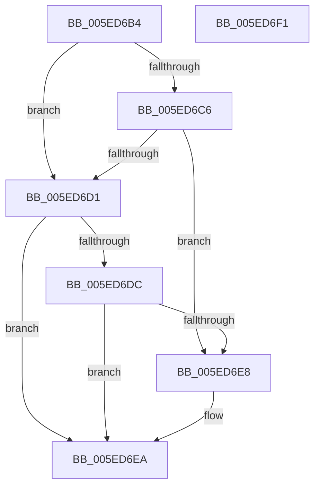

# CanComposeHangul

- RVA: `0x005ED6B4`–`0x005ED6F2` (길이 `62` bytes)
- VA: `0x00000001405ED6B4`
- 실행 섹션: `.text`
- PDB 이름 있음: `예`; PDB Function 태그: `아니요`
- unwind 정보 RVA: `0x0005C788`
- 디코드: `20`개 명령, `62/62` bytes 표시
- 미해석 바이트: `0` (있으면 어셈블리에 `.byte`로 보존)

> 이 문서는 커널 이미지의 기계어와 PDB 기호를 분석해 생성했습니다. 4번과 5번은 함수 원형과 자료형을 바이너리 사용 방식에서 추정한 C 해석이며 원본 소스 복구 결과는 아닙니다.

## 1. Dependencies

- 직접 호출 지점: **1**; 고유 호출 대상: **1**
- 직접 호출자로 확인된 함수: **1**
- RIP 상대 이미지 참조: **0**

### Outgoing calls
- `0x005ED6D1` → [IsHangulLV](IsHangulLV_function_005ED760.md) (function, `0x005ED760`)

### Direct callers
- [Normalization__IsNormalized](../../page/79/Normalization__IsNormalized_function_007934D0.md) at `0x007935E3`
- [Normalization__IsNormalized](../../page/79/Normalization__IsNormalized_function_007934D0.md) at `0x00793673`

### Static image references
- 디코드된 RIP-relative 메모리 참조가 없습니다.

## 2. Other-region calls and transfers

- 다른 실행 섹션으로 향하는 call: **0**
- 별도 외부 분기/꼬리 이동을 확인하지 못했습니다.

## 3. Assembly (complete function range)

```asm
005ED6B4  48 83 EC 28                     sub rsp, 0x28
005ED6B8  8D 81 00 EF FF FF               lea eax, [rcx - 0x1100]
005ED6BE  44 8B C2                        mov r8d, edx
005ED6C1  83 F8 12                        cmp eax, 0x12
005ED6C4  77 0B                           ja 0x1405ed6d1
005ED6C6  8D 82 9F EE FF FF               lea eax, [rdx - 0x1161]
005ED6CC  83 F8 14                        cmp eax, 0x14
005ED6CF  76 17                           jbe 0x1405ed6e8
005ED6D1  E8 8A 00 00 00                  call 0x1405ed760
005ED6D6  32 C9                           xor cl, cl
005ED6D8  84 C0                           test al, al
005ED6DA  74 0E                           je 0x1405ed6ea
005ED6DC  41 8D 80 58 EE FF FF            lea eax, [r8 - 0x11a8]
005ED6E3  83 F8 1A                        cmp eax, 0x1a
005ED6E6  77 02                           ja 0x1405ed6ea
005ED6E8  B1 01                           mov cl, 1
005ED6EA  8A C1                           mov al, cl
005ED6EC  48 83 C4 28                     add rsp, 0x28
005ED6F0  C3                              ret
005ED6F1  CC                              int3
```

## 4. C-style interpretation (structured pseudocode)

```c
__int64 __fastcall CanComposeHangul(__int64 a1, __int64 a2)
{
    __int64 result;
    __int64 v_rsp;

    v_rsp = (v_rsp) - (40);
    if (((unsigned int)(a1 - 4352)) > 18) goto loc_005ED6D1;
    if (((unsigned int)(a2 - 4449)) <= 20) goto loc_005ED6E8;
loc_005ED6D1:
    result = IsHangulLV(a1, a2, (unsigned int)((unsigned int)(a2)), a4);
    a1 = 0;
    if ((unsigned __int8)(result) == 0) goto loc_005ED6EA;
    if (((unsigned int)((unsigned int)((unsigned int)(a2)) - 4520)) <= 26) {
        a1 = 1;
    }
    v_rsp = (v_rsp) + (40);
    return (unsigned __int8)(a1);
}
```

## 5. (Beta) C Style

```c
int64_t CanComposeHangul(void *Arg1, void *Arg2)
{
    uint8_t *arg1 = (uint8_t *)Arg1;
    uint8_t *arg2 = (uint8_t *)Arg2;

    int64_t result;
    int64_t local_rsp;

    local_rsp = (local_rsp) - (40);
    if (((uint32_t)(Arg1 - 4352)) > 18) goto loc_005ED6D1;
    if (((uint32_t)(Arg2 - 4449)) <= 20) goto loc_005ED6E8;
loc_005ED6D1:
    result = IsHangulLV(Arg1, Arg2, (uint32_t)((uint32_t)(Arg2)), a4);
    Arg1 = 0;
    if ((uint8_t)(result) == 0) goto loc_005ED6EA;
    if (((uint32_t)((uint32_t)((uint32_t)(Arg2)) - 4520)) <= 26) {
        Arg1 = 1;
    }
    local_rsp = (local_rsp) + (40);
    return (uint8_t)(Arg1);
}
```

### 관측된 메모리 오프셋

구조체 형식이 확인되지 않은 접근은 인자 기준의 오프셋으로만 기록했습니다.

| 기준 인자 | 오프셋 표현 | 폭 (bit) | 접근 |
|---|---:|---:|---|
| `Arg1` | `- 0x1100` | `32` | `R` |
| `Arg2` | `- 0x1161` | `32` | `R` |

## 6. Execution-region graph

[열기: 2D/3D 그래프와 함수 탐색 컨트롤 패널](../../../control-panel.html?section=text&rva=0x005ED6B4&view=graph)

- 2D 그래프는 위에서 아래로 흐르고, 3D 그래프는 빈 공간을 드래그해 회전합니다. Shift+드래그는 이동, 휠은 확대·축소, 함수 노드 선택은 대상 보고서 이동입니다.

### Static fallback


