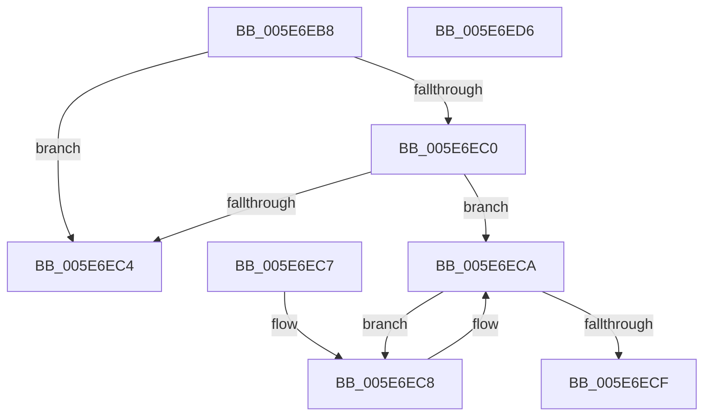

# CheckOneBitValidFlag

- RVA: `0x005E6EB8`–`0x005E6ED7` (길이 `31` bytes)
- VA: `0x00000001405E6EB8`
- 실행 섹션: `.text`
- PDB 이름 있음: `예`; PDB Function 태그: `아니요`
- unwind 정보 RVA: `0x000DB714`
- 디코드: `16`개 명령, `31/31` bytes 표시
- 미해석 바이트: `0` (있으면 어셈블리에 `.byte`로 보존)

> 이 문서는 커널 이미지의 기계어와 PDB 기호를 분석해 생성했습니다. 4번과 5번은 함수 원형과 자료형을 바이너리 사용 방식에서 추정한 C 해석이며 원본 소스 복구 결과는 아닙니다.

## 1. Dependencies

- 직접 호출 지점: **0**; 고유 호출 대상: **0**
- 직접 호출자로 확인된 함수: **1**
- RIP 상대 이미지 참조: **0**

### Outgoing calls
- 직접 디코드된 call 명령이 없습니다.

### Direct callers
- [sub_00B42D56](../../page/B4/Unknown_function_00B42D56.md) at `0x00B42EFB`
- [sub_00B42D56](../../page/B4/Unknown_function_00B42D56.md) at `0x00B42F14`
- [sub_00B42D56](../../page/B4/Unknown_function_00B42D56.md) at `0x00B42F28`
- [sub_00B42D56](../../page/B4/Unknown_function_00B42D56.md) at `0x00B42F3D`
- [sub_00B42D56](../../page/B4/Unknown_function_00B42D56.md) at `0x00B42F53`

### Static image references
- 디코드된 RIP-relative 메모리 참조가 없습니다.

## 2. Other-region calls and transfers

- 다른 실행 섹션으로 향하는 call: **0**
- 별도 외부 분기/꼬리 이동을 확인하지 못했습니다.

## 3. Assembly (complete function range)

```asm
005E6EB8  8B C2                           mov eax, edx
005E6EBA  F7 D0                           not eax
005E6EBC  85 C1                           test ecx, eax
005E6EBE  75 04                           jne 0x1405e6ec4
005E6EC0  23 CA                           and ecx, edx
005E6EC2  75 06                           jne 0x1405e6eca
005E6EC4  32 C0                           xor al, al
005E6EC6  C3                              ret
005E6EC7  CC                              int3
005E6EC8  D1 F9                           sar ecx, 1
005E6ECA  F6 C1 01                        test cl, 1
005E6ECD  74 F9                           je 0x1405e6ec8
005E6ECF  83 F9 01                        cmp ecx, 1
005E6ED2  0F 9E C0                        setle al
005E6ED5  C3                              ret
005E6ED6  CC                              int3
```

## 4. C-style interpretation (structured pseudocode)

```c
__int64 __fastcall CheckOneBitValidFlag(int a1, int a2)
{
    __int64 result;

    result = (unsigned int)(~((unsigned int)(a2)));
    if (((a1) & ((unsigned int)(result))) != 0) goto loc_005E6EC4;
    a1 = (unsigned int)((a1) & (a2));
    if (condition_is_not_equal) goto loc_005E6ECA;
loc_005E6EC4:
    result = 0;
    return result;
loc_005E6EC8:
    a1 = (unsigned int)((a1) >> (1));
loc_005E6ECA:
    if ((((unsigned __int8)(a1)) & (1)) == 0) goto loc_005E6EC8;
    result = (a1 <= 1) ? 1 : 0;
    return result;
}
```

## 5. (Beta) C Style

```c
int64_t CheckOneBitValidFlag(int32_t Arg1, int32_t Arg2)
{
    int64_t result;

    result = (uint32_t)(~((uint32_t)(Arg2)));
    if (((Arg1) & ((uint32_t)(result))) != 0) goto loc_005E6EC4;
    Arg1 = (uint32_t)((Arg1) & (Arg2));
    if (condition_is_not_equal) goto loc_005E6ECA;
loc_005E6EC4:
    result = 0;
    return result;
loc_005E6EC8:
    Arg1 = (uint32_t)((Arg1) >> (1));
loc_005E6ECA:
    if ((((uint8_t)(Arg1)) & (1)) == 0) goto loc_005E6EC8;
    result = (Arg1 <= 1) ? 1 : 0;
    return result;
}
```

## 6. Execution-region graph

[열기: 2D/3D 그래프와 함수 탐색 컨트롤 패널](../../../control-panel.html?section=text&rva=0x005E6EB8&view=graph)

- 2D 그래프는 위에서 아래로 흐르고, 3D 그래프는 빈 공간을 드래그해 회전합니다. Shift+드래그는 이동, 휠은 확대·축소, 함수 노드 선택은 대상 보고서 이동입니다.

### Static fallback


